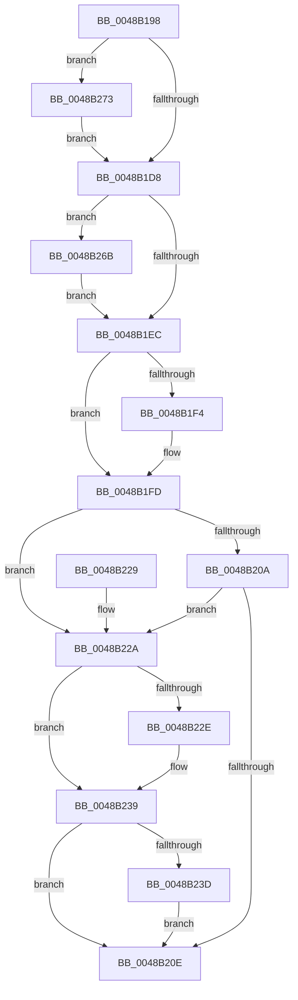

# FsRtlpDoBoost

- RVA: `0x0048B198`–`0x0048B283` (길이 `235` bytes)
- VA: `0x000000014048B198`
- 실행 섹션: `.text`
- PDB 이름 있음: `예`; PDB Function 태그: `아니요`
- unwind 정보 RVA: `0x000B0388`
- 디코드: `67`개 명령, `235/235` bytes 표시
- 미해석 바이트: `0` (있으면 어셈블리에 `.byte`로 보존)

> 이 문서는 커널 이미지의 기계어와 PDB 기호를 분석해 생성했습니다. 4번과 5번은 함수 원형과 자료형을 바이너리 사용 방식에서 추정한 C 해석이며 원본 소스 복구 결과는 아닙니다.

## 1. Dependencies

- 직접 호출 지점: **3**; 고유 호출 대상: **3**
- 직접 호출자로 확인된 함수: **1**
- RIP 상대 이미지 참조: **0**

### Outgoing calls
- `0x0048B234` → [KeSetPriorityBoost](../39/KeSetPriorityBoost_function_00398860.md) (function, `0x00398860`)
- `0x0048B24A` → [PsBoostThreadIoEx](../39/PsBoostThreadIoEx_function_00392C00.md) (function, `0x00392C00`)
- `0x0048B264` → [IoBoostThreadIoPriority](../21/IoBoostThreadIoPriority_function_00216110.md) (function, `0x00216110`)

### Direct callers
- [FsRtlpModifyThreadPriorities](FsRtlpModifyThreadPriorities_function_0048B098.md) at `0x0048B13A`
- [FsRtlpModifyThreadPriorities](FsRtlpModifyThreadPriorities_function_0048B098.md) at `0x0048B161`

### Static image references
- 디코드된 RIP-relative 메모리 참조가 없습니다.

## 2. Other-region calls and transfers

- 다른 실행 섹션으로 향하는 call: **0**
- 별도 외부 분기/꼬리 이동을 확인하지 못했습니다.

## 3. Assembly (complete function range)

```asm
0048B198  48 8B C4                        mov rax, rsp
0048B19B  48 89 58 08                     mov qword ptr [rax + 8], rbx
0048B19F  48 89 68 10                     mov qword ptr [rax + 0x10], rbp
0048B1A3  48 89 70 18                     mov qword ptr [rax + 0x18], rsi
0048B1A7  48 89 78 20                     mov qword ptr [rax + 0x20], rdi
0048B1AB  41 56                           push r14
0048B1AD  48 83 EC 20                     sub rsp, 0x20
0048B1B1  8B 81 A0 05 00 00               mov eax, dword ptr [rcx + 0x5a0]
0048B1B7  32 DB                           xor bl, bl
0048B1B9  25 00 0E 00 00                  and eax, 0xe00
0048B1BE  49 8B F1                        mov rsi, r9
0048B1C1  48 8B EA                        mov rbp, rdx
0048B1C4  48 8B F9                        mov rdi, rcx
0048B1C7  41 BE 01 00 00 00               mov r14d, 1
0048B1CD  3D 00 04 00 00                  cmp eax, 0x400
0048B1D2  0F 82 9B 00 00 00               jb 0x14048b273
0048B1D8  0F B6 8A C3 00 00 00            movzx ecx, byte ptr [rdx + 0xc3]
0048B1DF  41 B9 0F 00 00 00               mov r9d, 0xf
0048B1E5  8B D1                           mov edx, ecx
0048B1E7  41 3A C9                        cmp cl, r9b
0048B1EA  73 7F                           jae 0x14048b26b
0048B1EC  41 0F B6 00                     movzx eax, byte ptr [r8]
0048B1F0  3B C2                           cmp eax, edx
0048B1F2  77 09                           ja 0x14048b1fd
0048B1F4  41 3A C9                        cmp cl, r9b
0048B1F7  41 8B C1                        mov eax, r9d
0048B1FA  0F 42 C1                        cmovb eax, ecx
0048B1FD  41 88 00                        mov byte ptr [r8], al
0048B200  8A 8F C3 00 00 00               mov cl, byte ptr [rdi + 0xc3]
0048B206  84 DB                           test bl, bl
0048B208  75 20                           jne 0x14048b22a
0048B20A  3A C1                           cmp al, cl
0048B20C  77 1C                           ja 0x14048b22a
0048B20E  48 8B 5C 24 30                  mov rbx, qword ptr [rsp + 0x30]
0048B213  48 8B 6C 24 38                  mov rbp, qword ptr [rsp + 0x38]
0048B218  48 8B 74 24 40                  mov rsi, qword ptr [rsp + 0x40]
0048B21D  48 8B 7C 24 48                  mov rdi, qword ptr [rsp + 0x48]
0048B222  48 83 C4 20                     add rsp, 0x20
0048B226  41 5E                           pop r14
0048B228  C3                              ret
0048B229  CC                              int3
0048B22A  3A C1                           cmp al, cl
0048B22C  76 0B                           jbe 0x14048b239
0048B22E  0F B6 D0                        movzx edx, al
0048B231  48 8B CF                        mov rcx, rdi
0048B234  E8 27 D6 F0 FF                  call 0x140398860
0048B239  84 DB                           test bl, bl
0048B23B  74 D1                           je 0x14048b20e
0048B23D  4C 8B 4C 24 50                  mov r9, qword ptr [rsp + 0x50]
0048B242  45 8A C6                        mov r8b, r14b
0048B245  33 D2                           xor edx, edx
0048B247  48 8B CF                        mov rcx, rdi
0048B24A  E8 B1 79 F0 FF                  call 0x140392c00
0048B24F  83 0E 20                        or dword ptr [rsi], 0x20
0048B252  45 33 C0                        xor r8d, r8d
0048B255  8B 95 A0 05 00 00               mov edx, dword ptr [rbp + 0x5a0]
0048B25B  48 8B CF                        mov rcx, rdi
0048B25E  C1 EA 09                        shr edx, 9
0048B261  83 E2 07                        and edx, 7
0048B264  E8 A7 AE D8 FF                  call 0x140216110
0048B269  EB A3                           jmp 0x14048b20e
0048B26B  41 8B D1                        mov edx, r9d
0048B26E  E9 79 FF FF FF                  jmp 0x14048b1ec
0048B273  41 F6 01 20                     test byte ptr [r9], 0x20
0048B277  0F B6 DB                        movzx ebx, bl
0048B27A  41 0F 44 DE                     cmove ebx, r14d
0048B27E  E9 55 FF FF FF                  jmp 0x14048b1d8
```

## 4. C-style interpretation (structured pseudocode)

```c
__int64 __fastcall FsRtlpDoBoost(__int64 a1, __int64 a2, __int64 a3, __int64 a4, __int64 a5)
{
    __int64 result;
    __int64 v_rbx;
    __int64 v_rsp;
    unsigned __int64 v_stack_p10;
    unsigned __int64 v_stack_p18;
    unsigned __int64 v_stack_p20;
    unsigned __int64 v_stack_p8;

    *(unsigned __int64 *)(v_rsp + 8) = v_rbx;
    *(unsigned __int64 *)(v_rsp + 16) = v_rbp;
    *(unsigned __int64 *)(v_rsp + 24) = v_rsi;
    *(unsigned __int64 *)(v_rsp + 32) = v_rdi;
    v_rsp = (v_rsp) - (32);
    v_rbx = 0;
    result = (unsigned int)(((unsigned int)(*(unsigned int *)(a1 + 1440))) & (0xE00ULL));
    if (((unsigned int)(result)) < 0x400ULL) goto loc_0048B273;
loc_0048B1D8:
    if (((unsigned __int8)(*(unsigned __int8 *)(a2 + 195))) >= 15) goto loc_0048B26B;
loc_0048B1EC:
    result = *(unsigned __int8 *)(a3);
    if (((unsigned int)(*(unsigned __int8 *)(a3))) <= ((unsigned int)((unsigned int)((unsigned int)(*(unsigned __int8 *)(a2 + 195)))))) {
        result = 15;
        if (((unsigned __int8)(*(unsigned __int8 *)(a2 + 195))) < 15) { result = (unsigned int)(*(unsigned __int8 *)(a2 + 195)); }
    }
    *(unsigned __int8 *)(a3) = (unsigned __int8)(result);
    if (0 != 0) goto loc_0048B22A;
    if (((unsigned __int8)(result)) > ((unsigned __int8)(*(unsigned __int8 *)(a1 + 195)))) goto loc_0048B22A;
loc_0048B20E:
    v_rsp = (v_rsp) + (32);
    return result;
loc_0048B22A:
    if (((unsigned __int8)(result)) >= = ((unsigned __int8)(*(unsigned __int8 *)(a1 + 195)))) {
        a2 = (unsigned __int8)(result);
        a1 = v_stack_p20;
        result = KeSetPriorityBoost(a1, a2, a3, 15);
    }
    if ((unsigned __int8)(v_stack_p8) == 0) goto loc_0048B20E;
    a2 = 0;
    result = PsBoostThreadIoEx(v_stack_p20, a2, 1, a5);
    a3 = 0;
    a2 = (unsigned int)(((unsigned int)(*(unsigned int *)(v_stack_p10 + 1440))) >> (9));
    a2 = (unsigned int)((a2) & (7));
    result = IoBoostThreadIoPriority(v_stack_p20, a2, a3, a5);
    goto loc_0048B20E;
loc_0048B26B:
    goto loc_0048B1EC;
loc_0048B273:
    v_rbx = (unsigned __int8)(v_stack_p8);
    if (((*(unsigned __int8 *)(a5)) & (32)) == 0) { v_rbx = 1; }
    goto loc_0048B1D8;
}
```

## 5. (Beta) C Style

```c
int64_t FsRtlpDoBoost(void *Arg1, void *Arg2, void *Arg3, void *Arg4, int64_t Arg5)
{
    uint8_t *arg1 = (uint8_t *)Arg1;
    uint8_t *arg2 = (uint8_t *)Arg2;
    uint8_t *arg3 = (uint8_t *)Arg3;
    uint8_t *arg4 = (uint8_t *)Arg4;

    int64_t result;
    int64_t local_rbx;
    int64_t local_rsp;
    uint64_t v_stack_p10;
    uint64_t v_stack_p18;
    uint64_t v_stack_p20;
    uint64_t v_stack_p8;

    *(uint64_t *)(local_rsp + 0x8) = local_rbx;
    *(uint64_t *)(local_rsp + 0x10) = local_rbp;
    *(uint64_t *)(local_rsp + 0x18) = local_rsi;
    *(uint64_t *)(local_rsp + 0x20) = local_rdi;
    local_rsp = (local_rsp) - (32);
    local_rbx = 0;
    result = (uint32_t)(((uint32_t)(*(uint32_t *)(arg1 + 0x5A0))) & (0xE00ULL));
    if (((uint32_t)(result)) < 0x400ULL) goto loc_0048B273;
loc_0048B1D8:
    if (((uint8_t)(*(uint8_t *)(arg2 + 0xC3))) >= 15) goto loc_0048B26B;
loc_0048B1EC:
    result = *(uint8_t *)(arg3);
    if (((uint32_t)(*(uint8_t *)(arg3))) <= ((uint32_t)((uint32_t)((uint32_t)(*(uint8_t *)(arg2 + 0xC3)))))) {
        result = 15;
        if (((uint8_t)(*(uint8_t *)(arg2 + 0xC3))) < 15) { result = (uint32_t)(*(uint8_t *)(arg2 + 0xC3)); }
    }
    *(uint8_t *)(arg3) = (uint8_t)(result);
    if (0 != 0) goto loc_0048B22A;
    if (((uint8_t)(result)) > ((uint8_t)(*(uint8_t *)(arg1 + 0xC3)))) goto loc_0048B22A;
loc_0048B20E:
    local_rsp = (local_rsp) + (32);
    return result;
loc_0048B22A:
    if (((uint8_t)(result)) >= = ((uint8_t)(*(uint8_t *)(arg1 + 0xC3)))) {
        Arg2 = (uint8_t)(result);
        Arg1 = v_stack_p20;
        result = KeSetPriorityBoost(Arg1, Arg2, Arg3, 15);
    }
    if ((uint8_t)(v_stack_p8) == 0) goto loc_0048B20E;
    Arg2 = 0;
    result = PsBoostThreadIoEx(v_stack_p20, Arg2, 1, Arg5);
    Arg3 = 0;
    Arg2 = (uint32_t)(((uint32_t)(*(uint32_t *)(v_stack_p10 + 0x5A0))) >> (9));
    Arg2 = (uint32_t)((Arg2) & (7));
    result = IoBoostThreadIoPriority(v_stack_p20, Arg2, Arg3, Arg5);
    goto loc_0048B20E;
loc_0048B26B:
    goto loc_0048B1EC;
loc_0048B273:
    local_rbx = (uint8_t)(v_stack_p8);
    if (((*(uint8_t *)(Arg5)) & (32)) == 0) { local_rbx = 1; }
    goto loc_0048B1D8;
}
```

### 관측된 메모리 오프셋

구조체 형식이 확인되지 않은 접근은 인자 기준의 오프셋으로만 기록했습니다.

| 기준 인자 | 오프셋 표현 | 폭 (bit) | 접근 |
|---|---:|---:|---|
| `Arg1` | `+ 0xC3` | `8` | `R` |
| `Arg1` | `+ 0x5A0` | `32` | `R` |
| `Arg2` | `+ 0xC3` | `8` | `R` |
| `Arg2` | `+ 0x5A0` | `32` | `R` |
| `Arg3` | `+ 0x0` | `8` | `R` |
| `Arg3` | `+ 0x0` | `8` | `W` |
| `Arg4` | `+ 0x0` | `8` | `R` |
| `Arg4` | `+ 0x0` | `32` | `R/W` |

## 6. Execution-region graph

[열기: 2D/3D 그래프와 함수 탐색 컨트롤 패널](../../../control-panel.html?section=text&rva=0x0048B198&view=graph)

- 2D 그래프는 위에서 아래로 흐르고, 3D 그래프는 빈 공간을 드래그해 회전합니다. Shift+드래그는 이동, 휠은 확대·축소, 함수 노드 선택은 대상 보고서 이동입니다.

### Static fallback


