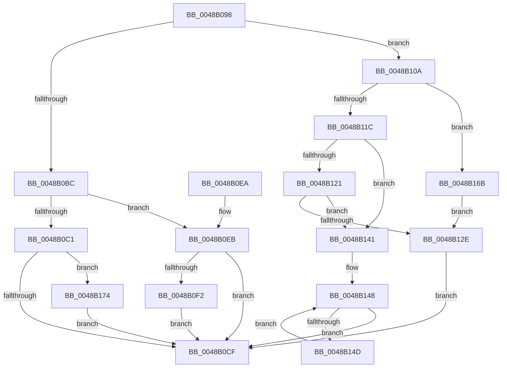

# FsRtlpModifyThreadPriorities

- RVA: `0x0048B098`–`0x0048B192` (길이 `250` bytes)
- VA: `0x000000014048B098`
- 실행 섹션: `.text`
- PDB 이름 있음: `예`; PDB Function 태그: `아니요`
- unwind 정보 RVA: `0x000B036C`
- 디코드: `70`개 명령, `250/250` bytes 표시
- 미해석 바이트: `0` (있으면 어셈블리에 `.byte`로 보존)

> 이 문서는 커널 이미지의 기계어와 PDB 기호를 분석해 생성했습니다. 4번과 5번은 함수 원형과 자료형을 바이너리 사용 방식에서 추정한 C 해석이며 원본 소스 복구 결과는 아닙니다.

## 1. Dependencies

- 직접 호출 지점: **4**; 고유 호출 대상: **2**
- 직접 호출자로 확인된 함수: **11**
- RIP 상대 이미지 참조: **0**

### Outgoing calls
- `0x0048B0FF` → [PsBoostThreadIoEx](../39/PsBoostThreadIoEx_function_00392C00.md) (function, `0x00392C00`)
- `0x0048B13A` → [FsRtlpDoBoost](FsRtlpDoBoost_function_0048B198.md) (function, `0x0048B198`)
- `0x0048B161` → [FsRtlpDoBoost](FsRtlpDoBoost_function_0048B198.md) (function, `0x0048B198`)
- `0x0048B181` → [PsBoostThreadIoEx](../39/PsBoostThreadIoEx_function_00392C00.md) (function, `0x00392C00`)

### Direct callers
- [FsRtlpAcknowledgeOplockBreakByCacheFlags](../3F/FsRtlpAcknowledgeOplockBreakByCacheFlags_function_003F1988.md) at `0x003F1C8E`
- [FsRtlpAcknowledgeOplockBreakByCacheFlags](../3F/FsRtlpAcknowledgeOplockBreakByCacheFlags_function_003F1988.md) at `0x003F222D`
- [FsRtlpAcknowledgeOplockBreakByCacheFlags](../3F/FsRtlpAcknowledgeOplockBreakByCacheFlags_function_003F1988.md) at `0x003F24F5`
- [FsRtlpOplockCleanup](../42/FsRtlpOplockCleanup_function_00425030.md) at `0x00425513`
- [FsRtlpOplockCleanup](../42/FsRtlpOplockCleanup_function_00425030.md) at `0x00425643`
- [FsRtlpRemoveAndCompleteRHIrp](../42/FsRtlpRemoveAndCompleteRHIrp_function_00425964.md) at `0x00425C66`
- [FsRtlpOplockBreakToII](../4B/FsRtlpOplockBreakToII_function_004BB824.md) at `0x004BB8FA`
- [FsRtlpOplockBreakToII](../4B/FsRtlpOplockBreakToII_function_004BB824.md) at `0x004BB9F0`
- [FsRtlUninitializeOplock](../4E/FsRtlUninitializeOplock_function_004E42C0.md) at `0x004E43E3`
- [FsRtlUninitializeOplock](../4E/FsRtlUninitializeOplock_function_004E42C0.md) at `0x004E44A8`
- [FsRtlpOplockBreakByCacheFlags](../4E/FsRtlpOplockBreakByCacheFlags_function_004E4990.md) at `0x004E56FD`
- [FsRtlpOplockBreakByCacheFlags](../4E/FsRtlpOplockBreakByCacheFlags_function_004E4990.md) at `0x004E6D18`
- [FsRtlpOplockBreakToNone](../4F/FsRtlpOplockBreakToNone_function_004F8354.md) at `0x004F8410`
- [FsRtlpOplockBreakToNone](../4F/FsRtlpOplockBreakToNone_function_004F8354.md) at `0x004F8587`
- [FsRtlpCancelExclusiveIrp](../4F/FsRtlpCancelExclusiveIrp_function_004F96CC.md) at `0x004F9731`
- [FsRtlpAcknowledgeOplockBreak](../58/FsRtlpAcknowledgeOplockBreak_function_00582144.md) at `0x00582303`
- [FsRtlpOpBatchBreakClosePending](../../page/71/FsRtlpOpBatchBreakClosePending_function_00714CDC.md) at `0x00714D60`
- [FsRtlpOplockBreakNotify](../../page/71/FsRtlpOplockBreakNotify_function_00714E10.md) at `0x00714EED`

### Static image references
- 디코드된 RIP-relative 메모리 참조가 없습니다.

## 2. Other-region calls and transfers

- 다른 실행 섹션으로 향하는 call: **0**
- 별도 외부 분기/꼬리 이동을 확인하지 못했습니다.

## 3. Assembly (complete function range)

```asm
0048B098  48 8B C4                        mov rax, rsp
0048B09B  48 89 58 08                     mov qword ptr [rax + 8], rbx
0048B09F  48 89 68 10                     mov qword ptr [rax + 0x10], rbp
0048B0A3  48 89 70 18                     mov qword ptr [rax + 0x18], rsi
0048B0A7  48 89 78 20                     mov qword ptr [rax + 0x20], rdi
0048B0AB  41 56                           push r14
0048B0AD  48 83 EC 30                     sub rsp, 0x30
0048B0B1  48 8B FA                        mov rdi, rdx
0048B0B4  48 8B D9                        mov rbx, rcx
0048B0B7  45 84 C0                        test r8b, r8b
0048B0BA  75 4E                           jne 0x14048b10a
0048B0BC  48 85 D2                        test rdx, rdx
0048B0BF  75 2A                           jne 0x14048b0eb
0048B0C1  8B 81 90 00 00 00               mov eax, dword ptr [rcx + 0x90]
0048B0C7  A8 20                           test al, 0x20
0048B0C9  0F 85 A5 00 00 00               jne 0x14048b174
0048B0CF  48 8B 5C 24 40                  mov rbx, qword ptr [rsp + 0x40]
0048B0D4  48 8B 6C 24 48                  mov rbp, qword ptr [rsp + 0x48]
0048B0D9  48 8B 74 24 50                  mov rsi, qword ptr [rsp + 0x50]
0048B0DE  48 8B 7C 24 58                  mov rdi, qword ptr [rsp + 0x58]
0048B0E3  48 83 C4 30                     add rsp, 0x30
0048B0E7  41 5E                           pop r14
0048B0E9  C3                              ret
0048B0EA  CC                              int3
0048B0EB  8B 42 30                        mov eax, dword ptr [rdx + 0x30]
0048B0EE  A8 20                           test al, 0x20
0048B0F0  74 DD                           je 0x14048b0cf
0048B0F2  48 8B 4F 28                     mov rcx, qword ptr [rdi + 0x28]
0048B0F6  41 B0 01                        mov r8b, 1
0048B0F9  41 8A D0                        mov dl, r8b
0048B0FC  4C 8B CB                        mov r9, rbx
0048B0FF  E8 FC 7A F0 FF                  call 0x140392c00
0048B104  83 67 30 DF                     and dword ptr [rdi + 0x30], 0xffffffdf
0048B108  EB C5                           jmp 0x14048b0cf
0048B10A  65 48 8B 2C 25 88 01 00 00      mov rbp, qword ptr gs:[0x188]
0048B113  48 8B 49 18                     mov rcx, qword ptr [rcx + 0x18]
0048B117  48 85 C9                        test rcx, rcx
0048B11A  75 4F                           jne 0x14048b16b
0048B11C  48 85 FF                        test rdi, rdi
0048B11F  74 20                           je 0x14048b141
0048B121  48 8B 4A 28                     mov rcx, qword ptr [rdx + 0x28]
0048B125  4C 8D 4A 30                     lea r9, [rdx + 0x30]
0048B129  48 85 C9                        test rcx, rcx
0048B12C  74 13                           je 0x14048b141
0048B12E  4C 8D 43 20                     lea r8, [rbx + 0x20]
0048B132  48 89 5C 24 20                  mov qword ptr [rsp + 0x20], rbx
0048B137  48 8B D5                        mov rdx, rbp
0048B13A  E8 59 00 00 00                  call 0x14048b198
0048B13F  EB 8E                           jmp 0x14048b0cf
0048B141  48 8D 73 48                     lea rsi, [rbx + 0x48]
0048B145  48 8B 3E                        mov rdi, qword ptr [rsi]
0048B148  48 3B FE                        cmp rdi, rsi
0048B14B  74 82                           je 0x14048b0cf
0048B14D  48 8B 4F 28                     mov rcx, qword ptr [rdi + 0x28]
0048B151  4C 8D 4F 30                     lea r9, [rdi + 0x30]
0048B155  4C 8D 43 20                     lea r8, [rbx + 0x20]
0048B159  48 89 5C 24 20                  mov qword ptr [rsp + 0x20], rbx
0048B15E  48 8B D5                        mov rdx, rbp
0048B161  E8 32 00 00 00                  call 0x14048b198
0048B166  48 8B 3F                        mov rdi, qword ptr [rdi]
0048B169  EB DD                           jmp 0x14048b148
0048B16B  4C 8D 8B 90 00 00 00            lea r9, [rbx + 0x90]
0048B172  EB BA                           jmp 0x14048b12e
0048B174  48 8B 49 18                     mov rcx, qword ptr [rcx + 0x18]
0048B178  41 B0 01                        mov r8b, 1
0048B17B  41 8A D0                        mov dl, r8b
0048B17E  4C 8B CB                        mov r9, rbx
0048B181  E8 7A 7A F0 FF                  call 0x140392c00
0048B186  83 A3 90 00 00 00 DF            and dword ptr [rbx + 0x90], 0xffffffdf
0048B18D  E9 3D FF FF FF                  jmp 0x14048b0cf
```

## 4. C-style interpretation (structured pseudocode)

```c
__int64 __fastcall FsRtlpModifyThreadPriorities(__int64 a1, __int64 a2, unsigned __int8 a3)
{
    __int64 result;
    __int64 v_rsp;
    unsigned __int64 v_stack_p10;
    unsigned __int64 v_stack_p18;
    unsigned __int64 v_stack_p20;
    unsigned __int64 v_stack_p8;

    *(unsigned __int64 *)(v_rsp + 8) = v_rbx;
    *(unsigned __int64 *)(v_rsp + 16) = v_rbp;
    *(unsigned __int64 *)(v_rsp + 24) = v_rsi;
    *(unsigned __int64 *)(v_rsp + 32) = v_rdi;
    v_rsp = (v_rsp) - (48);
    if (a3 != 0) goto loc_0048B10A;
    if (a2 != 0) goto loc_0048B0EB;
    if ((((unsigned __int8)((unsigned int)(*(unsigned int *)(a1 + 144)))) & (32)) != 0) goto loc_0048B174;
loc_0048B0CF:
    v_rsp = (v_rsp) + (48);
    return (unsigned int)(*(unsigned int *)(a1 + 144));
loc_0048B0EB:
    if ((((unsigned __int8)((unsigned int)(*(unsigned int *)(a2 + 48)))) & (32)) == 0) goto loc_0048B0CF;
    result = PsBoostThreadIoEx(*(unsigned __int64 *)(v_stack_p20 + 40), 1, 1, v_stack_p8);
    goto loc_0048B0CF;
loc_0048B10A:
    if (*(unsigned __int64 *)(*(unsigned __int64 *)(v_stack_p20 + 40) + 24) != 0) goto loc_0048B16B;
    if (v_stack_p20 == 0) goto loc_0048B141;
    if (*(unsigned __int64 *)(1 + 40) == 0) goto loc_0048B141;
loc_0048B12E:
    v_stack_p20 = v_stack_p8;
    result = FsRtlpDoBoost(*(unsigned __int64 *)(1 + 40), *(unsigned __int64 *)(gs_base + (0 + 392)), v_stack_p8 + 32, 1 + 48);
    goto loc_0048B0CF;
loc_0048B141:
loc_0048B148:
    if ((*(unsigned __int64 *)(v_stack_p8 + 72)) == (v_stack_p8 + 72)) goto loc_0048B0CF;
    v_stack_p20 = v_stack_p8;
    result = FsRtlpDoBoost(*(unsigned __int64 *)(*(unsigned __int64 *)(v_stack_p8 + 72) + 40), *(unsigned __int64 *)(gs_base + (0 + 392)), v_stack_p8 + 32, *(unsigned __int64 *)(v_stack_p8 + 72) + 48);
    goto loc_0048B148;
loc_0048B16B:
    goto loc_0048B12E;
loc_0048B174:
    result = PsBoostThreadIoEx(*(unsigned __int64 *)(*(unsigned __int64 *)(*(unsigned __int64 *)(v_stack_p8 + 72) + 40) + 24), 1, 1, v_stack_p8);
    goto loc_0048B0CF;
}
```

## 5. (Beta) C Style

```c
int64_t FsRtlpModifyThreadPriorities(void *Arg1, void *Arg2, uint8_t Arg3)
{
    uint8_t *arg1 = (uint8_t *)Arg1;
    uint8_t *arg2 = (uint8_t *)Arg2;

    int64_t result;
    int64_t local_rsp;
    uint64_t v_stack_p10;
    uint64_t v_stack_p18;
    uint64_t v_stack_p20;
    uint64_t v_stack_p8;

    *(uint64_t *)(local_rsp + 0x8) = local_rbx;
    *(uint64_t *)(local_rsp + 0x10) = local_rbp;
    *(uint64_t *)(local_rsp + 0x18) = local_rsi;
    *(uint64_t *)(local_rsp + 0x20) = local_rdi;
    local_rsp = (local_rsp) - (48);
    if (Arg3 != 0) goto loc_0048B10A;
    if (Arg2 != NULL) goto loc_0048B0EB;
    if ((((uint8_t)((uint32_t)(*(uint32_t *)(arg1 + 0x90)))) & (32)) != 0) goto loc_0048B174;
loc_0048B0CF:
    local_rsp = (local_rsp) + (48);
    return (uint32_t)(*(uint32_t *)(arg1 + 0x90));
loc_0048B0EB:
    if ((((uint8_t)((uint32_t)(*(uint32_t *)(arg2 + 0x30)))) & (32)) == 0) goto loc_0048B0CF;
    result = PsBoostThreadIoEx(*(uint64_t *)(v_stack_p20 + 0x28), 1, 1, v_stack_p8);
    goto loc_0048B0CF;
loc_0048B10A:
    if (*(uint64_t *)(*(uint64_t *)(v_stack_p20 + 0x28) + 0x18) != 0) goto loc_0048B16B;
    if (v_stack_p20 == 0) goto loc_0048B141;
    if (*(uint64_t *)(1 + 0x28) == 0) goto loc_0048B141;
loc_0048B12E:
    v_stack_p20 = v_stack_p8;
    result = FsRtlpDoBoost(*(uint64_t *)(1 + 0x28), *(uint64_t *)(gs_base + (0 + 0x188)), v_stack_p8 + 32, 1 + 48);
    goto loc_0048B0CF;
loc_0048B141:
loc_0048B148:
    if ((*(uint64_t *)(v_stack_p8 + 0x48)) == (v_stack_p8 + 72)) goto loc_0048B0CF;
    v_stack_p20 = v_stack_p8;
    result = FsRtlpDoBoost(*(uint64_t *)(*(uint64_t *)(v_stack_p8 + 0x48) + 0x28), *(uint64_t *)(gs_base + (0 + 0x188)), v_stack_p8 + 32, *(uint64_t *)(v_stack_p8 + 0x48) + 48);
    goto loc_0048B148;
loc_0048B16B:
    goto loc_0048B12E;
loc_0048B174:
    result = PsBoostThreadIoEx(*(uint64_t *)(*(uint64_t *)(*(uint64_t *)(v_stack_p8 + 0x48) + 0x28) + 0x18), 1, 1, v_stack_p8);
    goto loc_0048B0CF;
}
```

### 관측된 메모리 오프셋

구조체 형식이 확인되지 않은 접근은 인자 기준의 오프셋으로만 기록했습니다.

| 기준 인자 | 오프셋 표현 | 폭 (bit) | 접근 |
|---|---:|---:|---|
| `Arg1` | `+ 0x0` | `64` | `R` |
| `Arg1` | `+ 0x18` | `64` | `R` |
| `Arg1` | `+ 0x20` | `64` | `R` |
| `Arg1` | `+ 0x48` | `64` | `R` |
| `Arg1` | `+ 0x90` | `32` | `R` |
| `Arg1` | `+ 0x90` | `32` | `R/W` |
| `Arg1` | `+ 0x90` | `64` | `R` |
| `Arg2` | `+ 0x28` | `64` | `R` |
| `Arg2` | `+ 0x30` | `32` | `R/W` |
| `Arg2` | `+ 0x30` | `64` | `R` |

## 6. Execution-region graph

[열기: 2D/3D 그래프와 함수 탐색 컨트롤 패널](../../../control-panel.html?section=text&rva=0x0048B098&view=graph)

- 2D 그래프는 위에서 아래로 흐르고, 3D 그래프는 빈 공간을 드래그해 회전합니다. Shift+드래그는 이동, 휠은 확대·축소, 함수 노드 선택은 대상 보고서 이동입니다.

### Static fallback


