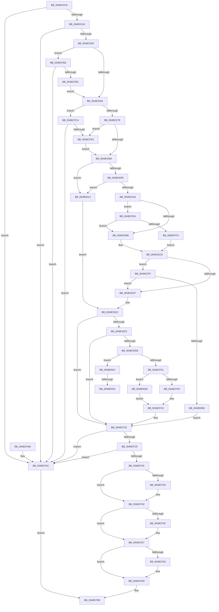

# GxpAdjustRectangleToFrameBuffer

- RVA: `0x0048CDC8`–`0x0048D044` (길이 `636` bytes)
- VA: `0x000000014048CDC8`
- 실행 섹션: `.text`
- PDB 이름 있음: `예`; PDB Function 태그: `예`
- unwind 정보 RVA: `0x000B1388`
- 디코드: `169`개 명령, `636/636` bytes 표시
- 미해석 바이트: `0` (있으면 어셈블리에 `.byte`로 보존)

> 이 문서는 커널 이미지의 기계어와 PDB 기호를 분석해 생성했습니다. 4번과 5번은 함수 원형과 자료형을 바이너리 사용 방식에서 추정한 C 해석이며 원본 소스 복구 결과는 아닙니다.

## 1. Dependencies

- 직접 호출 지점: **0**; 고유 호출 대상: **0**
- 직접 호출자로 확인된 함수: **2**
- RIP 상대 이미지 참조: **2**

### Outgoing calls
- 직접 디코드된 call 명령이 없습니다.

### Direct callers
- [GxpWriteFrameBufferPixels](GxpWriteFrameBufferPixels_function_0048C9F4.md) at `0x0048CAED`
- [GxpReadFrameBufferPixels](../../pagebgfx/BC/GxpReadFrameBufferPixels_function_00BC3F2C.md) at `0x00BC4034`

### Static image references
- `0x0048CE06` → RVA `0x00EF03E2` (`.data`; read)
- `0x0048CE99` → RVA `0x00EF03E0` (`.data`; read)

## 2. Other-region calls and transfers

- 다른 실행 섹션으로 향하는 call: **0**
- call이 아닌 외부 분기/꼬리 이동: **2**
  - `0x0048D027` → [sub_006F6604](../6F/Unknown_function_006F6604.md) (`tail-transfer`)
  - `0x0048D033` → [sub_006F6604 + 0xD](../6F/Unknown_function_006F6604.md) (`tail-transfer`)

## 3. Assembly (complete function range)

```asm
0048CDC8  4C 89 4C 24 20                  mov qword ptr [rsp + 0x20], r9
0048CDCD  4C 89 44 24 18                  mov qword ptr [rsp + 0x18], r8
0048CDD2  53                              push rbx
0048CDD3  55                              push rbp
0048CDD4  56                              push rsi
0048CDD5  57                              push rdi
0048CDD6  41 54                           push r12
0048CDD8  41 55                           push r13
0048CDDA  41 56                           push r14
0048CDDC  41 57                           push r15
0048CDDE  48 83 EC 38                     sub rsp, 0x38
0048CDE2  44 8B 49 04                     mov r9d, dword ptr [rcx + 4]
0048CDE6  4C 8B F9                        mov r15, rcx
0048CDE9  8B 29                           mov ebp, dword ptr [rcx]
0048CDEB  4C 8B F2                        mov r14, rdx
0048CDEE  41 8B 48 08                     mov ecx, dword ptr [r8 + 8]
0048CDF2  49 8B C0                        mov rax, r8
0048CDF5  48 8B 12                        mov rdx, qword ptr [rdx]
0048CDF8  45 8B D9                        mov r11d, r9d
0048CDFB  F2 41 0F 10 00                  movsd xmm0, qword ptr [r8]
0048CE00  45 8B 20                        mov r12d, dword ptr [r8]
0048CE03  44 8B C2                        mov r8d, edx
0048CE06  40 8A 3D D5 35 A6 00            mov dil, byte ptr [rip + 0xa635d5]
0048CE0D  89 0C 24                        mov dword ptr [rsp], ecx
0048CE10  41 8B 4F 0C                     mov ecx, dword ptr [r15 + 0xc]
0048CE14  8B D9                           mov ebx, ecx
0048CE16  89 8C 24 88 00 00 00            mov dword ptr [rsp + 0x88], ecx
0048CE1D  33 C9                           xor ecx, ecx
0048CE1F  44 89 8C 24 80 00 00 00         mov dword ptr [rsp + 0x80], r9d
0048CE27  44 8B D1                        mov r10d, ecx
0048CE2A  48 89 54 24 10                  mov qword ptr [rsp + 0x10], rdx
0048CE2F  48 89 54 24 08                  mov qword ptr [rsp + 8], rdx
0048CE34  F2 0F 11 44 24 18               movsd qword ptr [rsp + 0x18], xmm0
0048CE3A  44 3B E2                        cmp r12d, edx
0048CE3D  0F 82 69 01 00 00               jb 0x14048cfac
0048CE43  8B 70 04                        mov esi, dword ptr [rax + 4]
0048CE46  48 8B C2                        mov rax, rdx
0048CE49  48 C1 E8 20                     shr rax, 0x20
0048CE4D  3B F0                           cmp esi, eax
0048CE4F  0F 82 57 01 00 00               jb 0x14048cfac
0048CE55  44 8B 6C 24 18                  mov r13d, dword ptr [rsp + 0x18]
0048CE5A  41 8B D5                        mov edx, r13d
0048CE5D  41 2B D0                        sub edx, r8d
0048CE60  44 3B CA                        cmp r9d, edx
0048CE63  0F 87 4A 01 00 00               ja 0x14048cfb3
0048CE69  4C 8B 4C 24 18                  mov r9, qword ptr [rsp + 0x18]
0048CE6E  49 C1 E9 20                     shr r9, 0x20
0048CE72  44 2B C8                        sub r9d, eax
0048CE75  41 3B E9                        cmp ebp, r9d
0048CE78  0F 87 4C 01 00 00               ja 0x14048cfca
0048CE7E  44 8B CD                        mov r9d, ebp
0048CE81  45 85 D2                        test r10d, r10d
0048CE84  0F 85 49 01 00 00               jne 0x14048cfd3
0048CE8A  40 8A C7                        mov al, dil
0048CE8D  B2 02                           mov dl, 2
0048CE8F  2A C2                           sub al, dl
0048CE91  3C 01                           cmp al, 1
0048CE93  0F 87 7A 01 00 00               ja 0x14048d013
0048CE99  38 0D 41 35 A6 00               cmp byte ptr [rip + 0xa63541], cl
0048CE9F  0F 84 6E 01 00 00               je 0x14048d013
0048CEA5  44 8B 94 24 80 00 00 00         mov r10d, dword ptr [rsp + 0x80]
0048CEAD  45 3B DA                        cmp r11d, r10d
0048CEB0  0F 82 34 01 00 00               jb 0x14048cfea
0048CEB6  41 8B C4                        mov eax, r12d
0048CEB9  41 2B C3                        sub eax, r11d
0048CEBC  41 2B C0                        sub eax, r8d
0048CEBF  44 8B C0                        mov r8d, eax
0048CEC2  89 44 24 08                     mov dword ptr [rsp + 8], eax
0048CEC6  44 3B CD                        cmp r9d, ebp
0048CEC9  0F 82 30 01 00 00               jb 0x14048cfff
0048CECF  8B D6                           mov edx, esi
0048CED1  41 2B D1                        sub edx, r9d
0048CED4  2B 54 24 0C                     sub edx, dword ptr [rsp + 0xc]
0048CED8  89 54 24 0C                     mov dword ptr [rsp + 0xc], edx
0048CEDC  8D 47 FF                        lea eax, [rdi - 1]
0048CEDF  A8 FD                           test al, 0xfd
0048CEE1  75 3D                           jne 0x14048cf20
0048CEE3  38 0D F7 34 A6 00               cmp byte ptr [rip + 0xa634f7], cl
0048CEE9  74 35                           je 0x14048cf20
0048CEEB  44 89 64 24 1C                  mov dword ptr [rsp + 0x1c], r12d
0048CEF0  44 8B EE                        mov r13d, esi
0048CEF3  89 74 24 18                     mov dword ptr [rsp + 0x18], esi
0048CEF7  40 80 FF 01                     cmp dil, 1
0048CEFB  0F 84 23 01 00 00               je 0x14048d024
0048CF01  44 3B CD                        cmp r9d, ebp
0048CF04  0F 82 2E 01 00 00               jb 0x14048d038
0048CF0A  44 8B C6                        mov r8d, esi
0048CF0D  45 2B 46 04                     sub r8d, dword ptr [r14 + 4]
0048CF11  45 2B C1                        sub r8d, r9d
0048CF14  44 89 44 24 08                  mov dword ptr [rsp + 8], r8d
0048CF19  41 8B 16                        mov edx, dword ptr [r14]
0048CF1C  89 54 24 0C                     mov dword ptr [rsp + 0xc], edx
0048CF20  45 3B E8                        cmp r13d, r8d
0048CF23  0F 82 83 00 00 00               jb 0x14048cfac
0048CF29  39 54 24 1C                     cmp dword ptr [rsp + 0x1c], edx
0048CF2D  72 7D                           jb 0x14048cfac
0048CF2F  48 8B 84 24 98 00 00 00         mov rax, qword ptr [rsp + 0x98]
0048CF37  48 85 C0                        test rax, rax
0048CF3A  74 06                           je 0x14048cf42
0048CF3C  89 68 04                        mov dword ptr [rax + 4], ebp
0048CF3F  44 89 10                        mov dword ptr [rax], r10d
0048CF42  48 8B 84 24 A0 00 00 00         mov rax, qword ptr [rsp + 0xa0]
0048CF4A  48 85 C0                        test rax, rax
0048CF4D  74 08                           je 0x14048cf57
0048CF4F  48 8B 54 24 10                  mov rdx, qword ptr [rsp + 0x10]
0048CF54  48 89 10                        mov qword ptr [rax], rdx
0048CF57  48 8B 84 24 A8 00 00 00         mov rax, qword ptr [rsp + 0xa8]
0048CF5F  48 85 C0                        test rax, rax
0048CF62  74 09                           je 0x14048cf6d
0048CF64  8B 94 24 88 00 00 00            mov edx, dword ptr [rsp + 0x88]
0048CF6B  89 10                           mov dword ptr [rax], edx
0048CF6D  48 8B 84 24 90 00 00 00         mov rax, qword ptr [rsp + 0x90]
0048CF75  F2 0F 10 44 24 18               movsd xmm0, qword ptr [rsp + 0x18]
0048CF7B  8B 14 24                        mov edx, dword ptr [rsp]
0048CF7E  F2 0F 11 00                     movsd qword ptr [rax], xmm0
0048CF82  89 50 08                        mov dword ptr [rax + 8], edx
0048CF85  48 8B 44 24 08                  mov rax, qword ptr [rsp + 8]
0048CF8A  49 89 06                        mov qword ptr [r14], rax
0048CF8D  45 89 0F                        mov dword ptr [r15], r9d
0048CF90  45 89 5F 04                     mov dword ptr [r15 + 4], r11d
0048CF94  41 89 5F 0C                     mov dword ptr [r15 + 0xc], ebx
0048CF98  8B C1                           mov eax, ecx
0048CF9A  48 83 C4 38                     add rsp, 0x38
0048CF9E  41 5F                           pop r15
0048CFA0  41 5E                           pop r14
0048CFA2  41 5D                           pop r13
0048CFA4  41 5C                           pop r12
0048CFA6  5F                              pop rdi
0048CFA7  5E                              pop rsi
0048CFA8  5D                              pop rbp
0048CFA9  5B                              pop rbx
0048CFAA  C3                              ret
0048CFAB  CC                              int3
0048CFAC  B9 0D 00 00 C0                  mov ecx, 0xc000000d
0048CFB1  EB E5                           jmp 0x14048cf98
0048CFB3  38 8C 24 B0 00 00 00            cmp byte ptr [rsp + 0xb0], cl
0048CFBA  74 F0                           je 0x14048cfac
0048CFBC  44 8B DA                        mov r11d, edx
0048CFBF  41 BA 01 00 00 00               mov r10d, 1
0048CFC5  E9 9F FE FF FF                  jmp 0x14048ce69
0048CFCA  38 8C 24 B0 00 00 00            cmp byte ptr [rsp + 0xb0], cl
0048CFD1  74 D9                           je 0x14048cfac
0048CFD3  41 8B DB                        mov ebx, r11d
0048CFD6  41 0F AF 5F 08                  imul ebx, dword ptr [r15 + 8]
0048CFDB  41 0F AF D9                     imul ebx, r9d
0048CFDF  83 C3 07                        add ebx, 7
0048CFE2  C1 EB 03                        shr ebx, 3
0048CFE5  E9 A0 FE FF FF                  jmp 0x14048ce8a
0048CFEA  40 3A FA                        cmp dil, dl
0048CFED  0F 85 C3 FE FF FF               jne 0x14048ceb6
0048CFF3  44 8B C1                        mov r8d, ecx
0048CFF6  89 4C 24 08                     mov dword ptr [rsp + 8], ecx
0048CFFA  E9 C7 FE FF FF                  jmp 0x14048cec6
0048CFFF  40 3A FA                        cmp dil, dl
0048D002  0F 85 C7 FE FF FF               jne 0x14048cecf
0048D008  8B D1                           mov edx, ecx
0048D00A  89 4C 24 0C                     mov dword ptr [rsp + 0xc], ecx
0048D00E  E9 0D FF FF FF                  jmp 0x14048cf20
0048D013  8B 54 24 0C                     mov edx, dword ptr [rsp + 0xc]
0048D017  44 8B 94 24 80 00 00 00         mov r10d, dword ptr [rsp + 0x80]
0048D01F  E9 B8 FE FF FF                  jmp 0x14048cedc
0048D024  45 3B DA                        cmp r11d, r10d
0048D027  0F 83 D7 95 26 00               jae 0x1406f6604
0048D02D  8B D1                           mov edx, ecx
0048D02F  89 4C 24 0C                     mov dword ptr [rsp + 0xc], ecx
0048D033  E9 D9 95 26 00                  jmp 0x1406f6611
0048D038  44 8B C1                        mov r8d, ecx
0048D03B  89 4C 24 08                     mov dword ptr [rsp + 8], ecx
0048D03F  E9 D5 FE FF FF                  jmp 0x14048cf19
```

## 4. C-style interpretation (structured pseudocode)

```c
__int64 __fastcall GxpAdjustRectangleToFrameBuffer(__int64 a1, __int64 a2, __int64 a3, __int64 a4, __int64 a5, __int64 a6, unsigned __int8 a7)
{
    __int64 result;
    __int64 v_rbx;
    __int64 v_rsp;
    unsigned int v_stack_m5C;
    unsigned __int64 v_stack_m60;
    unsigned __int64 v_stack_m68;
    unsigned int v_stack_m6C;
    unsigned __int64 v_stack_m70;
    unsigned int v_stack_m78;
    unsigned int v_stack_p10;
    unsigned __int64 v_stack_p18;
    unsigned __int64 v_stack_p20;
    unsigned int v_stack_p8;
    unsigned int v_stack_p80;
    unsigned int v_stack_pC;

    v_stack_p20 = a4;
    v_stack_p18 = a3;
    v_rsp = (v_rsp) - (56);
    v_stack_m78 = (unsigned int)((unsigned int)(*(unsigned int *)(a3 + 8)));
    v_stack_p10 = (unsigned int)((unsigned int)(*(unsigned int *)(a1 + 12)));
    a1 = 0;
    v_stack_p8 = (unsigned int)((unsigned int)(*(unsigned int *)(a1 + 4)));
    v_stack_m68 = *(unsigned __int64 *)(a2);
    v_stack_m70 = *(unsigned __int64 *)(a2);
    v_stack_m60 = v_xmm0;
    if (((unsigned int)((unsigned int)(*(unsigned int *)(a3)))) < ((unsigned int)(*(unsigned __int64 *)(a2)))) goto loc_0048CFAC;
    result = (*(unsigned __int64 *)(a2)) >> (32);
    if (((unsigned int)((unsigned int)(*(unsigned int *)(a3 + 4)))) < ((unsigned int)(result))) goto loc_0048CFAC;
    a2 = (unsigned int)(((unsigned int)((unsigned int)((unsigned int)(v_stack_m60)))) - ((unsigned int)((unsigned int)((unsigned int)(*(unsigned __int64 *)(a2))))));
    if (((unsigned int)((unsigned int)(*(unsigned int *)(a1 + 4)))) > ((unsigned int)(a2))) goto loc_0048CFB3;
loc_0048CE69:
    a4 = (v_stack_m60) >> (32);
    a4 = (unsigned int)((a4) - ((unsigned int)(result)));
    if (((unsigned int)((unsigned int)(*(unsigned int *)(a1)))) > ((unsigned int)(a4))) goto loc_0048CFCA;
    if (0 != 0) goto loc_0048CFD3;
loc_0048CE8A:
    result = (unsigned __int8)(((unsigned __int8)(*(unsigned __int8 *)(v_rip + 10892757))) - (2));
    if (((unsigned __int8)(result)) > 1) goto loc_0048D013;
    if ((*(unsigned __int8 *)(v_rip + 10892609)) == 0) goto loc_0048D013;
    if (((unsigned int)((unsigned int)((unsigned int)((unsigned int)(*(unsigned int *)(a1 + 4)))))) < ((unsigned int)((unsigned int)(v_stack_p8)))) goto loc_0048CFEA;
loc_0048CEB6:
    result = (unsigned int)(((unsigned int)((unsigned int)((unsigned int)(*(unsigned int *)(a3))))) - ((unsigned int)((unsigned int)((unsigned int)((unsigned int)(*(unsigned int *)(a1 + 4)))))));
    result = (unsigned int)((result) - ((unsigned int)((unsigned int)((unsigned int)(*(unsigned __int64 *)(a2))))));
    v_stack_m70 = (unsigned int)(result);
loc_0048CEC6:
    if (((unsigned int)((unsigned int)((unsigned int)((unsigned int)(*(unsigned int *)(a1)))))) < ((unsigned int)((unsigned int)(*(unsigned int *)(a1))))) goto loc_0048CFFF;
loc_0048CECF:
    a2 = (unsigned int)(((unsigned int)((unsigned int)((unsigned int)(*(unsigned int *)(a3 + 4))))) - ((unsigned int)((unsigned int)((unsigned int)((unsigned int)(*(unsigned int *)(a1)))))));
    a2 = (unsigned int)((a2) - (v_stack_m6C));
    v_stack_m6C = (unsigned int)(a2);
loc_0048CEDC:
    if ((((unsigned __int8)(*(unsigned __int8 *)(v_rip + 10892757) - 1)) & (253)) != 0) goto loc_0048CF20;
    if ((*(unsigned __int8 *)(v_rip + 10892535)) == 0) goto loc_0048CF20;
    v_stack_m5C = (unsigned int)((unsigned int)(*(unsigned int *)(a3)));
    v_stack_m60 = (unsigned int)((unsigned int)(*(unsigned int *)(a3 + 4)));
    if (((unsigned __int8)(*(unsigned __int8 *)(v_rip + 10892757))) == 1) goto loc_0048D024;
    if (((unsigned int)((unsigned int)((unsigned int)((unsigned int)(*(unsigned int *)(a1)))))) < ((unsigned int)((unsigned int)(*(unsigned int *)(a1))))) goto loc_0048D038;
    a3 = (unsigned int)(((unsigned int)((unsigned int)((unsigned int)(*(unsigned int *)(a3 + 4))))) - (*(unsigned int *)(a2 + 4)));
    a3 = (unsigned int)((a3) - ((unsigned int)((unsigned int)((unsigned int)((unsigned int)(*(unsigned int *)(a1)))))));
    v_stack_m70 = (unsigned int)(a3);
loc_0048CF19:
    v_stack_m6C = (unsigned int)((unsigned int)(*(unsigned int *)(a2)));
loc_0048CF20:
    if (((unsigned int)((unsigned int)((unsigned int)((unsigned int)(*(unsigned int *)(a3 + 4)))))) < ((unsigned int)(a3))) goto loc_0048CFAC;
    if (v_stack_m5C < ((unsigned int)((unsigned int)(*(unsigned int *)(a2))))) goto loc_0048CFAC;
    if (v_stack_p20 != 0) {
        *(unsigned int *)(v_stack_p20 + 4) = (unsigned int)((unsigned int)(*(unsigned int *)(a1)));
        *(unsigned int *)(v_stack_p20) = (unsigned int)((unsigned int)(v_stack_p8));
    }
    if (a5 != 0) {
        a2 = v_stack_m68;
        *(unsigned __int64 *)(a5) = a2;
    }
    if (a6 != 0) {
        a2 = v_stack_p10;
        *(unsigned int *)(a6) = (unsigned int)(a2);
    }
    *(unsigned __int64 *)(v_stack_p18) = v_xmm0;
    *(unsigned int *)(v_stack_p18 + 8) = (unsigned int)((unsigned int)(v_stack_m78));
    *(unsigned __int64 *)(a2) = v_stack_m70;
    *(unsigned int *)(a1) = (unsigned int)((unsigned int)((unsigned int)((unsigned int)(*(unsigned int *)(a1)))));
    *(unsigned int *)(a1 + 4) = (unsigned int)((unsigned int)((unsigned int)((unsigned int)(*(unsigned int *)(a1 + 4)))));
    *(unsigned int *)(a1 + 12) = (unsigned int)((unsigned int)((unsigned int)((unsigned int)(*(unsigned int *)(a1 + 12)))));
loc_0048CF98:
    v_rsp = (v_rsp) + (56);
    return 0;
loc_0048CFAC:
    goto loc_0048CF98;
loc_0048CFB3:
    if (a7 == ((unsigned __int8)((unsigned int)(0xC000000DULL)))) goto loc_0048CFAC;
    goto loc_0048CE69;
loc_0048CFCA:
    if (a7 == ((unsigned __int8)((unsigned int)(0xC000000DULL)))) goto loc_0048CFAC;
loc_0048CFD3:
    v_rbx = (unsigned int)(((unsigned int)((unsigned int)((unsigned int)((unsigned int)((unsigned int)(v_stack_m78)))))) * (*(unsigned int *)(a1 + 8)));
    v_rbx = (unsigned int)((v_rbx) * ((unsigned int)((unsigned int)((unsigned int)((unsigned int)(*(unsigned int *)(a1)))))));
    v_rbx = (unsigned int)((v_rbx) + (7));
    v_rbx = (unsigned int)((v_rbx) >> (3));
    goto loc_0048CE8A;
loc_0048CFEA:
    if (((unsigned __int8)(*(unsigned __int8 *)(v_rip + 10892757))) != ((unsigned __int8)((unsigned int)(v_stack_m78)))) goto loc_0048CEB6;
    v_stack_p8 = (unsigned int)((unsigned int)(0xC000000DULL));
    goto loc_0048CEC6;
loc_0048CFFF:
    if (((unsigned __int8)(*(unsigned __int8 *)(v_rip + 10892757))) != ((unsigned __int8)((unsigned int)(v_stack_m78)))) goto loc_0048CECF;
    v_stack_pC = (unsigned int)((unsigned int)(0xC000000DULL));
    goto loc_0048CF20;
loc_0048D013:
    goto loc_0048CEDC;
loc_0048D024:
    v_stack_pC = (unsigned int)((unsigned int)(0xC000000DULL));
loc_0048D038:
    v_stack_p8 = (unsigned int)((unsigned int)(0xC000000DULL));
    goto loc_0048CF19;
}
```

## 5. (Beta) C Style

```c
int64_t GxpAdjustRectangleToFrameBuffer(void *Arg1, void *Arg2, void *Arg3, int64_t Arg4, int64_t Arg5, int64_t Arg6, uint8_t Arg7)
{
    uint8_t *arg1 = (uint8_t *)Arg1;
    uint8_t *arg2 = (uint8_t *)Arg2;
    uint8_t *arg3 = (uint8_t *)Arg3;

    int64_t result;
    int64_t local_rbx;
    int64_t local_rsp;
    uint32_t v_stack_m5C;
    uint64_t v_stack_m60;
    uint64_t v_stack_m68;
    uint32_t v_stack_m6C;
    uint64_t v_stack_m70;
    uint32_t v_stack_m78;
    uint32_t v_stack_p10;
    uint64_t v_stack_p18;
    uint64_t v_stack_p20;
    uint32_t v_stack_p8;
    uint32_t v_stack_p80;
    uint32_t v_stack_pC;

    v_stack_p20 = Arg4;
    v_stack_p18 = Arg3;
    local_rsp = (local_rsp) - (56);
    v_stack_m78 = (uint32_t)((uint32_t)(*(uint32_t *)(arg3 + 0x8)));
    v_stack_p10 = (uint32_t)((uint32_t)(*(uint32_t *)(arg1 + 0xC)));
    Arg1 = 0;
    v_stack_p8 = (uint32_t)((uint32_t)(*(uint32_t *)(arg1 + 0x4)));
    v_stack_m68 = *(uint64_t *)(arg2);
    v_stack_m70 = *(uint64_t *)(arg2);
    v_stack_m60 = v_xmm0;
    if (((uint32_t)((uint32_t)(*(uint32_t *)(arg3)))) < ((uint32_t)(*(uint64_t *)(arg2)))) goto loc_0048CFAC;
    result = (*(uint64_t *)(arg2)) >> (32);
    if (((uint32_t)((uint32_t)(*(uint32_t *)(arg3 + 0x4)))) < ((uint32_t)(result))) goto loc_0048CFAC;
    Arg2 = (uint32_t)(((uint32_t)((uint32_t)((uint32_t)(v_stack_m60)))) - ((uint32_t)((uint32_t)((uint32_t)(*(uint64_t *)(arg2))))));
    if (((uint32_t)((uint32_t)(*(uint32_t *)(arg1 + 0x4)))) > ((uint32_t)(Arg2))) goto loc_0048CFB3;
loc_0048CE69:
    Arg4 = (v_stack_m60) >> (32);
    Arg4 = (uint32_t)((Arg4) - ((uint32_t)(result)));
    if (((uint32_t)((uint32_t)(*(uint32_t *)(arg1)))) > ((uint32_t)(Arg4))) goto loc_0048CFCA;
    if (0 != 0) goto loc_0048CFD3;
loc_0048CE8A:
    result = (uint8_t)(((uint8_t)(*(uint8_t *)(v_rip + 0xA635D5))) - (2));
    if (((uint8_t)(result)) > 1) goto loc_0048D013;
    if ((*(uint8_t *)(v_rip + 0xA63541)) == 0) goto loc_0048D013;
    if (((uint32_t)((uint32_t)((uint32_t)((uint32_t)(*(uint32_t *)(arg1 + 0x4)))))) < ((uint32_t)((uint32_t)(v_stack_p8)))) goto loc_0048CFEA;
loc_0048CEB6:
    result = (uint32_t)(((uint32_t)((uint32_t)((uint32_t)(*(uint32_t *)(arg3))))) - ((uint32_t)((uint32_t)((uint32_t)((uint32_t)(*(uint32_t *)(arg1 + 0x4)))))));
    result = (uint32_t)((result) - ((uint32_t)((uint32_t)((uint32_t)(*(uint64_t *)(arg2))))));
    v_stack_m70 = (uint32_t)(result);
loc_0048CEC6:
    if (((uint32_t)((uint32_t)((uint32_t)((uint32_t)(*(uint32_t *)(arg1)))))) < ((uint32_t)((uint32_t)(*(uint32_t *)(arg1))))) goto loc_0048CFFF;
loc_0048CECF:
    Arg2 = (uint32_t)(((uint32_t)((uint32_t)((uint32_t)(*(uint32_t *)(arg3 + 0x4))))) - ((uint32_t)((uint32_t)((uint32_t)((uint32_t)(*(uint32_t *)(arg1)))))));
    Arg2 = (uint32_t)((Arg2) - (v_stack_m6C));
    v_stack_m6C = (uint32_t)(Arg2);
loc_0048CEDC:
    if ((((uint8_t)(*(uint8_t *)(v_rip + 0xA635D5) - 1)) & (253)) != 0) goto loc_0048CF20;
    if ((*(uint8_t *)(v_rip + 0xA634F7)) == 0) goto loc_0048CF20;
    v_stack_m5C = (uint32_t)((uint32_t)(*(uint32_t *)(arg3)));
    v_stack_m60 = (uint32_t)((uint32_t)(*(uint32_t *)(arg3 + 0x4)));
    if (((uint8_t)(*(uint8_t *)(v_rip + 0xA635D5))) == 1) goto loc_0048D024;
    if (((uint32_t)((uint32_t)((uint32_t)((uint32_t)(*(uint32_t *)(arg1)))))) < ((uint32_t)((uint32_t)(*(uint32_t *)(arg1))))) goto loc_0048D038;
    Arg3 = (uint32_t)(((uint32_t)((uint32_t)((uint32_t)(*(uint32_t *)(arg3 + 0x4))))) - (*(uint32_t *)(arg2 + 0x4)));
    Arg3 = (uint32_t)((Arg3) - ((uint32_t)((uint32_t)((uint32_t)((uint32_t)(*(uint32_t *)(arg1)))))));
    v_stack_m70 = (uint32_t)(Arg3);
loc_0048CF19:
    v_stack_m6C = (uint32_t)((uint32_t)(*(uint32_t *)(arg2)));
loc_0048CF20:
    if (((uint32_t)((uint32_t)((uint32_t)((uint32_t)(*(uint32_t *)(arg3 + 0x4)))))) < ((uint32_t)(Arg3))) goto loc_0048CFAC;
    if (v_stack_m5C < ((uint32_t)((uint32_t)(*(uint32_t *)(arg2))))) goto loc_0048CFAC;
    if (v_stack_p20 != 0) {
        *(uint32_t *)(v_stack_p20 + 0x4) = (uint32_t)((uint32_t)(*(uint32_t *)(arg1)));
        *(uint32_t *)(v_stack_p20) = (uint32_t)((uint32_t)(v_stack_p8));
    }
    if (Arg5 != 0) {
        Arg2 = v_stack_m68;
        *(void **)(Arg5) = Arg2;
    }
    if (Arg6 != 0) {
        Arg2 = v_stack_p10;
        *(uint32_t *)(Arg6) = (uint32_t)(Arg2);
    }
    *(uint64_t *)(v_stack_p18) = v_xmm0;
    *(uint32_t *)(v_stack_p18 + 0x8) = (uint32_t)((uint32_t)(v_stack_m78));
    *(uint64_t *)(arg2) = v_stack_m70;
    *(uint32_t *)(arg1) = (uint32_t)((uint32_t)((uint32_t)((uint32_t)(*(uint32_t *)(arg1)))));
    *(uint32_t *)(arg1 + 0x4) = (uint32_t)((uint32_t)((uint32_t)((uint32_t)(*(uint32_t *)(arg1 + 0x4)))));
    *(uint32_t *)(arg1 + 0xC) = (uint32_t)((uint32_t)((uint32_t)((uint32_t)(*(uint32_t *)(arg1 + 0xC)))));
loc_0048CF98:
    local_rsp = (local_rsp) + (56);
    return 0;
loc_0048CFAC:
    goto loc_0048CF98;
loc_0048CFB3:
    if (Arg7 == ((uint8_t)((uint32_t)(0xC000000DULL)))) goto loc_0048CFAC;
    goto loc_0048CE69;
loc_0048CFCA:
    if (Arg7 == ((uint8_t)((uint32_t)(0xC000000DULL)))) goto loc_0048CFAC;
loc_0048CFD3:
    local_rbx = (uint32_t)(((uint32_t)((uint32_t)((uint32_t)((uint32_t)((uint32_t)(v_stack_m78)))))) * (*(uint32_t *)(arg1 + 0x8)));
    local_rbx = (uint32_t)((local_rbx) * ((uint32_t)((uint32_t)((uint32_t)((uint32_t)(*(uint32_t *)(arg1)))))));
    local_rbx = (uint32_t)((local_rbx) + (7));
    local_rbx = (uint32_t)((local_rbx) >> (3));
    goto loc_0048CE8A;
loc_0048CFEA:
    if (((uint8_t)(*(uint8_t *)(v_rip + 0xA635D5))) != ((uint8_t)((uint32_t)(v_stack_m78)))) goto loc_0048CEB6;
    v_stack_p8 = (uint32_t)((uint32_t)(0xC000000DULL));
    goto loc_0048CEC6;
loc_0048CFFF:
    if (((uint8_t)(*(uint8_t *)(v_rip + 0xA635D5))) != ((uint8_t)((uint32_t)(v_stack_m78)))) goto loc_0048CECF;
    v_stack_pC = (uint32_t)((uint32_t)(0xC000000DULL));
    goto loc_0048CF20;
loc_0048D013:
    goto loc_0048CEDC;
loc_0048D024:
    v_stack_pC = (uint32_t)((uint32_t)(0xC000000DULL));
loc_0048D038:
    v_stack_p8 = (uint32_t)((uint32_t)(0xC000000DULL));
    goto loc_0048CF19;
}
```

### 관측된 메모리 오프셋

구조체 형식이 확인되지 않은 접근은 인자 기준의 오프셋으로만 기록했습니다.

| 기준 인자 | 오프셋 표현 | 폭 (bit) | 접근 |
|---|---:|---:|---|
| `Arg1` | `+ 0x0` | `32` | `R` |
| `Arg1` | `+ 0x0` | `32` | `W` |
| `Arg1` | `+ 0x4` | `32` | `R` |
| `Arg1` | `+ 0x4` | `32` | `W` |
| `Arg1` | `+ 0x8` | `32` | `R` |
| `Arg1` | `+ 0xC` | `32` | `R` |
| `Arg1` | `+ 0xC` | `32` | `W` |
| `Arg2` | `+ 0x0` | `32` | `R` |
| `Arg2` | `+ 0x0` | `64` | `R` |
| `Arg2` | `+ 0x0` | `64` | `W` |
| `Arg2` | `+ 0x4` | `32` | `R` |
| `Arg3` | `+ 0x0` | `32` | `R` |
| `Arg3` | `+ 0x0` | `64` | `R` |
| `Arg3` | `+ 0x4` | `32` | `R` |
| `Arg3` | `+ 0x8` | `32` | `R` |

## 6. Execution-region graph

[열기: 2D/3D 그래프와 함수 탐색 컨트롤 패널](../../../control-panel.html?section=text&rva=0x0048CDC8&view=graph)

- 2D 그래프는 위에서 아래로 흐르고, 3D 그래프는 빈 공간을 드래그해 회전합니다. Shift+드래그는 이동, 휠은 확대·축소, 함수 노드 선택은 대상 보고서 이동입니다.

### Static fallback


