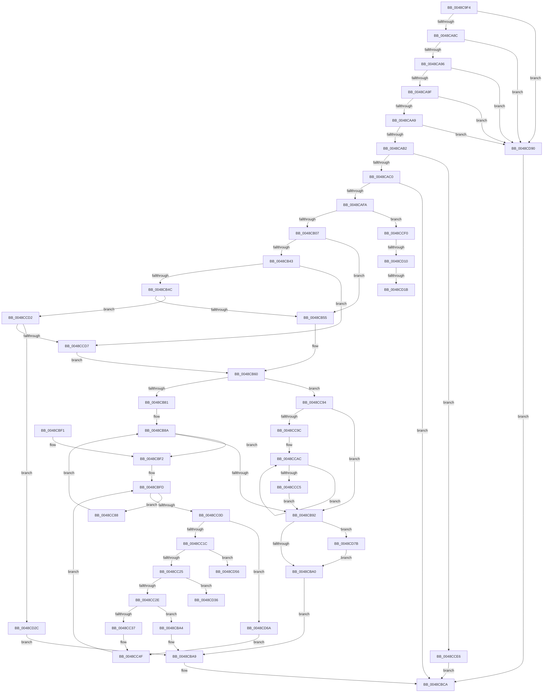

# GxpWriteFrameBufferPixels

- RVA: `0x0048C9F4`–`0x0048CD9A` (길이 `934` bytes)
- VA: `0x000000014048C9F4`
- 실행 섹션: `.text`
- PDB 이름 있음: `예`; PDB Function 태그: `예`
- unwind 정보 RVA: `0x000B1350`
- 디코드: `242`개 명령, `934/934` bytes 표시
- 미해석 바이트: `0` (있으면 어셈블리에 `.byte`로 보존)

> 이 문서는 커널 이미지의 기계어와 PDB 기호를 분석해 생성했습니다. 4번과 5번은 함수 원형과 자료형을 바이너리 사용 방식에서 추정한 C 해석이며 원본 소스 복구 결과는 아닙니다.

## 1. Dependencies

- 직접 호출 지점: **7**; 고유 호출 대상: **6**
- 직접 호출자로 확인된 함수: **1**
- RIP 상대 이미지 참조: **9**

### Outgoing calls
- `0x0048CA45` → [memset](../6C/memset_function_006C6C40.md) (function, `0x006C6C40`)
- `0x0048CA5D` → [BgpGetBitsPerPixel](BgpGetBitsPerPixel_function_0048CDA0.md) (function, `0x0048CDA0`)
- `0x0048CAED` → [GxpAdjustRectangleToFrameBuffer](GxpAdjustRectangleToFrameBuffer_function_0048CDC8.md) (function, `0x0048CDC8`)
- `0x0048CBD1` → [_security_check_cookie](../6A/_security_check_cookie_function_006AC640.md) (function, `0x006AC640`)
- `0x0048CC73` → [memcpy](../6C/memcpy_function_006C6840.md) (function, `0x006C6840`)
- `0x0048CCB5` → [memcpy](../6C/memcpy_function_006C6840.md) (function, `0x006C6840`)
- `0x0048CD86` → [BgfxGrowDirtyRect](../69/BgfxGrowDirtyRect_function_0069F0E0.md) (function, `0x0069F0E0`)

### Direct callers
- [BgpGxDrawRectangle](BgpGxDrawRectangle_function_0048C91C.md) at `0x0048C9A9`

### Static image references
- `0x0048CA10` → RVA `0x00E0A740` (`.data`; read)
- `0x0048CA65` → RVA `0x00EF03E8` (`.data`; read)
- `0x0048CA6F` → RVA `0x00EF03E4` (`.data`; read)
- `0x0048CA79` → RVA `0x00EF03EC` (`.data`; read)
- `0x0048CAB2` → RVA `0x00EF0450` (`.data`; read)
- `0x0048CAFA` → RVA `0x00EF03E0` (`.data`; read)
- `0x0048CB10` → RVA `0x00EF03E2` (`.data`; read)
- `0x0048CB32` → RVA `0x00EF0400` (`.data`; read)
- `0x0048CB92` → RVA `0x00EF05B0` (`.data`; read)

## 2. Other-region calls and transfers

- 다른 실행 섹션으로 향하는 call: **0**
- call이 아닌 외부 분기/꼬리 이동: **5**
  - `0x0048CD0A` → [sub_006F6564 + 0x38](../6F/Unknown_function_006F6564.md) (`tail-transfer`)
  - `0x0048CD15` → [sub_006F6564](../6F/Unknown_function_006F6564.md) (`tail-transfer`)
  - `0x0048CD27` → [sub_006F6564 + 0x3](../6F/Unknown_function_006F6564.md) (`tail-transfer`)
  - `0x0048CD51` → [sub_006F6564 + 0x99](../6F/Unknown_function_006F6564.md) (`tail-transfer`)
  - `0x0048CD65` → [sub_006F6564 + 0x99](../6F/Unknown_function_006F6564.md) (`tail-transfer`)

## 3. Assembly (complete function range)

```asm
0048C9F4  48 89 5C 24 18                  mov qword ptr [rsp + 0x18], rbx
0048C9F9  55                              push rbp
0048C9FA  56                              push rsi
0048C9FB  57                              push rdi
0048C9FC  41 54                           push r12
0048C9FE  41 55                           push r13
0048CA00  41 56                           push r14
0048CA02  41 57                           push r15
0048CA04  48 8D 6C 24 D0                  lea rbp, [rsp - 0x30]
0048CA09  48 81 EC 30 01 00 00            sub rsp, 0x130
0048CA10  48 8B 05 29 DD 97 00            mov rax, qword ptr [rip + 0x97dd29]
0048CA17  48 33 C4                        xor rax, rsp
0048CA1A  48 89 45 20                     mov qword ptr [rbp + 0x20], rax
0048CA1E  33 C0                           xor eax, eax
0048CA20  48 89 55 C8                     mov qword ptr [rbp - 0x38], rdx
0048CA24  4C 8B F2                        mov r14, rdx
0048CA27  48 89 4D C0                     mov qword ptr [rbp - 0x40], rcx
0048CA2B  48 8B F9                        mov rdi, rcx
0048CA2E  48 89 45 88                     mov qword ptr [rbp - 0x78], rax
0048CA32  33 D2                           xor edx, edx
0048CA34  48 89 44 24 50                  mov qword ptr [rsp + 0x50], rax
0048CA39  44 8D 40 48                     lea r8d, [rax + 0x48]
0048CA3D  89 44 24 58                     mov dword ptr [rsp + 0x58], eax
0048CA41  48 8D 4D D0                     lea rcx, [rbp - 0x30]
0048CA45  E8 F6 A1 23 00                  call 0x1406c6c40
0048CA4A  33 C0                           xor eax, eax
0048CA4C  48 21 45 80                     and qword ptr [rbp - 0x80], rax
0048CA50  21 44 24 48                     and dword ptr [rsp + 0x48], eax
0048CA54  48 21 44 24 40                  and qword ptr [rsp + 0x40], rax
0048CA59  48 89 45 98                     mov qword ptr [rbp - 0x68], rax
0048CA5D  E8 3E 03 00 00                  call 0x14048cda0
0048CA62  44 8B E0                        mov r12d, eax
0048CA65  8B 05 7D 39 A6 00               mov eax, dword ptr [rip + 0xa6397d]
0048CA6B  89 44 24 68                     mov dword ptr [rsp + 0x68], eax
0048CA6F  8B 05 6F 39 A6 00               mov eax, dword ptr [rip + 0xa6396f]
0048CA75  89 44 24 6C                     mov dword ptr [rsp + 0x6c], eax
0048CA79  8B 05 6D 39 A6 00               mov eax, dword ptr [rip + 0xa6396d]
0048CA7F  89 44 24 70                     mov dword ptr [rsp + 0x70], eax
0048CA83  48 85 FF                        test rdi, rdi
0048CA86  0F 84 04 03 00 00               je 0x14048cd90
0048CA8C  83 7F 04 00                     cmp dword ptr [rdi + 4], 0
0048CA90  0F 84 FA 02 00 00               je 0x14048cd90
0048CA96  83 3F 00                        cmp dword ptr [rdi], 0
0048CA99  0F 84 F1 02 00 00               je 0x14048cd90
0048CA9F  44 39 67 08                     cmp dword ptr [rdi + 8], r12d
0048CAA3  0F 85 E7 02 00 00               jne 0x14048cd90
0048CAA9  4D 85 F6                        test r14, r14
0048CAAC  0F 84 DE 02 00 00               je 0x14048cd90
0048CAB2  8B 05 98 39 A6 00               mov eax, dword ptr [rip + 0xa63998]
0048CAB8  A8 02                           test al, 2
0048CABA  0F 84 26 02 00 00               je 0x14048cce6
0048CAC0  48 8D 44 24 48                  lea rax, [rsp + 0x48]
0048CAC5  41 BF 01 00 00 00               mov r15d, 1
0048CACB  44 88 7C 24 30                  mov byte ptr [rsp + 0x30], r15b
0048CAD0  4C 8D 4D 98                     lea r9, [rbp - 0x68]
0048CAD4  48 89 44 24 28                  mov qword ptr [rsp + 0x28], rax
0048CAD9  4C 8D 44 24 68                  lea r8, [rsp + 0x68]
0048CADE  48 8D 45 80                     lea rax, [rbp - 0x80]
0048CAE2  49 8B D6                        mov rdx, r14
0048CAE5  48 8B CF                        mov rcx, rdi
0048CAE8  48 89 44 24 20                  mov qword ptr [rsp + 0x20], rax
0048CAED  E8 D6 02 00 00                  call 0x14048cdc8
0048CAF2  85 C0                           test eax, eax
0048CAF4  0F 88 D0 00 00 00               js 0x14048cbca
0048CAFA  80 3D DF 38 A6 00 00            cmp byte ptr [rip + 0xa638df], 0
0048CB01  0F 84 E9 01 00 00               je 0x14048ccf0
0048CB07  8B 74 24 70                     mov esi, dword ptr [rsp + 0x70]
0048CB0B  41 0F AF 76 04                  imul esi, dword ptr [r14 + 4]
0048CB10  44 0F B6 05 CA 38 A6 00         movzx r8d, byte ptr [rip + 0xa638ca]
0048CB18  44 8B 4D 98                     mov r9d, dword ptr [rbp - 0x68]
0048CB1C  41 8B C8                        mov ecx, r8d
0048CB1F  4C 8B 7F 18                     mov r15, qword ptr [rdi + 0x18]
0048CB23  41 C1 EC 03                     shr r12d, 3
0048CB27  41 03 36                        add esi, dword ptr [r14]
0048CB2A  41 0F AF F4                     imul esi, r12d
0048CB2E  45 0F AF CC                     imul r9d, r12d
0048CB32  48 03 35 C7 38 A6 00            add rsi, qword ptr [rip + 0xa638c7]
0048CB39  44 89 4C 24 78                  mov dword ptr [rsp + 0x78], r9d
0048CB3E  45 84 C0                        test r8b, r8b
0048CB41  74 12                           je 0x14048cb55
0048CB43  83 E9 01                        sub ecx, 1
0048CB46  0F 84 8B 01 00 00               je 0x14048ccd7
0048CB4C  83 E9 01                        sub ecx, 1
0048CB4F  0F 85 7D 01 00 00               jne 0x14048ccd2
0048CB55  44 8B 6F 04                     mov r13d, dword ptr [rdi + 4]
0048CB59  41 8B C5                        mov eax, r13d
0048CB5C  8B 1F                           mov ebx, dword ptr [rdi]
0048CB5E  8B D3                           mov edx, ebx
0048CB60  8B 4C 24 70                     mov ecx, dword ptr [rsp + 0x70]
0048CB64  41 0F AF CC                     imul ecx, r12d
0048CB68  41 0F AF C4                     imul eax, r12d
0048CB6C  89 5C 24 54                     mov dword ptr [rsp + 0x54], ebx
0048CB70  89 4C 24 58                     mov dword ptr [rsp + 0x58], ecx
0048CB74  89 44 24 50                     mov dword ptr [rsp + 0x50], eax
0048CB78  45 84 C0                        test r8b, r8b
0048CB7B  0F 84 13 01 00 00               je 0x14048cc94
0048CB81  44 89 6D 88                     mov dword ptr [rbp - 0x78], r13d
0048CB85  33 F6                           xor esi, esi
0048CB87  89 55 8C                        mov dword ptr [rbp - 0x74], edx
0048CB8A  89 74 24 44                     mov dword ptr [rsp + 0x44], esi
0048CB8E  3B 37                           cmp esi, dword ptr [rdi]
0048CB90  72 60                           jb 0x14048cbf2
0048CB92  48 83 3D 16 3A A6 00 00         cmp qword ptr [rip + 0xa63a16], 0
0048CB9A  0F 85 DB 01 00 00               jne 0x14048cd7b
0048CBA0  33 DB                           xor ebx, ebx
0048CBA2  EB 05                           jmp 0x14048cba9
0048CBA4  BB BB 00 00 C0                  mov ebx, 0xc00000bb
0048CBA9  8B 45 9C                        mov eax, dword ptr [rbp - 0x64]
0048CBAC  89 07                           mov dword ptr [rdi], eax
0048CBAE  8B 45 98                        mov eax, dword ptr [rbp - 0x68]
0048CBB1  89 47 04                        mov dword ptr [rdi + 4], eax
0048CBB4  8B 44 24 48                     mov eax, dword ptr [rsp + 0x48]
0048CBB8  89 47 0C                        mov dword ptr [rdi + 0xc], eax
0048CBBB  8B 45 80                        mov eax, dword ptr [rbp - 0x80]
0048CBBE  41 89 06                        mov dword ptr [r14], eax
0048CBC1  8B 45 84                        mov eax, dword ptr [rbp - 0x7c]
0048CBC4  41 89 46 04                     mov dword ptr [r14 + 4], eax
0048CBC8  8B C3                           mov eax, ebx
0048CBCA  48 8B 4D 20                     mov rcx, qword ptr [rbp + 0x20]
0048CBCE  48 33 CC                        xor rcx, rsp
0048CBD1  E8 6A FA 21 00                  call 0x1406ac640
0048CBD6  48 8B 9C 24 80 01 00 00         mov rbx, qword ptr [rsp + 0x180]
0048CBDE  48 81 C4 30 01 00 00            add rsp, 0x130
0048CBE5  41 5F                           pop r15
0048CBE7  41 5E                           pop r14
0048CBE9  41 5D                           pop r13
0048CBEB  41 5C                           pop r12
0048CBED  5F                              pop rdi
0048CBEE  5E                              pop rsi
0048CBEF  5D                              pop rbp
0048CBF0  C3                              ret
0048CBF1  CC                              int3
0048CBF2  44 0F AF CE                     imul r9d, esi
0048CBF6  4C 03 4F 18                     add r9, qword ptr [rdi + 0x18]
0048CBFA  45 33 FF                        xor r15d, r15d
0048CBFD  44 89 7C 24 40                  mov dword ptr [rsp + 0x40], r15d
0048CC02  4C 89 4C 24 60                  mov qword ptr [rsp + 0x60], r9
0048CC07  44 3B 7F 04                     cmp r15d, dword ptr [rdi + 4]
0048CC0B  73 7B                           jae 0x14048cc88
0048CC0D  0F B6 0D CE 37 A6 00            movzx ecx, byte ptr [rip + 0xa637ce]
0048CC14  85 C9                           test ecx, ecx
0048CC16  0F 84 4E 01 00 00               je 0x14048cd6a
0048CC1C  83 E9 01                        sub ecx, 1
0048CC1F  0F 84 31 01 00 00               je 0x14048cd56
0048CC25  83 E9 01                        sub ecx, 1
0048CC28  0F 84 08 01 00 00               je 0x14048cd36
0048CC2E  83 F9 01                        cmp ecx, 1
0048CC31  0F 85 6D FF FF FF               jne 0x14048cba4
0048CC37  48 8B 4D 88                     mov rcx, qword ptr [rbp - 0x78]
0048CC3B  41 8B D7                        mov edx, r15d
0048CC3E  48 8B 44 24 40                  mov rax, qword ptr [rsp + 0x40]
0048CC43  48 C1 E9 20                     shr rcx, 0x20
0048CC47  48 C1 E8 20                     shr rax, 0x20
0048CC4B  2B C8                           sub ecx, eax
0048CC4D  FF C9                           dec ecx
0048CC4F  41 8B 46 04                     mov eax, dword ptr [r14 + 4]
0048CC53  03 C2                           add eax, edx
0048CC55  45 8B C4                        mov r8d, r12d
0048CC58  0F AF 44 24 70                  imul eax, dword ptr [rsp + 0x70]
0048CC5D  49 8B D1                        mov rdx, r9
0048CC60  41 8B DC                        mov ebx, r12d
0048CC63  03 C8                           add ecx, eax
0048CC65  41 03 0E                        add ecx, dword ptr [r14]
0048CC68  41 0F AF CC                     imul ecx, r12d
0048CC6C  48 03 0D 8D 37 A6 00            add rcx, qword ptr [rip + 0xa6378d]
0048CC73  E8 C8 9B 23 00                  call 0x1406c6840
0048CC78  4C 8B 4C 24 60                  mov r9, qword ptr [rsp + 0x60]
0048CC7D  4C 03 CB                        add r9, rbx
0048CC80  41 FF C7                        inc r15d
0048CC83  E9 75 FF FF FF                  jmp 0x14048cbfd
0048CC88  44 8B 4C 24 78                  mov r9d, dword ptr [rsp + 0x78]
0048CC8D  FF C6                           inc esi
0048CC8F  E9 F6 FE FF FF                  jmp 0x14048cb8a
0048CC94  85 DB                           test ebx, ebx
0048CC96  0F 84 F6 FE FF FF               je 0x14048cb92
0048CC9C  44 8B E8                        mov r13d, eax
0048CC9F  41 8B C1                        mov eax, r9d
0048CCA2  48 89 44 24 60                  mov qword ptr [rsp + 0x60], rax
0048CCA7  44 8B F0                        mov r14d, eax
0048CCAA  8B F9                           mov edi, ecx
0048CCAC  4D 8B C5                        mov r8, r13
0048CCAF  49 8B D7                        mov rdx, r15
0048CCB2  48 8B CE                        mov rcx, rsi
0048CCB5  E8 86 9B 23 00                  call 0x1406c6840
0048CCBA  4D 03 FE                        add r15, r14
0048CCBD  48 03 F7                        add rsi, rdi
0048CCC0  83 C3 FF                        add ebx, -1
0048CCC3  75 E7                           jne 0x14048ccac
0048CCC5  48 8B 7D C0                     mov rdi, qword ptr [rbp - 0x40]
0048CCC9  4C 8B 75 C8                     mov r14, qword ptr [rbp - 0x38]
0048CCCD  E9 C0 FE FF FF                  jmp 0x14048cb92
0048CCD2  83 F9 01                        cmp ecx, 1
0048CCD5  75 55                           jne 0x14048cd2c
0048CCD7  8B 17                           mov edx, dword ptr [rdi]
0048CCD9  8B C2                           mov eax, edx
0048CCDB  8B 5F 04                        mov ebx, dword ptr [rdi + 4]
0048CCDE  44 8B EB                        mov r13d, ebx
0048CCE1  E9 7A FE FF FF                  jmp 0x14048cb60
0048CCE6  B8 01 00 00 C0                  mov eax, 0xc0000001
0048CCEB  E9 DA FE FF FF                  jmp 0x14048cbca
0048CCF0  8B 07                           mov eax, dword ptr [rdi]
0048CCF2  33 F6                           xor esi, esi
0048CCF4  89 45 A8                        mov dword ptr [rbp - 0x58], eax
0048CCF7  8B 47 04                        mov eax, dword ptr [rdi + 4]
0048CCFA  89 45 AC                        mov dword ptr [rbp - 0x54], eax
0048CCFD  8B 05 4D 37 A6 00               mov eax, dword ptr [rip + 0xa6374d]
0048CD03  48 89 74 24 40                  mov qword ptr [rsp + 0x40], rsi
0048CD08  A8 08                           test al, 8
0048CD0A  0F 84 8C 98 26 00               je 0x1406f659c
0048CD10  A9 00 0C 00 00                  test eax, 0xc00
0048CD15  0F 84 49 98 26 00               je 0x1406f6564
0048CD1B  48 8D 45 D0                     lea rax, [rbp - 0x30]
0048CD1F  45 8B CF                        mov r9d, r15d
0048CD22  48 89 44 24 40                  mov qword ptr [rsp + 0x40], rax
0048CD27  E9 3B 98 26 00                  jmp 0x1406f6567
0048CD2C  BB 0D 00 00 C0                  mov ebx, 0xc000000d
0048CD31  E9 73 FE FF FF                  jmp 0x14048cba9
0048CD36  48 8B 55 88                     mov rdx, qword ptr [rbp - 0x78]
0048CD3A  41 8B CD                        mov ecx, r13d
0048CD3D  48 8B 44 24 40                  mov rax, qword ptr [rsp + 0x40]
0048CD42  41 2B CF                        sub ecx, r15d
0048CD45  FF C9                           dec ecx
0048CD47  48 C1 EA 20                     shr rdx, 0x20
0048CD4B  48 C1 E8 20                     shr rax, 0x20
0048CD4F  2B D0                           sub edx, eax
0048CD51  E9 A7 98 26 00                  jmp 0x1406f65fd
0048CD56  48 8B 4C 24 40                  mov rcx, qword ptr [rsp + 0x40]
0048CD5B  41 8B D5                        mov edx, r13d
0048CD5E  48 C1 E9 20                     shr rcx, 0x20
0048CD62  41 2B D7                        sub edx, r15d
0048CD65  E9 93 98 26 00                  jmp 0x1406f65fd
0048CD6A  48 8B 54 24 40                  mov rdx, qword ptr [rsp + 0x40]
0048CD6F  41 8B CF                        mov ecx, r15d
0048CD72  48 C1 EA 20                     shr rdx, 0x20
0048CD76  E9 D4 FE FF FF                  jmp 0x14048cc4f
0048CD7B  45 8B C4                        mov r8d, r12d
0048CD7E  48 8D 4C 24 50                  lea rcx, [rsp + 0x50]
0048CD83  49 8B D6                        mov rdx, r14
0048CD86  E8 55 23 21 00                  call 0x14069f0e0
0048CD8B  E9 10 FE FF FF                  jmp 0x14048cba0
0048CD90  B8 0D 00 00 C0                  mov eax, 0xc000000d
0048CD95  E9 30 FE FF FF                  jmp 0x14048cbca
```

## 4. C-style interpretation (structured pseudocode)

```c
__int64 __fastcall GxpWriteFrameBufferPixels(__int64 a1, __int64 a2)
{
    __int64 result;
    __int64 v_r12;
    __int64 v_r15;
    __int64 v_rbx;
    __int64 v_rsi;
    __int64 v_rsp;
    unsigned int v_stack_m100;
    unsigned int v_stack_m110;
    unsigned int v_stack_m114;
    unsigned __int64 v_stack_m118;
    unsigned int v_stack_m120;
    unsigned int v_stack_m124;
    unsigned __int64 v_stack_m128;
    unsigned __int8 v_stack_m138;
    unsigned __int64 v_stack_m140;
    unsigned __int64 v_stack_m148;
    unsigned __int64 v_stack_m48;
    unsigned __int64 v_stack_m68;
    unsigned __int64 v_stack_m98;
    unsigned __int64 v_stack_mA0;
    unsigned __int64 v_stack_mA8;
    unsigned int v_stack_mBC;
    unsigned int v_stack_mC0;
    unsigned int v_stack_mCC;
    unsigned __int64 v_stack_mD0;
    unsigned int v_stack_mDC;
    unsigned __int64 v_stack_mE0;
    unsigned int v_stack_mE4;
    unsigned __int64 v_stack_mE8;
    unsigned int v_stack_mF0;
    unsigned int v_stack_mF8;
    unsigned int v_stack_mFC;
    unsigned __int64 v_stack_p18;
    unsigned int v_stack_p40;
    unsigned __int64 v_stack_p50;
    unsigned __int64 v_stack_p60;
    unsigned int v_stack_p70;
    unsigned int v_stack_p78;

    v_stack_p18 = v_rbx;
    v_rsp = (v_rsp) - (304);
    result = (*(unsigned __int64 *)(v_rip + 9952553)) ^ (v_rsp);
    v_stack_m48 = result;
    result = 0;
    v_stack_mA0 = a2;
    v_stack_mA8 = a1;
    v_stack_mE0 = 0;
    a2 = 0;
    v_stack_m118 = 0;
    v_stack_m110 = 0;
    result = memset(v_stack_m98, a2, result + 72, a4);
    result = 0;
    v_stack_mD0 = 0;
    result = BgpGetBitsPerPixel(v_stack_m98, a2, result + 72, a4);
    v_stack_m100 = (unsigned int)((unsigned int)(*(unsigned int *)(v_rip + 10893693)));
    v_stack_mFC = (unsigned int)((unsigned int)(*(unsigned int *)(v_rip + 10893679)));
    v_stack_mF8 = (unsigned int)((unsigned int)(*(unsigned int *)(v_rip + 10893677)));
    if (a1 == 0) goto loc_0048CD90;
    if ((*(unsigned int *)(a1 + 4)) == 0) goto loc_0048CD90;
    if ((*(unsigned int *)(a1)) == 0) goto loc_0048CD90;
    if ((*(unsigned int *)(a1 + 8)) != ((unsigned int)((unsigned int)((unsigned int)(result))))) goto loc_0048CD90;
    if (0 == 0) goto loc_0048CD90;
    if ((((unsigned __int8)((unsigned int)(*(unsigned int *)(v_rip + 10893720)))) & (2)) == 0) goto loc_0048CCE6;
    v_stack_m138 = 1;
    v_stack_m140 = v_stack_m120;
    v_stack_m148 = v_stack_mE8;
    result = GxpAdjustRectangleToFrameBuffer(a1, 0, v_stack_m100, v_stack_mD0);
    if (sign_flag) goto loc_0048CBCA;
    if ((*(unsigned __int8 *)(v_rip + 10893535)) == 0) goto loc_0048CCF0;
    v_rsi = (unsigned int)(((unsigned int)(v_stack_mF8)) * (*(unsigned int *)(a2 + 4)));
    v_r12 = (unsigned int)(((unsigned int)((unsigned int)(result))) >> (3));
    v_rsi = (unsigned int)((v_rsi) + (*(unsigned int *)(a2)));
    v_rsi = (unsigned int)((v_rsi) * ((unsigned int)(v_r12)));
    a4 = (unsigned int)(((unsigned int)(v_stack_mD0)) * ((unsigned int)(v_r12)));
    v_rsi = (v_rsi) + (*(unsigned __int64 *)(v_rip + 10893511));
    v_stack_mF0 = (unsigned int)(a4);
    if ((unsigned __int8)(*(unsigned __int8 *)(v_rip + 10893514)) == 0) goto loc_0048CB55;
    a1 = (unsigned int)(((unsigned int)((unsigned int)(*(unsigned __int8 *)(v_rip + 10893514)))) - (1));
    if (condition_is_equal) goto loc_0048CCD7;
    a1 = (unsigned int)((a1) - (1));
    if (condition_is_not_equal) goto loc_0048CCD2;
loc_0048CB55:
loc_0048CB60:
    a1 = (unsigned int)(((unsigned int)(v_stack_mF8)) * ((unsigned int)(v_r12)));
    result = (unsigned int)(((unsigned int)((unsigned int)((unsigned int)(*(unsigned int *)(a1 + 4))))) * ((unsigned int)(v_r12)));
    v_stack_m114 = (unsigned int)((unsigned int)(*(unsigned int *)(a1)));
    v_stack_m110 = (unsigned int)(a1);
    v_stack_m118 = (unsigned int)(result);
    if ((unsigned __int8)(*(unsigned __int8 *)(v_rip + 10893514)) == 0) goto loc_0048CC94;
    v_stack_mE0 = (unsigned int)((unsigned int)(*(unsigned int *)(a1 + 4)));
    v_rsi = 0;
    v_stack_mDC = (unsigned int)((unsigned int)((unsigned int)((unsigned int)(*(unsigned int *)(a1)))));
loc_0048CB8A:
    v_stack_m124 = 0;
    if (0 < (*(unsigned int *)(a1))) goto loc_0048CBF2;
loc_0048CB92:
    if ((*(unsigned __int64 *)(v_rip + 10893846)) != 0) goto loc_0048CD7B;
loc_0048CBA0:
    v_rbx = 0;
    goto loc_0048CBA9;
loc_0048CBA4:
loc_0048CBA9:
    *(unsigned int *)(a1) = (unsigned int)((unsigned int)(v_stack_mCC));
    *(unsigned int *)(a1 + 4) = (unsigned int)((unsigned int)(v_stack_mD0));
    *(unsigned int *)(a1 + 12) = (unsigned int)((unsigned int)(v_stack_m120));
    *(unsigned int *)(a2) = (unsigned int)((unsigned int)(v_stack_mE8));
    *(unsigned int *)(a2 + 4) = (unsigned int)((unsigned int)(v_stack_mE4));
loc_0048CBCA:
    a1 = (v_stack_m48) ^ (v_rsp);
    result = _security_check_cookie(a1, (unsigned int)((unsigned int)((unsigned int)(*(unsigned int *)(a1)))), *(unsigned __int8 *)(v_rip + 10893514), a4);
    v_rsp = (v_rsp) + (304);
    return result;
loc_0048CBF2:
    a4 = (unsigned int)((a4) * (0));
    a4 = (a4) + (*(unsigned __int64 *)(a1 + 24));
    v_r15 = 0;
loc_0048CBFD:
    v_stack_p40 = 0;
    v_stack_p60 = a4;
    if (0 >= (*(unsigned int *)(a1 + 4))) goto loc_0048CC88;
    if ((unsigned int)(*(unsigned __int8 *)(v_rip + 10893262)) == 0) goto loc_0048CD6A;
    a1 = (unsigned int)((*(unsigned __int8 *)(v_rip + 10893262)) - (1));
    if (condition_is_equal) goto loc_0048CD56;
    a1 = (unsigned int)((a1) - (1));
    if (condition_is_equal) goto loc_0048CD36;
    if (((unsigned int)(a1)) != 1) goto loc_0048CBA4;
    a1 = (v_stack_mE0) >> (32);
    result = (v_stack_p40) >> (32);
    a1 = (unsigned int)((a1) - ((unsigned int)(result)));
    a1 = (unsigned int)((a1) - 1);
loc_0048CC4F:
    result = (unsigned int)(((unsigned int)(*(unsigned int *)(a2 + 4))) + (0));
    result = (unsigned int)((result) * (v_stack_p70));
    a1 = (unsigned int)((a1) + ((unsigned int)(result)));
    a1 = (unsigned int)((a1) + (*(unsigned int *)(a2)));
    a1 = (unsigned int)((a1) * ((unsigned int)(v_r12)));
    a1 = (a1) + (*(unsigned __int64 *)(v_rip + 10893197));
    result = memcpy(a1, a4, (unsigned int)((unsigned int)(v_r12)), a4);
    a4 = (v_stack_p60) + ((unsigned int)((unsigned int)(v_r12)));
    v_r15 = (unsigned int)((v_r15) + 1);
    goto loc_0048CBFD;
loc_0048CC88:
    v_rsi = (unsigned int)((v_rsi) + 1);
    goto loc_0048CB8A;
loc_0048CC94:
    if ((unsigned int)((unsigned int)((unsigned int)(v_r12))) == 0) goto loc_0048CB92;
    v_stack_p60 = (unsigned int)((unsigned int)((unsigned int)(v_stack_p78)));
loc_0048CCAC:
    result = memcpy(v_rsi, v_r15, (unsigned int)((unsigned int)(result)), (unsigned int)(v_stack_p78));
    v_r15 = (v_r15) + ((unsigned int)((unsigned int)((unsigned int)((unsigned int)((unsigned int)(v_stack_p78))))));
    v_rsi = (v_rsi) + ((unsigned int)((unsigned int)(a1)));
    v_rbx = (unsigned int)(((unsigned int)((unsigned int)(v_r12))) + (-1));
    if (condition_is_not_equal) goto loc_0048CCAC;
    goto loc_0048CB92;
loc_0048CCD2:
    if (((unsigned int)(v_rsi)) != 1) goto loc_0048CD2C;
loc_0048CCD7:
    goto loc_0048CB60;
loc_0048CCE6:
    goto loc_0048CBCA;
loc_0048CCF0:
    v_rsi = 0;
    v_stack_mC0 = (unsigned int)((unsigned int)(*(unsigned int *)(v_stack_mA8)));
    v_stack_mBC = (unsigned int)((unsigned int)(*(unsigned int *)(v_stack_mA8 + 4)));
    v_stack_p40 = 0;
    v_stack_p40 = v_stack_m98;
loc_0048CD2C:
    goto loc_0048CBA9;
loc_0048CD36:
    a1 = (unsigned int)(((unsigned int)((unsigned int)((unsigned int)((unsigned int)((unsigned int)(*(unsigned int *)(v_stack_mA8 + 4))))))) - ((unsigned int)(v_r15)));
    a1 = (unsigned int)((a1) - 1);
    a2 = (v_stack_mE0) >> (32);
    result = (v_stack_p40) >> (32);
    a2 = (unsigned int)((a2) - ((unsigned int)(result)));
loc_0048CD56:
    a1 = (v_stack_p40) >> (32);
    a2 = (unsigned int)(((unsigned int)((unsigned int)((unsigned int)((unsigned int)((unsigned int)(*(unsigned int *)(v_stack_mA8 + 4))))))) - ((unsigned int)(v_r15)));
loc_0048CD6A:
    a2 = (v_stack_p40) >> (32);
    goto loc_0048CC4F;
loc_0048CD7B:
    result = BgfxGrowDirtyRect(v_stack_p50, v_stack_mA0, (unsigned int)((unsigned int)(v_r12)), (unsigned int)((unsigned int)(v_r15)));
    goto loc_0048CBA0;
loc_0048CD90:
    goto loc_0048CBCA;
}
```

## 5. (Beta) C Style

```c
int64_t GxpWriteFrameBufferPixels(int64_t Arg1, int64_t Arg2)
{
    int64_t result;
    int64_t local_r12;
    int64_t local_r15;
    int64_t local_rbx;
    int64_t local_rsi;
    int64_t local_rsp;
    uint32_t v_stack_m100;
    uint32_t v_stack_m110;
    uint32_t v_stack_m114;
    uint64_t v_stack_m118;
    uint32_t v_stack_m120;
    uint32_t v_stack_m124;
    uint64_t v_stack_m128;
    uint8_t v_stack_m138;
    uint64_t v_stack_m140;
    uint64_t v_stack_m148;
    uint64_t v_stack_m48;
    uint64_t v_stack_m68;
    uint64_t v_stack_m98;
    uint64_t v_stack_mA0;
    uint64_t v_stack_mA8;
    uint32_t v_stack_mBC;
    uint32_t v_stack_mC0;
    uint32_t v_stack_mCC;
    uint64_t v_stack_mD0;
    uint32_t v_stack_mDC;
    uint64_t v_stack_mE0;
    uint32_t v_stack_mE4;
    uint64_t v_stack_mE8;
    uint32_t v_stack_mF0;
    uint32_t v_stack_mF8;
    uint32_t v_stack_mFC;
    uint64_t v_stack_p18;
    uint32_t v_stack_p40;
    uint64_t v_stack_p50;
    uint64_t v_stack_p60;
    uint32_t v_stack_p70;
    uint32_t v_stack_p78;

    v_stack_p18 = local_rbx;
    local_rsp = (local_rsp) - (304);
    result = (*(uint64_t *)(v_rip + 0x97DD29)) ^ (local_rsp);
    v_stack_m48 = result;
    result = 0;
    v_stack_mA0 = Arg2;
    v_stack_mA8 = Arg1;
    v_stack_mE0 = 0;
    Arg2 = 0;
    v_stack_m118 = 0;
    v_stack_m110 = 0;
    result = memset(v_stack_m98, Arg2, result + 72, a4);
    result = 0;
    v_stack_mD0 = 0;
    result = BgpGetBitsPerPixel(v_stack_m98, Arg2, result + 72, a4);
    v_stack_m100 = (uint32_t)((uint32_t)(*(uint32_t *)(v_rip + 0xA6397D)));
    v_stack_mFC = (uint32_t)((uint32_t)(*(uint32_t *)(v_rip + 0xA6396F)));
    v_stack_mF8 = (uint32_t)((uint32_t)(*(uint32_t *)(v_rip + 0xA6396D)));
    if (Arg1 == 0) goto loc_0048CD90;
    if ((*(uint32_t *)(Arg1 + 0x4)) == 0) goto loc_0048CD90;
    if ((*(uint32_t *)(Arg1)) == 0) goto loc_0048CD90;
    if ((*(uint32_t *)(Arg1 + 0x8)) != ((uint32_t)((uint32_t)((uint32_t)(result))))) goto loc_0048CD90;
    if (0 == 0) goto loc_0048CD90;
    if ((((uint8_t)((uint32_t)(*(uint32_t *)(v_rip + 0xA63998)))) & (2)) == 0) goto loc_0048CCE6;
    v_stack_m138 = 1;
    v_stack_m140 = v_stack_m120;
    v_stack_m148 = v_stack_mE8;
    result = GxpAdjustRectangleToFrameBuffer(Arg1, 0, v_stack_m100, v_stack_mD0);
    if (sign_flag) goto loc_0048CBCA;
    if ((*(uint8_t *)(v_rip + 0xA638DF)) == 0) goto loc_0048CCF0;
    local_rsi = (uint32_t)(((uint32_t)(v_stack_mF8)) * (*(uint32_t *)(Arg2 + 0x4)));
    local_r12 = (uint32_t)(((uint32_t)((uint32_t)(result))) >> (3));
    local_rsi = (uint32_t)((local_rsi) + (*(uint32_t *)(Arg2)));
    local_rsi = (uint32_t)((local_rsi) * ((uint32_t)(local_r12)));
    a4 = (uint32_t)(((uint32_t)(v_stack_mD0)) * ((uint32_t)(local_r12)));
    local_rsi = (local_rsi) + (*(uint64_t *)(v_rip + 0xA638C7));
    v_stack_mF0 = (uint32_t)(a4);
    if ((uint8_t)(*(uint8_t *)(v_rip + 0xA638CA)) == 0) goto loc_0048CB55;
    Arg1 = (uint32_t)(((uint32_t)((uint32_t)(*(uint8_t *)(v_rip + 0xA638CA)))) - (1));
    if (condition_is_equal) goto loc_0048CCD7;
    Arg1 = (uint32_t)((Arg1) - (1));
    if (condition_is_not_equal) goto loc_0048CCD2;
loc_0048CB55:
loc_0048CB60:
    Arg1 = (uint32_t)(((uint32_t)(v_stack_mF8)) * ((uint32_t)(local_r12)));
    result = (uint32_t)(((uint32_t)((uint32_t)((uint32_t)(*(uint32_t *)(Arg1 + 0x4))))) * ((uint32_t)(local_r12)));
    v_stack_m114 = (uint32_t)((uint32_t)(*(uint32_t *)(Arg1)));
    v_stack_m110 = (uint32_t)(Arg1);
    v_stack_m118 = (uint32_t)(result);
    if ((uint8_t)(*(uint8_t *)(v_rip + 0xA638CA)) == 0) goto loc_0048CC94;
    v_stack_mE0 = (uint32_t)((uint32_t)(*(uint32_t *)(Arg1 + 0x4)));
    local_rsi = 0;
    v_stack_mDC = (uint32_t)((uint32_t)((uint32_t)((uint32_t)(*(uint32_t *)(Arg1)))));
loc_0048CB8A:
    v_stack_m124 = 0;
    if (0 < (*(uint32_t *)(Arg1))) goto loc_0048CBF2;
loc_0048CB92:
    if ((*(uint64_t *)(v_rip + 0xA63A16)) != 0) goto loc_0048CD7B;
loc_0048CBA0:
    local_rbx = 0;
    goto loc_0048CBA9;
loc_0048CBA4:
loc_0048CBA9:
    *(uint32_t *)(Arg1) = (uint32_t)((uint32_t)(v_stack_mCC));
    *(uint32_t *)(Arg1 + 0x4) = (uint32_t)((uint32_t)(v_stack_mD0));
    *(uint32_t *)(Arg1 + 0xC) = (uint32_t)((uint32_t)(v_stack_m120));
    *(uint32_t *)(Arg2) = (uint32_t)((uint32_t)(v_stack_mE8));
    *(uint32_t *)(Arg2 + 0x4) = (uint32_t)((uint32_t)(v_stack_mE4));
loc_0048CBCA:
    Arg1 = (v_stack_m48) ^ (local_rsp);
    result = _security_check_cookie(Arg1, (uint32_t)((uint32_t)((uint32_t)(*(uint32_t *)(Arg1)))), *(uint8_t *)(v_rip + 0xA638CA), a4);
    local_rsp = (local_rsp) + (304);
    return result;
loc_0048CBF2:
    a4 = (uint32_t)((a4) * (0));
    a4 = (a4) + (*(uint64_t *)(Arg1 + 0x18));
    local_r15 = 0;
loc_0048CBFD:
    v_stack_p40 = 0;
    v_stack_p60 = a4;
    if (0 >= (*(uint32_t *)(Arg1 + 0x4))) goto loc_0048CC88;
    if ((uint32_t)(*(uint8_t *)(v_rip + 0xA637CE)) == 0) goto loc_0048CD6A;
    Arg1 = (uint32_t)((*(uint8_t *)(v_rip + 0xA637CE)) - (1));
    if (condition_is_equal) goto loc_0048CD56;
    Arg1 = (uint32_t)((Arg1) - (1));
    if (condition_is_equal) goto loc_0048CD36;
    if (((uint32_t)(Arg1)) != 1) goto loc_0048CBA4;
    Arg1 = (v_stack_mE0) >> (32);
    result = (v_stack_p40) >> (32);
    Arg1 = (uint32_t)((Arg1) - ((uint32_t)(result)));
    Arg1 = (uint32_t)((Arg1) - 1);
loc_0048CC4F:
    result = (uint32_t)(((uint32_t)(*(uint32_t *)(Arg2 + 0x4))) + (0));
    result = (uint32_t)((result) * (v_stack_p70));
    Arg1 = (uint32_t)((Arg1) + ((uint32_t)(result)));
    Arg1 = (uint32_t)((Arg1) + (*(uint32_t *)(Arg2)));
    Arg1 = (uint32_t)((Arg1) * ((uint32_t)(local_r12)));
    Arg1 = (Arg1) + (*(uint64_t *)(v_rip + 0xA6378D));
    result = memcpy(Arg1, a4, (uint32_t)((uint32_t)(local_r12)), a4);
    a4 = (v_stack_p60) + ((uint32_t)((uint32_t)(local_r12)));
    local_r15 = (uint32_t)((local_r15) + 1);
    goto loc_0048CBFD;
loc_0048CC88:
    local_rsi = (uint32_t)((local_rsi) + 1);
    goto loc_0048CB8A;
loc_0048CC94:
    if ((uint32_t)((uint32_t)((uint32_t)(local_r12))) == 0) goto loc_0048CB92;
    v_stack_p60 = (uint32_t)((uint32_t)((uint32_t)(v_stack_p78)));
loc_0048CCAC:
    result = memcpy(local_rsi, local_r15, (uint32_t)((uint32_t)(result)), (uint32_t)(v_stack_p78));
    local_r15 = (local_r15) + ((uint32_t)((uint32_t)((uint32_t)((uint32_t)((uint32_t)(v_stack_p78))))));
    local_rsi = (local_rsi) + ((uint32_t)((uint32_t)(Arg1)));
    local_rbx = (uint32_t)(((uint32_t)((uint32_t)(local_r12))) + (-1));
    if (condition_is_not_equal) goto loc_0048CCAC;
    goto loc_0048CB92;
loc_0048CCD2:
    if (((uint32_t)(local_rsi)) != 1) goto loc_0048CD2C;
loc_0048CCD7:
    goto loc_0048CB60;
loc_0048CCE6:
    goto loc_0048CBCA;
loc_0048CCF0:
    local_rsi = 0;
    v_stack_mC0 = (uint32_t)((uint32_t)(*(uint32_t *)(v_stack_mA8)));
    v_stack_mBC = (uint32_t)((uint32_t)(*(uint32_t *)(v_stack_mA8 + 0x4)));
    v_stack_p40 = 0;
    v_stack_p40 = v_stack_m98;
loc_0048CD2C:
    goto loc_0048CBA9;
loc_0048CD36:
    Arg1 = (uint32_t)(((uint32_t)((uint32_t)((uint32_t)((uint32_t)((uint32_t)(*(uint32_t *)(v_stack_mA8 + 0x4))))))) - ((uint32_t)(local_r15)));
    Arg1 = (uint32_t)((Arg1) - 1);
    Arg2 = (v_stack_mE0) >> (32);
    result = (v_stack_p40) >> (32);
    Arg2 = (uint32_t)((Arg2) - ((uint32_t)(result)));
loc_0048CD56:
    Arg1 = (v_stack_p40) >> (32);
    Arg2 = (uint32_t)(((uint32_t)((uint32_t)((uint32_t)((uint32_t)((uint32_t)(*(uint32_t *)(v_stack_mA8 + 0x4))))))) - ((uint32_t)(local_r15)));
loc_0048CD6A:
    Arg2 = (v_stack_p40) >> (32);
    goto loc_0048CC4F;
loc_0048CD7B:
    result = BgfxGrowDirtyRect(v_stack_p50, v_stack_mA0, (uint32_t)((uint32_t)(local_r12)), (uint32_t)((uint32_t)(local_r15)));
    goto loc_0048CBA0;
loc_0048CD90:
    goto loc_0048CBCA;
}
```

## 6. Execution-region graph

[열기: 2D/3D 그래프와 함수 탐색 컨트롤 패널](../../../control-panel.html?section=text&rva=0x0048C9F4&view=graph)

- 2D 그래프는 위에서 아래로 흐르고, 3D 그래프는 빈 공간을 드래그해 회전합니다. Shift+드래그는 이동, 휠은 확대·축소, 함수 노드 선택은 대상 보고서 이동입니다.

### Static fallback


