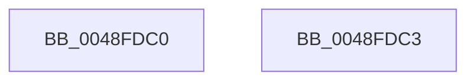

# HalAdjustResourceList

- RVA: `0x0048FDC0`–`0x0048FDC4` (길이 `4` bytes)
- VA: `0x000000014048FDC0`
- 실행 섹션: `.text`
- PDB 이름 있음: `예`; PDB Function 태그: `아니요`
- unwind 정보 RVA: `0x000DB714`
- 디코드: `3`개 명령, `4/4` bytes 표시
- 미해석 바이트: `0` (있으면 어셈블리에 `.byte`로 보존)

> 이 문서는 커널 이미지의 기계어와 PDB 기호를 분석해 생성했습니다. 4번과 5번은 함수 원형과 자료형을 바이너리 사용 방식에서 추정한 C 해석이며 원본 소스 복구 결과는 아닙니다.

## 1. Dependencies

- 직접 호출 지점: **0**; 고유 호출 대상: **0**
- 직접 호출자로 확인된 함수: **44**
- RIP 상대 이미지 참조: **0**

### Outgoing calls
- 직접 디코드된 call 명령이 없습니다.

### Direct callers
- [SymCryptSaveXmm](../49/SymCryptSaveXmm_function_004990EC.md) at `0x004990F0`
- [_call_matherr](../50/_call_matherr_function_00503E90.md) at `0x00503EE2`
- [DbgkpRemoveErrorPort](../../page/71/DbgkpRemoveErrorPort_function_00711038.md) at `0x007110B8`
- [HvlPhase0Initialize](../../page/71/HvlPhase0Initialize_function_00717AC8.md) at `0x00717B38`
- [ObShutdownSystem](../../page/74/ObShutdownSystem_function_0074DBB0.md) at `0x0074DD0A`
- [ObpCreateDosDevicesDirectory](../../page/74/ObpCreateDosDevicesDirectory_function_0074E03C.md) at `0x0074E10A`
- [PsBootPhaseComplete](../../page/77/PsBootPhaseComplete_function_0077EA18.md) at `0x0077ED32`
- [PsStartSiloMonitor](../../page/78/PsStartSiloMonitor_function_007867C0.md) at `0x0078686F`
- [PsStartSiloMonitor](../../page/78/PsStartSiloMonitor_function_007867C0.md) at `0x007869A4`
- [PsUnregisterSiloMonitor](../../page/78/PsUnregisterSiloMonitor_function_00786A00.md) at `0x00786A97`
- [RtlpInitCodePageTables](../../page/78/RtlpInitCodePageTables_function_0078C0F4.md) at `0x0078C1B2`
- [Pdcv2pActivationClientCallback](../../page/79/Pdcv2pActivationClientCallback_function_0079B2C0.md) at `0x0079B310`
- [EtwpUpdateFileInfoDriverRegistration](../../page/7B/EtwpUpdateFileInfoDriverRegistration_function_007B8B1C.md) at `0x007B8B54`
- [CmpMountPreloadedHives](../../page/7D/CmpMountPreloadedHives_function_007DBE18.md) at `0x007DBFAD`
- [CmpSetVersionData](../../page/7E/CmpSetVersionData_function_007E7854.md) at `0x007E7CE3`
- [ObCreateSiloRootDirectory](../../page/83/ObCreateSiloRootDirectory_function_0083CA34.md) at `0x0083CAC0`
- [MmProtectVirtualMemory](../../page/88/MmProtectVirtualMemory_function_00881050.md) at `0x008815D8`
- [MiValidateVadMetadataFlags](../../page/88/MiValidateVadMetadataFlags_function_008843D0.md) at `0x008843F7`
- [ObpParseSymbolicLinkEx](../../page/8B/ObpParseSymbolicLinkEx_function_008B35C0.md) at `0x008B3A63`
- [ExpWnfLookupPermanentName](../../page/8B/ExpWnfLookupPermanentName_function_008BD914.md) at `0x008BD97D`
- [ExpWnfGenerateStateName](../../page/8B/ExpWnfGenerateStateName_function_008BE738.md) at `0x008BE769`
- [MiCommitInitialVadMetadataBits](../../page/8D/MiCommitInitialVadMetadataBits_function_008D09CC.md) at `0x008D0A08`
- [ExpWnfResolveScopeInstance](../../page/90/ExpWnfResolveScopeInstance_function_0090B280.md) at `0x0090B2CA`
- [PopInvokeWin32Callout](../../page/91/PopInvokeWin32Callout_function_009125F4.md) at `0x00912756`
- [VRegEnabledInJob](../../page/93/VRegEnabledInJob_function_009350B0.md) at `0x009350CA`
- [MiPageHasRelocations](../../page/93/MiPageHasRelocations_function_0093EEC0.md) at `0x0093EF1C`
- [MiRelocateImagePfn](../../page/93/MiRelocateImagePfn_function_0093F2A8.md) at `0x0093F358`
- [MiMapViewOfImageSection](../../page/97/MiMapViewOfImageSection_function_0097E92C.md) at `0x0097F64D`
- [MmLoadSystemImageEx](../../page/99/MmLoadSystemImageEx_function_00999B8C.md) at `0x00999C25`
- [MiInitializePrivateFixupBitmap](../../page/9E/MiInitializePrivateFixupBitmap_function_009E55C8.md) at `0x009E5642`
- [sub_009E5A2C](../../page/9E/Unknown_function_009E5A2C.md) at `0x009E5AC6`
- [sub_009E5C69](../../page/9E/Unknown_function_009E5C69.md) at `0x009E5C91`
- [PspSelectMachineForProcess](../../page/A1/PspSelectMachineForProcess_function_00A1FFBC.md) at `0x00A200C4`
- [MiDeleteVadBitmap](../../page/A4/MiDeleteVadBitmap_function_00A45F18.md) at `0x00A46062`
- [PspEstimateNewProcessServerSilo](../../page/A5/PspEstimateNewProcessServerSilo_function_00A5F7E4.md) at `0x00A5F821`
- [SepRmCommandServerThread](../../page/A6/SepRmCommandServerThread_function_00A6A8D0.md) at `0x00A6AA1B`
- [ExpWnfEnumerateScopeInstances](../../page/A7/ExpWnfEnumerateScopeInstances_function_00A7ECE8.md) at `0x00A7ED15`
- [MmUnloadSystemImage](../../page/AA/MmUnloadSystemImage_function_00AA2F60.md) at `0x00AA2F91`
- [MiOpenHotPatchFile](../../page/AB/MiOpenHotPatchFile_function_00AB5684.md) at `0x00AB5783`
- [RtlGetHostNtSystemRoot](../../page/AB/RtlGetHostNtSystemRoot_function_00AB7800.md) at `0x00AB7804`
- [IopUnloadDriver](../../page/AB/IopUnloadDriver_function_00ABF868.md) at `0x00ABFB95`
- [NtManageHotPatch](../../page/AF/NtManageHotPatch_function_00AF8660.md) at `0x00AF877B`
- [sub_00B20D7E](../../page/B2/Unknown_function_00B20D7E.md) at `0x00B20D86`
- [sub_00B316B4](../../page/B3/Unknown_function_00B316B4.md) at `0x00B322ED`
- [IovpUnloadDriver](../../pagevrfy/B9/IovpUnloadDriver_function_00B92AE8.md) at `0x00B92B58`

### Static image references
- 디코드된 RIP-relative 메모리 참조가 없습니다.

## 2. Other-region calls and transfers

- 다른 실행 섹션으로 향하는 call: **0**
- 별도 외부 분기/꼬리 이동을 확인하지 못했습니다.

## 3. Assembly (complete function range)

```asm
0048FDC0  33 C0                           xor eax, eax
0048FDC2  C3                              ret
0048FDC3  CC                              int3
```

## 4. C-style interpretation (structured pseudocode)

```c
__int64 __fastcall HalAdjustResourceList(void)
{
    __int64 result;

    result = 0;
    return result;
}
```

## 5. (Beta) C Style

```c
void HalAdjustResourceList(void)
{
    int64_t result;

    result = 0;
    return result;
}
```

## 6. Execution-region graph

[열기: 2D/3D 그래프와 함수 탐색 컨트롤 패널](../../../control-panel.html?section=text&rva=0x0048FDC0&view=graph)

- 2D 그래프는 위에서 아래로 흐르고, 3D 그래프는 빈 공간을 드래그해 회전합니다. Shift+드래그는 이동, 휠은 확대·축소, 함수 노드 선택은 대상 보고서 이동입니다.

### Static fallback


