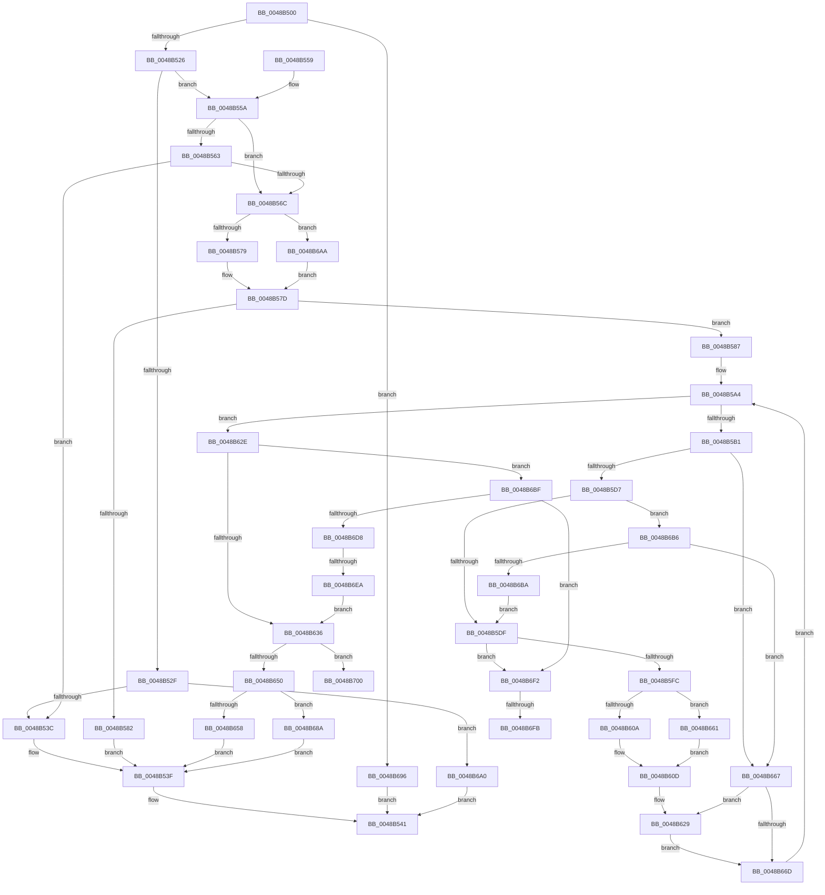

# HalBuildMdlFromScatterGatherListV3

- RVA: `0x0048B500`–`0x0048B70E` (길이 `526` bytes)
- VA: `0x000000014048B500`
- 실행 섹션: `.text`
- PDB 이름 있음: `예`; PDB Function 태그: `예`
- unwind 정보 RVA: `0x000B069C`
- 디코드: `143`개 명령, `526/526` bytes 표시
- 미해석 바이트: `0` (있으면 어셈블리에 `.byte`로 보존)

> 이 문서는 커널 이미지의 기계어와 PDB 기호를 분석해 생성했습니다. 4번과 5번은 함수 원형과 자료형을 바이너리 사용 방식에서 추정한 C 해석이며 원본 소스 복구 결과는 아닙니다.

## 1. Dependencies

- 직접 호출 지점: **2**; 고유 호출 대상: **1**
- 직접 호출자로 확인된 함수: **0**
- RIP 상대 이미지 참조: **0**

### Outgoing calls
- `0x0048B5EE` → [IoAllocateMdl](../29/IoAllocateMdl_function_0029EBF0.md) (function, `0x0029EBF0`)
- `0x0048B6CE` → [IoAllocateMdl](../29/IoAllocateMdl_function_0029EBF0.md) (function, `0x0029EBF0`)

### Direct callers
- 이 함수 시작 RVA로 연결되는 직접 call은 확인되지 않았습니다. 간접 호출은 완전히 역산할 수 없습니다.

### Static image references
- 디코드된 RIP-relative 메모리 참조가 없습니다.

## 2. Other-region calls and transfers

- 다른 실행 섹션으로 향하는 call: **0**
- call이 아닌 외부 분기/꼬리 이동: **4**
  - `0x0048B6E4` → [sub_006F606A + 0x1D](../6F/Unknown_function_006F606A.md) (`tail-transfer`)
  - `0x0048B6F5` → [sub_006F606A](../6F/Unknown_function_006F606A.md) (`tail-transfer`)
  - `0x0048B6FB` → [sub_006F606A + 0x13](../6F/Unknown_function_006F606A.md) (`tail-transfer`)
  - `0x0048B709` → [sub_006F606A + 0x26](../6F/Unknown_function_006F606A.md) (`tail-transfer`)

## 3. Assembly (complete function range)

```asm
0048B500  48 89 5C 24 10                  mov qword ptr [rsp + 0x10], rbx
0048B505  55                              push rbp
0048B506  56                              push rsi
0048B507  57                              push rdi
0048B508  41 54                           push r12
0048B50A  41 55                           push r13
0048B50C  41 56                           push r14
0048B50E  41 57                           push r15
0048B510  48 83 EC 40                     sub rsp, 0x40
0048B514  4D 8B F1                        mov r14, r9
0048B517  4C 8B FA                        mov r15, rdx
0048B51A  48 8B D9                        mov rbx, rcx
0048B51D  4D 85 C0                        test r8, r8
0048B520  0F 84 70 01 00 00               je 0x14048b696
0048B526  83 B9 08 02 00 00 03            cmp dword ptr [rcx + 0x208], 3
0048B52D  75 2B                           jne 0x14048b55a
0048B52F  80 B9 BD 01 00 00 00            cmp byte ptr [rcx + 0x1bd], 0
0048B536  0F 84 64 01 00 00               je 0x14048b6a0
0048B53C  4D 89 01                        mov qword ptr [r9], r8
0048B53F  33 C0                           xor eax, eax
0048B541  48 8B 9C 24 88 00 00 00         mov rbx, qword ptr [rsp + 0x88]
0048B549  48 83 C4 40                     add rsp, 0x40
0048B54D  41 5F                           pop r15
0048B54F  41 5E                           pop r14
0048B551  41 5D                           pop r13
0048B553  41 5C                           pop r12
0048B555  5F                              pop rdi
0048B556  5E                              pop rsi
0048B557  5D                              pop rbp
0048B558  C3                              ret
0048B559  CC                              int3
0048B55A  80 B9 B8 01 00 00 00            cmp byte ptr [rcx + 0x1b8], 0
0048B561  75 09                           jne 0x14048b56c
0048B563  80 B9 BD 01 00 00 00            cmp byte ptr [rcx + 0x1bd], 0
0048B56A  75 D0                           jne 0x14048b53c
0048B56C  48 8B 72 08                     mov rsi, qword ptr [rdx + 8]
0048B570  48 85 F6                        test rsi, rsi
0048B573  0F 84 31 01 00 00               je 0x14048b6aa
0048B579  48 8B 46 10                     mov rax, qword ptr [rsi + 0x10]
0048B57D  48 85 C0                        test rax, rax
0048B580  74 05                           je 0x14048b587
0048B582  49 89 01                        mov qword ptr [r9], rax
0048B585  EB B8                           jmp 0x14048b53f
0048B587  45 8B 17                        mov r10d, dword ptr [r15]
0048B58A  4D 8D 6F 10                     lea r13, [r15 + 0x10]
0048B58E  33 FF                           xor edi, edi
0048B590  44 89 54 24 30                  mov dword ptr [rsp + 0x30], r10d
0048B595  45 33 E4                        xor r12d, r12d
0048B598  33 C0                           xor eax, eax
0048B59A  45 33 C0                        xor r8d, r8d
0048B59D  33 D2                           xor edx, edx
0048B59F  45 33 C9                        xor r9d, r9d
0048B5A2  B1 01                           mov cl, 1
0048B5A4  44 89 8C 24 80 00 00 00         mov dword ptr [rsp + 0x80], r9d
0048B5AC  45 3B CA                        cmp r9d, r10d
0048B5AF  73 7D                           jae 0x14048b62e
0048B5B1  4D 8B 5D 00                     mov r11, qword ptr [r13]
0048B5B5  45 8B 55 08                     mov r10d, dword ptr [r13 + 8]
0048B5B9  41 8B EB                        mov ebp, r11d
0048B5BC  81 E5 FF 0F 00 00               and ebp, 0xfff
0048B5C2  4C 89 5C 24 38                  mov qword ptr [rsp + 0x38], r11
0048B5C7  44 89 94 24 90 00 00 00         mov dword ptr [rsp + 0x90], r10d
0048B5CF  84 C9                           test cl, cl
0048B5D1  0F 85 90 00 00 00               jne 0x14048b667
0048B5D7  85 C0                           test eax, eax
0048B5D9  0F 84 D7 00 00 00               je 0x14048b6b6
0048B5DF  48 83 64 24 20 00               and qword ptr [rsp + 0x20], 0
0048B5E5  45 33 C9                        xor r9d, r9d
0048B5E8  41 8B C8                        mov ecx, r8d
0048B5EB  41 B0 01                        mov r8b, 1
0048B5EE  E8 FD 35 E1 FF                  call 0x14029ebf0
0048B5F3  48 85 C0                        test rax, rax
0048B5F6  0F 84 F6 00 00 00               je 0x14048b6f2
0048B5FC  B9 02 28 00 00                  mov ecx, 0x2802
0048B601  66 09 48 0A                     or word ptr [rax + 0xa], cx
0048B605  48 85 FF                        test rdi, rdi
0048B608  75 57                           jne 0x14048b661
0048B60A  48 8B F8                        mov rdi, rax
0048B60D  44 8B 8C 24 80 00 00 00         mov r9d, dword ptr [rsp + 0x80]
0048B615  33 D2                           xor edx, edx
0048B617  44 8B 94 24 90 00 00 00         mov r10d, dword ptr [rsp + 0x90]
0048B61F  32 C9                           xor cl, cl
0048B621  4C 8B 5C 24 38                  mov r11, qword ptr [rsp + 0x38]
0048B626  4C 8B E0                        mov r12, rax
0048B629  44 8B C5                        mov r8d, ebp
0048B62C  EB 3F                           jmp 0x14048b66d
0048B62E  85 D2                           test edx, edx
0048B630  0F 85 89 00 00 00               jne 0x14048b6bf
0048B636  41 8B 0F                        mov ecx, dword ptr [r15]
0048B639  4C 8D 47 30                     lea r8, [rdi + 0x30]
0048B63D  33 C0                           xor eax, eax
0048B63F  4D 8D 5F 10                     lea r11, [r15 + 0x10]
0048B643  48 8B EF                        mov rbp, rdi
0048B646  B2 01                           mov dl, 1
0048B648  85 C9                           test ecx, ecx
0048B64A  0F 85 B0 00 00 00               jne 0x14048b700
0048B650  49 89 3E                        mov qword ptr [r14], rdi
0048B653  48 85 F6                        test rsi, rsi
0048B656  74 32                           je 0x14048b68a
0048B658  48 89 7E 10                     mov qword ptr [rsi + 0x10], rdi
0048B65C  E9 DE FE FF FF                  jmp 0x14048b53f
0048B661  49 89 04 24                     mov qword ptr [r12], rax
0048B665  EB A6                           jmp 0x14048b60d
0048B667  32 C9                           xor cl, cl
0048B669  85 D2                           test edx, edx
0048B66B  74 BC                           je 0x14048b629
0048B66D  43 8D 04 13                     lea eax, [r11 + r10]
0048B671  41 03 D2                        add edx, r10d
0048B674  44 8B 54 24 30                  mov r10d, dword ptr [rsp + 0x30]
0048B679  25 FF 0F 00 00                  and eax, 0xfff
0048B67E  49 83 C5 18                     add r13, 0x18
0048B682  41 FF C1                        inc r9d
0048B685  E9 1A FF FF FF                  jmp 0x14048b5a4
0048B68A  48 89 BB 28 02 00 00            mov qword ptr [rbx + 0x228], rdi
0048B691  E9 A9 FE FF FF                  jmp 0x14048b53f
0048B696  B8 0D 00 00 C0                  mov eax, 0xc000000d
0048B69B  E9 A1 FE FF FF                  jmp 0x14048b541
0048B6A0  B8 02 00 00 C0                  mov eax, 0xc0000002
0048B6A5  E9 97 FE FF FF                  jmp 0x14048b541
0048B6AA  48 8B 81 28 02 00 00            mov rax, qword ptr [rcx + 0x228]
0048B6B1  E9 C7 FE FF FF                  jmp 0x14048b57d
0048B6B6  85 ED                           test ebp, ebp
0048B6B8  74 AD                           je 0x14048b667
0048B6BA  E9 20 FF FF FF                  jmp 0x14048b5df
0048B6BF  48 83 64 24 20 00               and qword ptr [rsp + 0x20], 0
0048B6C5  45 33 C9                        xor r9d, r9d
0048B6C8  41 8B C8                        mov ecx, r8d
0048B6CB  41 B0 01                        mov r8b, 1
0048B6CE  E8 1D 35 E1 FF                  call 0x14029ebf0
0048B6D3  48 85 C0                        test rax, rax
0048B6D6  74 1A                           je 0x14048b6f2
0048B6D8  B9 02 28 00 00                  mov ecx, 0x2802
0048B6DD  66 09 48 0A                     or word ptr [rax + 0xa], cx
0048B6E1  48 85 FF                        test rdi, rdi
0048B6E4  0F 85 9D A9 26 00               jne 0x1406f6087
0048B6EA  48 8B F8                        mov rdi, rax
0048B6ED  E9 44 FF FF FF                  jmp 0x14048b636
0048B6F2  48 85 FF                        test rdi, rdi
0048B6F5  0F 85 6F A9 26 00               jne 0x1406f606a
0048B6FB  E9 7D A9 26 00                  jmp 0x1406f607d
0048B700  4C 8B E1                        mov r12, rcx
0048B703  41 BD FF 0F 00 00               mov r13d, 0xfff
0048B709  E9 82 A9 26 00                  jmp 0x1406f6090
```

## 4. C-style interpretation (structured pseudocode)

```c
__int64 __fastcall HalBuildMdlFromScatterGatherListV3(__int64 a1, __int64 a2, __int64 a3, __int64 a4)
{
    __int64 result;
    __int64 v_r12;
    __int64 v_r13;
    __int64 v_rbp;
    __int64 v_rdi;
    __int64 v_rsp;
    unsigned __int64 v_stack_p10;
    unsigned __int64 v_stack_p20;
    unsigned int v_stack_p30;
    unsigned __int64 v_stack_p38;
    unsigned int v_stack_p80;
    unsigned int v_stack_p90;

    v_stack_p10 = v_rbx;
    v_rsp = (v_rsp) - (64);
    if (a3 == 0) goto loc_0048B696;
    if ((*(unsigned int *)(a1 + 520)) != 3) goto loc_0048B55A;
    if ((*(unsigned __int8 *)(a1 + 445)) == 0) goto loc_0048B6A0;
loc_0048B53C:
    *(unsigned __int64 *)(a4) = a3;
loc_0048B53F:
    result = 0;
loc_0048B541:
    v_rsp = (v_rsp) + (64);
    return result;
loc_0048B55A:
    if ((*(unsigned __int8 *)(a1 + 440)) != 0) goto loc_0048B56C;
    if ((*(unsigned __int8 *)(a1 + 445)) != 0) goto loc_0048B53C;
loc_0048B56C:
    if (*(unsigned __int64 *)(a2 + 8) == 0) goto loc_0048B6AA;
loc_0048B57D:
    if (*(unsigned __int64 *)(*(unsigned __int64 *)(a2 + 8) + 16) == 0) goto loc_0048B587;
    *(unsigned __int64 *)(a4) = *(unsigned __int64 *)(*(unsigned __int64 *)(a2 + 8) + 16);
    goto loc_0048B53F;
loc_0048B587:
    v_rdi = 0;
    v_stack_p30 = (unsigned int)((unsigned int)(*(unsigned int *)(a2)));
    v_r12 = 0;
    result = 0;
    a3 = 0;
    a2 = 0;
    a4 = 0;
loc_0048B5A4:
    v_stack_p80 = 0;
    if (0 >= ((unsigned int)((unsigned int)(*(unsigned int *)(a2))))) goto loc_0048B62E;
    v_rbp = (unsigned int)(((unsigned int)((unsigned int)(*(unsigned __int64 *)(a2 + 16)))) & (0xFFFULL));
    v_stack_p38 = *(unsigned __int64 *)(a2 + 16);
    v_stack_p90 = (unsigned int)((unsigned int)(*(unsigned int *)(a2 + 16 + 8)));
    if (1 != 0) goto loc_0048B667;
    if (0 == 0) goto loc_0048B6B6;
loc_0048B5DF:
    a4 = 0;
    result = IoAllocateMdl(0, a2, 1, a4);
    if (result == 0) goto loc_0048B6F2;
    if (0 != 0) goto loc_0048B661;
loc_0048B60D:
    a2 = 0;
    a1 = 0;
loc_0048B629:
    goto loc_0048B66D;
loc_0048B62E:
    if (0 != 0) goto loc_0048B6BF;
loc_0048B636:
    result = 0;
    if ((unsigned int)((unsigned int)(*(unsigned int *)(a2))) != 0) goto loc_0048B700;
    *(unsigned __int64 *)(a4) = 0;
    if (*(unsigned __int64 *)(a2 + 8) == 0) goto loc_0048B68A;
    *(unsigned __int64 *)(*(unsigned __int64 *)(a2 + 8) + 16) = 0;
    goto loc_0048B53F;
loc_0048B661:
    *(unsigned __int64 *)(result) = 0;
    goto loc_0048B60D;
loc_0048B667:
    a1 = 0;
    if (1 == 0) goto loc_0048B629;
loc_0048B66D:
    a2 = (unsigned int)((1) + ((unsigned int)((unsigned int)(v_stack_p90))));
    result = (unsigned int)((a2 + 16 + (unsigned int)(v_stack_p90) * 1) & (0xFFFULL));
    v_r13 = (a2 + 16) + (24);
    a4 = (unsigned int)(((unsigned int)(v_stack_p80)) + 1);
    goto loc_0048B5A4;
loc_0048B68A:
    *(unsigned __int64 *)(v_stack_p10 + 552) = result;
    goto loc_0048B53F;
loc_0048B696:
    goto loc_0048B541;
loc_0048B6A0:
    goto loc_0048B541;
loc_0048B6AA:
    goto loc_0048B57D;
loc_0048B6B6:
    if (0 == 0) goto loc_0048B667;
    goto loc_0048B5DF;
loc_0048B6BF:
    a4 = 0;
    result = IoAllocateMdl((unsigned int)((unsigned int)(result + 48)), a2, 1, a4);
    if (result == 0) goto loc_0048B6F2;
    goto loc_0048B636;
loc_0048B6F2:
loc_0048B700:
}
```

## 5. (Beta) C Style

```c
int64_t HalBuildMdlFromScatterGatherListV3(void *Arg1, void *Arg2, int64_t Arg3, void *Arg4)
{
    uint8_t *arg1 = (uint8_t *)Arg1;
    uint8_t *arg2 = (uint8_t *)Arg2;
    uint8_t *arg4 = (uint8_t *)Arg4;

    int64_t result;
    int64_t local_r12;
    int64_t local_r13;
    int64_t local_rbp;
    int64_t local_rdi;
    int64_t local_rsp;
    uint64_t v_stack_p10;
    uint64_t v_stack_p20;
    uint32_t v_stack_p30;
    uint64_t v_stack_p38;
    uint32_t v_stack_p80;
    uint32_t v_stack_p90;

    v_stack_p10 = local_rbx;
    local_rsp = (local_rsp) - (64);
    if (Arg3 == 0) goto loc_0048B696;
    if ((*(uint32_t *)(arg1 + 0x208)) != 3) goto loc_0048B55A;
    if ((*(uint8_t *)(arg1 + 0x1BD)) == 0) goto loc_0048B6A0;
loc_0048B53C:
    *(uint64_t *)(arg4) = Arg3;
loc_0048B53F:
    result = 0;
loc_0048B541:
    local_rsp = (local_rsp) + (64);
    return result;
loc_0048B55A:
    if ((*(uint8_t *)(arg1 + 0x1B8)) != 0) goto loc_0048B56C;
    if ((*(uint8_t *)(arg1 + 0x1BD)) != 0) goto loc_0048B53C;
loc_0048B56C:
    if (*(uint64_t *)(arg2 + 0x8) == 0) goto loc_0048B6AA;
loc_0048B57D:
    if (*(uint64_t *)(*(uint64_t *)(arg2 + 0x8) + 0x10) == 0) goto loc_0048B587;
    *(uint64_t *)(arg4) = *(uint64_t *)(*(uint64_t *)(arg2 + 0x8) + 0x10);
    goto loc_0048B53F;
loc_0048B587:
    local_rdi = 0;
    v_stack_p30 = (uint32_t)((uint32_t)(*(uint32_t *)(arg2)));
    local_r12 = 0;
    result = 0;
    Arg3 = 0;
    Arg2 = 0;
    Arg4 = 0;
loc_0048B5A4:
    v_stack_p80 = 0;
    if (0 >= ((uint32_t)((uint32_t)(*(uint32_t *)(arg2))))) goto loc_0048B62E;
    local_rbp = (uint32_t)(((uint32_t)((uint32_t)(*(uint64_t *)(arg2 + 0x10)))) & (0xFFFULL));
    v_stack_p38 = *(uint64_t *)(arg2 + 0x10);
    v_stack_p90 = (uint32_t)((uint32_t)(*(uint32_t *)(arg2 + 0x10 + 0x8)));
    if (1 != 0) goto loc_0048B667;
    if (0 == 0) goto loc_0048B6B6;
loc_0048B5DF:
    Arg4 = 0;
    result = IoAllocateMdl(0, Arg2, 1, Arg4);
    if (result == 0) goto loc_0048B6F2;
    if (0 != 0) goto loc_0048B661;
loc_0048B60D:
    Arg2 = 0;
    Arg1 = 0;
loc_0048B629:
    goto loc_0048B66D;
loc_0048B62E:
    if (0 != 0) goto loc_0048B6BF;
loc_0048B636:
    result = 0;
    if ((uint32_t)((uint32_t)(*(uint32_t *)(arg2))) != 0) goto loc_0048B700;
    *(uint64_t *)(arg4) = 0;
    if (*(uint64_t *)(arg2 + 0x8) == 0) goto loc_0048B68A;
    *(uint64_t *)(*(uint64_t *)(arg2 + 0x8) + 0x10) = 0;
    goto loc_0048B53F;
loc_0048B661:
    *(uint64_t *)(result) = 0;
    goto loc_0048B60D;
loc_0048B667:
    Arg1 = 0;
    if (1 == 0) goto loc_0048B629;
loc_0048B66D:
    Arg2 = (uint32_t)((1) + ((uint32_t)((uint32_t)(v_stack_p90))));
    result = (uint32_t)((Arg2 + 16 + (uint32_t)(v_stack_p90) * 1) & (0xFFFULL));
    local_r13 = (Arg2 + 16) + (24);
    Arg4 = (uint32_t)(((uint32_t)(v_stack_p80)) + 1);
    goto loc_0048B5A4;
loc_0048B68A:
    *(uint64_t *)(v_stack_p10 + 0x228) = result;
    goto loc_0048B53F;
loc_0048B696:
    goto loc_0048B541;
loc_0048B6A0:
    goto loc_0048B541;
loc_0048B6AA:
    goto loc_0048B57D;
loc_0048B6B6:
    if (0 == 0) goto loc_0048B667;
    goto loc_0048B5DF;
loc_0048B6BF:
    Arg4 = 0;
    result = IoAllocateMdl((uint32_t)((uint32_t)(result + 48)), Arg2, 1, Arg4);
    if (result == 0) goto loc_0048B6F2;
    goto loc_0048B636;
loc_0048B6F2:
loc_0048B700:
}
```

### 관측된 메모리 오프셋

구조체 형식이 확인되지 않은 접근은 인자 기준의 오프셋으로만 기록했습니다.

| 기준 인자 | 오프셋 표현 | 폭 (bit) | 접근 |
|---|---:|---:|---|
| `Arg1` | `+ 0x1B8` | `8` | `R` |
| `Arg1` | `+ 0x1BD` | `8` | `R` |
| `Arg1` | `+ 0x208` | `32` | `R` |
| `Arg1` | `+ 0x228` | `64` | `R` |
| `Arg1` | `+ 0x228` | `64` | `W` |
| `Arg2` | `+ 0x0` | `32` | `R` |
| `Arg2` | `+ 0x0` | `64` | `R` |
| `Arg2` | `+ 0x8` | `32` | `R` |
| `Arg2` | `+ 0x8` | `64` | `R` |
| `Arg2` | `+ 0x10` | `64` | `R` |
| `Arg4` | `+ 0x0` | `64` | `W` |

## 6. Execution-region graph

[열기: 2D/3D 그래프와 함수 탐색 컨트롤 패널](../../../control-panel.html?section=text&rva=0x0048B500&view=graph)

- 2D 그래프는 위에서 아래로 흐르고, 3D 그래프는 빈 공간을 드래그해 회전합니다. Shift+드래그는 이동, 휠은 확대·축소, 함수 노드 선택은 대상 보고서 이동입니다.

### Static fallback


