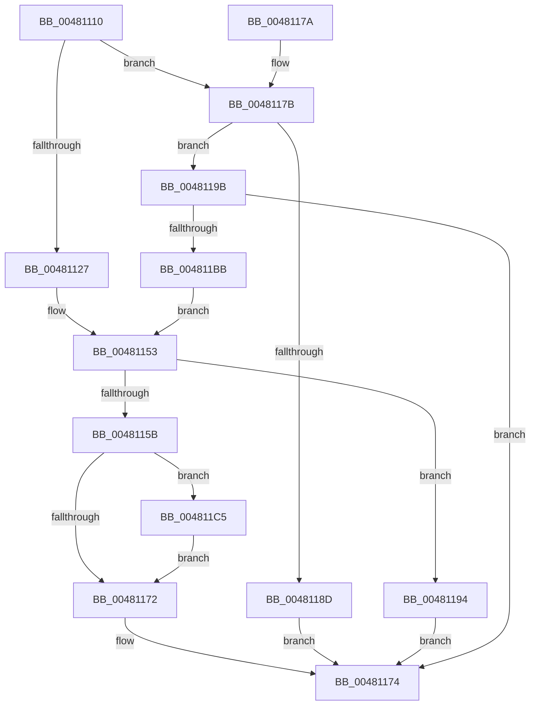

# HalCalculateScatterGatherListSizeV3

- RVA: `0x00481110`–`0x004811C9` (길이 `185` bytes)
- VA: `0x0000000140481110`
- 실행 섹션: `.text`
- PDB 이름 있음: `예`; PDB Function 태그: `아니요`
- unwind 정보 RVA: `0x000AEC48`
- 디코드: `51`개 명령, `185/185` bytes 표시
- 미해석 바이트: `0` (있으면 어셈블리에 `.byte`로 보존)

> 이 문서는 커널 이미지의 기계어와 PDB 기호를 분석해 생성했습니다. 4번과 5번은 함수 원형과 자료형을 바이너리 사용 방식에서 추정한 C 해석이며 원본 소스 복구 결과는 아닙니다.

## 1. Dependencies

- 직접 호출 지점: **1**; 고유 호출 대상: **1**
- 직접 호출자로 확인된 함수: **0**
- RIP 상대 이미지 참조: **0**

### Outgoing calls
- `0x004811B2` → [HalGetDmaTransferInfo](../3D/HalGetDmaTransferInfo_function_003DBE20.md) (function, `0x003DBE20`)

### Direct callers
- 이 함수 시작 RVA로 연결되는 직접 call은 확인되지 않았습니다. 간접 호출은 완전히 역산할 수 없습니다.

### Static image references
- 디코드된 RIP-relative 메모리 참조가 없습니다.

## 2. Other-region calls and transfers

- 다른 실행 섹션으로 향하는 call: **0**
- 별도 외부 분기/꼬리 이동을 확인하지 못했습니다.

## 3. Assembly (complete function range)

```asm
00481110  40 53                           push rbx
00481112  48 83 EC 50                     sub rsp, 0x50
00481116  0F 57 C0                        xorps xmm0, xmm0
00481119  48 8B D9                        mov rbx, rcx
0048111C  F3 0F 7F 44 24 34               movdqu xmmword ptr [rsp + 0x34], xmm0
00481122  48 85 D2                        test rdx, rdx
00481125  75 54                           jne 0x14048117b
00481127  41 81 E0 FF 0F 00 00            and r8d, 0xfff
0048112E  41 8B C9                        mov ecx, r9d
00481131  48 81 C1 FF 0F 00 00            add rcx, 0xfff
00481138  49 03 C8                        add rcx, r8
0048113B  48 C1 E9 0C                     shr rcx, 0xc
0048113F  8D 04 49                        lea eax, [rcx + rcx*2]
00481142  8D 14 C5 D0 00 00 00            lea edx, [rax*8 + 0xd0]
00481149  B8 A8 00 00 00                  mov eax, 0xa8
0048114E  3B D0                           cmp edx, eax
00481150  0F 42 D0                        cmovb edx, eax
00481153  3B 8B E8 00 00 00               cmp ecx, dword ptr [rbx + 0xe8]
00481159  77 39                           ja 0x140481194
0048115B  48 8B 84 24 80 00 00 00         mov rax, qword ptr [rsp + 0x80]
00481163  89 10                           mov dword ptr [rax], edx
00481165  48 8B 84 24 88 00 00 00         mov rax, qword ptr [rsp + 0x88]
0048116D  48 85 C0                        test rax, rax
00481170  75 53                           jne 0x1404811c5
00481172  33 C0                           xor eax, eax
00481174  48 83 C4 50                     add rsp, 0x50
00481178  5B                              pop rbx
00481179  C3                              ret
0048117A  CC                              int3
0048117B  8B 42 2C                        mov eax, dword ptr [rdx + 0x2c]
0048117E  4C 2B C0                        sub r8, rax
00481181  8B 42 28                        mov eax, dword ptr [rdx + 0x28]
00481184  4C 2B 42 20                     sub r8, qword ptr [rdx + 0x20]
00481188  4C 3B C0                        cmp r8, rax
0048118B  72 0E                           jb 0x14048119b
0048118D  B8 0D 00 00 C0                  mov eax, 0xc000000d
00481192  EB E0                           jmp 0x140481174
00481194  B8 9A 00 00 C0                  mov eax, 0xc000009a
00481199  EB D9                           jmp 0x140481174
0048119B  48 8D 44 24 30                  lea rax, [rsp + 0x30]
004811A0  C7 44 24 30 01 00 00 00         mov dword ptr [rsp + 0x30], 1
004811A8  48 89 44 24 28                  mov qword ptr [rsp + 0x28], rax
004811AD  C6 44 24 20 00                  mov byte ptr [rsp + 0x20], 0
004811B2  E8 69 AC F5 FF                  call 0x1403dbe20
004811B7  85 C0                           test eax, eax
004811B9  78 B9                           js 0x140481174
004811BB  8B 54 24 3C                     mov edx, dword ptr [rsp + 0x3c]
004811BF  8B 4C 24 34                     mov ecx, dword ptr [rsp + 0x34]
004811C3  EB 8E                           jmp 0x140481153
004811C5  89 08                           mov dword ptr [rax], ecx
004811C7  EB A9                           jmp 0x140481172
```

## 4. C-style interpretation (structured pseudocode)

```c
__int64 __fastcall HalCalculateScatterGatherListSizeV3(__int64 a1, __int64 a2, int a3, int a4, __int64 a5, __int64 a6)
{
    __int64 result;
    __int64 v_rsp;
    unsigned __int64 v_stack_m24;
    unsigned __int8 v_stack_p20;
    unsigned __int64 v_stack_p28;
    unsigned __int64 v_stack_p30;
    unsigned int v_stack_p34;
    unsigned int v_stack_p3C;

    v_rsp = (v_rsp) - (80);
    v_stack_m24 = v_xmm0;
    if (a2 != 0) goto loc_0048117B;
    a3 = (unsigned int)((a3) & (0xFFFULL));
    a1 = ((unsigned int)(a4)) + (0xFFFULL);
    a1 = (a1) + (a3);
    a1 = (a1) >> (12);
    a2 = a1 + a1 * 2 * 8 + 208;
    if (((unsigned int)(a1 + a1 * 2 * 8 + 208)) < 168) { a2 = 168; }
loc_00481153:
    if (((unsigned int)(a1)) > (*(unsigned int *)(a1 + 232))) goto loc_00481194;
    *(unsigned int *)(a5) = (unsigned int)(a2);
    if (a6 != 0) goto loc_004811C5;
loc_00481172:
    result = 0;
loc_00481174:
    v_rsp = (v_rsp) + (80);
    return result;
loc_0048117B:
    a3 = (a3) - ((unsigned int)(*(unsigned int *)(a2 + 44)));
    a3 = (a3) - (*(unsigned __int64 *)(a2 + 32));
    if (a3 < ((unsigned int)(*(unsigned int *)(a2 + 40)))) goto loc_0048119B;
    goto loc_00481174;
loc_00481194:
    goto loc_00481174;
loc_0048119B:
    v_stack_p30 = 1;
    v_stack_p28 = v_stack_p30;
    v_stack_p20 = 0;
    result = HalGetDmaTransferInfo(a1, a2, a3, a4);
    if (sign_flag) goto loc_00481174;
    goto loc_00481153;
loc_004811C5:
    *(unsigned int *)(result) = (unsigned int)((unsigned int)(v_stack_p34));
    goto loc_00481172;
}
```

## 5. (Beta) C Style

```c
int64_t HalCalculateScatterGatherListSizeV3(void *Arg1, int64_t Arg2, int32_t Arg3, int32_t Arg4, void *Arg5, int64_t Arg6)
{
    uint8_t *arg1 = (uint8_t *)Arg1;
    uint8_t *arg5 = (uint8_t *)Arg5;

    int64_t result;
    int64_t local_rsp;
    uint64_t v_stack_m24;
    uint8_t v_stack_p20;
    uint64_t v_stack_p28;
    uint64_t v_stack_p30;
    uint32_t v_stack_p34;
    uint32_t v_stack_p3C;

    local_rsp = (local_rsp) - (80);
    v_stack_m24 = v_xmm0;
    if (Arg2 != 0) goto loc_0048117B;
    Arg3 = (uint32_t)((Arg3) & (0xFFFULL));
    Arg1 = ((uint32_t)(Arg4)) + (0xFFFULL);
    Arg1 = (Arg1) + (Arg3);
    Arg1 = (Arg1) >> (12);
    Arg2 = Arg1 + Arg1 * 2 * 8 + 208;
    if (((uint32_t)(Arg1 + Arg1 * 2 * 8 + 208)) < 168) { Arg2 = 168; }
loc_00481153:
    if (((uint32_t)(Arg1)) > (*(uint32_t *)(arg1 + 0xE8))) goto loc_00481194;
    *(uint32_t *)(arg5) = (uint32_t)(Arg2);
    if (Arg6 != 0) goto loc_004811C5;
loc_00481172:
    result = 0;
loc_00481174:
    local_rsp = (local_rsp) + (80);
    return result;
loc_0048117B:
    Arg3 = (Arg3) - ((uint32_t)(*(uint32_t *)(Arg2 + 0x2C)));
    Arg3 = (Arg3) - (*(uint64_t *)(Arg2 + 0x20));
    if (Arg3 < ((uint32_t)(*(uint32_t *)(Arg2 + 0x28)))) goto loc_0048119B;
    goto loc_00481174;
loc_00481194:
    goto loc_00481174;
loc_0048119B:
    v_stack_p30 = 1;
    v_stack_p28 = v_stack_p30;
    v_stack_p20 = 0;
    result = HalGetDmaTransferInfo(Arg1, Arg2, Arg3, Arg4);
    if (sign_flag) goto loc_00481174;
    goto loc_00481153;
loc_004811C5:
    *(uint32_t *)(result) = (uint32_t)((uint32_t)(v_stack_p34));
    goto loc_00481172;
}
```

### 관측된 메모리 오프셋

구조체 형식이 확인되지 않은 접근은 인자 기준의 오프셋으로만 기록했습니다.

| 기준 인자 | 오프셋 표현 | 폭 (bit) | 접근 |
|---|---:|---:|---|
| `Arg1` | `+ 0xE8` | `32` | `R` |
| `Arg5` | `+ 0x0` | `32` | `W` |

## 6. Execution-region graph

[열기: 2D/3D 그래프와 함수 탐색 컨트롤 패널](../../../control-panel.html?section=text&rva=0x00481110&view=graph)

- 2D 그래프는 위에서 아래로 흐르고, 3D 그래프는 빈 공간을 드래그해 회전합니다. Shift+드래그는 이동, 휠은 확대·축소, 함수 노드 선택은 대상 보고서 이동입니다.

### Static fallback


