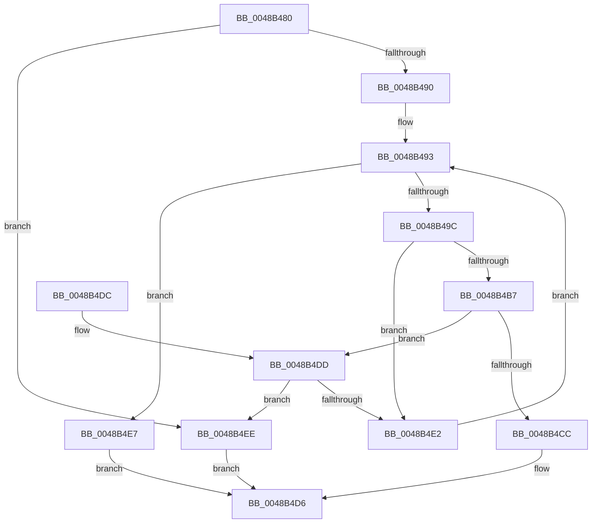

# HalGetMemoryCachingRequirements

- RVA: `0x0048B480`–`0x0048B4F5` (길이 `117` bytes)
- VA: `0x000000014048B480`
- 실행 섹션: `.text`
- PDB 이름 있음: `예`; PDB Function 태그: `아니요`
- unwind 정보 RVA: `0x000A744C`
- 디코드: `35`개 명령, `117/117` bytes 표시
- 미해석 바이트: `0` (있으면 어셈블리에 `.byte`로 보존)

> 이 문서는 커널 이미지의 기계어와 PDB 기호를 분석해 생성했습니다. 4번과 5번은 함수 원형과 자료형을 바이너리 사용 방식에서 추정한 C 해석이며 원본 소스 복구 결과는 아닙니다.

## 1. Dependencies

- 직접 호출 지점: **0**; 고유 호출 대상: **0**
- 직접 호출자로 확인된 함수: **2**
- RIP 상대 이미지 참조: **2**

### Outgoing calls
- 직접 디코드된 call 명령이 없습니다.

### Direct callers
- [PopGetHwConfigurationSignature](../../pagelk/B6/PopGetHwConfigurationSignature_function_00B6D5A4.md) at `0x00B6D687`
- [HalpPowerInitFwPerformanceTableMappings](../../init/C1/HalpPowerInitFwPerformanceTableMappings_function_00C1EC34.md) at `0x00C1ECB5`
- [HalpPowerInitFwPerformanceTableMappings](../../init/C1/HalpPowerInitFwPerformanceTableMappings_function_00C1EC34.md) at `0x00C1ED32`

### Static image references
- `0x0048B493` → RVA `0x00FC2CC8` (`.data`; read)
- `0x0048B49C` → RVA `0x00FC2CC0` (`.data`; read)

## 2. Other-region calls and transfers

- 다른 실행 섹션으로 향하는 call: **0**
- 별도 외부 분기/꼬리 이동을 확인하지 못했습니다.

## 3. Assembly (complete function range)

```asm
0048B480  48 89 5C 24 08                  mov qword ptr [rsp + 8], rbx
0048B485  45 33 C9                        xor r9d, r9d
0048B488  48 8B DA                        mov rbx, rdx
0048B48B  4D 85 C0                        test r8, r8
0048B48E  74 5E                           je 0x14048b4ee
0048B490  45 89 08                        mov dword ptr [r8], r9d
0048B493  44 3B 0D 2E 78 B3 00            cmp r9d, dword ptr [rip + 0xb3782e]
0048B49A  73 4B                           jae 0x14048b4e7
0048B49C  4C 8B 1D 1D 78 B3 00            mov r11, qword ptr [rip + 0xb3781d]
0048B4A3  41 8B C1                        mov eax, r9d
0048B4A6  4C 8D 14 40                     lea r10, [rax + rax*2]
0048B4AA  4B 8B 04 D3                     mov rax, qword ptr [r11 + r10*8]
0048B4AE  48 C1 E0 0C                     shl rax, 0xc
0048B4B2  48 3B C8                        cmp rcx, rax
0048B4B5  72 2B                           jb 0x14048b4e2
0048B4B7  4B 8B 54 D3 08                  mov rdx, qword ptr [r11 + r10*8 + 8]
0048B4BC  48 C1 E2 0C                     shl rdx, 0xc
0048B4C0  48 03 D0                        add rdx, rax
0048B4C3  48 8D 04 19                     lea rax, [rcx + rbx]
0048B4C7  48 3B C2                        cmp rax, rdx
0048B4CA  77 11                           ja 0x14048b4dd
0048B4CC  43 8B 44 D3 10                  mov eax, dword ptr [r11 + r10*8 + 0x10]
0048B4D1  41 89 00                        mov dword ptr [r8], eax
0048B4D4  33 C0                           xor eax, eax
0048B4D6  48 8B 5C 24 08                  mov rbx, qword ptr [rsp + 8]
0048B4DB  C3                              ret
0048B4DC  CC                              int3
0048B4DD  48 3B CA                        cmp rcx, rdx
0048B4E0  72 0C                           jb 0x14048b4ee
0048B4E2  41 FF C1                        inc r9d
0048B4E5  EB AC                           jmp 0x14048b493
0048B4E7  B8 01 00 00 C0                  mov eax, 0xc0000001
0048B4EC  EB E8                           jmp 0x14048b4d6
0048B4EE  B8 0D 00 00 C0                  mov eax, 0xc000000d
0048B4F3  EB E1                           jmp 0x14048b4d6
```

## 4. C-style interpretation (structured pseudocode)

```c
__int64 __fastcall HalGetMemoryCachingRequirements(__int64 a1, __int64 a2, __int64 a3, int a4)
{
    __int64 result;
    unsigned __int64 v_stack_p8;

    v_stack_p8 = v_rbx;
    a4 = 0;
    if (a3 == 0) goto loc_0048B4EE;
    *(unsigned int *)(a3) = 0;
loc_0048B493:
    if (0 >= (*(unsigned int *)(v_rip + 11761710))) goto loc_0048B4E7;
    result = (*(unsigned __int64 *)(*(unsigned __int64 *)(v_rip + 11761693) + 0 + 0 * 2 * 8)) << (12);
    if (a1 < result) goto loc_0048B4E2;
    a2 = (*(unsigned __int64 *)(*(unsigned __int64 *)(v_rip + 11761693) + 0 + 0 * 2 * 8 + 8)) << (12);
    a2 = (a2) + (result);
    if ((a1 + a2 * 1) > a2) goto loc_0048B4DD;
    *(unsigned int *)(a3) = (unsigned int)((unsigned int)(*(unsigned int *)(*(unsigned __int64 *)(v_rip + 11761693) + 0 + 0 * 2 * 8 + 16)));
    result = 0;
loc_0048B4D6:
    return result;
loc_0048B4DD:
    if (a1 < a2) goto loc_0048B4EE;
loc_0048B4E2:
    a4 = (unsigned int)((a4) + 1);
    goto loc_0048B493;
loc_0048B4E7:
    goto loc_0048B4D6;
loc_0048B4EE:
    goto loc_0048B4D6;
}
```

## 5. (Beta) C Style

```c
int64_t HalGetMemoryCachingRequirements(int64_t Arg1, int64_t Arg2, int64_t Arg3, int32_t Arg4)
{
    int64_t result;
    uint64_t v_stack_p8;

    v_stack_p8 = local_rbx;
    Arg4 = 0;
    if (Arg3 == 0) goto loc_0048B4EE;
    *(uint32_t *)(Arg3) = 0;
loc_0048B493:
    if (0 >= (*(uint32_t *)(v_rip + 0xB3782E))) goto loc_0048B4E7;
    result = (*(uint64_t *)(*(uint64_t *)(v_rip + 0xB3781D) + 0x0 + 0x0 * 2 * 8)) << (12);
    if (Arg1 < result) goto loc_0048B4E2;
    Arg2 = (*(uint64_t *)(*(uint64_t *)(v_rip + 0xB3781D) + 0x0 + 0x0 * 2 * 8 + 0x8)) << (12);
    Arg2 = (Arg2) + (result);
    if ((Arg1 + Arg2 * 1) > Arg2) goto loc_0048B4DD;
    *(uint32_t *)(Arg3) = (uint32_t)((uint32_t)(*(uint32_t *)(*(uint64_t *)(v_rip + 0xB3781D) + 0x0 + 0x0 * 2 * 8 + 0x10)));
    result = 0;
loc_0048B4D6:
    return result;
loc_0048B4DD:
    if (Arg1 < Arg2) goto loc_0048B4EE;
loc_0048B4E2:
    Arg4 = (uint32_t)((Arg4) + 1);
    goto loc_0048B493;
loc_0048B4E7:
    goto loc_0048B4D6;
loc_0048B4EE:
    goto loc_0048B4D6;
}
```

## 6. Execution-region graph

[열기: 2D/3D 그래프와 함수 탐색 컨트롤 패널](../../../control-panel.html?section=text&rva=0x0048B480&view=graph)

- 2D 그래프는 위에서 아래로 흐르고, 3D 그래프는 빈 공간을 드래그해 회전합니다. Shift+드래그는 이동, 휠은 확대·축소, 함수 노드 선택은 대상 보고서 이동입니다.

### Static fallback


