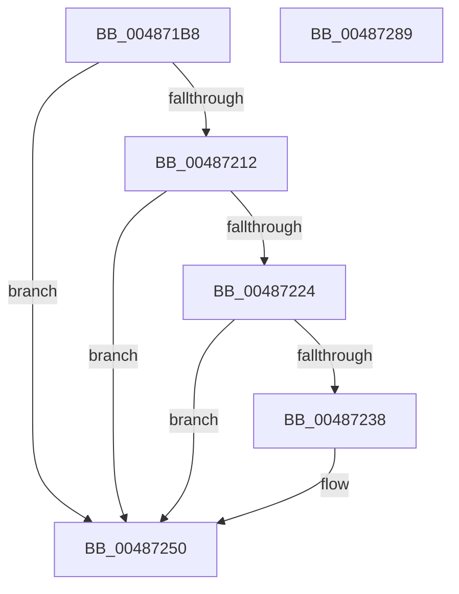

# HaliWheaInitProcessorGenericSection

- RVA: `0x004871B8`–`0x0048728A` (길이 `210` bytes)
- VA: `0x00000001404871B8`
- 실행 섹션: `.text`
- PDB 이름 있음: `예`; PDB Function 태그: `아니요`
- unwind 정보 RVA: `0x000AFB08`
- 디코드: `59`개 명령, `210/210` bytes 표시
- 미해석 바이트: `0` (있으면 어셈블리에 `.byte`로 보존)

> 이 문서는 커널 이미지의 기계어와 PDB 기호를 분석해 생성했습니다. 4번과 5번은 함수 원형과 자료형을 바이너리 사용 방식에서 추정한 C 해석이며 원본 소스 복구 결과는 아닙니다.

## 1. Dependencies

- 직접 호출 지점: **3**; 고유 호출 대상: **3**
- 직접 호출자로 확인된 함수: **1**
- RIP 상대 이미지 참조: **1**

### Outgoing calls
- `0x004871E3` → [memset](../6C/memset_function_006C6C40.md) (function, `0x006C6C40`)
- `0x00487209` → [HalpGetCpuVendor](HalpGetCpuVendor_function_004879E4.md) (function, `0x004879E4`)
- `0x00487274` → [_security_check_cookie](../6A/_security_check_cookie_function_006AC640.md) (function, `0x006AC640`)

### Direct callers
- [HalpWheaInitProcessorGenericSection](HalpWheaInitProcessorGenericSection_function_00487160.md) at `0x0048719E`

### Static image references
- `0x004871CA` → RVA `0x00E0A740` (`.data`; read)

## 2. Other-region calls and transfers

- 다른 실행 섹션으로 향하는 call: **0**
- 별도 외부 분기/꼬리 이동을 확인하지 못했습니다.

## 3. Assembly (complete function range)

```asm
004871B8  48 89 5C 24 10                  mov qword ptr [rsp + 0x10], rbx
004871BD  48 89 7C 24 18                  mov qword ptr [rsp + 0x18], rdi
004871C2  55                              push rbp
004871C3  48 8B EC                        mov rbp, rsp
004871C6  48 83 EC 40                     sub rsp, 0x40
004871CA  48 8B 05 6F 35 98 00            mov rax, qword ptr [rip + 0x98356f]
004871D1  48 33 C4                        xor rax, rsp
004871D4  48 89 45 F0                     mov qword ptr [rbp - 0x10], rax
004871D8  33 D2                           xor edx, edx
004871DA  41 B8 C0 00 00 00               mov r8d, 0xc0
004871E0  48 8B F9                        mov rdi, rcx
004871E3  E8 58 FA 23 00                  call 0x1406c6c40
004871E8  48 83 0F 43                     or qword ptr [rdi], 0x43
004871EC  B8 01 00 00 00                  mov eax, 1
004871F1  33 C9                           xor ecx, ecx
004871F3  C6 47 09 02                     mov byte ptr [rdi + 9], 2
004871F7  0F A2                           cpuid
004871F9  8B C0                           mov eax, eax
004871FB  0F 57 C0                        xorps xmm0, xmm0
004871FE  0F 11 45 E0                     movups xmmword ptr [rbp - 0x20], xmm0
00487202  48 89 47 10                     mov qword ptr [rdi + 0x10], rax
00487206  89 5D E4                        mov dword ptr [rbp - 0x1c], ebx
00487209  E8 D6 07 00 00                  call 0x1404879e4
0048720E  3C 02                           cmp al, 2
00487210  75 3E                           jne 0x140487250
00487212  33 C0                           xor eax, eax
00487214  33 C9                           xor ecx, ecx
00487216  0F A2                           cpuid
00487218  0F 11 45 E0                     movups xmmword ptr [rbp - 0x20], xmm0
0048721C  89 5D E4                        mov dword ptr [rbp - 0x1c], ebx
0048721F  83 F8 1A                        cmp eax, 0x1a
00487222  72 2C                           jb 0x140487250
00487224  33 C9                           xor ecx, ecx
00487226  B8 1A 00 00 00                  mov eax, 0x1a
0048722B  0F A2                           cpuid
0048722D  0F 11 45 E0                     movups xmmword ptr [rbp - 0x20], xmm0
00487231  89 5D E4                        mov dword ptr [rbp - 0x1c], ebx
00487234  85 C0                           test eax, eax
00487236  74 18                           je 0x140487250
00487238  48 8B 4F 10                     mov rcx, qword ptr [rdi + 0x10]
0048723C  48 0F BA 2F 0D                  bts qword ptr [rdi], 0xd
00487241  48 89 4D E0                     mov qword ptr [rbp - 0x20], rcx
00487245  89 45 E4                        mov dword ptr [rbp - 0x1c], eax
00487248  48 8B 45 E0                     mov rax, qword ptr [rbp - 0x20]
0048724C  48 89 47 10                     mov qword ptr [rdi + 0x10], rax
00487250  65 48 8B 04 25 20 00 00 00      mov rax, qword ptr gs:[0x20]
00487259  8B 88 D4 00 00 00               mov ecx, dword ptr [rax + 0xd4]
0048725F  48 0F BA 2F 08                  bts qword ptr [rdi], 8
00487264  33 C0                           xor eax, eax
00487266  48 89 8F 98 00 00 00            mov qword ptr [rdi + 0x98], rcx
0048726D  48 8B 4D F0                     mov rcx, qword ptr [rbp - 0x10]
00487271  48 33 CC                        xor rcx, rsp
00487274  E8 C7 53 22 00                  call 0x1406ac640
00487279  48 8B 5C 24 58                  mov rbx, qword ptr [rsp + 0x58]
0048727E  48 8B 7C 24 60                  mov rdi, qword ptr [rsp + 0x60]
00487283  48 83 C4 40                     add rsp, 0x40
00487287  5D                              pop rbp
00487288  C3                              ret
00487289  CC                              int3
```

## 4. C-style interpretation (structured pseudocode)

```c
__int64 __fastcall HaliWheaInitProcessorGenericSection(__int64 a1, int a2)
{
    __int64 result;
    __int64 v_rsp;
    unsigned __int64 v_stack_m18;
    unsigned int v_stack_m24;
    unsigned __int64 v_stack_m28;
    unsigned __int64 v_stack_p10;
    unsigned __int64 v_stack_p18;

    v_stack_p10 = v_rbx;
    v_stack_p18 = v_rdi;
    v_rsp = (v_rsp) - (64);
    result = (*(unsigned __int64 *)(v_rip + 9975151)) ^ (v_rsp);
    v_stack_m18 = result;
    a2 = 0;
    result = memset(a1, a2, 192, a4);
    a1 = 0;
    *(unsigned __int8 *)(a1 + 9) = 2;
    v_stack_m28 = v_xmm0;
    *(unsigned __int64 *)(a1 + 16) = 1;
    v_stack_m24 = (unsigned int)(v_rbx);
    result = HalpGetCpuVendor(a1, a2, 192, a4);
    if (((unsigned __int8)(result)) != 2) goto loc_00487250;
    result = 0;
    a1 = 0;
    v_stack_m28 = v_xmm0;
    v_stack_m24 = (unsigned int)(v_rbx);
    if (0 < 26) goto loc_00487250;
    a1 = 0;
    v_stack_m28 = v_xmm0;
    v_stack_m24 = (unsigned int)(v_rbx);
    result = 26;
    if (26 != 0) {
        a1 = *(unsigned __int64 *)(a1 + 16);
        v_stack_m28 = a1;
        v_stack_m24 = 26;
        result = v_stack_m28;
        *(unsigned __int64 *)(a1 + 16) = result;
    }
    result = 0;
    *(unsigned __int64 *)(a1 + 152) = (unsigned int)(*(unsigned int *)(*(unsigned __int64 *)(gs_base + (0 + 32)) + 212));
    a1 = (v_stack_m18) ^ (v_rsp);
    result = _security_check_cookie(a1, a2, 192, a4);
    v_rsp = (v_rsp) + (64);
    return result;
}
```

## 5. (Beta) C Style

```c
int64_t HaliWheaInitProcessorGenericSection(void *Arg1, int32_t Arg2)
{
    uint8_t *arg1 = (uint8_t *)Arg1;

    int64_t result;
    int64_t local_rsp;
    uint64_t v_stack_m18;
    uint32_t v_stack_m24;
    uint64_t v_stack_m28;
    uint64_t v_stack_p10;
    uint64_t v_stack_p18;

    v_stack_p10 = local_rbx;
    v_stack_p18 = local_rdi;
    local_rsp = (local_rsp) - (64);
    result = (*(uint64_t *)(v_rip + 0x98356F)) ^ (local_rsp);
    v_stack_m18 = result;
    Arg2 = 0;
    result = memset(Arg1, Arg2, 192, a4);
    Arg1 = 0;
    *(uint8_t *)(arg1 + 0x9) = 2;
    v_stack_m28 = v_xmm0;
    *(uint64_t *)(arg1 + 0x10) = 1;
    v_stack_m24 = (uint32_t)(local_rbx);
    result = HalpGetCpuVendor(Arg1, Arg2, 192, a4);
    if (((uint8_t)(result)) != 2) goto loc_00487250;
    result = 0;
    Arg1 = 0;
    v_stack_m28 = v_xmm0;
    v_stack_m24 = (uint32_t)(local_rbx);
    if (0 < 26) goto loc_00487250;
    Arg1 = 0;
    v_stack_m28 = v_xmm0;
    v_stack_m24 = (uint32_t)(local_rbx);
    result = 26;
    if (26 != 0) {
        Arg1 = *(uint64_t *)(arg1 + 0x10);
        v_stack_m28 = Arg1;
        v_stack_m24 = 26;
        result = v_stack_m28;
        *(uint64_t *)(arg1 + 0x10) = result;
    }
    result = 0;
    *(uint64_t *)(arg1 + 0x98) = (uint32_t)(*(uint32_t *)(*(uint64_t *)(gs_base + (0 + 0x20)) + 0xD4));
    Arg1 = (v_stack_m18) ^ (local_rsp);
    result = _security_check_cookie(Arg1, Arg2, 192, a4);
    local_rsp = (local_rsp) + (64);
    return result;
}
```

### 관측된 메모리 오프셋

구조체 형식이 확인되지 않은 접근은 인자 기준의 오프셋으로만 기록했습니다.

| 기준 인자 | 오프셋 표현 | 폭 (bit) | 접근 |
|---|---:|---:|---|
| `Arg1` | `+ 0x0` | `64` | `R/W` |
| `Arg1` | `+ 0x9` | `8` | `W` |
| `Arg1` | `+ 0x10` | `64` | `R` |
| `Arg1` | `+ 0x10` | `64` | `W` |
| `Arg1` | `+ 0x98` | `64` | `W` |

## 6. Execution-region graph

[열기: 2D/3D 그래프와 함수 탐색 컨트롤 패널](../../../control-panel.html?section=text&rva=0x004871B8&view=graph)

- 2D 그래프는 위에서 아래로 흐르고, 3D 그래프는 빈 공간을 드래그해 회전합니다. Shift+드래그는 이동, 휠은 확대·축소, 함수 노드 선택은 대상 보고서 이동입니다.

### Static fallback


