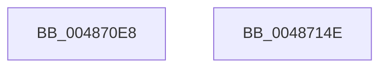

# HalpCmcInitializeErrorPacketContents

- RVA: `0x004870E8`–`0x0048714F` (길이 `103` bytes)
- VA: `0x00000001404870E8`
- 실행 섹션: `.text`
- PDB 이름 있음: `예`; PDB Function 태그: `아니요`
- unwind 정보 RVA: `0x0005CF00`
- 디코드: `24`개 명령, `103/103` bytes 표시
- 미해석 바이트: `0` (있으면 어셈블리에 `.byte`로 보존)

> 이 문서는 커널 이미지의 기계어와 PDB 기호를 분석해 생성했습니다. 4번과 5번은 함수 원형과 자료형을 바이너리 사용 방식에서 추정한 C 해석이며 원본 소스 복구 결과는 아닙니다.

## 1. Dependencies

- 직접 호출 지점: **1**; 고유 호출 대상: **1**
- 직접 호출자로 확인된 함수: **2**
- RIP 상대 이미지 참조: **2**

### Outgoing calls
- `0x004870F9` → [memset](../6C/memset_function_006C6C40.md) (function, `0x006C6C40`)

### Direct callers
- [HalpCmciInitializeErrorPacket](HalpCmciInitializeErrorPacket_function_00487010.md) at `0x00487094`
- [HalpCmcInitializePolling](../54/HalpCmcInitializePolling_function_005408E4.md) at `0x00540921`

### Static image references
- `0x004870FE` → RVA `0x00E0FC04` (`.data`; read)
- `0x00487104` → RVA `0x0001A5A0` (`.rdata`; read)

## 2. Other-region calls and transfers

- 다른 실행 섹션으로 향하는 call: **0**
- 별도 외부 분기/꼬리 이동을 확인하지 못했습니다.

## 3. Assembly (complete function range)

```asm
004870E8  40 53                           push rbx
004870EA  48 83 EC 20                     sub rsp, 0x20
004870EE  33 D2                           xor edx, edx
004870F0  41 B8 F8 04 00 00               mov r8d, 0x4f8
004870F6  48 8B D9                        mov rbx, rcx
004870F9  E8 42 FB 23 00                  call 0x1406c6c40
004870FE  8B 05 00 8B 98 00               mov eax, dword ptr [rip + 0x988b00]
00487104  0F 10 05 95 34 B9 FF            movups xmm0, xmmword ptr [rip - 0x46cb6b]
0048710B  89 43 18                        mov dword ptr [rbx + 0x18], eax
0048710E  B8 01 00 00 00                  mov eax, 1
00487113  89 43 1C                        mov dword ptr [rbx + 0x1c], eax
00487116  89 43 38                        mov dword ptr [rbx + 0x38], eax
00487119  48 8D 43 50                     lea rax, [rbx + 0x50]
0048711D  48 89 43 30                     mov qword ptr [rbx + 0x30], rax
00487121  C7 03 57 48 45 41               mov dword ptr [rbx], 0x41454857
00487127  C7 43 04 03 00 00 00            mov dword ptr [rbx + 4], 3
0048712E  C7 43 08 F8 04 00 00            mov dword ptr [rbx + 8], 0x4f8
00487135  F3 0F 7F 43 20                  movdqu xmmword ptr [rbx + 0x20], xmm0
0048713A  C7 43 40 50 00 00 00            mov dword ptr [rbx + 0x40], 0x50
00487141  C7 43 44 A8 04 00 00            mov dword ptr [rbx + 0x44], 0x4a8
00487148  48 83 C4 20                     add rsp, 0x20
0048714C  5B                              pop rbx
0048714D  C3                              ret
0048714E  CC                              int3
```

## 4. C-style interpretation (structured pseudocode)

```c
__int64 __fastcall HalpCmcInitializeErrorPacketContents(__int64 a1, int a2)
{
    __int64 result;
    __int64 v_rsp;

    v_rsp = (v_rsp) - (32);
    a2 = 0;
    result = memset(a1, a2, (unsigned int)(0x4F8ULL), a4);
    *(unsigned int *)(a1 + 24) = (unsigned int)((unsigned int)(*(unsigned int *)(v_rip + 9997056)));
    *(unsigned int *)(a1 + 28) = 1;
    *(unsigned int *)(a1 + 56) = 1;
    *(unsigned __int64 *)(a1 + 48) = a1 + 80;
    *(unsigned int *)(a1) = 0x41454857ULL;
    *(unsigned int *)(a1 + 4) = 3;
    *(unsigned int *)(a1 + 8) = 0x4F8ULL;
    *(unsigned __int64 *)(a1 + 32) = v_xmm0;
    *(unsigned int *)(a1 + 64) = 80;
    *(unsigned int *)(a1 + 68) = 0x4A8ULL;
    v_rsp = (v_rsp) + (32);
    return a1 + 80;
}
```

## 5. (Beta) C Style

```c
void *HalpCmcInitializeErrorPacketContents(void *Arg1, int32_t Arg2)
{
    uint8_t *arg1 = (uint8_t *)Arg1;

    int64_t result;
    int64_t local_rsp;

    local_rsp = (local_rsp) - (32);
    Arg2 = 0;
    result = memset(Arg1, Arg2, (uint32_t)(0x4F8ULL), a4);
    *(uint32_t *)(arg1 + 0x18) = (uint32_t)((uint32_t)(*(uint32_t *)(v_rip + 0x988B00)));
    *(uint32_t *)(arg1 + 0x1C) = 1;
    *(uint32_t *)(arg1 + 0x38) = 1;
    *(void **)(arg1 + 0x30) = Arg1 + 80;
    *(uint32_t *)(arg1) = 0x41454857ULL;
    *(uint32_t *)(arg1 + 0x4) = 3;
    *(uint32_t *)(arg1 + 0x8) = 0x4F8ULL;
    *(uint64_t *)(arg1 + 0x20) = v_xmm0;
    *(uint32_t *)(arg1 + 0x40) = 80;
    *(uint32_t *)(arg1 + 0x44) = 0x4A8ULL;
    local_rsp = (local_rsp) + (32);
    return Arg1 + 80;
}
```

### 관측된 메모리 오프셋

구조체 형식이 확인되지 않은 접근은 인자 기준의 오프셋으로만 기록했습니다.

| 기준 인자 | 오프셋 표현 | 폭 (bit) | 접근 |
|---|---:|---:|---|
| `Arg1` | `+ 0x0` | `32` | `W` |
| `Arg1` | `+ 0x4` | `32` | `W` |
| `Arg1` | `+ 0x8` | `32` | `W` |
| `Arg1` | `+ 0x18` | `32` | `W` |
| `Arg1` | `+ 0x1C` | `32` | `W` |
| `Arg1` | `+ 0x20` | `128` | `W` |
| `Arg1` | `+ 0x30` | `64` | `W` |
| `Arg1` | `+ 0x38` | `32` | `W` |
| `Arg1` | `+ 0x40` | `32` | `W` |
| `Arg1` | `+ 0x44` | `32` | `W` |
| `Arg1` | `+ 0x50` | `64` | `R` |

## 6. Execution-region graph

[열기: 2D/3D 그래프와 함수 탐색 컨트롤 패널](../../../control-panel.html?section=text&rva=0x004870E8&view=graph)

- 2D 그래프는 위에서 아래로 흐르고, 3D 그래프는 빈 공간을 드래그해 회전합니다. Shift+드래그는 이동, 휠은 확대·축소, 함수 노드 선택은 대상 보고서 이동입니다.

### Static fallback


