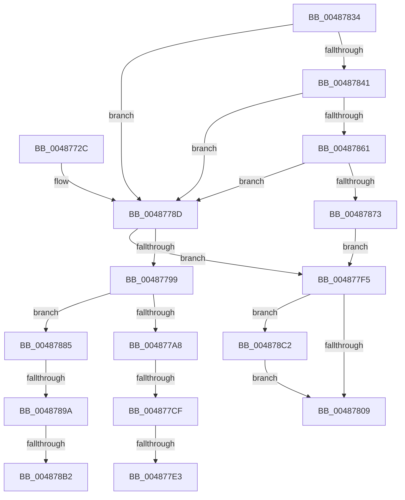

# HalpCmcPollProcessor

- RVA: `0x0048772C`–`0x004878CE` (길이 `418` bytes)
- VA: `0x000000014048772C`
- 실행 섹션: `.text`
- PDB 이름 있음: `예`; PDB Function 태그: `예`
- unwind 정보 RVA: `0x000AFB50`
- 디코드: `106`개 명령, `418/418` bytes 표시
- 미해석 바이트: `0` (있으면 어셈블리에 `.byte`로 보존)

> 이 문서는 커널 이미지의 기계어와 PDB 기호를 분석해 생성했습니다. 4번과 5번은 함수 원형과 자료형을 바이너리 사용 방식에서 추정한 C 해석이며 원본 소스 복구 결과는 아닙니다.

## 1. Dependencies

- 직접 호출 지점: **8**; 고유 호출 대상: **8**
- 직접 호출자로 확인된 함수: **2**
- RIP 상대 이미지 참조: **2**

### Outgoing calls
- `0x00487784` → [HalpGetCpuVendor](HalpGetCpuVendor_function_004879E4.md) (function, `0x004879E4`)
- `0x00487790` → [HalpMcaReadErrorPresence](HalpMcaReadErrorPresence_function_004878D4.md) (function, `0x004878D4`)
- `0x004877C2` → [HalpMcaReadError](../54/HalpMcaReadError_function_00541A2C.md) (function, `0x00541A2C`)
- `0x00487811` → [_security_check_cookie](../6A/_security_check_cookie_function_006AC640.md) (function, `0x006AC640`)
- `0x00487854` → [KeQueryDpcWatchdogInformation](../40/KeQueryDpcWatchdogInformation_function_0040DB20.md) (function, `0x0040DB20`)
- `0x00487866` → [HalpCmcIsDpcTimeRunningLow](../54/HalpCmcIsDpcTimeRunningLow_function_005409E4.md) (function, `0x005409E4`)
- `0x0048787B` → [HalpCmcLogPollingTimeoutEvent](../54/HalpCmcLogPollingTimeoutEvent_function_00540A3C.md) (function, `0x00540A3C`)
- `0x004878B7` → [KiRaiseIrqlProcessIrqlFlags](../4F/KiRaiseIrqlProcessIrqlFlags_function_004F56FC.md) (function, `0x004F56FC`)

### Direct callers
- [HalpCmciPollProcessor](HalpCmciPollProcessor_function_00487A88.md) at `0x00487AB1`
- [HalpCmcWorkerRoutine](../../page/A6/HalpCmcWorkerRoutine_function_00A637B0.md) at `0x00A6388B`

### Static image references
- `0x00487748` → RVA `0x00E0A740` (`.data`; read)
- `0x004878A5` → RVA `0x00FC6D20` (`ALMOSTRO`; read)

## 2. Other-region calls and transfers

- 다른 실행 섹션으로 향하는 call: **0**
- call이 아닌 외부 분기/꼬리 이동: **6**
  - `0x004877C9` → [sub_006F5696 + 0xD2](../6F/Unknown_function_006F5696.md) (`tail-transfer`)
  - `0x004877DD` → [sub_006F5696 + 0x3C](../6F/Unknown_function_006F5696.md) (`tail-transfer`)
  - `0x004877F0` → [sub_006F5696 + 0x41](../6F/Unknown_function_006F5696.md) (`tail-transfer`)
  - `0x00487894` → [sub_006F5696](../6F/Unknown_function_006F5696.md) (`tail-transfer`)
  - `0x004878AC` → [sub_006F5696](../6F/Unknown_function_006F5696.md) (`tail-transfer`)
  - `0x004878BD` → [sub_006F5696](../6F/Unknown_function_006F5696.md) (`tail-transfer`)

## 3. Assembly (complete function range)

```asm
0048772C  48 89 5C 24 08                  mov qword ptr [rsp + 8], rbx
00487731  48 89 6C 24 10                  mov qword ptr [rsp + 0x10], rbp
00487736  48 89 74 24 18                  mov qword ptr [rsp + 0x18], rsi
0048773B  57                              push rdi
0048773C  41 54                           push r12
0048773E  41 55                           push r13
00487740  41 56                           push r14
00487742  41 57                           push r15
00487744  48 83 EC 60                     sub rsp, 0x60
00487748  48 8B 05 F1 2F 98 00            mov rax, qword ptr [rip + 0x982ff1]
0048774F  48 33 C4                        xor rax, rsp
00487752  48 89 44 24 58                  mov qword ptr [rsp + 0x58], rax
00487757  83 64 24 34 00                  and dword ptr [rsp + 0x34], 0
0048775C  0F 57 C0                        xorps xmm0, xmm0
0048775F  48 89 4C 24 38                  mov qword ptr [rsp + 0x38], rcx
00487764  33 FF                           xor edi, edi
00487766  33 C9                           xor ecx, ecx
00487768  88 54 24 30                     mov byte ptr [rsp + 0x30], dl
0048776C  45 33 E4                        xor r12d, r12d
0048776F  89 4C 24 50                     mov dword ptr [rsp + 0x50], ecx
00487773  40 32 F6                        xor sil, sil
00487776  4D 8B E9                        mov r13, r9
00487779  49 8B D8                        mov rbx, r8
0048777C  44 8A FA                        mov r15b, dl
0048777F  0F 11 44 24 40                  movups xmmword ptr [rsp + 0x40], xmm0
00487784  E8 5B 02 00 00                  call 0x1404879e4
00487789  88 44 24 31                     mov byte ptr [rsp + 0x31], al
0048778D  48 8B D3                        mov rdx, rbx
00487790  E8 3F 01 00 00                  call 0x1404878d4
00487795  85 C0                           test eax, eax
00487797  78 5C                           js 0x1404877f5
00487799  45 32 F6                        xor r14b, r14b
0048779C  40 32 ED                        xor bpl, bpl
0048779F  45 84 FF                        test r15b, r15b
004877A2  0F 85 DD 00 00 00               jne 0x140487885
004877A8  48 8B 54 24 38                  mov rdx, qword ptr [rsp + 0x38]
004877AD  4C 8D 44 24 34                  lea r8, [rsp + 0x34]
004877B2  45 33 C9                        xor r9d, r9d
004877B5  48 89 5C 24 20                  mov qword ptr [rsp + 0x20], rbx
004877BA  48 83 C2 50                     add rdx, 0x50
004877BE  41 8D 49 01                     lea ecx, [r9 + 1]
004877C2  E8 65 A2 0B 00                  call 0x140541a2c
004877C7  85 C0                           test eax, eax
004877C9  0F 88 99 DF 26 00               js 0x1406f5768
004877CF  48 8B 4C 24 38                  mov rcx, qword ptr [rsp + 0x38]
004877D4  B8 02 00 00 00                  mov eax, 2
004877D9  38 44 24 31                     cmp byte ptr [rsp + 0x31], al
004877DD  0F 85 EF DE 26 00               jne 0x1406f56d2
004877E3  48 8B 41 78                     mov rax, qword ptr [rcx + 0x78]
004877E7  48 C1 E8 26                     shr rax, 0x26
004877EB  25 FF 7F 00 00                  and eax, 0x7fff
004877F0  E9 E2 DE 26 00                  jmp 0x1406f56d7
004877F5  41 89 BD A4 00 00 00            mov dword ptr [r13 + 0xa4], edi
004877FC  41 3B BD A8 00 00 00            cmp edi, dword ptr [r13 + 0xa8]
00487803  0F 87 B9 00 00 00               ja 0x1404878c2
00487809  48 8B 4C 24 58                  mov rcx, qword ptr [rsp + 0x58]
0048780E  48 33 CC                        xor rcx, rsp
00487811  E8 2A 4E 22 00                  call 0x1406ac640
00487816  4C 8D 5C 24 60                  lea r11, [rsp + 0x60]
0048781B  49 8B 5B 30                     mov rbx, qword ptr [r11 + 0x30]
0048781F  49 8B 6B 38                     mov rbp, qword ptr [r11 + 0x38]
00487823  49 8B 73 40                     mov rsi, qword ptr [r11 + 0x40]
00487827  49 8B E3                        mov rsp, r11
0048782A  41 5F                           pop r15
0048782C  41 5E                           pop r14
0048782E  41 5D                           pop r13
00487830  41 5C                           pop r12
00487832  5F                              pop rdi
00487833  C3                              ret
00487834  CC                              int3
00487835  44 0F 20 C0                     mov rax, cr8
00487839  3C 02                           cmp al, 2
0048783B  0F 82 4C FF FF FF               jb 0x14048778d
00487841  0F 57 C0                        xorps xmm0, xmm0
00487844  48 8D 4C 24 40                  lea rcx, [rsp + 0x40]
00487849  33 C0                           xor eax, eax
0048784B  0F 11 44 24 40                  movups xmmword ptr [rsp + 0x40], xmm0
00487850  89 44 24 50                     mov dword ptr [rsp + 0x50], eax
00487854  E8 C7 62 F8 FF                  call 0x14040db20
00487859  85 C0                           test eax, eax
0048785B  0F 85 2C FF FF FF               jne 0x14048778d
00487861  48 8D 4C 24 40                  lea rcx, [rsp + 0x40]
00487866  E8 79 91 0B 00                  call 0x1405409e4
0048786B  84 C0                           test al, al
0048786D  0F 84 1A FF FF FF               je 0x14048778d
00487873  41 8B D4                        mov edx, r12d
00487876  48 8D 4C 24 40                  lea rcx, [rsp + 0x40]
0048787B  E8 BC 91 0B 00                  call 0x140540a3c
00487880  E9 70 FF FF FF                  jmp 0x1404877f5
00487885  44 0F 20 C0                     mov rax, cr8
00487889  B9 02 00 00 00                  mov ecx, 2
0048788E  44 8D 71 FF                     lea r14d, [rcx - 1]
00487892  3A C1                           cmp al, cl
00487894  0F 83 FC DD 26 00               jae 0x1406f5696
0048789A  41 8A EE                        mov bpl, r14b
0048789D  44 0F 20 C6                     mov rsi, cr8
004878A1  44 0F 22 C1                     mov cr8, rcx
004878A5  83 3D 74 F4 B3 00 00            cmp dword ptr [rip + 0xb3f474], 0
004878AC  0F 84 E4 DD 26 00               je 0x1406f5696
004878B2  8A D1                           mov dl, cl
004878B4  40 8A CE                        mov cl, sil
004878B7  E8 40 DE 06 00                  call 0x1404f56fc
004878BC  90                              nop
004878BD  E9 D4 DD 26 00                  jmp 0x1406f5696
004878C2  41 89 BD A8 00 00 00            mov dword ptr [r13 + 0xa8], edi
004878C9  E9 3B FF FF FF                  jmp 0x140487809
```

## 4. C-style interpretation (structured pseudocode)

```c
__int64 __fastcall HalpCmcPollProcessor(__int64 a1, unsigned __int8 a2, __int64 a3, __int64 a4)
{
    __int64 result;
    __int64 v_r12;
    __int64 v_r14;
    __int64 v_rbp;
    __int64 v_rdi;
    __int64 v_rsi;
    __int64 v_rsp;
    unsigned int v_stack_m10;
    unsigned __int64 v_stack_m20;
    unsigned __int64 v_stack_m28;
    unsigned __int64 v_stack_m30;
    unsigned int v_stack_m38;
    unsigned __int64 v_stack_m48;
    unsigned __int64 v_stack_m50;
    unsigned int v_stack_m54;
    unsigned __int8 v_stack_m57;
    unsigned __int8 v_stack_m58;
    unsigned __int64 v_stack_m68;
    unsigned __int64 v_stack_p10;
    unsigned __int64 v_stack_p18;
    unsigned __int64 v_stack_p8;

    v_stack_p8 = v_rbx;
    v_stack_p10 = v_rbp;
    v_stack_p18 = v_rsi;
    v_rsp = (v_rsp) - (96);
    result = (*(unsigned __int64 *)(v_rip + 9973745)) ^ (v_rsp);
    v_stack_m30 = result;
    v_stack_m50 = a1;
    v_rdi = 0;
    a1 = 0;
    v_stack_m58 = a2;
    v_r12 = 0;
    v_stack_m38 = 0;
    v_rsi = 0;
    v_stack_m48 = v_xmm0;
    result = HalpGetCpuVendor(a1, a2, a3, a4);
    v_stack_m57 = (unsigned __int8)(result);
loc_0048778D:
    result = HalpMcaReadErrorPresence(a1, a3, a3, a4);
    if (sign_flag) goto loc_004877F5;
    v_r14 = 0;
    v_rbp = 0;
    if (a2 != 0) goto loc_00487885;
    a4 = 0;
    v_stack_m68 = a3;
    a2 = (v_stack_m50) + (80);
    result = HalpMcaReadError(a4 + 1, a2, v_stack_m54, a4);
    result = (*(unsigned __int64 *)(v_stack_m50 + 120)) >> (38);
    result = (unsigned int)((result) & (0x7FFFULL));
loc_004877F5:
    *(unsigned int *)(a4 + 164) = 0;
    if (0 > (*(unsigned int *)(a4 + 168))) goto loc_004878C2;
loc_00487809:
    a1 = (v_stack_m30) ^ (v_rsp);
    result = _security_check_cookie(a1, a2, v_stack_m54, a4);
    return result;
loc_00487885:
    result = KiRaiseIrqlProcessIrqlFlags((unsigned __int8)(v_cr8), 2, v_stack_m54, a4);
loc_004878C2:
    *(unsigned int *)(a4 + 168) = 0;
    goto loc_00487809;
}
```

## 5. (Beta) C Style

```c
int64_t HalpCmcPollProcessor(int64_t Arg1, uint8_t Arg2, int64_t Arg3, void *Arg4)
{
    uint8_t *arg4 = (uint8_t *)Arg4;

    int64_t result;
    int64_t local_r12;
    int64_t local_r14;
    int64_t local_rbp;
    int64_t local_rdi;
    int64_t local_rsi;
    int64_t local_rsp;
    uint32_t v_stack_m10;
    uint64_t v_stack_m20;
    uint64_t v_stack_m28;
    uint64_t v_stack_m30;
    uint32_t v_stack_m38;
    uint64_t v_stack_m48;
    uint64_t v_stack_m50;
    uint32_t v_stack_m54;
    uint8_t v_stack_m57;
    uint8_t v_stack_m58;
    uint64_t v_stack_m68;
    uint64_t v_stack_p10;
    uint64_t v_stack_p18;
    uint64_t v_stack_p8;

    v_stack_p8 = local_rbx;
    v_stack_p10 = local_rbp;
    v_stack_p18 = local_rsi;
    local_rsp = (local_rsp) - (96);
    result = (*(uint64_t *)(v_rip + 0x982FF1)) ^ (local_rsp);
    v_stack_m30 = result;
    v_stack_m50 = Arg1;
    local_rdi = 0;
    Arg1 = 0;
    v_stack_m58 = Arg2;
    local_r12 = 0;
    v_stack_m38 = 0;
    local_rsi = 0;
    v_stack_m48 = v_xmm0;
    result = HalpGetCpuVendor(Arg1, Arg2, Arg3, Arg4);
    v_stack_m57 = (uint8_t)(result);
loc_0048778D:
    result = HalpMcaReadErrorPresence(Arg1, Arg3, Arg3, Arg4);
    if (sign_flag) goto loc_004877F5;
    local_r14 = 0;
    local_rbp = 0;
    if (Arg2 != 0) goto loc_00487885;
    Arg4 = 0;
    v_stack_m68 = Arg3;
    Arg2 = (v_stack_m50) + (80);
    result = HalpMcaReadError(Arg4 + 1, Arg2, v_stack_m54, Arg4);
    result = (*(uint64_t *)(v_stack_m50 + 0x78)) >> (38);
    result = (uint32_t)((result) & (0x7FFFULL));
loc_004877F5:
    *(uint32_t *)(arg4 + 0xA4) = 0;
    if (0 > (*(uint32_t *)(arg4 + 0xA8))) goto loc_004878C2;
loc_00487809:
    Arg1 = (v_stack_m30) ^ (local_rsp);
    result = _security_check_cookie(Arg1, Arg2, v_stack_m54, Arg4);
    return result;
loc_00487885:
    result = KiRaiseIrqlProcessIrqlFlags((uint8_t)(v_cr8), 2, v_stack_m54, Arg4);
loc_004878C2:
    *(uint32_t *)(arg4 + 0xA8) = 0;
    goto loc_00487809;
}
```

### 관측된 메모리 오프셋

구조체 형식이 확인되지 않은 접근은 인자 기준의 오프셋으로만 기록했습니다.

| 기준 인자 | 오프셋 표현 | 폭 (bit) | 접근 |
|---|---:|---:|---|
| `Arg4` | `+ 0xA4` | `32` | `W` |
| `Arg4` | `+ 0xA8` | `32` | `R` |
| `Arg4` | `+ 0xA8` | `32` | `W` |

## 6. Execution-region graph

[열기: 2D/3D 그래프와 함수 탐색 컨트롤 패널](../../../control-panel.html?section=text&rva=0x0048772C&view=graph)

- 2D 그래프는 위에서 아래로 흐르고, 3D 그래프는 빈 공간을 드래그해 회전합니다. Shift+드래그는 이동, 휠은 확대·축소, 함수 노드 선택은 대상 보고서 이동입니다.

### Static fallback


