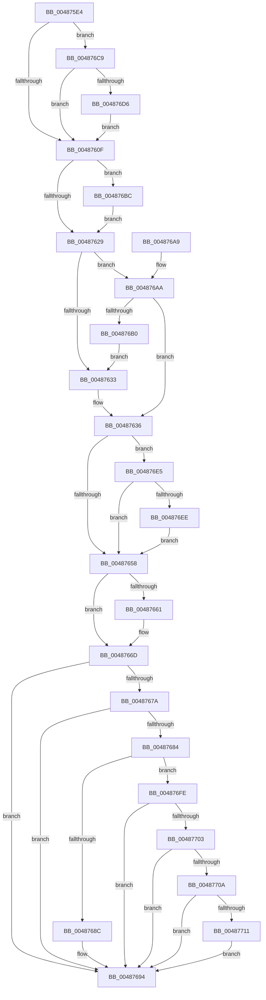

# HalpCmciInitProcessor

- RVA: `0x004875E4`–`0x00487724` (길이 `320` bytes)
- VA: `0x00000001404875E4`
- 실행 섹션: `.text`
- PDB 이름 있음: `예`; PDB Function 태그: `아니요`
- unwind 정보 RVA: `0x000A9430`
- 디코드: `82`개 명령, `320/320` bytes 표시
- 미해석 바이트: `0` (있으면 어셈블리에 `.byte`로 보존)

> 이 문서는 커널 이미지의 기계어와 PDB 기호를 분석해 생성했습니다. 4번과 5번은 함수 원형과 자료형을 바이너리 사용 방식에서 추정한 C 해석이며 원본 소스 복구 결과는 아닙니다.

## 1. Dependencies

- 직접 호출 지점: **8**; 고유 호출 대상: **8**
- 직접 호출자로 확인된 함수: **3**
- RIP 상대 이미지 참조: **4**

### Outgoing calls
- `0x00487601` → [HalpGetCpuVendor](HalpGetCpuVendor_function_004879E4.md) (function, `0x004879E4`)
- `0x0048763F` → [HalpCmciSetProcessorConfig](HalpCmciSetProcessorConfig_function_00487A04.md) (function, `0x00487A04`)
- `0x00487647` → [HalpGetMcaPcrContext](HalpGetMcaPcrContext_function_00487A38.md) (function, `0x00487A38`)
- `0x00487668` → [KiLowerIrqlProcessIrqlFlags](../4F/KiLowerIrqlProcessIrqlFlags_function_004F5698.md) (function, `0x004F5698`)
- `0x0048768F` → [HalpCmciPollProcessor](HalpCmciPollProcessor_function_00487A88.md) (function, `0x00487A88`)
- `0x004876BF` → [KiRaiseIrqlProcessIrqlFlags](../4F/KiRaiseIrqlProcessIrqlFlags_function_004F56FC.md) (function, `0x004F56FC`)
- `0x004876C9` → [HalpIsCmciImplementedAMD](../../pagelk/B5/HalpIsCmciImplementedAMD_function_00B5C37C.md) (function, `0x00B5C37C`)
- `0x0048771A` → [KeInsertQueueDpc](../20/KeInsertQueueDpc_function_00207C50.md) (function, `0x00207C50`)

### Direct callers
- [HalpInitializeCmc](../../pagelk/B5/HalpInitializeCmc_function_00B5BB08.md) at `0x00B5BB92`
- [HalpMcaResumeProcessorConfig](../../pagelk/B7/HalpMcaResumeProcessorConfig_function_00B7B31C.md) at `0x00B7B3DA`
- [HalpCmciInit](../../pagelk/B7/HalpCmciInit_function_00B7C348.md) at `0x00B7C429`

### Static image references
- `0x0048761C` → RVA `0x00FC6D20` (`ALMOSTRO`; read)
- `0x00487629` → RVA `0x00E0F6A0` (`.data`; read)
- `0x0048767A` → RVA `0x00E0FC02` (`.data`; read)
- `0x004876B0` → RVA `0x00E0FC00` (`.data`; write)

## 2. Other-region calls and transfers

- 다른 실행 섹션으로 향하는 call: **1**
  - `0x004876C9` → [HalpIsCmciImplementedAMD](../../pagelk/B5/HalpIsCmciImplementedAMD_function_00B5C37C.md) (`.text` → `PAGELK`)
- 별도 외부 분기/꼬리 이동을 확인하지 못했습니다.

## 3. Assembly (complete function range)

```asm
004875E4  48 89 5C 24 08                  mov qword ptr [rsp + 8], rbx
004875E9  48 89 6C 24 10                  mov qword ptr [rsp + 0x10], rbp
004875EE  48 89 74 24 18                  mov qword ptr [rsp + 0x18], rsi
004875F3  57                              push rdi
004875F4  48 83 EC 20                     sub rsp, 0x20
004875F8  48 8B DA                        mov rbx, rdx
004875FB  48 8B F9                        mov rdi, rcx
004875FE  40 B6 01                        mov sil, 1
00487601  E8 DE 03 00 00                  call 0x1404879e4
00487606  40 3A C6                        cmp al, sil
00487609  0F 84 BA 00 00 00               je 0x1404876c9
0048760F  44 0F 20 C5                     mov rbp, cr8
00487613  BA 0F 00 00 00                  mov edx, 0xf
00487618  44 0F 22 C2                     mov cr8, rdx
0048761C  83 3D FD F6 B3 00 00            cmp dword ptr [rip + 0xb3f6fd], 0
00487623  0F 85 93 00 00 00               jne 0x1404876bc
00487629  8B 05 71 80 98 00               mov eax, dword ptr [rip + 0x988071]
0048762F  85 C0                           test eax, eax
00487631  74 77                           je 0x1404876aa
00487633  40 32 F6                        xor sil, sil
00487636  4C 8B C3                        mov r8, rbx
00487639  40 8A D6                        mov dl, sil
0048763C  48 8B CF                        mov rcx, rdi
0048763F  E8 C0 03 00 00                  call 0x140487a04
00487644  48 8B CB                        mov rcx, rbx
00487647  E8 EC 03 00 00                  call 0x140487a38
0048764C  48 8B F8                        mov rdi, rax
0048764F  48 85 C0                        test rax, rax
00487652  0F 85 8D 00 00 00               jne 0x1404876e5
00487658  83 3D C1 F6 B3 00 00            cmp dword ptr [rip + 0xb3f6c1], 0
0048765F  74 0C                           je 0x14048766d
00487661  44 0F 20 C1                     mov rcx, cr8
00487665  40 8A D5                        mov dl, bpl
00487668  E8 2B E0 06 00                  call 0x1404f5698
0048766D  40 0F B6 C5                     movzx eax, bpl
00487671  44 0F 22 C0                     mov cr8, rax
00487675  40 84 F6                        test sil, sil
00487678  74 1A                           je 0x140487694
0048767A  8A 05 82 85 98 00               mov al, byte ptr [rip + 0x988582]
00487680  84 C0                           test al, al
00487682  74 10                           je 0x140487694
00487684  44 0F 20 C0                     mov rax, cr8
00487688  3C 02                           cmp al, 2
0048768A  77 72                           ja 0x1404876fe
0048768C  48 8B CB                        mov rcx, rbx
0048768F  E8 F4 03 00 00                  call 0x140487a88
00487694  48 8B 5C 24 30                  mov rbx, qword ptr [rsp + 0x30]
00487699  48 8B 6C 24 38                  mov rbp, qword ptr [rsp + 0x38]
0048769E  48 8B 74 24 40                  mov rsi, qword ptr [rsp + 0x40]
004876A3  48 83 C4 20                     add rsp, 0x20
004876A7  5F                              pop rdi
004876A8  C3                              ret
004876A9  CC                              int3
004876AA  80 7F 30 05                     cmp byte ptr [rdi + 0x30], 5
004876AE  74 86                           je 0x140487636
004876B0  C6 05 49 85 98 00 01            mov byte ptr [rip + 0x988549], 1
004876B7  E9 77 FF FF FF                  jmp 0x140487633
004876BC  40 8A CD                        mov cl, bpl
004876BF  E8 38 E0 06 00                  call 0x1404f56fc
004876C4  E9 60 FF FF FF                  jmp 0x140487629
004876C9  E8 AE 4C 6D 00                  call 0x140b5c37c
004876CE  84 C0                           test al, al
004876D0  0F 85 39 FF FF FF               jne 0x14048760f
004876D6  40 88 35 23 85 98 00            mov byte ptr [rip + 0x988523], sil
004876DD  40 32 F6                        xor sil, sil
004876E0  E9 2A FF FF FF                  jmp 0x14048760f
004876E5  40 84 F6                        test sil, sil
004876E8  0F 84 6A FF FF FF               je 0x140487658
004876EE  83 60 78 00                     and dword ptr [rax + 0x78], 0
004876F2  C6 80 80 00 00 00 00            mov byte ptr [rax + 0x80], 0
004876F9  E9 5A FF FF FF                  jmp 0x140487658
004876FE  48 85 FF                        test rdi, rdi
00487701  74 91                           je 0x140487694
00487703  48 83 7F 10 00                  cmp qword ptr [rdi + 0x10], 0
00487708  74 8A                           je 0x140487694
0048770A  48 83 7F 18 00                  cmp qword ptr [rdi + 0x18], 0
0048770F  74 83                           je 0x140487694
00487711  48 8D 4F 30                     lea rcx, [rdi + 0x30]
00487715  45 33 C0                        xor r8d, r8d
00487718  33 D2                           xor edx, edx
0048771A  E8 31 05 D8 FF                  call 0x140207c50
0048771F  E9 70 FF FF FF                  jmp 0x140487694
```

## 4. C-style interpretation (structured pseudocode)

```c
__int64 __fastcall HalpCmciInitProcessor(__int64 a1, __int64 a2)
{
    __int64 result;
    __int64 v_rsi;
    __int64 v_rsp;
    unsigned __int64 v_stack_p10;
    unsigned __int64 v_stack_p18;
    unsigned __int64 v_stack_p8;

    v_stack_p8 = v_rbx;
    v_stack_p10 = v_rbp;
    v_stack_p18 = v_rsi;
    v_rsp = (v_rsp) - (32);
    result = HalpGetCpuVendor(a1, a2, a3, a4);
    if (((unsigned __int8)(result)) == 1) goto loc_004876C9;
loc_0048760F:
    if ((*(unsigned int *)(v_rip + 11794173)) != 0) goto loc_004876BC;
loc_00487629:
    if ((unsigned int)((unsigned int)(*(unsigned int *)(v_rip + 9994353))) == 0) goto loc_004876AA;
loc_00487633:
    v_rsi = 0;
loc_00487636:
    result = HalpCmciSetProcessorConfig(a1, 0, a2, a4);
    result = HalpGetMcaPcrContext(a2, 0, a2, a4);
    if (result != 0) goto loc_004876E5;
loc_00487658:
    if ((*(unsigned int *)(v_rip + 11794113)) != 0) {
        a1 = 15;
        a2 = (unsigned __int8)(v_cr8);
        result = KiLowerIrqlProcessIrqlFlags(a1, a2, a2, a4);
    }
    if (0 == 0) goto loc_00487694;
    if ((unsigned __int8)(*(unsigned __int8 *)(v_rip + 9995650)) == 0) goto loc_00487694;
    if (((unsigned __int8)((unsigned __int8)(v_cr8))) > 2) goto loc_004876FE;
    result = HalpCmciPollProcessor(a2, a2, a2, a4);
loc_00487694:
    v_rsp = (v_rsp) + (32);
    return result;
loc_004876AA:
    if ((*(unsigned __int8 *)(result + 48)) == 5) goto loc_00487636;
    *(unsigned __int8 *)(v_rip + 9995593) = 1;
    goto loc_00487633;
loc_004876BC:
    result = KiRaiseIrqlProcessIrqlFlags((unsigned __int8)(v_stack_p10), a2, a2, a4);
    goto loc_00487629;
loc_004876C9:
    result = HalpIsCmciImplementedAMD((unsigned __int8)(v_stack_p10), a2, a2, a4);
    if ((unsigned __int8)(result) != 0) goto loc_0048760F;
    *(unsigned __int8 *)(v_rip + 9995555) = (unsigned __int8)(v_stack_p18);
    v_rsi = 0;
    goto loc_0048760F;
loc_004876E5:
    if (0 == 0) goto loc_00487658;
    *(unsigned __int8 *)(result + 128) = 0;
    goto loc_00487658;
loc_004876FE:
    if (result == 0) goto loc_00487694;
    if ((*(unsigned __int64 *)(result + 16)) == 0) goto loc_00487694;
    if ((*(unsigned __int64 *)(result + 24)) == 0) goto loc_00487694;
    a3 = 0;
    a2 = 0;
    result = KeInsertQueueDpc(result + 48, a2, a3, a4);
    goto loc_00487694;
}
```

## 5. (Beta) C Style

```c
int64_t HalpCmciInitProcessor(void *Arg1, int64_t Arg2)
{
    uint8_t *arg1 = (uint8_t *)Arg1;

    int64_t result;
    int64_t local_rsi;
    int64_t local_rsp;
    uint64_t v_stack_p10;
    uint64_t v_stack_p18;
    uint64_t v_stack_p8;

    v_stack_p8 = local_rbx;
    v_stack_p10 = local_rbp;
    v_stack_p18 = local_rsi;
    local_rsp = (local_rsp) - (32);
    result = HalpGetCpuVendor(Arg1, Arg2, a3, a4);
    if (((uint8_t)(result)) == 1) goto loc_004876C9;
loc_0048760F:
    if ((*(uint32_t *)(v_rip + 0xB3F6FD)) != 0) goto loc_004876BC;
loc_00487629:
    if ((uint32_t)((uint32_t)(*(uint32_t *)(v_rip + 0x988071))) == 0) goto loc_004876AA;
loc_00487633:
    local_rsi = 0;
loc_00487636:
    result = HalpCmciSetProcessorConfig(Arg1, 0, Arg2, a4);
    result = HalpGetMcaPcrContext(Arg2, 0, Arg2, a4);
    if (result != 0) goto loc_004876E5;
loc_00487658:
    if ((*(uint32_t *)(v_rip + 0xB3F6C1)) != 0) {
        Arg1 = 15;
        Arg2 = (uint8_t)(v_cr8);
        result = KiLowerIrqlProcessIrqlFlags(Arg1, Arg2, Arg2, a4);
    }
    if (0 == 0) goto loc_00487694;
    if ((uint8_t)(*(uint8_t *)(v_rip + 0x988582)) == 0) goto loc_00487694;
    if (((uint8_t)((uint8_t)(v_cr8))) > 2) goto loc_004876FE;
    result = HalpCmciPollProcessor(Arg2, Arg2, Arg2, a4);
loc_00487694:
    local_rsp = (local_rsp) + (32);
    return result;
loc_004876AA:
    if ((*(uint8_t *)(result + 0x30)) == 5) goto loc_00487636;
    *(uint8_t *)(v_rip + 0x988549) = 1;
    goto loc_00487633;
loc_004876BC:
    result = KiRaiseIrqlProcessIrqlFlags((uint8_t)(v_stack_p10), Arg2, Arg2, a4);
    goto loc_00487629;
loc_004876C9:
    result = HalpIsCmciImplementedAMD((uint8_t)(v_stack_p10), Arg2, Arg2, a4);
    if ((uint8_t)(result) != 0) goto loc_0048760F;
    *(uint8_t *)(v_rip + 0x988523) = (uint8_t)(v_stack_p18);
    local_rsi = 0;
    goto loc_0048760F;
loc_004876E5:
    if (0 == 0) goto loc_00487658;
    *(uint8_t *)(result + 0x80) = 0;
    goto loc_00487658;
loc_004876FE:
    if (result == 0) goto loc_00487694;
    if ((*(uint64_t *)(result + 0x10)) == 0) goto loc_00487694;
    if ((*(uint64_t *)(result + 0x18)) == 0) goto loc_00487694;
    a3 = 0;
    Arg2 = 0;
    result = KeInsertQueueDpc(result + 48, Arg2, a3, a4);
    goto loc_00487694;
}
```

### 관측된 메모리 오프셋

구조체 형식이 확인되지 않은 접근은 인자 기준의 오프셋으로만 기록했습니다.

| 기준 인자 | 오프셋 표현 | 폭 (bit) | 접근 |
|---|---:|---:|---|
| `Arg1` | `+ 0x30` | `8` | `R` |

## 6. Execution-region graph

[열기: 2D/3D 그래프와 함수 탐색 컨트롤 패널](../../../control-panel.html?section=text&rva=0x004875E4&view=graph)

- 2D 그래프는 위에서 아래로 흐르고, 3D 그래프는 빈 공간을 드래그해 회전합니다. Shift+드래그는 이동, 휠은 확대·축소, 함수 노드 선택은 대상 보고서 이동입니다.

### Static fallback


