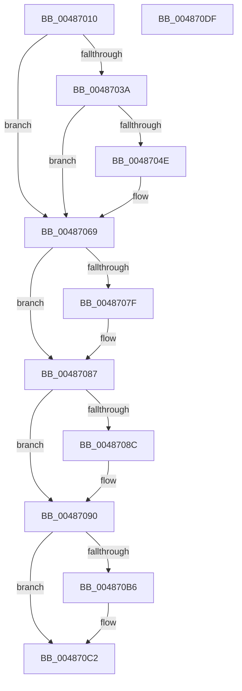

# HalpCmciInitializeErrorPacket

- RVA: `0x00487010`–`0x004870E0` (길이 `208` bytes)
- VA: `0x0000000140487010`
- 실행 섹션: `.text`
- PDB 이름 있음: `예`; PDB Function 태그: `아니요`
- unwind 정보 RVA: `0x00066400`
- 디코드: `55`개 명령, `208/208` bytes 표시
- 미해석 바이트: `0` (있으면 어셈블리에 `.byte`로 보존)

> 이 문서는 커널 이미지의 기계어와 PDB 기호를 분석해 생성했습니다. 4번과 5번은 함수 원형과 자료형을 바이너리 사용 방식에서 추정한 C 해석이며 원본 소스 복구 결과는 아닙니다.

## 1. Dependencies

- 직접 호출 지점: **6**; 고유 호출 대상: **6**
- 직접 호출자로 확인된 함수: **2**
- RIP 상대 이미지 참조: **2**

### Outgoing calls
- `0x0048702C` → [HalpGetMcaPcrContext](HalpGetMcaPcrContext_function_00487A38.md) (function, `0x00487A38`)
- `0x00487041` → [HalpMmAllocCtxAlloc](../3E/HalpMmAllocCtxAlloc_function_003E10B8.md) (function, `0x003E10B8`)
- `0x00487063` → [KeBugCheckEx](../4F/KeBugCheckEx_function_004FD660.md) (function, `0x004FD660`)
- `0x00487082` → [KiRaiseIrqlProcessIrqlFlags](../4F/KiRaiseIrqlProcessIrqlFlags_function_004F56FC.md) (function, `0x004F56FC`)
- `0x00487094` → [HalpCmcInitializeErrorPacketContents](HalpCmcInitializeErrorPacketContents_function_004870E8.md) (function, `0x004870E8`)
- `0x004870BD` → [KiLowerIrqlProcessIrqlFlags](../4F/KiLowerIrqlProcessIrqlFlags_function_004F5698.md) (function, `0x004F5698`)

### Direct callers
- [HalpInitializeCmc](../../pagelk/B5/HalpInitializeCmc_function_00B5BB08.md) at `0x00B5BB85`
- [HalpCmciInit](../../pagelk/B7/HalpCmciInit_function_00B7C348.md) at `0x00B7C41E`

### Static image references
- `0x00487076` → RVA `0x00FC6D20` (`ALMOSTRO`; read)
- `0x0048709D` → RVA `0x0001A590` (`.rdata`; read)

## 2. Other-region calls and transfers

- 다른 실행 섹션으로 향하는 call: **0**
- 별도 외부 분기/꼬리 이동을 확인하지 못했습니다.

## 3. Assembly (complete function range)

```asm
00487010  48 89 5C 24 08                  mov qword ptr [rsp + 8], rbx
00487015  48 89 6C 24 10                  mov qword ptr [rsp + 0x10], rbp
0048701A  48 89 74 24 18                  mov qword ptr [rsp + 0x18], rsi
0048701F  57                              push rdi
00487020  48 83 EC 30                     sub rsp, 0x30
00487024  48 8B E9                        mov rbp, rcx
00487027  33 DB                           xor ebx, ebx
00487029  48 8B CA                        mov rcx, rdx
0048702C  E8 07 0A 00 00                  call 0x140487a38
00487031  48 8B F0                        mov rsi, rax
00487034  48 39 58 10                     cmp qword ptr [rax + 0x10], rbx
00487038  75 2F                           jne 0x140487069
0048703A  BF F8 04 00 00                  mov edi, 0x4f8
0048703F  8B D7                           mov edx, edi
00487041  E8 72 A0 F5 FF                  call 0x1403e10b8
00487046  48 8B D8                        mov rbx, rax
00487049  48 85 C0                        test rax, rax
0048704C  75 1B                           jne 0x140487069
0048704E  48 21 44 24 20                  and qword ptr [rsp + 0x20], rax
00487053  45 33 C9                        xor r9d, r9d
00487056  41 B8 00 DA 00 00               mov r8d, 0xda00
0048705C  8B D7                           mov edx, edi
0048705E  B9 AC 00 00 00                  mov ecx, 0xac
00487063  E8 F8 65 07 00                  call 0x1404fd660
00487068  CC                              int3
00487069  44 0F 20 C7                     mov rdi, cr8
0048706D  BA 0F 00 00 00                  mov edx, 0xf
00487072  44 0F 22 C2                     mov cr8, rdx
00487076  83 3D A3 FC B3 00 00            cmp dword ptr [rip + 0xb3fca3], 0
0048707D  74 08                           je 0x140487087
0048707F  40 8A CF                        mov cl, dil
00487082  E8 75 E6 06 00                  call 0x1404f56fc
00487087  48 85 DB                        test rbx, rbx
0048708A  74 04                           je 0x140487090
0048708C  48 89 5E 10                     mov qword ptr [rsi + 0x10], rbx
00487090  48 8B 4E 10                     mov rcx, qword ptr [rsi + 0x10]
00487094  E8 4F 00 00 00                  call 0x1404870e8
00487099  48 8B 46 10                     mov rax, qword ptr [rsi + 0x10]
0048709D  0F 10 05 EC 34 B9 FF            movups xmm0, xmmword ptr [rip - 0x46cb14]
004870A4  F3 0F 7F 40 20                  movdqu xmmword ptr [rax + 0x20], xmm0
004870A9  48 89 6E 18                     mov qword ptr [rsi + 0x18], rbp
004870AD  83 3D 6C FC B3 00 00            cmp dword ptr [rip + 0xb3fc6c], 0
004870B4  74 0C                           je 0x1404870c2
004870B6  44 0F 20 C1                     mov rcx, cr8
004870BA  40 8A D7                        mov dl, dil
004870BD  E8 D6 E5 06 00                  call 0x1404f5698
004870C2  40 0F B6 C7                     movzx eax, dil
004870C6  44 0F 22 C0                     mov cr8, rax
004870CA  48 8B 5C 24 40                  mov rbx, qword ptr [rsp + 0x40]
004870CF  48 8B 6C 24 48                  mov rbp, qword ptr [rsp + 0x48]
004870D4  48 8B 74 24 50                  mov rsi, qword ptr [rsp + 0x50]
004870D9  48 83 C4 30                     add rsp, 0x30
004870DD  5F                              pop rdi
004870DE  C3                              ret
004870DF  CC                              int3
```

## 4. C-style interpretation (structured pseudocode)

```c
__int64 __fastcall HalpCmciInitializeErrorPacket(__int64 a1, __int64 a2, __int64 a3, int a4)
{
    __int64 result;
    __int64 v_rbx;
    __int64 v_rsp;
    unsigned __int64 v_stack_m18;
    unsigned __int64 v_stack_p10;
    unsigned __int64 v_stack_p18;
    unsigned __int64 v_stack_p8;

    v_stack_p8 = v_rbx;
    v_stack_p10 = v_rbp;
    v_stack_p18 = v_rsi;
    v_rsp = (v_rsp) - (48);
    v_rbx = 0;
    result = HalpGetMcaPcrContext(a2, a2, a3, a4);
    if ((*(unsigned __int64 *)(result + 16)) != 0) goto loc_00487069;
    result = HalpMmAllocCtxAlloc(a2, (unsigned int)((unsigned int)((unsigned int)(0x4F8ULL))), a3, a4);
    if (result == 0) {
        a4 = 0;
        a3 = 0xDA00ULL;
        a2 = (unsigned int)((unsigned int)(0x4F8ULL));
        a1 = 172;
        result = KeBugCheckEx(a1, a2, a3, a4);
    }
    if ((*(unsigned int *)(v_rip + 11795619)) != 0) {
        a1 = (unsigned __int8)(v_cr8);
        result = KiRaiseIrqlProcessIrqlFlags(a1, 15, a3, a4);
    }
    if (result != 0) {
        *(unsigned __int64 *)(result + 16) = result;
    }
    result = HalpCmcInitializeErrorPacketContents(*(unsigned __int64 *)(result + 16), 15, a3, a4);
    *(unsigned __int64 *)(*(unsigned __int64 *)(result + 16) + 32) = v_xmm0;
    *(unsigned __int64 *)(result + 24) = a1;
    result = *(unsigned __int64 *)(result + 16);
    if ((*(unsigned int *)(v_rip + 11795564)) != 0) {
        a1 = 15;
        a2 = (unsigned __int8)(v_cr8);
        result = KiLowerIrqlProcessIrqlFlags(a1, a2, a3, a4);
    }
    v_rsp = (v_rsp) + (48);
    return (unsigned __int8)(v_cr8);
}
```

## 5. (Beta) C Style

```c
int64_t HalpCmciInitializeErrorPacket(int64_t Arg1, int64_t Arg2, int64_t Arg3, int32_t Arg4)
{
    int64_t result;
    int64_t local_rbx;
    int64_t local_rsp;
    uint64_t v_stack_m18;
    uint64_t v_stack_p10;
    uint64_t v_stack_p18;
    uint64_t v_stack_p8;

    v_stack_p8 = local_rbx;
    v_stack_p10 = local_rbp;
    v_stack_p18 = local_rsi;
    local_rsp = (local_rsp) - (48);
    local_rbx = 0;
    result = HalpGetMcaPcrContext(Arg2, Arg2, Arg3, Arg4);
    if ((*(uint64_t *)(result + 0x10)) != 0) goto loc_00487069;
    result = HalpMmAllocCtxAlloc(Arg2, (uint32_t)((uint32_t)((uint32_t)(0x4F8ULL))), Arg3, Arg4);
    if (result == 0) {
        Arg4 = 0;
        Arg3 = 0xDA00ULL;
        Arg2 = (uint32_t)((uint32_t)(0x4F8ULL));
        Arg1 = 172;
        result = KeBugCheckEx(Arg1, Arg2, Arg3, Arg4);
    }
    if ((*(uint32_t *)(v_rip + 0xB3FCA3)) != 0) {
        Arg1 = (uint8_t)(v_cr8);
        result = KiRaiseIrqlProcessIrqlFlags(Arg1, 15, Arg3, Arg4);
    }
    if (result != 0) {
        *(uint64_t *)(result + 0x10) = result;
    }
    result = HalpCmcInitializeErrorPacketContents(*(uint64_t *)(result + 0x10), 15, Arg3, Arg4);
    *(uint64_t *)(*(uint64_t *)(result + 0x10) + 0x20) = v_xmm0;
    *(uint64_t *)(result + 0x18) = Arg1;
    result = *(uint64_t *)(result + 0x10);
    if ((*(uint32_t *)(v_rip + 0xB3FC6C)) != 0) {
        Arg1 = 15;
        Arg2 = (uint8_t)(v_cr8);
        result = KiLowerIrqlProcessIrqlFlags(Arg1, Arg2, Arg3, Arg4);
    }
    local_rsp = (local_rsp) + (48);
    return (uint8_t)(v_cr8);
}
```

## 6. Execution-region graph

[열기: 2D/3D 그래프와 함수 탐색 컨트롤 패널](../../../control-panel.html?section=text&rva=0x00487010&view=graph)

- 2D 그래프는 위에서 아래로 흐르고, 3D 그래프는 빈 공간을 드래그해 회전합니다. Shift+드래그는 이동, 휠은 확대·축소, 함수 노드 선택은 대상 보고서 이동입니다.

### Static fallback


