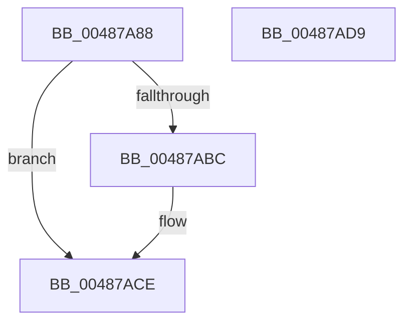

# HalpCmciPollProcessor

- RVA: `0x00487A88`–`0x00487ADA` (길이 `82` bytes)
- VA: `0x0000000140487A88`
- 실행 섹션: `.text`
- PDB 이름 있음: `예`; PDB Function 태그: `아니요`
- unwind 정보 RVA: `0x0005CAAC`
- 디코드: `24`개 명령, `82/82` bytes 표시
- 미해석 바이트: `0` (있으면 어셈블리에 `.byte`로 보존)

> 이 문서는 커널 이미지의 기계어와 PDB 기호를 분석해 생성했습니다. 4번과 5번은 함수 원형과 자료형을 바이너리 사용 방식에서 추정한 C 해석이며 원본 소스 복구 결과는 아닙니다.

## 1. Dependencies

- 직접 호출 지점: **4**; 고유 호출 대상: **4**
- 직접 호출자로 확인된 함수: **2**
- RIP 상대 이미지 참조: **1**

### Outgoing calls
- `0x00487A95` → [HalpGetCpuVendor](HalpGetCpuVendor_function_004879E4.md) (function, `0x004879E4`)
- `0x00487AA0` → [HalpGetMcaPcrContext](HalpGetMcaPcrContext_function_00487A38.md) (function, `0x00487A38`)
- `0x00487AB1` → [HalpCmcPollProcessor](HalpCmcPollProcessor_function_0048772C.md) (function, `0x0048772C`)
- `0x00487AC9` → [HalpCmciSetProcessorConfigAMD](HalpCmciSetProcessorConfigAMD_function_00487BE0.md) (function, `0x00487BE0`)

### Direct callers
- [HalpCmciDeferredRoutine](HalpCmciDeferredRoutine_function_00487290.md) at `0x004872AB`
- [HalpCmciInitProcessor](HalpCmciInitProcessor_function_004875E4.md) at `0x0048768F`

### Static image references
- `0x00487ABC` → RVA `0x00E0F6C8` (`.data`; read)

## 2. Other-region calls and transfers

- 다른 실행 섹션으로 향하는 call: **0**
- 별도 외부 분기/꼬리 이동을 확인하지 못했습니다.

## 3. Assembly (complete function range)

```asm
00487A88  48 89 5C 24 08                  mov qword ptr [rsp + 8], rbx
00487A8D  57                              push rdi
00487A8E  48 83 EC 20                     sub rsp, 0x20
00487A92  48 8B D9                        mov rbx, rcx
00487A95  E8 4A FF FF FF                  call 0x1404879e4
00487A9A  48 8B CB                        mov rcx, rbx
00487A9D  40 8A F8                        mov dil, al
00487AA0  E8 93 FF FF FF                  call 0x140487a38
00487AA5  4C 8B C8                        mov r9, rax
00487AA8  4C 8B C3                        mov r8, rbx
00487AAB  B2 01                           mov dl, 1
00487AAD  48 8B 48 10                     mov rcx, qword ptr [rax + 0x10]
00487AB1  E8 76 FC FF FF                  call 0x14048772c
00487AB6  40 80 FF 01                     cmp dil, 1
00487ABA  75 12                           jne 0x140487ace
00487ABC  48 8B 0D 05 7C 98 00            mov rcx, qword ptr [rip + 0x987c05]
00487AC3  4C 8B C3                        mov r8, rbx
00487AC6  40 8A D7                        mov dl, dil
00487AC9  E8 12 01 00 00                  call 0x140487be0
00487ACE  48 8B 5C 24 30                  mov rbx, qword ptr [rsp + 0x30]
00487AD3  48 83 C4 20                     add rsp, 0x20
00487AD7  5F                              pop rdi
00487AD8  C3                              ret
00487AD9  CC                              int3
```

## 4. C-style interpretation (structured pseudocode)

```c
__int64 __fastcall HalpCmciPollProcessor(__int64 a1)
{
    __int64 result;
    __int64 v_rsp;
    unsigned __int64 v_stack_p8;

    v_stack_p8 = v_rbx;
    v_rsp = (v_rsp) - (32);
    result = HalpGetCpuVendor(a1, a2, a3, a4);
    result = HalpGetMcaPcrContext(a1, a2, a3, a4);
    result = HalpCmcPollProcessor(*(unsigned __int64 *)(result + 16), 1, a1, result);
    if (((unsigned __int8)((unsigned __int8)(result))) == 1) {
        a1 = *(unsigned __int64 *)(v_rip + 9993221);
        a3 = a1;
        a2 = (unsigned __int8)((unsigned __int8)(result));
        result = HalpCmciSetProcessorConfigAMD(a1, a2, a3, result);
    }
    v_rsp = (v_rsp) + (32);
    return result;
}
```

## 5. (Beta) C Style

```c
int64_t HalpCmciPollProcessor(int64_t Arg1)
{
    int64_t result;
    int64_t local_rsp;
    uint64_t v_stack_p8;

    v_stack_p8 = local_rbx;
    local_rsp = (local_rsp) - (32);
    result = HalpGetCpuVendor(Arg1, a2, a3, a4);
    result = HalpGetMcaPcrContext(Arg1, a2, a3, a4);
    result = HalpCmcPollProcessor(*(uint64_t *)(result + 0x10), 1, Arg1, result);
    if (((uint8_t)((uint8_t)(result))) == 1) {
        Arg1 = *(uint64_t *)(v_rip + 0x987C05);
        a3 = Arg1;
        a2 = (uint8_t)((uint8_t)(result));
        result = HalpCmciSetProcessorConfigAMD(Arg1, a2, a3, result);
    }
    local_rsp = (local_rsp) + (32);
    return result;
}
```

## 6. Execution-region graph

[열기: 2D/3D 그래프와 함수 탐색 컨트롤 패널](../../../control-panel.html?section=text&rva=0x00487A88&view=graph)

- 2D 그래프는 위에서 아래로 흐르고, 3D 그래프는 빈 공간을 드래그해 회전합니다. Shift+드래그는 이동, 휠은 확대·축소, 함수 노드 선택은 대상 보고서 이동입니다.

### Static fallback


