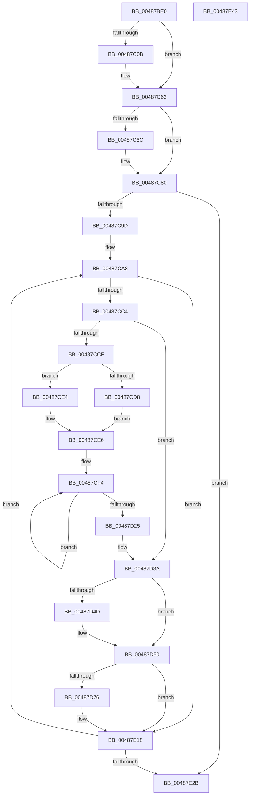

# HalpCmciSetProcessorConfigAMD

- RVA: `0x00487BE0`–`0x00487E44` (길이 `612` bytes)
- VA: `0x0000000140487BE0`
- 실행 섹션: `.text`
- PDB 이름 있음: `예`; PDB Function 태그: `아니요`
- unwind 정보 RVA: `0x000AFBC4`
- 디코드: `159`개 명령, `612/612` bytes 표시
- 미해석 바이트: `0` (있으면 어셈블리에 `.byte`로 보존)

> 이 문서는 커널 이미지의 기계어와 PDB 기호를 분석해 생성했습니다. 4번과 5번은 함수 원형과 자료형을 바이너리 사용 방식에서 추정한 C 해석이며 원본 소스 복구 결과는 아닙니다.

## 1. Dependencies

- 직접 호출 지점: **12**; 고유 호출 대상: **3**
- 직접 호출자로 확인된 함수: **3**
- RIP 상대 이미지 참조: **5**

### Outgoing calls
- `0x00487C1F` → [guard_dispatch_icall](../6B/guard_dispatch_icall_function_006BAAD0.md) (function, `0x006BAAD0`)
- `0x00487C5D` → [guard_dispatch_icall](../6B/guard_dispatch_icall_function_006BAAD0.md) (function, `0x006BAAD0`)
- `0x00487CAE` → [HalpWheaReadMsrMisc](HalpWheaReadMsrMisc_function_004872EC.md) (function, `0x004872EC`)
- `0x00487D03` → [guard_dispatch_icall](../6B/guard_dispatch_icall_function_006BAAD0.md) (function, `0x006BAAD0`)
- `0x00487D18` → [HalpCmciSetProcessorMiscConfigAMD](../4F/HalpCmciSetProcessorMiscConfigAMD_function_004FD07C.md) (function, `0x004FD07C`)
- `0x00487D64` → [HalpCmciSetProcessorMiscConfigAMD](../4F/HalpCmciSetProcessorMiscConfigAMD_function_004FD07C.md) (function, `0x004FD07C`)
- `0x00487D87` → [guard_dispatch_icall](../6B/guard_dispatch_icall_function_006BAAD0.md) (function, `0x006BAAD0`)
- `0x00487DBF` → [guard_dispatch_icall](../6B/guard_dispatch_icall_function_006BAAD0.md) (function, `0x006BAAD0`)
- `0x00487DD3` → [guard_dispatch_icall](../6B/guard_dispatch_icall_function_006BAAD0.md) (function, `0x006BAAD0`)
- `0x00487DE8` → [HalpCmciSetProcessorMiscConfigAMD](../4F/HalpCmciSetProcessorMiscConfigAMD_function_004FD07C.md) (function, `0x004FD07C`)
- `0x00487DFD` → [guard_dispatch_icall](../6B/guard_dispatch_icall_function_006BAAD0.md) (function, `0x006BAAD0`)
- `0x00487E13` → [HalpCmciSetProcessorMiscConfigAMD](../4F/HalpCmciSetProcessorMiscConfigAMD_function_004FD07C.md) (function, `0x004FD07C`)

### Direct callers
- [HalpCmciSetProcessorConfig](HalpCmciSetProcessorConfig_function_00487A04.md) at `0x00487A29`
- [HalpCmciPollProcessor](HalpCmciPollProcessor_function_00487A88.md) at `0x00487AC9`
- [HalpCmciHandler](../54/HalpCmciHandler_function_00545168.md) at `0x00545288`

### Static image references
- `0x00487BF9` → RVA `0x00E10258` (`.data`; read)
- `0x00487C0B` → RVA `0x00FC1990` (`.data`; read)
- `0x00487C56` → RVA `0x00FC1980` (`.data`; read)
- `0x00487C62` → RVA `0x00E100E0` (`.data`; read)
- `0x00487C7A` → RVA `0x00E100E0` (`.data`; write)

## 2. Other-region calls and transfers

- 다른 실행 섹션으로 향하는 call: **0**
- 별도 외부 분기/꼬리 이동을 확인하지 못했습니다.

## 3. Assembly (complete function range)

```asm
00487BE0  48 89 5C 24 10                  mov qword ptr [rsp + 0x10], rbx
00487BE5  48 89 4C 24 08                  mov qword ptr [rsp + 8], rcx
00487BEA  55                              push rbp
00487BEB  56                              push rsi
00487BEC  57                              push rdi
00487BED  41 54                           push r12
00487BEF  41 55                           push r13
00487BF1  41 56                           push r14
00487BF3  41 57                           push r15
00487BF5  48 83 EC 40                     sub rsp, 0x40
00487BF9  80 3D 58 86 98 00 00            cmp byte ptr [rip + 0x988658], 0
00487C00  49 8B D8                        mov rbx, r8
00487C03  44 8A FA                        mov r15b, dl
00487C06  48 8B E9                        mov rbp, rcx
00487C09  74 57                           je 0x140487c62
00487C0B  48 8B 05 7E 9D B3 00            mov rax, qword ptr [rip + 0xb39d7e]
00487C12  BF 10 04 00 C0                  mov edi, 0xc0000410
00487C17  8B D7                           mov edx, edi
00487C19  45 33 C0                        xor r8d, r8d
00487C1C  48 8B CB                        mov rcx, rbx
00487C1F  E8 AC 2E 23 00                  call 0x1406baad0
00487C24  48 25 FF 0F FF FF               and rax, 0xffffffffffff0fff
00487C2A  41 8A CF                        mov cl, r15b
00487C2D  F6 D9                           neg cl
00487C2F  8B D7                           mov edx, edi
00487C31  41 8A CF                        mov cl, r15b
00487C34  4D 1B C0                        sbb r8, r8
00487C37  41 81 E0 00 10 00 00            and r8d, 0x1000
00487C3E  49 0B C0                        or rax, r8
00487C41  F6 D9                           neg cl
00487C43  48 8B CB                        mov rcx, rbx
00487C46  4D 1B C0                        sbb r8, r8
00487C49  48 25 0F FF FF FF               and rax, 0xffffffffffffff0f
00487C4F  41 83 E0 20                     and r8d, 0x20
00487C53  4C 0B C0                        or r8, rax
00487C56  48 8B 05 23 9D B3 00            mov rax, qword ptr [rip + 0xb39d23]
00487C5D  E8 6E 2E 23 00                  call 0x1406baad0
00487C62  8A 05 78 84 98 00               mov al, byte ptr [rip + 0x988478]
00487C68  84 C0                           test al, al
00487C6A  75 14                           jne 0x140487c80
00487C6C  B9 79 01 00 00                  mov ecx, 0x179
00487C71  0F 32                           rdmsr
00487C73  48 C1 E2 20                     shl rdx, 0x20
00487C77  48 0B C2                        or rax, rdx
00487C7A  88 05 60 84 98 00               mov byte ptr [rip + 0x988460], al
00487C80  8A 05 5A 84 98 00               mov al, byte ptr [rip + 0x98845a]
00487C86  45 33 F6                        xor r14d, r14d
00487C89  44 0F B6 E8                     movzx r13d, al
00487C8D  44 89 AC 24 98 00 00 00         mov dword ptr [rsp + 0x98], r13d
00487C95  84 C0                           test al, al
00487C97  0F 84 8E 01 00 00               je 0x140487e2b
00487C9D  BE 0A 20 00 C0                  mov esi, 0xc000200a
00487CA2  41 BC 03 04 00 00               mov r12d, 0x403
00487CA8  41 8B D6                        mov edx, r14d
00487CAB  48 8B CB                        mov rcx, rbx
00487CAE  E8 39 F6 FF FF                  call 0x1404872ec
00487CB3  48 89 44 24 30                  mov qword ptr [rsp + 0x30], rax
00487CB8  48 8B F8                        mov rdi, rax
00487CBB  48 85 C0                        test rax, rax
00487CBE  0F 89 54 01 00 00               jns 0x140487e18
00487CC4  48 8B C8                        mov rcx, rax
00487CC7  48 C1 E9 18                     shr rcx, 0x18
00487CCB  84 C9                           test cl, cl
00487CCD  74 6B                           je 0x140487d3a
00487CCF  80 3D 82 85 98 00 00            cmp byte ptr [rip + 0x988582], 0
00487CD6  75 0C                           jne 0x140487ce4
00487CD8  0F B6 C1                        movzx eax, cl
00487CDB  8D 2C C5 00 04 00 C0            lea ebp, [rax*8 - 0x3ffffc00]
00487CE2  EB 02                           jmp 0x140487ce6
00487CE4  8B EE                           mov ebp, esi
00487CE6  48 8B BC 24 80 00 00 00         mov rdi, qword ptr [rsp + 0x80]
00487CEE  41 BD 04 00 00 00               mov r13d, 4
00487CF4  48 8B 05 95 9C B3 00            mov rax, qword ptr [rip + 0xb39c95]
00487CFB  45 33 C0                        xor r8d, r8d
00487CFE  8B D5                           mov edx, ebp
00487D00  48 8B CB                        mov rcx, rbx
00487D03  E8 C8 2D 23 00                  call 0x1406baad0
00487D08  45 8A CF                        mov r9b, r15b
00487D0B  48 89 5C 24 20                  mov qword ptr [rsp + 0x20], rbx
00487D10  4C 8B C0                        mov r8, rax
00487D13  8B D5                           mov edx, ebp
00487D15  48 8B CF                        mov rcx, rdi
00487D18  E8 5F 53 07 00                  call 0x1404fd07c
00487D1D  FF C5                           inc ebp
00487D1F  49 83 ED 01                     sub r13, 1
00487D23  75 CF                           jne 0x140487cf4
00487D25  48 8B 7C 24 30                  mov rdi, qword ptr [rsp + 0x30]
00487D2A  44 8B AC 24 98 00 00 00         mov r13d, dword ptr [rsp + 0x98]
00487D32  48 8B AC 24 80 00 00 00         mov rbp, qword ptr [rsp + 0x80]
00487D3A  80 3D 17 85 98 00 00            cmp byte ptr [rip + 0x988517], 0
00487D41  8D 56 F9                        lea edx, [rsi - 7]
00487D44  8B C6                           mov eax, esi
00487D46  B9 FA FF FF FF                  mov ecx, 0xfffffffa
00487D4B  75 03                           jne 0x140487d50
00487D4D  41 8B D4                        mov edx, r12d
00487D50  03 C1                           add eax, ecx
00487D52  48 89 5C 24 20                  mov qword ptr [rsp + 0x20], rbx
00487D57  48 8B CD                        mov rcx, rbp
00487D5A  89 44 24 30                     mov dword ptr [rsp + 0x30], eax
00487D5E  45 8A CF                        mov r9b, r15b
00487D61  4C 8B C7                        mov r8, rdi
00487D64  E8 13 53 07 00                  call 0x1404fd07c
00487D69  80 3D E8 84 98 00 00            cmp byte ptr [rip + 0x9884e8], 0
00487D70  0F 84 A2 00 00 00               je 0x140487e18
00487D76  48 8B 05 13 9C B3 00            mov rax, qword ptr [rip + 0xb39c13]
00487D7D  45 33 C0                        xor r8d, r8d
00487D80  8B 54 24 30                     mov edx, dword ptr [rsp + 0x30]
00487D84  48 8B CB                        mov rcx, rbx
00487D87  E8 44 2D 23 00                  call 0x1406baad0
00487D8C  8B 54 24 30                     mov edx, dword ptr [rsp + 0x30]
00487D90  41 8A CF                        mov cl, r15b
00487D93  F6 D9                           neg cl
00487D95  48 B9 00 00 00 00 20 00 00 00   movabs rcx, 0x2000000000
00487D9F  4D 1B C0                        sbb r8, r8
00487DA2  4C 23 C1                        and r8, rcx
00487DA5  48 B9 FF FF FF FF 9F FF FF FF   movabs rcx, 0xffffff9fffffffff
00487DAF  48 23 C1                        and rax, rcx
00487DB2  48 8B CB                        mov rcx, rbx
00487DB5  4C 0B C0                        or r8, rax
00487DB8  48 8B 05 C1 9B B3 00            mov rax, qword ptr [rip + 0xb39bc1]
00487DBF  E8 0C 2D 23 00                  call 0x1406baad0
00487DC4  48 8B 05 C5 9B B3 00            mov rax, qword ptr [rip + 0xb39bc5]
00487DCB  45 33 C0                        xor r8d, r8d
00487DCE  8B D6                           mov edx, esi
00487DD0  48 8B CB                        mov rcx, rbx
00487DD3  E8 F8 2C 23 00                  call 0x1406baad0
00487DD8  45 8A CF                        mov r9b, r15b
00487DDB  48 89 5C 24 20                  mov qword ptr [rsp + 0x20], rbx
00487DE0  4C 8B C0                        mov r8, rax
00487DE3  8B D6                           mov edx, esi
00487DE5  48 8B CD                        mov rcx, rbp
00487DE8  E8 8F 52 07 00                  call 0x1404fd07c
00487DED  48 8B 05 9C 9B B3 00            mov rax, qword ptr [rip + 0xb39b9c]
00487DF4  8D 56 01                        lea edx, [rsi + 1]
00487DF7  45 33 C0                        xor r8d, r8d
00487DFA  48 8B CB                        mov rcx, rbx
00487DFD  E8 CE 2C 23 00                  call 0x1406baad0
00487E02  45 8A CF                        mov r9b, r15b
00487E05  48 89 5C 24 20                  mov qword ptr [rsp + 0x20], rbx
00487E0A  4C 8B C0                        mov r8, rax
00487E0D  8D 56 01                        lea edx, [rsi + 1]
00487E10  48 8B CD                        mov rcx, rbp
00487E13  E8 64 52 07 00                  call 0x1404fd07c
00487E18  41 FF C6                        inc r14d
00487E1B  41 83 C4 04                     add r12d, 4
00487E1F  83 C6 10                        add esi, 0x10
00487E22  45 3B F5                        cmp r14d, r13d
00487E25  0F 82 7D FE FF FF               jb 0x140487ca8
00487E2B  48 8B 9C 24 88 00 00 00         mov rbx, qword ptr [rsp + 0x88]
00487E33  48 83 C4 40                     add rsp, 0x40
00487E37  41 5F                           pop r15
00487E39  41 5E                           pop r14
00487E3B  41 5D                           pop r13
00487E3D  41 5C                           pop r12
00487E3F  5F                              pop rdi
00487E40  5E                              pop rsi
00487E41  5D                              pop rbp
00487E42  C3                              ret
00487E43  CC                              int3
```

## 4. C-style interpretation (structured pseudocode)

```c
__int64 __fastcall HalpCmciSetProcessorConfigAMD(__int64 a1, unsigned __int8 a2, __int64 a3)
{
    __int64 result;
    __int64 v_r12;
    __int64 v_r13;
    __int64 v_r14;
    __int64 v_rbp;
    __int64 v_rdi;
    __int64 v_rsi;
    __int64 v_rsp;
    unsigned __int64 v_stack_m48;
    unsigned __int64 v_stack_m58;
    unsigned __int64 v_stack_p10;
    unsigned int v_stack_p20;
    unsigned __int64 v_stack_p8;

    v_stack_p10 = v_rbx;
    v_stack_p8 = a1;
    v_rsp = (v_rsp) - (64);
    if ((*(unsigned __int8 *)(v_rip + 9995864)) != 0) {
        result = *(unsigned __int64 *)(v_rip + 11771262);
        v_rdi = 0xC0000410ULL;
        a2 = (unsigned int)(v_rdi);
        a3 = 0;
        a1 = 0;
        result = guard_dispatch_icall(a1, a2, a3, a4);
        result = (result) & (0xFFFFFFFFFFFF0FFFULL);
        a1 = a2;
        a1 = (unsigned __int8)(-(a1));
        a2 = (unsigned int)(v_rdi);
        a1 = a2;
        a3 = (unsigned int)((a3) & (0x1000ULL));
        result = (result) | (a3);
        a1 = (unsigned __int8)(-(a1));
        a1 = a3;
        result = (result) & (-241);
        a3 = (unsigned int)((a3) & (32));
        a3 = (a3) | (result);
        result = *(unsigned __int64 *)(v_rip + 11771171);
        result = guard_dispatch_icall(a1, a2, a3, a4);
    }
    result = *(unsigned __int8 *)(v_rip + 9995384);
    if ((unsigned __int8)(*(unsigned __int8 *)(v_rip + 9995384)) == 0) {
        a1 = 377;
        a2 = (a2) << (32);
        result = (*(unsigned __int8 *)(v_rip + 9995384)) | (a2);
        *(unsigned __int8 *)(v_rip + 9995360) = (unsigned __int8)(result);
    }
    v_r14 = 0;
    v_stack_p20 = (unsigned int)((unsigned __int8)(*(unsigned __int8 *)(v_rip + 9995354)));
    if ((unsigned __int8)(*(unsigned __int8 *)(v_rip + 9995354)) == 0) goto loc_00487E2B;
loc_00487CA8:
    result = HalpWheaReadMsrMisc(a3, 0, a3, a4);
    v_stack_m48 = result;
    if (!sign_flag) goto loc_00487E18;
    a1 = (result) >> (24);
    if ((unsigned __int8)(a1) == 0) goto loc_00487D3A;
    if ((*(unsigned __int8 *)(v_rip + 9995650)) != 0) goto loc_00487CE4;
    goto loc_00487CE6;
loc_00487CE4:
loc_00487CE6:
loc_00487CF4:
    a3 = 0;
    result = guard_dispatch_icall(0, (unsigned int)((unsigned int)((unsigned int)((unsigned int)((unsigned int)(0xC000200AULL))))), a3, a4);
    v_stack_m58 = 0;
    result = HalpCmciSetProcessorMiscConfigAMD(v_stack_p8, (unsigned int)((unsigned int)((unsigned int)((unsigned int)((unsigned int)(0xC000200AULL))))), result, a2);
    v_rbp = (unsigned int)(((unsigned int)((unsigned int)((unsigned int)(0xC000200AULL)))) + 1);
    v_r13 = (4) - (1);
    if (condition_is_not_equal) goto loc_00487CF4;
loc_00487D3A:
    if ((*(unsigned __int8 *)(v_rip + 9995543)) == 0) {
        a2 = (unsigned int)((unsigned int)(0x403ULL));
    }
    result = (unsigned int)(((unsigned int)((unsigned int)((unsigned int)(0xC000200AULL)))) + ((unsigned int)((unsigned int)(0xFFFFFFFAULL))));
    v_stack_m58 = 0;
    v_stack_m48 = (unsigned int)(result);
    result = HalpCmciSetProcessorMiscConfigAMD(v_stack_p8, a2, v_stack_m48, a2);
    if ((*(unsigned __int8 *)(v_rip + 9995496)) != 0) {
        result = *(unsigned __int64 *)(v_rip + 11770899);
        a3 = 0;
        a2 = v_stack_m48;
        a1 = 0;
        result = guard_dispatch_icall(a1, a2, a3, a2);
        a2 = v_stack_m48;
        a1 = a2;
        a1 = (unsigned __int8)(-(a1));
        a3 = (a3) & (a1);
        result = (result) & (a1);
        a1 = a3;
        a3 = (a3) | (result);
        result = *(unsigned __int64 *)(v_rip + 11770817);
        result = guard_dispatch_icall(a1, a2, a3, a2);
        result = *(unsigned __int64 *)(v_rip + 11770821);
        a3 = 0;
        a2 = (unsigned int)((unsigned int)(0xC000200AULL));
        a1 = 0;
        result = guard_dispatch_icall(a1, a2, a3, a2);
        a4 = a2;
        v_stack_m58 = 0;
        a3 = result;
        a2 = (unsigned int)((unsigned int)(0xC000200AULL));
        a1 = v_stack_p8;
        result = HalpCmciSetProcessorMiscConfigAMD(a1, a2, a3, a4);
        result = *(unsigned __int64 *)(v_rip + 11770780);
        a2 = (unsigned int)(0xC000200AULL) + 1;
        a3 = 0;
        a1 = 0;
        result = guard_dispatch_icall(a1, a2, a3, a4);
        a4 = a2;
        v_stack_m58 = 0;
        a3 = result;
        a2 = (unsigned int)(0xC000200AULL) + 1;
        a1 = v_stack_p8;
        result = HalpCmciSetProcessorMiscConfigAMD(a1, a2, a3, a4);
    }
    v_r14 = (unsigned int)((v_r14) + 1);
    v_r12 = (unsigned int)(((unsigned int)(0x403ULL)) + (4));
    v_rsi = (unsigned int)(((unsigned int)(0xC000200AULL)) + (16));
    if (((unsigned int)(v_r14)) < ((unsigned int)((unsigned int)(v_stack_p20)))) goto loc_00487CA8;
loc_00487E2B:
    v_rsp = (v_rsp) + (64);
    return result;
}
```

## 5. (Beta) C Style

```c
int64_t HalpCmciSetProcessorConfigAMD(int64_t Arg1, uint8_t Arg2, int64_t Arg3)
{
    int64_t result;
    int64_t local_r12;
    int64_t local_r13;
    int64_t local_r14;
    int64_t local_rbp;
    int64_t local_rdi;
    int64_t local_rsi;
    int64_t local_rsp;
    uint64_t v_stack_m48;
    uint64_t v_stack_m58;
    uint64_t v_stack_p10;
    uint32_t v_stack_p20;
    uint64_t v_stack_p8;

    v_stack_p10 = local_rbx;
    v_stack_p8 = Arg1;
    local_rsp = (local_rsp) - (64);
    if ((*(uint8_t *)(v_rip + 0x988658)) != 0) {
        result = *(uint64_t *)(v_rip + 0xB39D7E);
        local_rdi = 0xC0000410ULL;
        Arg2 = (uint32_t)(local_rdi);
        Arg3 = 0;
        Arg1 = 0;
        result = guard_dispatch_icall(Arg1, Arg2, Arg3, a4);
        result = (result) & (0xFFFFFFFFFFFF0FFFULL);
        Arg1 = Arg2;
        Arg1 = (uint8_t)(-(Arg1));
        Arg2 = (uint32_t)(local_rdi);
        Arg1 = Arg2;
        Arg3 = (uint32_t)((Arg3) & (0x1000ULL));
        result = (result) | (Arg3);
        Arg1 = (uint8_t)(-(Arg1));
        Arg1 = Arg3;
        result = (result) & (-241);
        Arg3 = (uint32_t)((Arg3) & (32));
        Arg3 = (Arg3) | (result);
        result = *(uint64_t *)(v_rip + 0xB39D23);
        result = guard_dispatch_icall(Arg1, Arg2, Arg3, a4);
    }
    result = *(uint8_t *)(v_rip + 0x988478);
    if ((uint8_t)(*(uint8_t *)(v_rip + 0x988478)) == 0) {
        Arg1 = 377;
        Arg2 = (Arg2) << (32);
        result = (*(uint8_t *)(v_rip + 0x988478)) | (Arg2);
        *(uint8_t *)(v_rip + 0x988460) = (uint8_t)(result);
    }
    local_r14 = 0;
    v_stack_p20 = (uint32_t)((uint8_t)(*(uint8_t *)(v_rip + 0x98845A)));
    if ((uint8_t)(*(uint8_t *)(v_rip + 0x98845A)) == 0) goto loc_00487E2B;
loc_00487CA8:
    result = HalpWheaReadMsrMisc(Arg3, 0, Arg3, a4);
    v_stack_m48 = result;
    if (!sign_flag) goto loc_00487E18;
    Arg1 = (result) >> (24);
    if ((uint8_t)(Arg1) == 0) goto loc_00487D3A;
    if ((*(uint8_t *)(v_rip + 0x988582)) != 0) goto loc_00487CE4;
    goto loc_00487CE6;
loc_00487CE4:
loc_00487CE6:
loc_00487CF4:
    Arg3 = 0;
    result = guard_dispatch_icall(0, (uint32_t)((uint32_t)((uint32_t)((uint32_t)((uint32_t)(0xC000200AULL))))), Arg3, a4);
    v_stack_m58 = 0;
    result = HalpCmciSetProcessorMiscConfigAMD(v_stack_p8, (uint32_t)((uint32_t)((uint32_t)((uint32_t)((uint32_t)(0xC000200AULL))))), result, Arg2);
    local_rbp = (uint32_t)(((uint32_t)((uint32_t)((uint32_t)(0xC000200AULL)))) + 1);
    local_r13 = (4) - (1);
    if (condition_is_not_equal) goto loc_00487CF4;
loc_00487D3A:
    if ((*(uint8_t *)(v_rip + 0x988517)) == 0) {
        Arg2 = (uint32_t)((uint32_t)(0x403ULL));
    }
    result = (uint32_t)(((uint32_t)((uint32_t)((uint32_t)(0xC000200AULL)))) + ((uint32_t)((uint32_t)(0xFFFFFFFAULL))));
    v_stack_m58 = 0;
    v_stack_m48 = (uint32_t)(result);
    result = HalpCmciSetProcessorMiscConfigAMD(v_stack_p8, Arg2, v_stack_m48, Arg2);
    if ((*(uint8_t *)(v_rip + 0x9884E8)) != 0) {
        result = *(uint64_t *)(v_rip + 0xB39C13);
        Arg3 = 0;
        Arg2 = v_stack_m48;
        Arg1 = 0;
        result = guard_dispatch_icall(Arg1, Arg2, Arg3, Arg2);
        Arg2 = v_stack_m48;
        Arg1 = Arg2;
        Arg1 = (uint8_t)(-(Arg1));
        Arg3 = (Arg3) & (Arg1);
        result = (result) & (Arg1);
        Arg1 = Arg3;
        Arg3 = (Arg3) | (result);
        result = *(uint64_t *)(v_rip + 0xB39BC1);
        result = guard_dispatch_icall(Arg1, Arg2, Arg3, Arg2);
        result = *(uint64_t *)(v_rip + 0xB39BC5);
        Arg3 = 0;
        Arg2 = (uint32_t)((uint32_t)(0xC000200AULL));
        Arg1 = 0;
        result = guard_dispatch_icall(Arg1, Arg2, Arg3, Arg2);
        a4 = Arg2;
        v_stack_m58 = 0;
        Arg3 = result;
        Arg2 = (uint32_t)((uint32_t)(0xC000200AULL));
        Arg1 = v_stack_p8;
        result = HalpCmciSetProcessorMiscConfigAMD(Arg1, Arg2, Arg3, a4);
        result = *(uint64_t *)(v_rip + 0xB39B9C);
        Arg2 = (uint32_t)(0xC000200AULL) + 1;
        Arg3 = 0;
        Arg1 = 0;
        result = guard_dispatch_icall(Arg1, Arg2, Arg3, a4);
        a4 = Arg2;
        v_stack_m58 = 0;
        Arg3 = result;
        Arg2 = (uint32_t)(0xC000200AULL) + 1;
        Arg1 = v_stack_p8;
        result = HalpCmciSetProcessorMiscConfigAMD(Arg1, Arg2, Arg3, a4);
    }
    local_r14 = (uint32_t)((local_r14) + 1);
    local_r12 = (uint32_t)(((uint32_t)(0x403ULL)) + (4));
    local_rsi = (uint32_t)(((uint32_t)(0xC000200AULL)) + (16));
    if (((uint32_t)(local_r14)) < ((uint32_t)((uint32_t)(v_stack_p20)))) goto loc_00487CA8;
loc_00487E2B:
    local_rsp = (local_rsp) + (64);
    return result;
}
```

## 6. Execution-region graph

[열기: 2D/3D 그래프와 함수 탐색 컨트롤 패널](../../../control-panel.html?section=text&rva=0x00487BE0&view=graph)

- 2D 그래프는 위에서 아래로 흐르고, 3D 그래프는 빈 공간을 드래그해 회전합니다. Shift+드래그는 이동, 휠은 확대·축소, 함수 노드 선택은 대상 보고서 이동입니다.

### Static fallback


