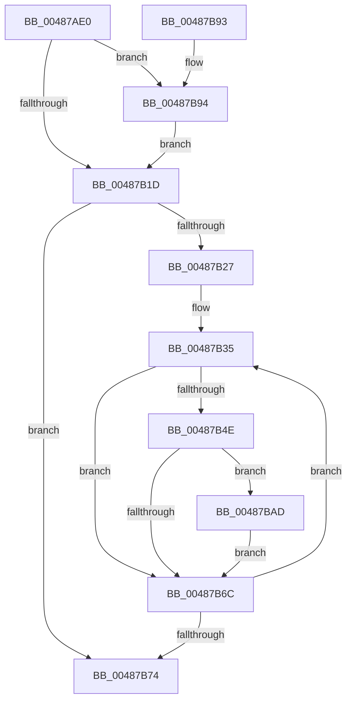

# HalpCmciSetProcessorConfigIntel

- RVA: `0x00487AE0`–`0x00487BD8` (길이 `248` bytes)
- VA: `0x0000000140487AE0`
- 실행 섹션: `.text`
- PDB 이름 있음: `예`; PDB Function 태그: `아니요`
- unwind 정보 RVA: `0x000AFBA4`
- 디코드: `69`개 명령, `248/248` bytes 표시
- 미해석 바이트: `0` (있으면 어셈블리에 `.byte`로 보존)

> 이 문서는 커널 이미지의 기계어와 PDB 기호를 분석해 생성했습니다. 4번과 5번은 함수 원형과 자료형을 바이너리 사용 방식에서 추정한 C 해석이며 원본 소스 복구 결과는 아닙니다.

## 1. Dependencies

- 직접 호출 지점: **3**; 고유 호출 대상: **1**
- 직접 호출자로 확인된 함수: **1**
- RIP 상대 이미지 참조: **4**

### Outgoing calls
- `0x00487B44` → [guard_dispatch_icall](../6B/guard_dispatch_icall_function_006BAAD0.md) (function, `0x006BAAD0`)
- `0x00487B5D` → [guard_dispatch_icall](../6B/guard_dispatch_icall_function_006BAAD0.md) (function, `0x006BAAD0`)
- `0x00487BD1` → [guard_dispatch_icall](../6B/guard_dispatch_icall_function_006BAAD0.md) (function, `0x006BAAD0`)

### Direct callers
- [HalpCmciSetProcessorConfig](HalpCmciSetProcessorConfig_function_00487A04.md) at `0x00487A17`

### Static image references
- `0x00487B07` → RVA `0x00E100E0` (`.data`; read)
- `0x00487B35` → RVA `0x00FC1980` (`.data`; read)
- `0x00487B4E` → RVA `0x00FC1990` (`.data`; read)
- `0x00487BA2` → RVA `0x00E100E0` (`.data`; write)

## 2. Other-region calls and transfers

- 다른 실행 섹션으로 향하는 call: **0**
- 별도 외부 분기/꼬리 이동을 확인하지 못했습니다.

## 3. Assembly (complete function range)

```asm
00487AE0  48 8B C4                        mov rax, rsp
00487AE3  48 89 58 08                     mov qword ptr [rax + 8], rbx
00487AE7  48 89 68 10                     mov qword ptr [rax + 0x10], rbp
00487AEB  48 89 70 18                     mov qword ptr [rax + 0x18], rsi
00487AEF  48 89 78 20                     mov qword ptr [rax + 0x20], rdi
00487AF3  41 54                           push r12
00487AF5  41 56                           push r14
00487AF7  41 57                           push r15
00487AF9  48 83 EC 20                     sub rsp, 0x20
00487AFD  8A C2                           mov al, dl
00487AFF  49 8B D8                        mov rbx, r8
00487B02  F6 D8                           neg al
00487B04  44 8A F2                        mov r14b, dl
00487B07  8A 05 D3 85 98 00               mov al, byte ptr [rip + 0x9885d3]
00487B0D  4C 8B F9                        mov r15, rcx
00487B10  48 1B F6                        sbb rsi, rsi
00487B13  81 E6 00 00 00 40               and esi, 0x40000000
00487B19  84 C0                           test al, al
00487B1B  74 77                           je 0x140487b94
00487B1D  8A 05 BD 85 98 00               mov al, byte ptr [rip + 0x9885bd]
00487B23  84 C0                           test al, al
00487B25  74 4D                           je 0x140487b74
00487B27  BF 80 02 00 00                  mov edi, 0x280
00487B2C  0F B6 E8                        movzx ebp, al
00487B2F  41 BC 01 00 00 00               mov r12d, 1
00487B35  48 8B 05 44 9E B3 00            mov rax, qword ptr [rip + 0xb39e44]
00487B3C  4C 8B C6                        mov r8, rsi
00487B3F  8B D7                           mov edx, edi
00487B41  48 8B CB                        mov rcx, rbx
00487B44  E8 87 2F 23 00                  call 0x1406baad0
00487B49  45 84 F6                        test r14b, r14b
00487B4C  74 1E                           je 0x140487b6c
00487B4E  48 8B 05 3B 9E B3 00            mov rax, qword ptr [rip + 0xb39e3b]
00487B55  45 33 C0                        xor r8d, r8d
00487B58  8B D7                           mov edx, edi
00487B5A  48 8B CB                        mov rcx, rbx
00487B5D  E8 6E 2F 23 00                  call 0x1406baad0
00487B62  4C 8B C0                        mov r8, rax
00487B65  48 0F BA E0 1E                  bt rax, 0x1e
00487B6A  72 41                           jb 0x140487bad
00487B6C  41 03 FC                        add edi, r12d
00487B6F  49 2B EC                        sub rbp, r12
00487B72  75 C1                           jne 0x140487b35
00487B74  48 8B 5C 24 40                  mov rbx, qword ptr [rsp + 0x40]
00487B79  48 8B 6C 24 48                  mov rbp, qword ptr [rsp + 0x48]
00487B7E  48 8B 74 24 50                  mov rsi, qword ptr [rsp + 0x50]
00487B83  48 8B 7C 24 58                  mov rdi, qword ptr [rsp + 0x58]
00487B88  48 83 C4 20                     add rsp, 0x20
00487B8C  41 5F                           pop r15
00487B8E  41 5E                           pop r14
00487B90  41 5C                           pop r12
00487B92  C3                              ret
00487B93  CC                              int3
00487B94  B9 79 01 00 00                  mov ecx, 0x179
00487B99  0F 32                           rdmsr
00487B9B  48 C1 E2 20                     shl rdx, 0x20
00487B9F  48 0B C2                        or rax, rdx
00487BA2  88 05 38 85 98 00               mov byte ptr [rip + 0x988538], al
00487BA8  E9 70 FF FF FF                  jmp 0x140487b1d
00487BAD  41 8B 4F 44                     mov ecx, dword ptr [r15 + 0x44]
00487BB1  8B D7                           mov edx, edi
00487BB3  48 8B 05 C6 9D B3 00            mov rax, qword ptr [rip + 0xb39dc6]
00487BBA  81 E1 FF 3F 00 00               and ecx, 0x3fff
00487BC0  49 0F 44 CC                     cmove rcx, r12
00487BC4  49 81 E0 00 C0 FF FF            and r8, 0xffffffffffffc000
00487BCB  4C 0B C1                        or r8, rcx
00487BCE  48 8B CB                        mov rcx, rbx
00487BD1  E8 FA 2E 23 00                  call 0x1406baad0
00487BD6  EB 94                           jmp 0x140487b6c
```

## 4. C-style interpretation (structured pseudocode)

```c
__int64 __fastcall HalpCmciSetProcessorConfigIntel(__int64 a1, unsigned __int8 a2, __int64 a3)
{
    __int64 result;
    __int64 v_rbp;
    __int64 v_rdi;
    __int64 v_rsi;
    __int64 v_rsp;
    unsigned __int64 v_stack_p10;
    unsigned __int64 v_stack_p18;
    unsigned __int64 v_stack_p20;
    unsigned __int64 v_stack_p8;

    *(unsigned __int64 *)(v_rsp + 8) = v_rbx;
    *(unsigned __int64 *)(v_rsp + 16) = v_rbp;
    *(unsigned __int64 *)(v_rsp + 24) = v_rsi;
    *(unsigned __int64 *)(v_rsp + 32) = v_rdi;
    v_rsp = (v_rsp) - (32);
    result = (unsigned __int8)(-(a2));
    v_rsi = (unsigned int)((v_rsi) & (0x40000000ULL));
    if ((unsigned __int8)(*(unsigned __int8 *)(v_rip + 9995731)) == 0) goto loc_00487B94;
loc_00487B1D:
    if ((unsigned __int8)(*(unsigned __int8 *)(v_rip + 9995709)) == 0) goto loc_00487B74;
loc_00487B35:
    result = guard_dispatch_icall(a3, 640, v_rsi, a4);
    if (a2 == 0) goto loc_00487B6C;
    a3 = 0;
    result = guard_dispatch_icall(0, 640, a3, a4);
    if (condition_is_below) goto loc_00487BAD;
loc_00487B6C:
    v_rdi = (unsigned int)((640) + (1));
    v_rbp = ((unsigned __int8)(*(unsigned __int8 *)(v_rip + 9995709))) - (1);
    if (condition_is_not_equal) goto loc_00487B35;
loc_00487B74:
    v_rsp = (v_rsp) + (32);
    return result;
loc_00487B94:
    a2 = (640) << (32);
    result = (result) | (a2);
    *(unsigned __int8 *)(v_rip + 9995576) = (unsigned __int8)(result);
    goto loc_00487B1D;
loc_00487BAD:
    a1 = (unsigned int)(((unsigned int)(*(unsigned int *)(a1 + 68))) & (0x3FFFULL));
    if (condition_is_equal) { a1 = 1; }
    a3 = (result) & (0xFFFFFFFFFFFFC000ULL);
    a3 = (a3) | (a1);
    result = guard_dispatch_icall(v_stack_p8, (unsigned int)((unsigned int)(v_stack_p20)), a3, a4);
    goto loc_00487B6C;
}
```

## 5. (Beta) C Style

```c
int64_t HalpCmciSetProcessorConfigIntel(void *Arg1, uint8_t Arg2, int64_t Arg3)
{
    uint8_t *arg1 = (uint8_t *)Arg1;

    int64_t result;
    int64_t local_rbp;
    int64_t local_rdi;
    int64_t local_rsi;
    int64_t local_rsp;
    uint64_t v_stack_p10;
    uint64_t v_stack_p18;
    uint64_t v_stack_p20;
    uint64_t v_stack_p8;

    *(uint64_t *)(local_rsp + 0x8) = local_rbx;
    *(uint64_t *)(local_rsp + 0x10) = local_rbp;
    *(uint64_t *)(local_rsp + 0x18) = local_rsi;
    *(uint64_t *)(local_rsp + 0x20) = local_rdi;
    local_rsp = (local_rsp) - (32);
    result = (uint8_t)(-(Arg2));
    local_rsi = (uint32_t)((local_rsi) & (0x40000000ULL));
    if ((uint8_t)(*(uint8_t *)(v_rip + 0x9885D3)) == 0) goto loc_00487B94;
loc_00487B1D:
    if ((uint8_t)(*(uint8_t *)(v_rip + 0x9885BD)) == 0) goto loc_00487B74;
loc_00487B35:
    result = guard_dispatch_icall(Arg3, 640, local_rsi, a4);
    if (Arg2 == 0) goto loc_00487B6C;
    Arg3 = 0;
    result = guard_dispatch_icall(0, 640, Arg3, a4);
    if (condition_is_below) goto loc_00487BAD;
loc_00487B6C:
    local_rdi = (uint32_t)((640) + (1));
    local_rbp = ((uint8_t)(*(uint8_t *)(v_rip + 0x9885BD))) - (1);
    if (condition_is_not_equal) goto loc_00487B35;
loc_00487B74:
    local_rsp = (local_rsp) + (32);
    return result;
loc_00487B94:
    Arg2 = (640) << (32);
    result = (result) | (Arg2);
    *(uint8_t *)(v_rip + 0x988538) = (uint8_t)(result);
    goto loc_00487B1D;
loc_00487BAD:
    Arg1 = (uint32_t)(((uint32_t)(*(uint32_t *)(arg1 + 0x44))) & (0x3FFFULL));
    if (condition_is_equal) { Arg1 = 1; }
    Arg3 = (result) & (0xFFFFFFFFFFFFC000ULL);
    Arg3 = (Arg3) | (Arg1);
    result = guard_dispatch_icall(v_stack_p8, (uint32_t)((uint32_t)(v_stack_p20)), Arg3, a4);
    goto loc_00487B6C;
}
```

### 관측된 메모리 오프셋

구조체 형식이 확인되지 않은 접근은 인자 기준의 오프셋으로만 기록했습니다.

| 기준 인자 | 오프셋 표현 | 폭 (bit) | 접근 |
|---|---:|---:|---|
| `Arg1` | `+ 0x44` | `32` | `R` |

## 6. Execution-region graph

[열기: 2D/3D 그래프와 함수 탐색 컨트롤 패널](../../../control-panel.html?section=text&rva=0x00487AE0&view=graph)

- 2D 그래프는 위에서 아래로 흐르고, 3D 그래프는 빈 공간을 드래그해 회전합니다. Shift+드래그는 이동, 휠은 확대·축소, 함수 노드 선택은 대상 보고서 이동입니다.

### Static fallback


