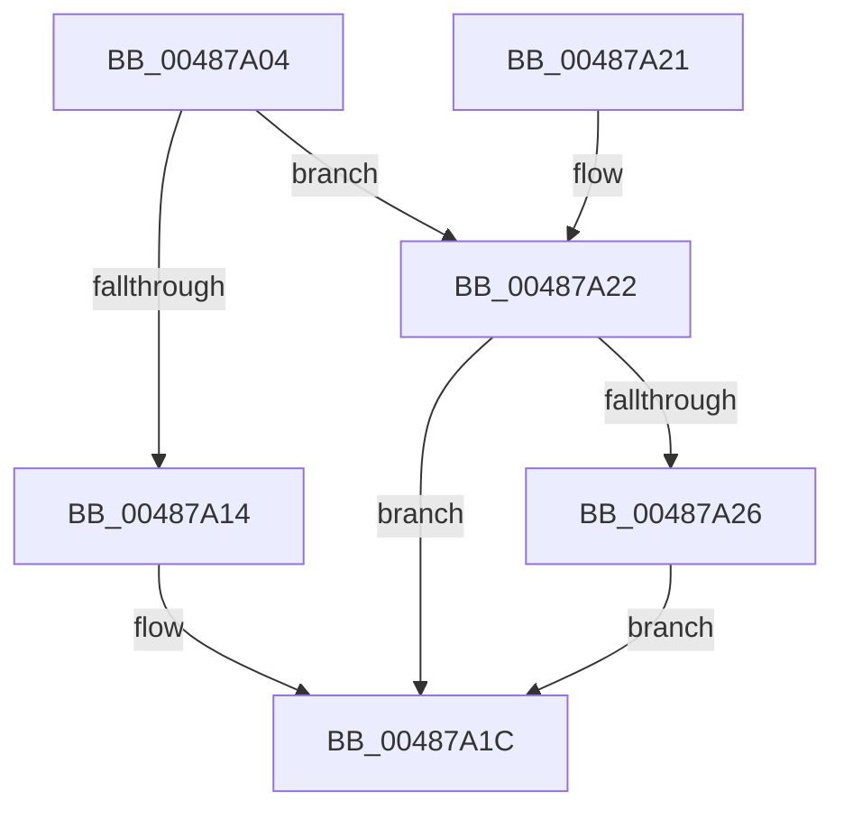

# HalpCmciSetProcessorConfig

- RVA: `0x00487A04`–`0x00487A30` (길이 `44` bytes)
- VA: `0x0000000140487A04`
- 실행 섹션: `.text`
- PDB 이름 있음: `예`; PDB Function 태그: `아니요`
- unwind 정보 RVA: `0x00064C74`
- 디코드: `15`개 명령, `44/44` bytes 표시
- 미해석 바이트: `0` (있으면 어셈블리에 `.byte`로 보존)

> 이 문서는 커널 이미지의 기계어와 PDB 기호를 분석해 생성했습니다. 4번과 5번은 함수 원형과 자료형을 바이너리 사용 방식에서 추정한 C 해석이며 원본 소스 복구 결과는 아닙니다.

## 1. Dependencies

- 직접 호출 지점: **3**; 고유 호출 대상: **3**
- 직접 호출자로 확인된 함수: **2**
- RIP 상대 이미지 참조: **0**

### Outgoing calls
- `0x00487A0B` → [HalpGetCpuVendor](HalpGetCpuVendor_function_004879E4.md) (function, `0x004879E4`)
- `0x00487A17` → [HalpCmciSetProcessorConfigIntel](HalpCmciSetProcessorConfigIntel_function_00487AE0.md) (function, `0x00487AE0`)
- `0x00487A29` → [HalpCmciSetProcessorConfigAMD](HalpCmciSetProcessorConfigAMD_function_00487BE0.md) (function, `0x00487BE0`)

### Direct callers
- [HalpCmciInitProcessor](HalpCmciInitProcessor_function_004875E4.md) at `0x0048763F`
- [HalpDisableCmciOnProcessor](../54/HalpDisableCmciOnProcessor_function_00545390.md) at `0x005453C3`

### Static image references
- 디코드된 RIP-relative 메모리 참조가 없습니다.

## 2. Other-region calls and transfers

- 다른 실행 섹션으로 향하는 call: **0**
- 별도 외부 분기/꼬리 이동을 확인하지 못했습니다.

## 3. Assembly (complete function range)

```asm
00487A04  48 83 EC 28                     sub rsp, 0x28
00487A08  4C 8B C9                        mov r9, rcx
00487A0B  E8 D4 FF FF FF                  call 0x1404879e4
00487A10  3C 02                           cmp al, 2
00487A12  75 0E                           jne 0x140487a22
00487A14  49 8B C9                        mov rcx, r9
00487A17  E8 C4 00 00 00                  call 0x140487ae0
00487A1C  48 83 C4 28                     add rsp, 0x28
00487A20  C3                              ret
00487A21  CC                              int3
00487A22  3C 01                           cmp al, 1
00487A24  75 F6                           jne 0x140487a1c
00487A26  49 8B C9                        mov rcx, r9
00487A29  E8 B2 01 00 00                  call 0x140487be0
00487A2E  EB EC                           jmp 0x140487a1c
```

## 4. C-style interpretation (structured pseudocode)

```c
__int64 __fastcall HalpCmciSetProcessorConfig(__int64 a1)
{
    __int64 result;
    __int64 v_rsp;

    v_rsp = (v_rsp) - (40);
    result = HalpGetCpuVendor(a1, a2, a3, a1);
    if (((unsigned __int8)(result)) != 2) goto loc_00487A22;
    result = HalpCmciSetProcessorConfigIntel(a1, a2, a3, a1);
loc_00487A1C:
    v_rsp = (v_rsp) + (40);
    return result;
loc_00487A22:
    if (((unsigned __int8)(result)) != 1) goto loc_00487A1C;
    result = HalpCmciSetProcessorConfigAMD(a1, a2, a3, a1);
    goto loc_00487A1C;
}
```

## 5. (Beta) C Style

```c
int64_t HalpCmciSetProcessorConfig(int64_t Arg1)
{
    int64_t result;
    int64_t local_rsp;

    local_rsp = (local_rsp) - (40);
    result = HalpGetCpuVendor(Arg1, a2, a3, Arg1);
    if (((uint8_t)(result)) != 2) goto loc_00487A22;
    result = HalpCmciSetProcessorConfigIntel(Arg1, a2, a3, Arg1);
loc_00487A1C:
    local_rsp = (local_rsp) + (40);
    return result;
loc_00487A22:
    if (((uint8_t)(result)) != 1) goto loc_00487A1C;
    result = HalpCmciSetProcessorConfigAMD(Arg1, a2, a3, Arg1);
    goto loc_00487A1C;
}
```

## 6. Execution-region graph

[열기: 2D/3D 그래프와 함수 탐색 컨트롤 패널](../../../control-panel.html?section=text&rva=0x00487A04&view=graph)

- 2D 그래프는 위에서 아래로 흐르고, 3D 그래프는 빈 공간을 드래그해 회전합니다. Shift+드래그는 이동, 휠은 확대·축소, 함수 노드 선택은 대상 보고서 이동입니다.

### Static fallback


