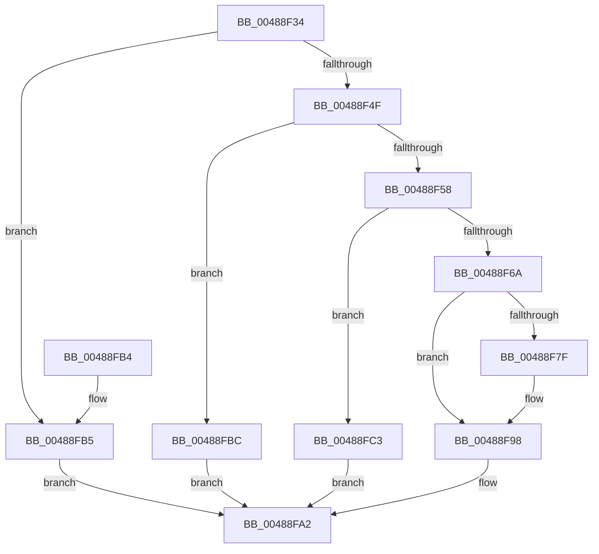

# HalpDisableSecondaryInterrupt

- RVA: `0x00488F34`–`0x00488FCA` (길이 `150` bytes)
- VA: `0x0000000140488F34`
- 실행 섹션: `.text`
- PDB 이름 있음: `예`; PDB Function 태그: `아니요`
- unwind 정보 RVA: `0x0009E850`
- 디코드: `44`개 명령, `150/150` bytes 표시
- 미해석 바이트: `0` (있으면 어셈블리에 `.byte`로 보존)

> 이 문서는 커널 이미지의 기계어와 PDB 기호를 분석해 생성했습니다. 4번과 5번은 함수 원형과 자료형을 바이너리 사용 방식에서 추정한 C 해석이며 원본 소스 복구 결과는 아닙니다.

## 1. Dependencies

- 직접 호출 지점: **4**; 고유 호출 대상: **4**
- 직접 호출자로 확인된 함수: **1**
- RIP 상대 이미지 참조: **1**

### Outgoing calls
- `0x00488F4F` → [HalpCheckInterruptType](../4F/HalpCheckInterruptType_function_004FC2D8.md) (function, `0x004FC2D8`)
- `0x00488F5D` → [HalpFindSecondaryIcEntry](../2D/HalpFindSecondaryIcEntry_function_002D219C.md) (function, `0x002D219C`)
- `0x00488F74` → [guard_dispatch_icall](../6B/guard_dispatch_icall_function_006BAAD0.md) (function, `0x006BAAD0`)
- `0x00488F9D` → [HalpReleaseSecondaryIcEntryShared](HalpReleaseSecondaryIcEntryShared_function_00488FD0.md) (function, `0x00488FD0`)

### Direct callers
- [HalDisableInterrupt](../2D/HalDisableInterrupt_function_002D39F0.md) at `0x002D3B19`

### Static image references
- `0x00488F43` → RVA `0x00E10424` (`.data`; read)

## 2. Other-region calls and transfers

- 다른 실행 섹션으로 향하는 call: **0**
- 별도 외부 분기/꼬리 이동을 확인하지 못했습니다.

## 3. Assembly (complete function range)

```asm
00488F34  48 89 5C 24 08                  mov qword ptr [rsp + 8], rbx
00488F39  48 89 74 24 10                  mov qword ptr [rsp + 0x10], rsi
00488F3E  57                              push rdi
00488F3F  48 83 EC 20                     sub rsp, 0x20
00488F43  80 3D DA 74 98 00 00            cmp byte ptr [rip + 0x9874da], 0
00488F4A  48 8B F1                        mov rsi, rcx
00488F4D  74 66                           je 0x140488fb5
00488F4F  E8 84 33 07 00                  call 0x1404fc2d8
00488F54  84 C0                           test al, al
00488F56  74 64                           je 0x140488fbc
00488F58  8B 76 40                        mov esi, dword ptr [rsi + 0x40]
00488F5B  8B CE                           mov ecx, esi
00488F5D  E8 3A 92 E4 FF                  call 0x1402d219c
00488F62  48 8B D8                        mov rbx, rax
00488F65  48 85 C0                        test rax, rax
00488F68  74 59                           je 0x140488fc3
00488F6A  48 8B 40 40                     mov rax, qword ptr [rax + 0x40]
00488F6E  8B D6                           mov edx, esi
00488F70  48 8B 4B 20                     mov rcx, qword ptr [rbx + 0x20]
00488F74  E8 57 1B 23 00                  call 0x1406baad0
00488F79  8B F8                           mov edi, eax
00488F7B  85 C0                           test eax, eax
00488F7D  78 19                           js 0x140488f98
00488F7F  2B 73 10                        sub esi, dword ptr [rbx + 0x10]
00488F82  8B CE                           mov ecx, esi
00488F84  48 03 C9                        add rcx, rcx
00488F87  0F BA AC CB A8 00 00 00 1F      bts dword ptr [rbx + rcx*8 + 0xa8], 0x1f
00488F90  C6 84 CB AC 00 00 00 00         mov byte ptr [rbx + rcx*8 + 0xac], 0
00488F98  B2 01                           mov dl, 1
00488F9A  48 8B CB                        mov rcx, rbx
00488F9D  E8 2E 00 00 00                  call 0x140488fd0
00488FA2  48 8B 5C 24 30                  mov rbx, qword ptr [rsp + 0x30]
00488FA7  8B C7                           mov eax, edi
00488FA9  48 8B 74 24 38                  mov rsi, qword ptr [rsp + 0x38]
00488FAE  48 83 C4 20                     add rsp, 0x20
00488FB2  5F                              pop rdi
00488FB3  C3                              ret
00488FB4  CC                              int3
00488FB5  BF BB 00 00 C0                  mov edi, 0xc00000bb
00488FBA  EB E6                           jmp 0x140488fa2
00488FBC  BF 0D 00 00 C0                  mov edi, 0xc000000d
00488FC1  EB DF                           jmp 0x140488fa2
00488FC3  BF 21 A1 00 C0                  mov edi, 0xc000a121
00488FC8  EB D8                           jmp 0x140488fa2
```

## 4. C-style interpretation (structured pseudocode)

```c
__int64 __fastcall HalpDisableSecondaryInterrupt(__int64 a1)
{
    __int64 result;
    __int64 v_rsi;
    __int64 v_rsp;
    unsigned __int64 v_stack_p10;
    unsigned __int64 v_stack_p8;

    v_stack_p8 = v_rbx;
    v_stack_p10 = v_rsi;
    v_rsp = (v_rsp) - (32);
    if ((*(unsigned __int8 *)(v_rip + 9991386)) == 0) goto loc_00488FB5;
    result = HalpCheckInterruptType(a1, a2, a3, a4);
    if ((unsigned __int8)(result) == 0) goto loc_00488FBC;
    result = HalpFindSecondaryIcEntry((unsigned int)((unsigned int)((unsigned int)(*(unsigned int *)(a1 + 64)))), a2, a3, a4);
    if (result == 0) goto loc_00488FC3;
    result = guard_dispatch_icall(*(unsigned __int64 *)(result + 32), (unsigned int)((unsigned int)((unsigned int)(*(unsigned int *)(a1 + 64)))), a3, a4);
    v_rsi = (unsigned int)(*(unsigned int *)(a1 + 64));
    if (!(sign_flag)) {
        v_rsi = (unsigned int)(((unsigned int)(*(unsigned int *)(a1 + 64))) - (*(unsigned int *)(result + 16)));
        a1 = (unsigned int)(v_rsi);
        a1 = (a1) + (a1);
        *(unsigned __int8 *)(result + a1 * 8 + 172) = 0;
    }
    result = HalpReleaseSecondaryIcEntryShared(result, 1, a3, a4);
loc_00488FA2:
    v_rsp = (v_rsp) + (32);
    return (unsigned int)((unsigned int)((unsigned int)((unsigned int)(result))));
loc_00488FB5:
    goto loc_00488FA2;
loc_00488FBC:
    goto loc_00488FA2;
loc_00488FC3:
    goto loc_00488FA2;
}
```

## 5. (Beta) C Style

```c
int64_t HalpDisableSecondaryInterrupt(void *Arg1)
{
    uint8_t *arg1 = (uint8_t *)Arg1;

    int64_t result;
    int64_t local_rsi;
    int64_t local_rsp;
    uint64_t v_stack_p10;
    uint64_t v_stack_p8;

    v_stack_p8 = local_rbx;
    v_stack_p10 = local_rsi;
    local_rsp = (local_rsp) - (32);
    if ((*(uint8_t *)(v_rip + 0x9874DA)) == 0) goto loc_00488FB5;
    result = HalpCheckInterruptType(Arg1, a2, a3, a4);
    if ((uint8_t)(result) == 0) goto loc_00488FBC;
    result = HalpFindSecondaryIcEntry((uint32_t)((uint32_t)((uint32_t)(*(uint32_t *)(arg1 + 0x40)))), a2, a3, a4);
    if (result == 0) goto loc_00488FC3;
    result = guard_dispatch_icall(*(uint64_t *)(result + 0x20), (uint32_t)((uint32_t)((uint32_t)(*(uint32_t *)(arg1 + 0x40)))), a3, a4);
    local_rsi = (uint32_t)(*(uint32_t *)(arg1 + 0x40));
    if (!(sign_flag)) {
        local_rsi = (uint32_t)(((uint32_t)(*(uint32_t *)(arg1 + 0x40))) - (*(uint32_t *)(result + 0x10)));
        Arg1 = (uint32_t)(local_rsi);
        Arg1 = (Arg1) + (Arg1);
        *(uint8_t *)(result + arg1 * 8 + 0xAC) = 0;
    }
    result = HalpReleaseSecondaryIcEntryShared(result, 1, a3, a4);
loc_00488FA2:
    local_rsp = (local_rsp) + (32);
    return (uint32_t)((uint32_t)((uint32_t)((uint32_t)(result))));
loc_00488FB5:
    goto loc_00488FA2;
loc_00488FBC:
    goto loc_00488FA2;
loc_00488FC3:
    goto loc_00488FA2;
}
```

### 관측된 메모리 오프셋

구조체 형식이 확인되지 않은 접근은 인자 기준의 오프셋으로만 기록했습니다.

| 기준 인자 | 오프셋 표현 | 폭 (bit) | 접근 |
|---|---:|---:|---|
| `Arg1` | `+ 0x40` | `32` | `R` |

## 6. Execution-region graph

[열기: 2D/3D 그래프와 함수 탐색 컨트롤 패널](../../../control-panel.html?section=text&rva=0x00488F34&view=graph)

- 2D 그래프는 위에서 아래로 흐르고, 3D 그래프는 빈 공간을 드래그해 회전합니다. Shift+드래그는 이동, 휠은 확대·축소, 함수 노드 선택은 대상 보고서 이동입니다.

### Static fallback


