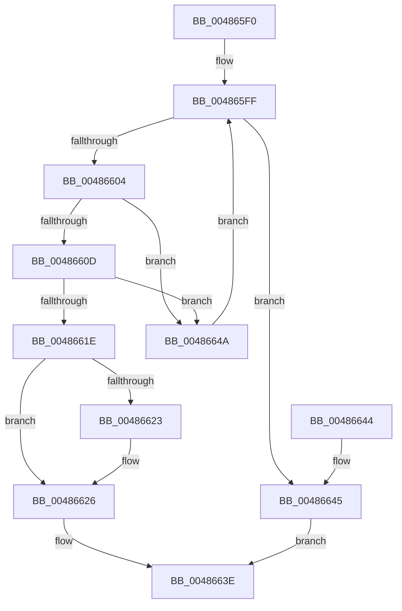

# HalpDmaTranslationEntryToIndex

- RVA: `0x004865F0`–`0x00486653` (길이 `99` bytes)
- VA: `0x00000001404865F0`
- 실행 섹션: `.text`
- PDB 이름 있음: `예`; PDB Function 태그: `아니요`
- unwind 정보 RVA: `0x000AF814`
- 디코드: `30`개 명령, `99/99` bytes 표시
- 미해석 바이트: `0` (있으면 어셈블리에 `.byte`로 보존)

> 이 문서는 커널 이미지의 기계어와 PDB 기호를 분석해 생성했습니다. 4번과 5번은 함수 원형과 자료형을 바이너리 사용 방식에서 추정한 C 해석이며 원본 소스 복구 결과는 아닙니다.

## 1. Dependencies

- 직접 호출 지점: **0**; 고유 호출 대상: **0**
- 직접 호출자로 확인된 함수: **1**
- RIP 상대 이미지 참조: **0**

### Outgoing calls
- 직접 디코드된 call 명령이 없습니다.

### Direct callers
- [HalpDmaCommitContiguousMapBuffers](../55/HalpDmaCommitContiguousMapBuffers_function_00550A84.md) at `0x00550B37`

### Static image references
- 디코드된 RIP-relative 메모리 참조가 없습니다.

## 2. Other-region calls and transfers

- 다른 실행 섹션으로 향하는 call: **0**
- 별도 외부 분기/꼬리 이동을 확인하지 못했습니다.

## 3. Assembly (complete function range)

```asm
004865F0  48 89 5C 24 08                  mov qword ptr [rsp + 8], rbx
004865F5  4C 8B 49 30                     mov r9, qword ptr [rcx + 0x30]
004865F9  49 8B D8                        mov rbx, r8
004865FC  45 33 D2                        xor r10d, r10d
004865FF  4D 85 C9                        test r9, r9
00486602  74 41                           je 0x140486645
00486604  4D 8B 59 10                     mov r11, qword ptr [r9 + 0x10]
00486608  4C 3B DA                        cmp r11, rdx
0048660B  77 3D                           ja 0x14048664a
0048660D  41 8B 41 08                     mov eax, dword ptr [r9 + 8]
00486611  48 8D 0C C0                     lea rcx, [rax + rax*8]
00486615  49 8D 04 CB                     lea rax, [r11 + rcx*8]
00486619  48 3B D0                        cmp rdx, rax
0048661C  73 2C                           jae 0x14048664a
0048661E  48 85 DB                        test rbx, rbx
00486621  74 03                           je 0x140486626
00486623  4D 89 08                        mov qword ptr [r8], r9
00486626  49 2B D3                        sub rdx, r11
00486629  48 B8 39 8E E3 38 8E E3 38 8E   movabs rax, 0x8e38e38e38e38e39
00486633  48 C1 FA 03                     sar rdx, 3
00486637  48 0F AF C2                     imul rax, rdx
0048663B  41 03 C2                        add eax, r10d
0048663E  48 8B 5C 24 08                  mov rbx, qword ptr [rsp + 8]
00486643  C3                              ret
00486644  CC                              int3
00486645  83 C8 FF                        or eax, 0xffffffff
00486648  EB F4                           jmp 0x14048663e
0048664A  45 03 51 08                     add r10d, dword ptr [r9 + 8]
0048664E  4D 8B 09                        mov r9, qword ptr [r9]
00486651  EB AC                           jmp 0x1404865ff
```

## 4. C-style interpretation (structured pseudocode)

```c
__int64 __fastcall HalpDmaTranslationEntryToIndex(__int64 a1, __int64 a2, __int64 a3)
{
    __int64 result;
    __int64 v_r10;
    unsigned __int64 v_stack_p8;

    v_stack_p8 = v_rbx;
    v_r10 = 0;
loc_004865FF:
    if (*(unsigned __int64 *)(a1 + 48) == 0) goto loc_00486645;
    if ((*(unsigned __int64 *)(*(unsigned __int64 *)(a1 + 48) + 16)) > a2) goto loc_0048664A;
    if (a2 >= (*(unsigned __int64 *)(*(unsigned __int64 *)(a1 + 48) + 16) + (unsigned int)(*(unsigned int *)(*(unsigned __int64 *)(a1 + 48) + 8)) + (unsigned int)(*(unsigned int *)(*(unsigned __int64 *)(a1 + 48) + 8)) * 8 * 8)) goto loc_0048664A;
    if (a3 != 0) {
        *(unsigned __int64 *)(a3) = *(unsigned __int64 *)(a1 + 48);
    }
    a2 = (a2) - (*(unsigned __int64 *)(*(unsigned __int64 *)(a1 + 48) + 16));
    a2 = (a2) >> (3);
    result = (*(unsigned __int64 *)(*(unsigned __int64 *)(a1 + 48) + 16) + (unsigned int)(*(unsigned int *)(*(unsigned __int64 *)(a1 + 48) + 8)) + (unsigned int)(*(unsigned int *)(*(unsigned __int64 *)(a1 + 48) + 8)) * 8 * 8) * (a2);
    result = (unsigned int)((result) + (0));
loc_0048663E:
    return result;
loc_00486645:
    result = (unsigned int)((result) | (0xFFFFFFFFULL));
    goto loc_0048663E;
loc_0048664A:
    v_r10 = (unsigned int)((v_r10) + (*(unsigned int *)(*(unsigned __int64 *)(a1 + 48) + 8)));
    goto loc_004865FF;
}
```

## 5. (Beta) C Style

```c
int64_t HalpDmaTranslationEntryToIndex(void *Arg1, int64_t Arg2, void *Arg3)
{
    uint8_t *arg1 = (uint8_t *)Arg1;
    uint8_t *arg3 = (uint8_t *)Arg3;

    int64_t result;
    int64_t local_r10;
    uint64_t v_stack_p8;

    v_stack_p8 = local_rbx;
    local_r10 = 0;
loc_004865FF:
    if (*(uint64_t *)(arg1 + 0x30) == 0) goto loc_00486645;
    if ((*(uint64_t *)(*(uint64_t *)(arg1 + 0x30) + 0x10)) > Arg2) goto loc_0048664A;
    if (Arg2 >= (*(uint64_t *)(*(uint64_t *)(arg1 + 0x30) + 0x10) + (uint32_t)(*(uint32_t *)(*(uint64_t *)(arg1 + 0x30) + 0x8)) + (uint32_t)(*(uint32_t *)(*(uint64_t *)(arg1 + 0x30) + 0x8)) * 8 * 8)) goto loc_0048664A;
    if (Arg3 != NULL) {
        *(uint64_t *)(arg3) = *(uint64_t *)(arg1 + 0x30);
    }
    Arg2 = (Arg2) - (*(uint64_t *)(*(uint64_t *)(arg1 + 0x30) + 0x10));
    Arg2 = (Arg2) >> (3);
    result = (*(uint64_t *)(*(uint64_t *)(arg1 + 0x30) + 0x10) + (uint32_t)(*(uint32_t *)(*(uint64_t *)(arg1 + 0x30) + 0x8)) + (uint32_t)(*(uint32_t *)(*(uint64_t *)(arg1 + 0x30) + 0x8)) * 8 * 8) * (Arg2);
    result = (uint32_t)((result) + (0));
loc_0048663E:
    return result;
loc_00486645:
    result = (uint32_t)((result) | (0xFFFFFFFFULL));
    goto loc_0048663E;
loc_0048664A:
    local_r10 = (uint32_t)((local_r10) + (*(uint32_t *)(*(uint64_t *)(arg1 + 0x30) + 0x8)));
    goto loc_004865FF;
}
```

### 관측된 메모리 오프셋

구조체 형식이 확인되지 않은 접근은 인자 기준의 오프셋으로만 기록했습니다.

| 기준 인자 | 오프셋 표현 | 폭 (bit) | 접근 |
|---|---:|---:|---|
| `Arg1` | `+ 0x30` | `64` | `R` |
| `Arg3` | `+ 0x0` | `64` | `W` |

## 6. Execution-region graph

[열기: 2D/3D 그래프와 함수 탐색 컨트롤 패널](../../../control-panel.html?section=text&rva=0x004865F0&view=graph)

- 2D 그래프는 위에서 아래로 흐르고, 3D 그래프는 빈 공간을 드래그해 회전합니다. Shift+드래그는 이동, 휠은 확대·축소, 함수 노드 선택은 대상 보고서 이동입니다.

### Static fallback


