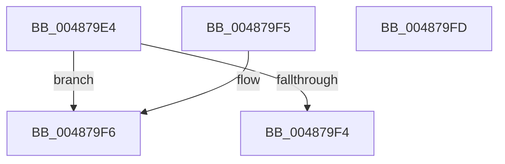

# HalpGetCpuVendor

- RVA: `0x004879E4`–`0x004879FE` (길이 `26` bytes)
- VA: `0x00000001404879E4`
- 실행 섹션: `.text`
- PDB 이름 있음: `예`; PDB Function 태그: `아니요`
- unwind 정보 RVA: `0x000DB714`
- 디코드: `9`개 명령, `26/26` bytes 표시
- 미해석 바이트: `0` (있으면 어셈블리에 `.byte`로 보존)

> 이 문서는 커널 이미지의 기계어와 PDB 기호를 분석해 생성했습니다. 4번과 5번은 함수 원형과 자료형을 바이너리 사용 방식에서 추정한 C 해석이며 원본 소스 복구 결과는 아닙니다.

## 1. Dependencies

- 직접 호출 지점: **0**; 고유 호출 대상: **0**
- 직접 호출자로 확인된 함수: **26**
- RIP 상대 이미지 참조: **0**

### Outgoing calls
- 직접 디코드된 call 명령이 없습니다.

### Direct callers
- [HaliWheaInitProcessorGenericSection](HaliWheaInitProcessorGenericSection_function_004871B8.md) at `0x00487209`
- [HalpMcaProcessorBankConfig](HalpMcaProcessorBankConfig_function_004872BC.md) at `0x004872C3`
- [HalpWheaReadMsrMisc](HalpWheaReadMsrMisc_function_004872EC.md) at `0x004872F3`
- [HalpWheaGetBankFromMciStatusIndex](HalpWheaGetBankFromMciStatusIndex_function_0048746C.md) at `0x00487476`
- [HalpWheaWriteMsrStatus](HalpWheaWriteMsrStatus_function_004874C0.md) at `0x004874C7`
- [HalpWheaWriteMsrControl](HalpWheaWriteMsrControl_function_0048750C.md) at `0x00487513`
- [HalpCmciInitProcessor](HalpCmciInitProcessor_function_004875E4.md) at `0x00487601`
- [HalpCmcPollProcessor](HalpCmcPollProcessor_function_0048772C.md) at `0x00487784`
- [HalpMcaReadErrorPresence](HalpMcaReadErrorPresence_function_004878D4.md) at `0x0048793C`
- [HalpWheaReadMsrStatus](HalpWheaReadMsrStatus_function_0048799C.md) at `0x004879A3`
- [HalpCmciSetProcessorConfig](HalpCmciSetProcessorConfig_function_00487A04.md) at `0x00487A0B`
- [HalpCmciPollProcessor](HalpCmciPollProcessor_function_00487A88.md) at `0x00487A95`
- [HalpIsLmceSupported](../4F/HalpIsLmceSupported_function_004FBD7C.md) at `0x004FBD80`
- [HalpCreateMcaMemoryErrorRecord](../54/HalpCreateMcaMemoryErrorRecord_function_00540C78.md) at `0x00540F11`
- [HalpCreateMcaMemoryErrorRecord](../54/HalpCreateMcaMemoryErrorRecord_function_00540C78.md) at `0x00540F99`
- [HalpMcaClearError](../54/HalpMcaClearError_function_00541478.md) at `0x00541490`
- [HalpMcaPopulateErrorData](../54/HalpMcaPopulateErrorData_function_005417AC.md) at `0x00541808`
- [HalpMcaPopulateErrorData](../54/HalpMcaPopulateErrorData_function_005417AC.md) at `0x0054193C`
- [HalpMcaReadError](../54/HalpMcaReadError_function_00541A2C.md) at `0x00541BC1`
- [HalpMcaReadError](../54/HalpMcaReadError_function_00541A2C.md) at `0x00541C93`
- [HalpMcaReportError](../54/HalpMcaReportError_function_00541D04.md) at `0x00541D68`
- [HalpCmciHandler](../54/HalpCmciHandler_function_00545168.md) at `0x00545255`
- [HalpGetMcaMaxVendorSpecificSectionLength](../54/HalpGetMcaMaxVendorSpecificSectionLength_function_005453E4.md) at `0x005453E8`
- [HalpGetMcaVendorSpecificSections](../54/HalpGetMcaVendorSpecificSections_function_00545408.md) at `0x0054540C`
- [HalpMcaReadErrorUncorrected](../54/HalpMcaReadErrorUncorrected_function_00545520.md) at `0x00545527`
- [HalpHvInitMcaStatusMsrCache](../54/HalpHvInitMcaStatusMsrCache_function_0054C170.md) at `0x0054C20A`
- [HalpWheaReadMsrAddress](../55/HalpWheaReadMsrAddress_function_005559C0.md) at `0x005559C7`
- [HalpIsCmciImplemented](../../pagelk/B5/HalpIsCmciImplemented_function_00B5C314.md) at `0x00B5C324`
- [HalpMcaSetFeatureFlags](../../pagelk/B5/HalpMcaSetFeatureFlags_function_00B5C434.md) at `0x00B5C449`

### Static image references
- 디코드된 RIP-relative 메모리 참조가 없습니다.

## 2. Other-region calls and transfers

- 다른 실행 섹션으로 향하는 call: **0**
- 별도 외부 분기/꼬리 이동을 확인하지 못했습니다.

## 3. Assembly (complete function range)

```asm
004879E4  65 48 8B 0C 25 20 00 00 00      mov rcx, qword ptr gs:[0x20]
004879ED  32 C0                           xor al, al
004879EF  38 41 41                        cmp byte ptr [rcx + 0x41], al
004879F2  75 02                           jne 0x1404879f6
004879F4  C3                              ret
004879F5  CC                              int3
004879F6  8A 81 8D 00 00 00               mov al, byte ptr [rcx + 0x8d]
004879FC  C3                              ret
004879FD  CC                              int3
```

## 4. C-style interpretation (structured pseudocode)

```c
__int64 __fastcall HalpGetCpuVendor(void)
{
    __int64 result;

    result = 0;
    if ((*(unsigned __int8 *)(*(unsigned __int64 *)(gs_base + (0 + 32)) + 65)) != 0) goto loc_004879F6;
    return result;
loc_004879F6:
    return *(unsigned __int8 *)(*(unsigned __int64 *)(gs_base + (0 + 32)) + 141);
}
```

## 5. (Beta) C Style

```c
void HalpGetCpuVendor(void)
{
    int64_t result;

    result = 0;
    if ((*(uint8_t *)(*(uint64_t *)(gs_base + (0 + 0x20)) + 0x41)) != 0) goto loc_004879F6;
    return result;
loc_004879F6:
    return *(uint8_t *)(*(uint64_t *)(gs_base + (0 + 0x20)) + 0x8D);
}
```

## 6. Execution-region graph

[열기: 2D/3D 그래프와 함수 탐색 컨트롤 패널](../../../control-panel.html?section=text&rva=0x004879E4&view=graph)

- 2D 그래프는 위에서 아래로 흐르고, 3D 그래프는 빈 공간을 드래그해 회전합니다. Shift+드래그는 이동, 휠은 확대·축소, 함수 노드 선택은 대상 보고서 이동입니다.

### Static fallback


