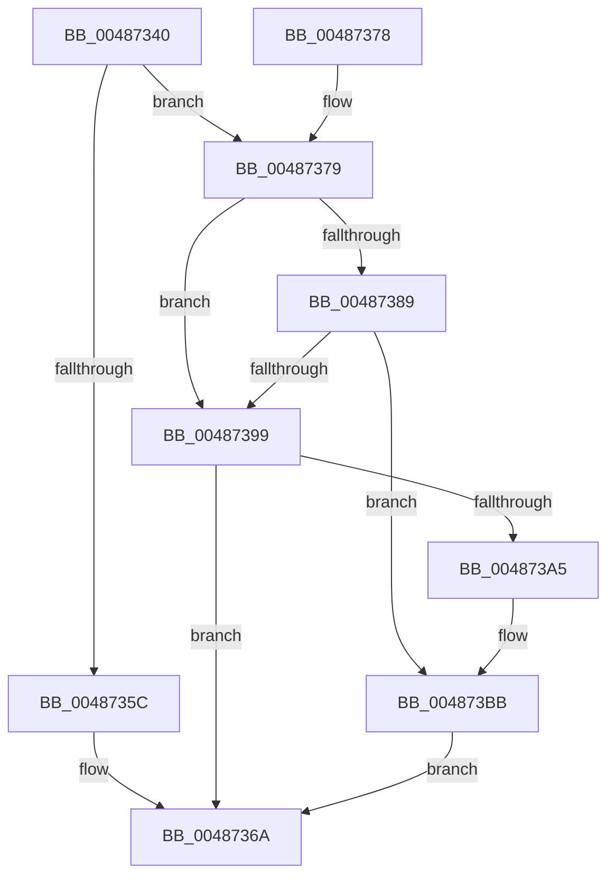

# HalpHvEpReadMsr

- RVA: `0x00487340`–`0x004873C2` (길이 `130` bytes)
- VA: `0x0000000140487340`
- 실행 섹션: `.text`
- PDB 이름 있음: `예`; PDB Function 태그: `아니요`
- unwind 정보 RVA: `0x000AFB24`
- 디코드: `40`개 명령, `130/130` bytes 표시
- 미해석 바이트: `0` (있으면 어셈블리에 `.byte`로 보존)

> 이 문서는 커널 이미지의 기계어와 PDB 기호를 분석해 생성했습니다. 4번과 5번은 함수 원형과 자료형을 바이너리 사용 방식에서 추정한 C 해석이며 원본 소스 복구 결과는 아닙니다.

## 1. Dependencies

- 직접 호출 지점: **2**; 고유 호출 대상: **2**
- 직접 호출자로 확인된 함수: **0**
- RIP 상대 이미지 참조: **1**

### Outgoing calls
- `0x00487390` → [HalpHvLpReadMcaStatusMsr](HalpHvLpReadMcaStatusMsr_function_004873C8.md) (function, `0x004873C8`)
- `0x004873B6` → [guard_dispatch_icall](../6B/guard_dispatch_icall_function_006BAAD0.md) (function, `0x006BAAD0`)

### Direct callers
- 이 함수 시작 RVA로 연결되는 직접 call은 확인되지 않았습니다. 간접 호출은 완전히 역산할 수 없습니다.

### Static image references
- `0x00487399` → RVA `0x00FC1CD8` (`.data`; read)

## 2. Other-region calls and transfers

- 다른 실행 섹션으로 향하는 call: **0**
- 별도 외부 분기/꼬리 이동을 확인하지 못했습니다.

## 3. Assembly (complete function range)

```asm
00487340  48 89 5C 24 18                  mov qword ptr [rsp + 0x18], rbx
00487345  89 54 24 10                     mov dword ptr [rsp + 0x10], edx
00487349  57                              push rdi
0048734A  48 83 EC 30                     sub rsp, 0x30
0048734E  48 8B C1                        mov rax, rcx
00487351  48 8B D9                        mov rbx, rcx
00487354  48 C1 E8 20                     shr rax, 0x20
00487358  A8 01                           test al, 1
0048735A  74 1D                           je 0x140487379
0048735C  8B CA                           mov ecx, edx
0048735E  0F 32                           rdmsr
00487360  48 C1 E2 20                     shl rdx, 0x20
00487364  48 0B C2                        or rax, rdx
00487367  48 8B F8                        mov rdi, rax
0048736A  48 8B 5C 24 50                  mov rbx, qword ptr [rsp + 0x50]
0048736F  48 8B C7                        mov rax, rdi
00487372  48 83 C4 30                     add rsp, 0x30
00487376  5F                              pop rdi
00487377  C3                              ret
00487378  CC                              int3
00487379  33 FF                           xor edi, edi
0048737B  0F BA F3 1F                     btr ebx, 0x1f
0048737F  48 89 7C 24 40                  mov qword ptr [rsp + 0x40], rdi
00487384  4D 85 C0                        test r8, r8
00487387  74 10                           je 0x140487399
00487389  4C 8D 4C 24 40                  lea r9, [rsp + 0x40]
0048738E  8B CB                           mov ecx, ebx
00487390  E8 33 00 00 00                  call 0x1404873c8
00487395  84 C0                           test al, al
00487397  75 22                           jne 0x1404873bb
00487399  48 8B 05 38 A9 B3 00            mov rax, qword ptr [rip + 0xb3a938]
004873A0  48 85 C0                        test rax, rax
004873A3  74 C5                           je 0x14048736a
004873A5  4C 8D 4C 24 40                  lea r9, [rsp + 0x40]
004873AA  BA 01 00 00 00                  mov edx, 1
004873AF  4C 8D 44 24 48                  lea r8, [rsp + 0x48]
004873B4  8B CB                           mov ecx, ebx
004873B6  E8 15 37 23 00                  call 0x1406baad0
004873BB  48 8B 7C 24 40                  mov rdi, qword ptr [rsp + 0x40]
004873C0  EB A8                           jmp 0x14048736a
```

## 4. C-style interpretation (structured pseudocode)

```c
__int64 __fastcall HalpHvEpReadMsr(__int64 a1, __int64 a2, __int64 a3)
{
    __int64 result;
    __int64 v_rdi;
    __int64 v_rsp;
    unsigned int v_stack_p10;
    unsigned __int64 v_stack_p18;
    unsigned __int64 v_stack_p40;
    unsigned __int64 v_stack_p48;

    v_stack_p18 = v_rbx;
    v_stack_p10 = (unsigned int)(a2);
    v_rsp = (v_rsp) - (48);
    result = (a1) >> (32);
    if ((((unsigned __int8)(result)) & (1)) == 0) goto loc_00487379;
    a2 = (a2) << (32);
    result = (result) | (a2);
loc_0048736A:
    v_rsp = (v_rsp) + (48);
    return result;
loc_00487379:
    v_rdi = 0;
    v_stack_p40 = 0;
    if (a3 == 0) goto loc_00487399;
    result = HalpHvLpReadMcaStatusMsr((unsigned int)((unsigned int)(v_stack_p18)), a2, a3, v_stack_p40);
    if ((unsigned __int8)(result) != 0) goto loc_004873BB;
loc_00487399:
    if (*(unsigned __int64 *)(v_rip + 11774264) == 0) goto loc_0048736A;
    result = guard_dispatch_icall((unsigned int)((unsigned int)(v_stack_p18)), 1, v_stack_p48, v_stack_p40);
loc_004873BB:
    goto loc_0048736A;
}
```

## 5. (Beta) C Style

```c
int64_t HalpHvEpReadMsr(int64_t Arg1, int64_t Arg2, int64_t Arg3)
{
    int64_t result;
    int64_t local_rdi;
    int64_t local_rsp;
    uint32_t v_stack_p10;
    uint64_t v_stack_p18;
    uint64_t v_stack_p40;
    uint64_t v_stack_p48;

    v_stack_p18 = local_rbx;
    v_stack_p10 = (uint32_t)(Arg2);
    local_rsp = (local_rsp) - (48);
    result = (Arg1) >> (32);
    if ((((uint8_t)(result)) & (1)) == 0) goto loc_00487379;
    Arg2 = (Arg2) << (32);
    result = (result) | (Arg2);
loc_0048736A:
    local_rsp = (local_rsp) + (48);
    return result;
loc_00487379:
    local_rdi = 0;
    v_stack_p40 = 0;
    if (Arg3 == 0) goto loc_00487399;
    result = HalpHvLpReadMcaStatusMsr((uint32_t)((uint32_t)(v_stack_p18)), Arg2, Arg3, v_stack_p40);
    if ((uint8_t)(result) != 0) goto loc_004873BB;
loc_00487399:
    if (*(uint64_t *)(v_rip + 0xB3A938) == 0) goto loc_0048736A;
    result = guard_dispatch_icall((uint32_t)((uint32_t)(v_stack_p18)), 1, v_stack_p48, v_stack_p40);
loc_004873BB:
    goto loc_0048736A;
}
```

## 6. Execution-region graph

[열기: 2D/3D 그래프와 함수 탐색 컨트롤 패널](../../../control-panel.html?section=text&rva=0x00487340&view=graph)

- 2D 그래프는 위에서 아래로 흐르고, 3D 그래프는 빈 공간을 드래그해 회전합니다. Shift+드래그는 이동, 휠은 확대·축소, 함수 노드 선택은 대상 보고서 이동입니다.

### Static fallback


