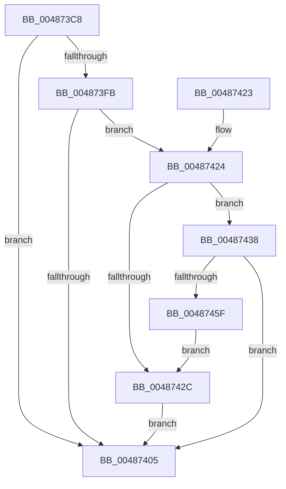

# HalpHvLpReadMcaStatusMsr

- RVA: `0x004873C8`–`0x00487464` (길이 `156` bytes)
- VA: `0x00000001404873C8`
- 실행 섹션: `.text`
- PDB 이름 있음: `예`; PDB Function 태그: `아니요`
- unwind 정보 RVA: `0x000AFB34`
- 디코드: `47`개 명령, `156/156` bytes 표시
- 미해석 바이트: `0` (있으면 어셈블리에 `.byte`로 보존)

> 이 문서는 커널 이미지의 기계어와 PDB 기호를 분석해 생성했습니다. 4번과 5번은 함수 원형과 자료형을 바이너리 사용 방식에서 추정한 C 해석이며 원본 소스 복구 결과는 아닙니다.

## 1. Dependencies

- 직접 호출 지점: **2**; 고유 호출 대상: **2**
- 직접 호출자로 확인된 함수: **1**
- RIP 상대 이미지 참조: **3**

### Outgoing calls
- `0x004873EE` → [HalpWheaGetBankFromMciStatusIndex](HalpWheaGetBankFromMciStatusIndex_function_0048746C.md) (function, `0x0048746C`)
- `0x00487456` → [HalpHvLpReadMultipleMsr](HalpHvLpReadMultipleMsr_function_00487E4C.md) (function, `0x00487E4C`)

### Direct callers
- [HalpHvEpReadMsr](HalpHvEpReadMsr_function_00487340.md) at `0x00487390`

### Static image references
- `0x004873FB` → RVA `0x00FC21CC` (`.data`; read)
- `0x00487438` → RVA `0x00FC21D8` (`.data`; read)
- `0x00487442` → RVA `0x00FC21E0` (`.data`; read)

## 2. Other-region calls and transfers

- 다른 실행 섹션으로 향하는 call: **0**
- 별도 외부 분기/꼬리 이동을 확인하지 못했습니다.

## 3. Assembly (complete function range)

```asm
004873C8  48 8B C4                        mov rax, rsp
004873CB  48 89 58 08                     mov qword ptr [rax + 8], rbx
004873CF  48 89 70 10                     mov qword ptr [rax + 0x10], rsi
004873D3  48 89 78 18                     mov qword ptr [rax + 0x18], rdi
004873D7  4C 89 70 20                     mov qword ptr [rax + 0x20], r14
004873DB  41 57                           push r15
004873DD  48 83 EC 20                     sub rsp, 0x20
004873E1  44 8B D1                        mov r10d, ecx
004873E4  4D 8B F9                        mov r15, r9
004873E7  8B CA                           mov ecx, edx
004873E9  4D 8B F0                        mov r14, r8
004873EC  33 FF                           xor edi, edi
004873EE  E8 79 00 00 00                  call 0x14048746c
004873F3  48 63 F0                        movsxd rsi, eax
004873F6  83 FE FF                        cmp esi, -1
004873F9  7E 0A                           jle 0x140487405
004873FB  8B 15 CB AD B3 00               mov edx, dword ptr [rip + 0xb3adcb]
00487401  3B F2                           cmp esi, edx
00487403  72 1F                           jb 0x140487424
00487405  48 8B 5C 24 30                  mov rbx, qword ptr [rsp + 0x30]
0048740A  40 8A C7                        mov al, dil
0048740D  48 8B 7C 24 40                  mov rdi, qword ptr [rsp + 0x40]
00487412  48 8B 74 24 38                  mov rsi, qword ptr [rsp + 0x38]
00487417  4C 8B 74 24 48                  mov r14, qword ptr [rsp + 0x48]
0048741C  48 83 C4 20                     add rsp, 0x20
00487420  41 5F                           pop r15
00487422  C3                              ret
00487423  CC                              int3
00487424  49 8B 1E                        mov rbx, qword ptr [r14]
00487427  48 85 DB                        test rbx, rbx
0048742A  74 0C                           je 0x140487438
0048742C  48 8B 0C F3                     mov rcx, qword ptr [rbx + rsi*8]
00487430  40 B7 01                        mov dil, 1
00487433  49 89 0F                        mov qword ptr [r15], rcx
00487436  EB CD                           jmp 0x140487405
00487438  48 8B 05 99 AD B3 00            mov rax, qword ptr [rip + 0xb3ad99]
0048743F  41 8B CA                        mov ecx, r10d
00487442  4C 8B 05 97 AD B3 00            mov r8, qword ptr [rip + 0xb3ad97]
00487449  0F AF CA                        imul ecx, edx
0048744C  48 8D 1C C8                     lea rbx, [rax + rcx*8]
00487450  41 8B CA                        mov ecx, r10d
00487453  4C 8B CB                        mov r9, rbx
00487456  E8 F1 09 00 00                  call 0x140487e4c
0048745B  85 C0                           test eax, eax
0048745D  78 A6                           js 0x140487405
0048745F  49 89 1E                        mov qword ptr [r14], rbx
00487462  EB C8                           jmp 0x14048742c
```

## 4. C-style interpretation (structured pseudocode)

```c
__int64 __fastcall HalpHvLpReadMcaStatusMsr(int a1, int a2, __int64 a3, __int64 a4)
{
    __int64 result;
    __int64 v_rdi;
    __int64 v_rsp;
    unsigned __int64 v_stack_p10;
    unsigned __int64 v_stack_p18;
    unsigned __int64 v_stack_p20;
    unsigned __int64 v_stack_p8;

    *(unsigned __int64 *)(v_rsp + 8) = v_rbx;
    *(unsigned __int64 *)(v_rsp + 16) = v_rsi;
    *(unsigned __int64 *)(v_rsp + 24) = v_rdi;
    *(unsigned __int64 *)(v_rsp + 32) = v_r14;
    v_rsp = (v_rsp) - (32);
    v_rdi = 0;
    result = HalpWheaGetBankFromMciStatusIndex((unsigned int)(a2), a2, a3, a4);
    if (((unsigned int)((int)((unsigned int)(result)))) <= -1) goto loc_00487405;
    if (((unsigned int)((int)((unsigned int)(result)))) < ((unsigned int)((unsigned int)(*(unsigned int *)(v_rip + 11775435))))) goto loc_00487424;
loc_00487405:
    v_rsp = (v_rsp) + (32);
    return 0;
loc_00487424:
    if (*(unsigned __int64 *)(v_stack_p20) == 0) goto loc_00487438;
loc_0048742C:
    *(unsigned __int64 *)(a4) = *(unsigned __int64 *)(*(unsigned __int64 *)(v_stack_p20) + v_stack_p10 * 8);
    goto loc_00487405;
loc_00487438:
    a1 = (unsigned int)(((unsigned int)((unsigned int)((unsigned int)(a1)))) * ((unsigned int)((unsigned int)(*(unsigned int *)(v_rip + 11775435)))));
    result = HalpHvLpReadMultipleMsr((unsigned int)((unsigned int)((unsigned int)(a1))), (unsigned int)(*(unsigned int *)(v_rip + 11775435)), *(unsigned __int64 *)(v_rip + 11775383), *(unsigned __int64 *)(v_rip + 11775385) + a1 * 8);
    if (sign_flag) goto loc_00487405;
    *(unsigned __int64 *)(v_stack_p20) = *(unsigned __int64 *)(v_rip + 11775385) + a1 * 8;
    goto loc_0048742C;
}
```

## 5. (Beta) C Style

```c
int64_t HalpHvLpReadMcaStatusMsr(int32_t Arg1, int32_t Arg2, void *Arg3, void *Arg4)
{
    uint8_t *arg3 = (uint8_t *)Arg3;
    uint8_t *arg4 = (uint8_t *)Arg4;

    int64_t result;
    int64_t local_rdi;
    int64_t local_rsp;
    uint64_t v_stack_p10;
    uint64_t v_stack_p18;
    uint64_t v_stack_p20;
    uint64_t v_stack_p8;

    *(uint64_t *)(local_rsp + 0x8) = local_rbx;
    *(uint64_t *)(local_rsp + 0x10) = local_rsi;
    *(uint64_t *)(local_rsp + 0x18) = local_rdi;
    *(uint64_t *)(local_rsp + 0x20) = local_r14;
    local_rsp = (local_rsp) - (32);
    local_rdi = 0;
    result = HalpWheaGetBankFromMciStatusIndex((uint32_t)(Arg2), Arg2, Arg3, Arg4);
    if (((uint32_t)((int32_t)((uint32_t)(result)))) <= -1) goto loc_00487405;
    if (((uint32_t)((int32_t)((uint32_t)(result)))) < ((uint32_t)((uint32_t)(*(uint32_t *)(v_rip + 0xB3ADCB))))) goto loc_00487424;
loc_00487405:
    local_rsp = (local_rsp) + (32);
    return 0;
loc_00487424:
    if (*(uint64_t *)(v_stack_p20) == 0) goto loc_00487438;
loc_0048742C:
    *(uint64_t *)(arg4) = *(uint64_t *)(*(uint64_t *)(v_stack_p20) + v_stack_p10 * 8);
    goto loc_00487405;
loc_00487438:
    Arg1 = (uint32_t)(((uint32_t)((uint32_t)((uint32_t)(Arg1)))) * ((uint32_t)((uint32_t)(*(uint32_t *)(v_rip + 0xB3ADCB)))));
    result = HalpHvLpReadMultipleMsr((uint32_t)((uint32_t)((uint32_t)(Arg1))), (uint32_t)(*(uint32_t *)(v_rip + 0xB3ADCB)), *(uint64_t *)(v_rip + 0xB3AD97), *(uint64_t *)(v_rip + 0xB3AD99) + Arg1 * 8);
    if (sign_flag) goto loc_00487405;
    *(uint64_t *)(v_stack_p20) = *(uint64_t *)(v_rip + 0xB3AD99) + Arg1 * 8;
    goto loc_0048742C;
}
```

### 관측된 메모리 오프셋

구조체 형식이 확인되지 않은 접근은 인자 기준의 오프셋으로만 기록했습니다.

| 기준 인자 | 오프셋 표현 | 폭 (bit) | 접근 |
|---|---:|---:|---|
| `Arg3` | `+ 0x0` | `64` | `R` |
| `Arg3` | `+ 0x0` | `64` | `W` |
| `Arg4` | `+ 0x0` | `64` | `W` |

## 6. Execution-region graph

[열기: 2D/3D 그래프와 함수 탐색 컨트롤 패널](../../../control-panel.html?section=text&rva=0x004873C8&view=graph)

- 2D 그래프는 위에서 아래로 흐르고, 3D 그래프는 빈 공간을 드래그해 회전합니다. Shift+드래그는 이동, 휠은 확대·축소, 함수 노드 선택은 대상 보고서 이동입니다.

### Static fallback


