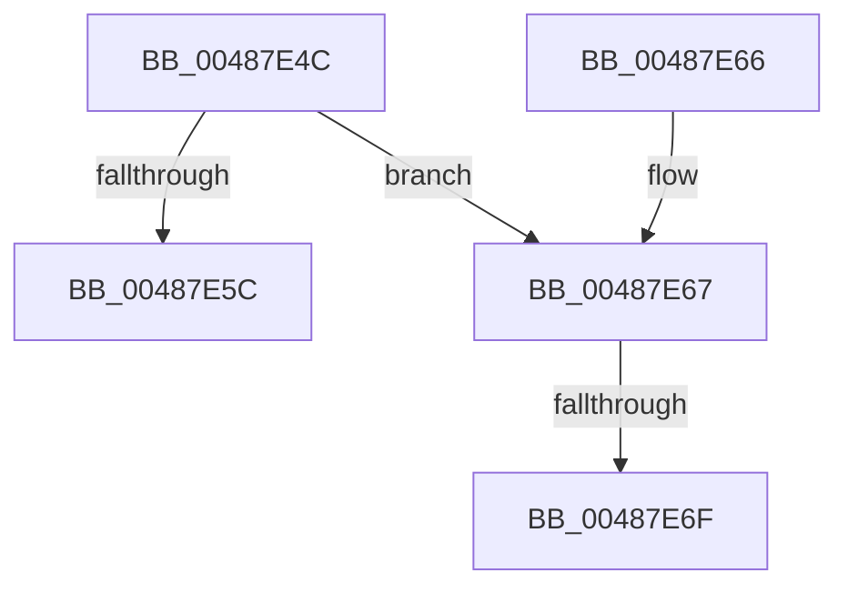

# HalpHvLpReadMultipleMsr

- RVA: `0x00487E4C`–`0x00487E86` (길이 `58` bytes)
- VA: `0x0000000140487E4C`
- 실행 섹션: `.text`
- PDB 이름 있음: `예`; PDB Function 태그: `예`
- unwind 정보 RVA: `0x0007D698`
- 디코드: `17`개 명령, `58/58` bytes 표시
- 미해석 바이트: `0` (있으면 어셈블리에 `.byte`로 보존)

> 이 문서는 커널 이미지의 기계어와 PDB 기호를 분석해 생성했습니다. 4번과 5번은 함수 원형과 자료형을 바이너리 사용 방식에서 추정한 C 해석이며 원본 소스 복구 결과는 아닙니다.

## 1. Dependencies

- 직접 호출 지점: **2**; 고유 호출 대상: **2**
- 직접 호출자로 확인된 함수: **1**
- RIP 상대 이미지 참조: **1**

### Outgoing calls
- `0x00487E5C` → [guard_dispatch_icall](../6B/guard_dispatch_icall_function_006BAAD0.md) (function, `0x006BAAD0`)
- `0x00487E7B` → [memset](../6C/memset_function_006C6C40.md) (function, `0x006C6C40`)

### Direct callers
- [HalpHvLpReadMcaStatusMsr](HalpHvLpReadMcaStatusMsr_function_004873C8.md) at `0x00487456`

### Static image references
- `0x00487E50` → RVA `0x00FC1CD8` (`.data`; read)

## 2. Other-region calls and transfers

- 다른 실행 섹션으로 향하는 call: **0**
- call이 아닌 외부 분기/꼬리 이동: **2**
  - `0x00487E69` → [sub_006F57AA](../6F/Unknown_function_006F57AA.md) (`tail-transfer`)
  - `0x00487E81` → [sub_006F57AA](../6F/Unknown_function_006F57AA.md) (`tail-transfer`)

## 3. Assembly (complete function range)

```asm
00487E4C  48 83 EC 38                     sub rsp, 0x38
00487E50  48 8B 05 81 9E B3 00            mov rax, qword ptr [rip + 0xb39e81]
00487E57  48 85 C0                        test rax, rax
00487E5A  74 0B                           je 0x140487e67
00487E5C  E8 6F 2C 23 00                  call 0x1406baad0
00487E61  48 83 C4 38                     add rsp, 0x38
00487E65  C3                              ret
00487E66  CC                              int3
00487E67  85 D2                           test edx, edx
00487E69  0F 84 3B D9 26 00               je 0x1406f57aa
00487E6F  44 8B C2                        mov r8d, edx
00487E72  49 8B C9                        mov rcx, r9
00487E75  49 C1 E0 03                     shl r8, 3
00487E79  33 D2                           xor edx, edx
00487E7B  E8 C0 ED 23 00                  call 0x1406c6c40
00487E80  90                              nop
00487E81  E9 24 D9 26 00                  jmp 0x1406f57aa
```

## 4. C-style interpretation (structured pseudocode)

```c
__int64 __fastcall HalpHvLpReadMultipleMsr(__int64 a1, int a2, __int64 a3, __int64 a4)
{
    __int64 result;
    __int64 v_rsp;

    v_rsp = (v_rsp) - (56);
    if (*(unsigned __int64 *)(v_rip + 11771521) == 0) goto loc_00487E67;
    result = guard_dispatch_icall(a1, a2, a3, a4);
    v_rsp = (v_rsp) + (56);
    return result;
loc_00487E67:
    a3 = ((unsigned int)(a2)) << (3);
    a2 = 0;
    result = memset(a4, a2, a3, a4);
}
```

## 5. (Beta) C Style

```c
int64_t HalpHvLpReadMultipleMsr(int64_t Arg1, int32_t Arg2, int64_t Arg3, int64_t Arg4)
{
    int64_t result;
    int64_t local_rsp;

    local_rsp = (local_rsp) - (56);
    if (*(uint64_t *)(v_rip + 0xB39E81) == 0) goto loc_00487E67;
    result = guard_dispatch_icall(Arg1, Arg2, Arg3, Arg4);
    local_rsp = (local_rsp) + (56);
    return result;
loc_00487E67:
    Arg3 = ((uint32_t)(Arg2)) << (3);
    Arg2 = 0;
    result = memset(Arg4, Arg2, Arg3, Arg4);
}
```

## 6. Execution-region graph

[열기: 2D/3D 그래프와 함수 탐색 컨트롤 패널](../../../control-panel.html?section=text&rva=0x00487E4C&view=graph)

- 2D 그래프는 위에서 아래로 흐르고, 3D 그래프는 빈 공간을 드래그해 회전합니다. Shift+드래그는 이동, 휠은 확대·축소, 함수 노드 선택은 대상 보고서 이동입니다.

### Static fallback


