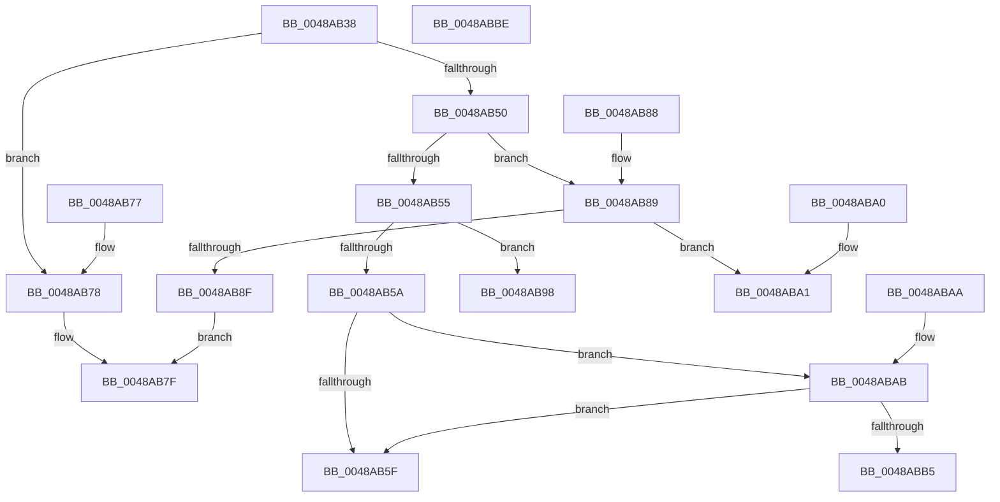

# HalpInterruptAddTarget

- RVA: `0x0048AB38`–`0x0048ABBF` (길이 `135` bytes)
- VA: `0x000000014048AB38`
- 실행 섹션: `.text`
- PDB 이름 있음: `예`; PDB Function 태그: `아니요`
- unwind 정보 RVA: `0x000DB714`
- 디코드: `43`개 명령, `135/135` bytes 표시
- 미해석 바이트: `0` (있으면 어셈블리에 `.byte`로 보존)

> 이 문서는 커널 이미지의 기계어와 PDB 기호를 분석해 생성했습니다. 4번과 5번은 함수 원형과 자료형을 바이너리 사용 방식에서 추정한 C 해석이며 원본 소스 복구 결과는 아닙니다.

## 1. Dependencies

- 직접 호출 지점: **0**; 고유 호출 대상: **0**
- 직접 호출자로 확인된 함수: **1**
- RIP 상대 이미지 참조: **1**

### Outgoing calls
- 직접 디코드된 call 명령이 없습니다.

### Direct callers
- [HalpInterruptDestinationToTarget](HalpInterruptDestinationToTarget_function_0048AA54.md) at `0x0048AABD`

### Static image references
- `0x0048AB3D` → RVA `0x00E101E8` (`.data`; read)

## 2. Other-region calls and transfers

- 다른 실행 섹션으로 향하는 call: **0**
- 별도 외부 분기/꼬리 이동을 확인하지 못했습니다.

## 3. Assembly (complete function range)

```asm
0048AB38  8B C2                           mov eax, edx
0048AB3A  4C 8B C1                        mov r8, rcx
0048AB3D  48 8B 15 A4 56 98 00            mov rdx, qword ptr [rip + 0x9856a4]
0048AB44  48 8D 0C 40                     lea rcx, [rax + rax*2]
0048AB48  8B 04 CA                        mov eax, dword ptr [rdx + rcx*8]
0048AB4B  83 F8 04                        cmp eax, 4
0048AB4E  74 28                           je 0x14048ab78
0048AB50  83 F8 05                        cmp eax, 5
0048AB53  74 34                           je 0x14048ab89
0048AB55  83 F8 06                        cmp eax, 6
0048AB58  75 3E                           jne 0x14048ab98
0048AB5A  41 39 00                        cmp dword ptr [r8], eax
0048AB5D  74 4C                           je 0x14048abab
0048AB5F  41 C7 00 06 00 00 00            mov dword ptr [r8], 6
0048AB66  8B 44 CA 08                     mov eax, dword ptr [rdx + rcx*8 + 8]
0048AB6A  41 89 40 08                     mov dword ptr [r8 + 8], eax
0048AB6E  8B 44 CA 0C                     mov eax, dword ptr [rdx + rcx*8 + 0xc]
0048AB72  41 89 40 0C                     mov dword ptr [r8 + 0xc], eax
0048AB76  C3                              ret
0048AB77  CC                              int3
0048AB78  41 C7 00 04 00 00 00            mov dword ptr [r8], 4
0048AB7F  8B 44 CA 08                     mov eax, dword ptr [rdx + rcx*8 + 8]
0048AB83  41 89 40 08                     mov dword ptr [r8 + 8], eax
0048AB87  C3                              ret
0048AB88  CC                              int3
0048AB89  41 83 38 05                     cmp dword ptr [r8], 5
0048AB8D  74 12                           je 0x14048aba1
0048AB8F  41 C7 00 05 00 00 00            mov dword ptr [r8], 5
0048AB96  EB E7                           jmp 0x14048ab7f
0048AB98  41 C7 00 03 00 00 00            mov dword ptr [r8], 3
0048AB9F  C3                              ret
0048ABA0  CC                              int3
0048ABA1  8B 4C CA 08                     mov ecx, dword ptr [rdx + rcx*8 + 8]
0048ABA5  41 09 48 08                     or dword ptr [r8 + 8], ecx
0048ABA9  C3                              ret
0048ABAA  CC                              int3
0048ABAB  8B 44 CA 08                     mov eax, dword ptr [rdx + rcx*8 + 8]
0048ABAF  41 39 40 08                     cmp dword ptr [r8 + 8], eax
0048ABB3  75 AA                           jne 0x14048ab5f
0048ABB5  8B 44 CA 0C                     mov eax, dword ptr [rdx + rcx*8 + 0xc]
0048ABB9  41 09 40 0C                     or dword ptr [r8 + 0xc], eax
0048ABBD  C3                              ret
0048ABBE  CC                              int3
```

## 4. C-style interpretation (structured pseudocode)

```c
__int64 __fastcall HalpInterruptAddTarget(__int64 a1, int a2)
{
    if (((unsigned int)((unsigned int)(*(unsigned int *)(*(unsigned __int64 *)(v_rip + 9983652) + (unsigned int)(a2) + (unsigned int)(a2) * 2 * 8)))) == 4) goto loc_0048AB78;
    if (((unsigned int)((unsigned int)(*(unsigned int *)(*(unsigned __int64 *)(v_rip + 9983652) + (unsigned int)(a2) + (unsigned int)(a2) * 2 * 8)))) == 5) goto loc_0048AB89;
    if (((unsigned int)((unsigned int)(*(unsigned int *)(*(unsigned __int64 *)(v_rip + 9983652) + (unsigned int)(a2) + (unsigned int)(a2) * 2 * 8)))) != 6) goto loc_0048AB98;
    if ((*(unsigned int *)(a1)) == ((unsigned int)((unsigned int)(*(unsigned int *)(*(unsigned __int64 *)(v_rip + 9983652) + (unsigned int)(a2) + (unsigned int)(a2) * 2 * 8))))) goto loc_0048ABAB;
loc_0048AB5F:
    *(unsigned int *)(a1) = 6;
    *(unsigned int *)(a1 + 8) = (unsigned int)((unsigned int)(*(unsigned int *)(*(unsigned __int64 *)(v_rip + 9983652) + (unsigned int)(a2) + (unsigned int)(a2) * 2 * 8 + 8)));
    *(unsigned int *)(a1 + 12) = (unsigned int)((unsigned int)(*(unsigned int *)(*(unsigned __int64 *)(v_rip + 9983652) + (unsigned int)(a2) + (unsigned int)(a2) * 2 * 8 + 12)));
    return (unsigned int)(*(unsigned int *)(*(unsigned __int64 *)(v_rip + 9983652) + (unsigned int)(a2) + (unsigned int)(a2) * 2 * 8 + 12));
loc_0048AB78:
    *(unsigned int *)(a1) = 4;
loc_0048AB7F:
    *(unsigned int *)(a1 + 8) = (unsigned int)((unsigned int)(*(unsigned int *)(*(unsigned __int64 *)(v_rip + 9983652) + (unsigned int)(a2) + (unsigned int)(a2) * 2 * 8 + 8)));
    return (unsigned int)(*(unsigned int *)(*(unsigned __int64 *)(v_rip + 9983652) + (unsigned int)(a2) + (unsigned int)(a2) * 2 * 8 + 8));
loc_0048AB89:
    if ((*(unsigned int *)(a1)) == 5) goto loc_0048ABA1;
    *(unsigned int *)(a1) = 5;
    goto loc_0048AB7F;
loc_0048AB98:
    *(unsigned int *)(a1) = 3;
    return (unsigned int)(*(unsigned int *)(*(unsigned __int64 *)(v_rip + 9983652) + (unsigned int)(a2) + (unsigned int)(a2) * 2 * 8 + 8));
loc_0048ABA1:
    return (unsigned int)(*(unsigned int *)(*(unsigned __int64 *)(v_rip + 9983652) + (unsigned int)(a2) + (unsigned int)(a2) * 2 * 8 + 8));
loc_0048ABAB:
    if ((*(unsigned int *)(a1 + 8)) != ((unsigned int)((unsigned int)(*(unsigned int *)(*(unsigned __int64 *)(v_rip + 9983652) + (unsigned int)(*(unsigned int *)(*(unsigned __int64 *)(v_rip + 9983652) + (unsigned int)(a2) + (unsigned int)(a2) * 2 * 8 + 8)) * 8 + 8))))) goto loc_0048AB5F;
    return (unsigned int)(*(unsigned int *)(*(unsigned __int64 *)(v_rip + 9983652) + (unsigned int)(*(unsigned int *)(*(unsigned __int64 *)(v_rip + 9983652) + (unsigned int)(a2) + (unsigned int)(a2) * 2 * 8 + 8)) * 8 + 12));
}
```

## 5. (Beta) C Style

```c
int64_t HalpInterruptAddTarget(void *Arg1, void *Arg2)
{
    uint8_t *arg1 = (uint8_t *)Arg1;
    uint8_t *arg2 = (uint8_t *)Arg2;

    if (((uint32_t)((uint32_t)(*(uint32_t *)(*(uint64_t *)(v_rip + 0x9856A4) + (uint32_t)(arg2) + (uint32_t)(arg2) * 2 * 8)))) == 4) goto loc_0048AB78;
    if (((uint32_t)((uint32_t)(*(uint32_t *)(*(uint64_t *)(v_rip + 0x9856A4) + (uint32_t)(arg2) + (uint32_t)(arg2) * 2 * 8)))) == 5) goto loc_0048AB89;
    if (((uint32_t)((uint32_t)(*(uint32_t *)(*(uint64_t *)(v_rip + 0x9856A4) + (uint32_t)(arg2) + (uint32_t)(arg2) * 2 * 8)))) != 6) goto loc_0048AB98;
    if ((*(uint32_t *)(arg1)) == ((uint32_t)((uint32_t)(*(uint32_t *)(*(uint64_t *)(v_rip + 0x9856A4) + (uint32_t)(arg2) + (uint32_t)(arg2) * 2 * 8))))) goto loc_0048ABAB;
loc_0048AB5F:
    *(uint32_t *)(arg1) = 6;
    *(uint32_t *)(arg1 + 0x8) = (uint32_t)((uint32_t)(*(uint32_t *)(*(uint64_t *)(v_rip + 0x9856A4) + (uint32_t)(arg2) + (uint32_t)(arg2) * 2 * 8 + 0x8)));
    *(uint32_t *)(arg1 + 0xC) = (uint32_t)((uint32_t)(*(uint32_t *)(*(uint64_t *)(v_rip + 0x9856A4) + (uint32_t)(arg2) + (uint32_t)(arg2) * 2 * 8 + 0xC)));
    return (uint32_t)(*(uint32_t *)(*(uint64_t *)(v_rip + 0x9856A4) + (uint32_t)(arg2) + (uint32_t)(arg2) * 2 * 8 + 0xC));
loc_0048AB78:
    *(uint32_t *)(arg1) = 4;
loc_0048AB7F:
    *(uint32_t *)(arg1 + 0x8) = (uint32_t)((uint32_t)(*(uint32_t *)(*(uint64_t *)(v_rip + 0x9856A4) + (uint32_t)(arg2) + (uint32_t)(arg2) * 2 * 8 + 0x8)));
    return (uint32_t)(*(uint32_t *)(*(uint64_t *)(v_rip + 0x9856A4) + (uint32_t)(arg2) + (uint32_t)(arg2) * 2 * 8 + 0x8));
loc_0048AB89:
    if ((*(uint32_t *)(arg1)) == 5) goto loc_0048ABA1;
    *(uint32_t *)(arg1) = 5;
    goto loc_0048AB7F;
loc_0048AB98:
    *(uint32_t *)(arg1) = 3;
    return (uint32_t)(*(uint32_t *)(*(uint64_t *)(v_rip + 0x9856A4) + (uint32_t)(arg2) + (uint32_t)(arg2) * 2 * 8 + 0x8));
loc_0048ABA1:
    return (uint32_t)(*(uint32_t *)(*(uint64_t *)(v_rip + 0x9856A4) + (uint32_t)(arg2) + (uint32_t)(arg2) * 2 * 8 + 0x8));
loc_0048ABAB:
    if ((*(uint32_t *)(arg1 + 0x8)) != ((uint32_t)((uint32_t)(*(uint32_t *)(*(uint64_t *)(v_rip + 0x9856A4) + (uint32_t)(*(uint32_t *)(*(uint64_t *)(v_rip + 0x9856A4) + (uint32_t)(arg2) + (uint32_t)(arg2) * 2 * 8 + 0x8)) * 8 + 0x8))))) goto loc_0048AB5F;
    return (uint32_t)(*(uint32_t *)(*(uint64_t *)(v_rip + 0x9856A4) + (uint32_t)(*(uint32_t *)(*(uint64_t *)(v_rip + 0x9856A4) + (uint32_t)(arg2) + (uint32_t)(arg2) * 2 * 8 + 0x8)) * 8 + 0xC));
}
```

### 관측된 메모리 오프셋

구조체 형식이 확인되지 않은 접근은 인자 기준의 오프셋으로만 기록했습니다.

| 기준 인자 | 오프셋 표현 | 폭 (bit) | 접근 |
|---|---:|---:|---|
| `Arg1` | `+ 0x0` | `32` | `R` |
| `Arg1` | `+ 0x0` | `32` | `W` |
| `Arg1` | `+ 0x8` | `32` | `R` |
| `Arg1` | `+ 0x8` | `32` | `R/W` |
| `Arg1` | `+ 0x8` | `32` | `W` |
| `Arg1` | `+ 0xC` | `32` | `R/W` |
| `Arg1` | `+ 0xC` | `32` | `W` |
| `Arg2` | `+ 0x0 + rax*2` | `64` | `R` |

## 6. Execution-region graph

[열기: 2D/3D 그래프와 함수 탐색 컨트롤 패널](../../../control-panel.html?section=text&rva=0x0048AB38&view=graph)

- 2D 그래프는 위에서 아래로 흐르고, 3D 그래프는 빈 공간을 드래그해 회전합니다. Shift+드래그는 이동, 휠은 확대·축소, 함수 노드 선택은 대상 보고서 이동입니다.

### Static fallback


