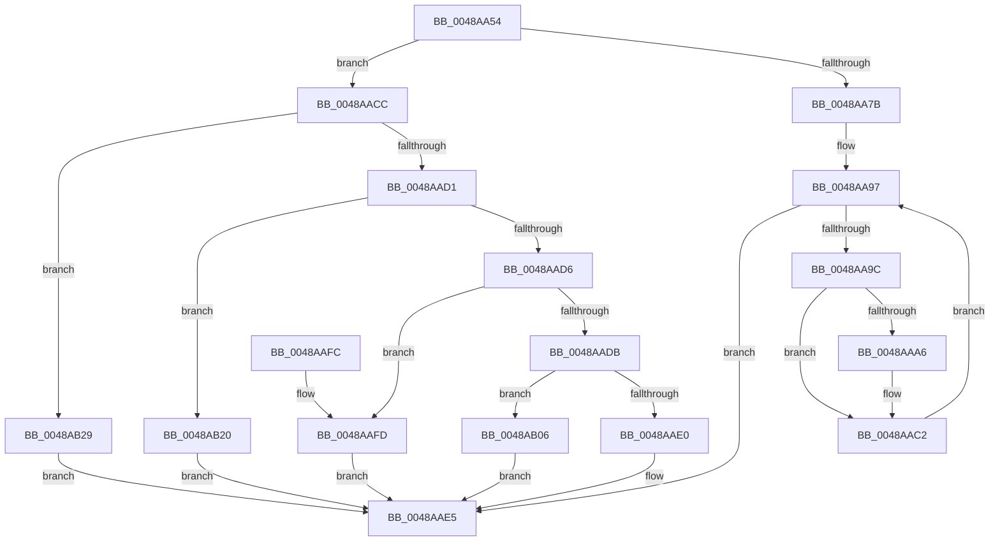

# HalpInterruptDestinationToTarget

- RVA: `0x0048AA54`–`0x0048AB32` (길이 `222` bytes)
- VA: `0x000000014048AA54`
- 실행 섹션: `.text`
- PDB 이름 있음: `예`; PDB Function 태그: `아니요`
- unwind 정보 RVA: `0x000B0174`
- 디코드: `64`개 명령, `222/222` bytes 표시
- 미해석 바이트: `0` (있으면 어셈블리에 `.byte`로 보존)

> 이 문서는 커널 이미지의 기계어와 PDB 기호를 분석해 생성했습니다. 4번과 5번은 함수 원형과 자료형을 바이너리 사용 방식에서 추정한 C 해석이며 원본 소스 복구 결과는 아닙니다.

## 1. Dependencies

- 직접 호출 지점: **2**; 고유 호출 대상: **2**
- 직접 호출자로 확인된 함수: **6**
- RIP 상대 이미지 참조: **1**

### Outgoing calls
- `0x0048AAB3` → [KeGetProcessorIndexFromNumber](../2D/KeGetProcessorIndexFromNumber_function_002DD2D0.md) (function, `0x002DD2D0`)
- `0x0048AABD` → [HalpInterruptAddTarget](HalpInterruptAddTarget_function_0048AB38.md) (function, `0x0048AB38`)

### Direct callers
- [HalpInterruptSetLineState](HalpInterruptSetLineState_function_0048A0C8.md) at `0x0048A346`
- [HalpInterruptSetDestinationInternal](HalpInterruptSetDestinationInternal_function_0048A530.md) at `0x0048A612`
- [HalpInterruptSetRemappedDestination](HalpInterruptSetRemappedDestination_function_0048A850.md) at `0x0048A8BA`
- [HalpInterruptGenerateMessage](../54/HalpInterruptGenerateMessage_function_005428F0.md) at `0x00542A86`
- [HalpInterruptRemap](../54/HalpInterruptRemap_function_00542AE4.md) at `0x00542C79`
- [HalpInterruptRemap](../54/HalpInterruptRemap_function_00542AE4.md) at `0x00542E00`
- [sub_006FA83C](../6F/Unknown_function_006FA83C.md) at `0x006FA9CC`

### Static image references
- `0x0048AB06` → RVA `0x00E101F8` (`.data`; read)

## 2. Other-region calls and transfers

- 다른 실행 섹션으로 향하는 call: **0**
- 별도 외부 분기/꼬리 이동을 확인하지 못했습니다.

## 3. Assembly (complete function range)

```asm
0048AA54  48 8B C4                        mov rax, rsp
0048AA57  48 89 58 10                     mov qword ptr [rax + 0x10], rbx
0048AA5B  48 89 68 18                     mov qword ptr [rax + 0x18], rbp
0048AA5F  48 89 70 20                     mov qword ptr [rax + 0x20], rsi
0048AA63  48 89 48 08                     mov qword ptr [rax + 8], rcx
0048AA67  57                              push rdi
0048AA68  48 83 EC 20                     sub rsp, 0x20
0048AA6C  33 FF                           xor edi, edi
0048AA6E  49 8B D8                        mov rbx, r8
0048AA71  41 89 38                        mov dword ptr [r8], edi
0048AA74  8B 0A                           mov ecx, dword ptr [rdx]
0048AA76  83 E9 01                        sub ecx, 1
0048AA79  75 51                           jne 0x14048aacc
0048AA7B  48 8B 42 08                     mov rax, qword ptr [rdx + 8]
0048AA7F  40 8A F7                        mov sil, dil
0048AA82  89 7C 24 30                     mov dword ptr [rsp + 0x30], edi
0048AA86  40 88 7C 24 32                  mov byte ptr [rsp + 0x32], dil
0048AA8B  48 8B 28                        mov rbp, qword ptr [rax]
0048AA8E  0F B7 40 08                     movzx eax, word ptr [rax + 8]
0048AA92  66 89 44 24 30                  mov word ptr [rsp + 0x30], ax
0048AA97  48 85 ED                        test rbp, rbp
0048AA9A  74 49                           je 0x14048aae5
0048AA9C  40 0F B6 C6                     movzx eax, sil
0048AAA0  48 0F A3 C5                     bt rbp, rax
0048AAA4  73 1C                           jae 0x14048aac2
0048AAA6  40 0F B6 C6                     movzx eax, sil
0048AAAA  48 8D 4C 24 30                  lea rcx, [rsp + 0x30]
0048AAAF  48 0F B3 C5                     btr rbp, rax
0048AAB3  E8 18 28 E5 FF                  call 0x1402dd2d0
0048AAB8  8B D0                           mov edx, eax
0048AABA  48 8B CB                        mov rcx, rbx
0048AABD  E8 76 00 00 00                  call 0x14048ab38
0048AAC2  40 FE C6                        inc sil
0048AAC5  40 88 74 24 32                  mov byte ptr [rsp + 0x32], sil
0048AACA  EB CB                           jmp 0x14048aa97
0048AACC  83 E9 02                        sub ecx, 2
0048AACF  74 58                           je 0x14048ab29
0048AAD1  83 E9 01                        sub ecx, 1
0048AAD4  74 4A                           je 0x14048ab20
0048AAD6  83 E9 01                        sub ecx, 1
0048AAD9  74 22                           je 0x14048aafd
0048AADB  83 F9 01                        cmp ecx, 1
0048AADE  74 26                           je 0x14048ab06
0048AAE0  BF 0D 00 00 C0                  mov edi, 0xc000000d
0048AAE5  48 8B 5C 24 38                  mov rbx, qword ptr [rsp + 0x38]
0048AAEA  8B C7                           mov eax, edi
0048AAEC  48 8B 6C 24 40                  mov rbp, qword ptr [rsp + 0x40]
0048AAF1  48 8B 74 24 48                  mov rsi, qword ptr [rsp + 0x48]
0048AAF6  48 83 C4 20                     add rsp, 0x20
0048AAFA  5F                              pop rdi
0048AAFB  C3                              ret
0048AAFC  CC                              int3
0048AAFD  41 C7 00 03 00 00 00            mov dword ptr [r8], 3
0048AB04  EB DF                           jmp 0x14048aae5
0048AB06  48 8B 05 EB 56 98 00            mov rax, qword ptr [rip + 0x9856eb]
0048AB0D  41 C7 00 04 00 00 00            mov dword ptr [r8], 4
0048AB14  8B 4A 08                        mov ecx, dword ptr [rdx + 8]
0048AB17  8B 0C 88                        mov ecx, dword ptr [rax + rcx*4]
0048AB1A  41 89 48 08                     mov dword ptr [r8 + 8], ecx
0048AB1E  EB C5                           jmp 0x14048aae5
0048AB20  41 C7 00 02 00 00 00            mov dword ptr [r8], 2
0048AB27  EB BC                           jmp 0x14048aae5
0048AB29  41 C7 00 01 00 00 00            mov dword ptr [r8], 1
0048AB30  EB B3                           jmp 0x14048aae5
```

## 4. C-style interpretation (structured pseudocode)

```c
__int64 __fastcall HalpInterruptDestinationToTarget(__int64 a1, __int64 a2, __int64 a3)
{
    __int64 result;
    __int64 v_rdi;
    __int64 v_rsi;
    __int64 v_rsp;
    unsigned __int64 v_stack_p10;
    unsigned __int64 v_stack_p18;
    unsigned __int64 v_stack_p20;
    unsigned int v_stack_p8;
    unsigned __int8 v_stack_pA;

    *(unsigned __int64 *)(v_rsp + 16) = v_rbx;
    *(unsigned __int64 *)(v_rsp + 24) = v_rbp;
    *(unsigned __int64 *)(v_rsp + 32) = v_rsi;
    *(unsigned __int64 *)(v_rsp + 8) = a1;
    v_rsp = (v_rsp) - (32);
    v_rdi = 0;
    *(unsigned int *)(a3) = 0;
    a1 = (unsigned int)(((unsigned int)(*(unsigned int *)(a2))) - (1));
    if (condition_is_not_equal) goto loc_0048AACC;
    v_stack_p8 = 0;
    v_stack_pA = 0;
    v_stack_p8 = (unsigned __int16)(*(unsigned __int16 *)(*(unsigned __int64 *)(a2 + 8) + 8));
loc_0048AA97:
    if (*(unsigned __int64 *)(*(unsigned __int64 *)(a2 + 8)) == 0) goto loc_0048AAE5;
    result = 0;
    if (!(condition_is_above_or_equal)) {
        result = 0;
        a1 = v_stack_p8;
        result = KeGetProcessorIndexFromNumber(a1, a2, a3, a4);
        a2 = (unsigned int)(result);
        a1 = a3;
        result = HalpInterruptAddTarget(a1, a2, a3, a4);
    }
    v_rsi = (unsigned __int8)((0) + 1);
    v_stack_pA = (unsigned __int8)(v_rsi);
    goto loc_0048AA97;
loc_0048AACC:
    a1 = (unsigned int)((a1) - (2));
    if (condition_is_equal) goto loc_0048AB29;
    a1 = (unsigned int)((a1) - (1));
    if (condition_is_equal) goto loc_0048AB20;
    a1 = (unsigned int)((a1) - (1));
    if (condition_is_equal) goto loc_0048AAFD;
    if (((unsigned int)(a1)) == 1) goto loc_0048AB06;
loc_0048AAE5:
    v_rsp = (v_rsp) + (32);
    return (unsigned int)((unsigned int)((unsigned int)(0xC000000DULL)));
loc_0048AAFD:
    *(unsigned int *)(a3) = 3;
    goto loc_0048AAE5;
loc_0048AB06:
    *(unsigned int *)(a3) = 4;
    *(unsigned int *)(a3 + 8) = (unsigned int)((unsigned int)(*(unsigned int *)(*(unsigned __int64 *)(v_rip + 9983723) + (unsigned int)(*(unsigned int *)(a2 + 8)) * 4)));
    goto loc_0048AAE5;
loc_0048AB20:
    *(unsigned int *)(a3) = 2;
    goto loc_0048AAE5;
loc_0048AB29:
    *(unsigned int *)(a3) = 1;
    goto loc_0048AAE5;
}
```

## 5. (Beta) C Style

```c
int64_t HalpInterruptDestinationToTarget(int64_t Arg1, void *Arg2, void *Arg3)
{
    uint8_t *arg2 = (uint8_t *)Arg2;
    uint8_t *arg3 = (uint8_t *)Arg3;

    int64_t result;
    int64_t local_rdi;
    int64_t local_rsi;
    int64_t local_rsp;
    uint64_t v_stack_p10;
    uint64_t v_stack_p18;
    uint64_t v_stack_p20;
    uint32_t v_stack_p8;
    uint8_t v_stack_pA;

    *(uint64_t *)(local_rsp + 0x10) = local_rbx;
    *(uint64_t *)(local_rsp + 0x18) = local_rbp;
    *(uint64_t *)(local_rsp + 0x20) = local_rsi;
    *(uint64_t *)(local_rsp + 0x8) = Arg1;
    local_rsp = (local_rsp) - (32);
    local_rdi = 0;
    *(uint32_t *)(arg3) = 0;
    Arg1 = (uint32_t)(((uint32_t)(*(uint32_t *)(arg2))) - (1));
    if (condition_is_not_equal) goto loc_0048AACC;
    v_stack_p8 = 0;
    v_stack_pA = 0;
    v_stack_p8 = (uint16_t)(*(uint16_t *)(*(uint64_t *)(arg2 + 0x8) + 0x8));
loc_0048AA97:
    if (*(uint64_t *)(*(uint64_t *)(arg2 + 0x8)) == 0) goto loc_0048AAE5;
    result = 0;
    if (!(condition_is_above_or_equal)) {
        result = 0;
        Arg1 = v_stack_p8;
        result = KeGetProcessorIndexFromNumber(Arg1, Arg2, Arg3, a4);
        Arg2 = (uint32_t)(result);
        Arg1 = Arg3;
        result = HalpInterruptAddTarget(Arg1, Arg2, Arg3, a4);
    }
    local_rsi = (uint8_t)((0) + 1);
    v_stack_pA = (uint8_t)(local_rsi);
    goto loc_0048AA97;
loc_0048AACC:
    Arg1 = (uint32_t)((Arg1) - (2));
    if (condition_is_equal) goto loc_0048AB29;
    Arg1 = (uint32_t)((Arg1) - (1));
    if (condition_is_equal) goto loc_0048AB20;
    Arg1 = (uint32_t)((Arg1) - (1));
    if (condition_is_equal) goto loc_0048AAFD;
    if (((uint32_t)(Arg1)) == 1) goto loc_0048AB06;
loc_0048AAE5:
    local_rsp = (local_rsp) + (32);
    return (uint32_t)((uint32_t)((uint32_t)(0xC000000DULL)));
loc_0048AAFD:
    *(uint32_t *)(arg3) = 3;
    goto loc_0048AAE5;
loc_0048AB06:
    *(uint32_t *)(arg3) = 4;
    *(uint32_t *)(arg3 + 0x8) = (uint32_t)((uint32_t)(*(uint32_t *)(*(uint64_t *)(v_rip + 0x9856EB) + (uint32_t)(*(uint32_t *)(arg2 + 0x8)) * 4)));
    goto loc_0048AAE5;
loc_0048AB20:
    *(uint32_t *)(arg3) = 2;
    goto loc_0048AAE5;
loc_0048AB29:
    *(uint32_t *)(arg3) = 1;
    goto loc_0048AAE5;
}
```

### 관측된 메모리 오프셋

구조체 형식이 확인되지 않은 접근은 인자 기준의 오프셋으로만 기록했습니다.

| 기준 인자 | 오프셋 표현 | 폭 (bit) | 접근 |
|---|---:|---:|---|
| `Arg2` | `+ 0x0` | `32` | `R` |
| `Arg2` | `+ 0x8` | `32` | `R` |
| `Arg2` | `+ 0x8` | `64` | `R` |
| `Arg3` | `+ 0x0` | `32` | `W` |
| `Arg3` | `+ 0x8` | `32` | `W` |

## 6. Execution-region graph

[열기: 2D/3D 그래프와 함수 탐색 컨트롤 패널](../../../control-panel.html?section=text&rva=0x0048AA54&view=graph)

- 2D 그래프는 위에서 아래로 흐르고, 3D 그래프는 빈 공간을 드래그해 회전합니다. Shift+드래그는 이동, 휠은 확대·축소, 함수 노드 선택은 대상 보고서 이동입니다.

### Static fallback


