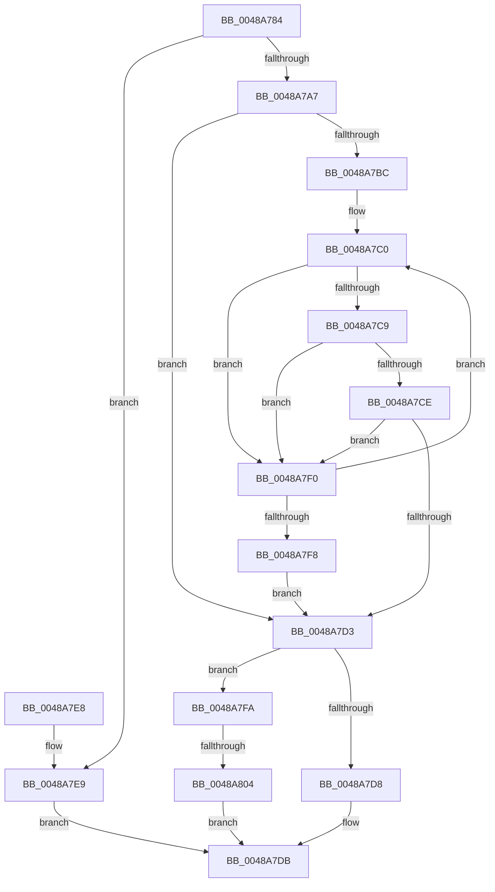

# HalpInterruptFindBestRouting

- RVA: `0x0048A784`–`0x0048A829` (길이 `165` bytes)
- VA: `0x000000014048A784`
- 실행 섹션: `.text`
- PDB 이름 있음: `예`; PDB Function 태그: `예`
- unwind 정보 RVA: `0x000B0130`
- 디코드: `50`개 명령, `165/165` bytes 표시
- 미해석 바이트: `0` (있으면 어셈블리에 `.byte`로 보존)

> 이 문서는 커널 이미지의 기계어와 PDB 기호를 분석해 생성했습니다. 4번과 5번은 함수 원형과 자료형을 바이너리 사용 방식에서 추정한 C 해석이며 원본 소스 복구 결과는 아닙니다.

## 1. Dependencies

- 직접 호출 지점: **2**; 고유 호출 대상: **2**
- 직접 호출자로 확인된 함수: **3**
- RIP 상대 이미지 참조: **1**

### Outgoing calls
- `0x0048A798` → [HalpInterruptLookupController](../2D/HalpInterruptLookupController_function_002D20D4.md) (function, `0x002D20D4`)
- `0x0048A81D` → [HalpInterruptSetProblemEx](HalpInterruptSetProblemEx_function_0048AC8C.md) (function, `0x0048AC8C`)

### Direct callers
- [HalpInterruptSetLineState](HalpInterruptSetLineState_function_0048A0C8.md) at `0x0048A368`
- [HalpInterruptSetDestinationInternal](HalpInterruptSetDestinationInternal_function_0048A530.md) at `0x0048A625`
- [HalpInterruptRemap](../54/HalpInterruptRemap_function_00542AE4.md) at `0x00542E24`

### Static image references
- `0x0048A80F` → RVA `0x00010AA8` (`.rdata`; read)

## 2. Other-region calls and transfers

- 다른 실행 섹션으로 향하는 call: **0**
- call이 아닌 외부 분기/꼬리 이동: **1**
  - `0x0048A7FE` → [sub_006F601A](../6F/Unknown_function_006F601A.md) (`tail-transfer`)

## 3. Assembly (complete function range)

```asm
0048A784  48 89 5C 24 08                  mov qword ptr [rsp + 8], rbx
0048A789  48 89 54 24 10                  mov qword ptr [rsp + 0x10], rdx
0048A78E  57                              push rdi
0048A78F  48 83 EC 30                     sub rsp, 0x30
0048A793  8B 09                           mov ecx, dword ptr [rcx]
0048A795  4C 8B CA                        mov r9, rdx
0048A798  E8 37 79 E4 FF                  call 0x1402d20d4
0048A79D  33 C9                           xor ecx, ecx
0048A79F  48 8B D8                        mov rbx, rax
0048A7A2  48 85 C0                        test rax, rax
0048A7A5  74 42                           je 0x14048a7e9
0048A7A7  48 8D 90 18 01 00 00            lea rdx, [rax + 0x118]
0048A7AE  44 8B D9                        mov r11d, ecx
0048A7B1  4C 8B 12                        mov r10, qword ptr [rdx]
0048A7B4  49 8B C2                        mov rax, r10
0048A7B7  4C 3B D2                        cmp r10, rdx
0048A7BA  74 17                           je 0x14048a7d3
0048A7BC  8B 7C 24 4C                     mov edi, dword ptr [rsp + 0x4c]
0048A7C0  41 FF C3                        inc r11d
0048A7C3  44 39 48 10                     cmp dword ptr [rax + 0x10], r9d
0048A7C7  75 27                           jne 0x14048a7f0
0048A7C9  39 78 14                        cmp dword ptr [rax + 0x14], edi
0048A7CC  7F 22                           jg 0x14048a7f0
0048A7CE  39 78 18                        cmp dword ptr [rax + 0x18], edi
0048A7D1  7E 1D                           jle 0x14048a7f0
0048A7D3  48 3B C2                        cmp rax, rdx
0048A7D6  74 22                           je 0x14048a7fa
0048A7D8  4D 89 08                        mov qword ptr [r8], r9
0048A7DB  48 8B 5C 24 40                  mov rbx, qword ptr [rsp + 0x40]
0048A7E0  8B C1                           mov eax, ecx
0048A7E2  48 83 C4 30                     add rsp, 0x30
0048A7E6  5F                              pop rdi
0048A7E7  C3                              ret
0048A7E8  CC                              int3
0048A7E9  B9 0D 00 00 C0                  mov ecx, 0xc000000d
0048A7EE  EB EB                           jmp 0x14048a7db
0048A7F0  48 8B 00                        mov rax, qword ptr [rax]
0048A7F3  48 3B C2                        cmp rax, rdx
0048A7F6  75 C8                           jne 0x14048a7c0
0048A7F8  EB D9                           jmp 0x14048a7d3
0048A7FA  41 83 FB 01                     cmp r11d, 1
0048A7FE  0F 84 16 B8 26 00               je 0x1406f601a
0048A804  45 33 C0                        xor r8d, r8d
0048A807  C7 44 24 20 F5 0D 00 00         mov dword ptr [rsp + 0x20], 0xdf5
0048A80F  4C 8D 0D 92 62 B8 FF            lea r9, [rip - 0x479d6e]
0048A816  48 8B CB                        mov rcx, rbx
0048A819  41 8D 50 17                     lea edx, [r8 + 0x17]
0048A81D  E8 6A 04 00 00                  call 0x14048ac8c
0048A822  B9 01 00 00 C0                  mov ecx, 0xc0000001
0048A827  EB B2                           jmp 0x14048a7db
```

## 4. C-style interpretation (structured pseudocode)

```c
__int64 __fastcall HalpInterruptFindBestRouting(__int64 a1, __int64 a2, __int64 a3)
{
    __int64 result;
    __int64 v_r11;
    __int64 v_rsp;
    unsigned __int64 v_stack_p10;
    unsigned int v_stack_p14;
    unsigned int v_stack_p20;
    unsigned __int64 v_stack_p8;

    v_stack_p8 = v_rbx;
    v_stack_p10 = a2;
    v_rsp = (v_rsp) - (48);
    result = HalpInterruptLookupController((unsigned int)(*(unsigned int *)(a1)), a2, a3, a2);
    a1 = 0;
    if (result == 0) goto loc_0048A7E9;
    if ((*(unsigned __int64 *)(result + 280)) == (result + 280)) goto loc_0048A7D3;
loc_0048A7C0:
    v_r11 = (unsigned int)((0) + 1);
    if ((*(unsigned int *)(*(unsigned __int64 *)(result + 280) + 16)) != ((unsigned int)(a2))) goto loc_0048A7F0;
    if ((*(unsigned int *)(*(unsigned __int64 *)(result + 280) + 20)) > ((unsigned int)((unsigned int)(v_stack_p14)))) goto loc_0048A7F0;
    if ((*(unsigned int *)(*(unsigned __int64 *)(result + 280) + 24)) <= ((unsigned int)((unsigned int)(v_stack_p14)))) goto loc_0048A7F0;
loc_0048A7D3:
    if ((*(unsigned __int64 *)(result + 280)) == (result + 280)) goto loc_0048A7FA;
    *(unsigned __int64 *)(a3) = a2;
loc_0048A7DB:
    v_rsp = (v_rsp) + (48);
    return 0;
loc_0048A7E9:
    goto loc_0048A7DB;
loc_0048A7F0:
    if ((*(unsigned __int64 *)(0)) != (result + 280)) goto loc_0048A7C0;
    goto loc_0048A7D3;
loc_0048A7FA:
    a3 = 0;
    v_stack_p20 = 0xDF5ULL;
    result = HalpInterruptSetProblemEx(v_stack_p8, a3 + 23, a3, v_rip - 4693358);
    goto loc_0048A7DB;
}
```

## 5. (Beta) C Style

```c
int64_t HalpInterruptFindBestRouting(void *Arg1, int64_t Arg2, int64_t Arg3)
{
    uint8_t *arg1 = (uint8_t *)Arg1;

    int64_t result;
    int64_t local_r11;
    int64_t local_rsp;
    uint64_t v_stack_p10;
    uint32_t v_stack_p14;
    uint32_t v_stack_p20;
    uint64_t v_stack_p8;

    v_stack_p8 = local_rbx;
    v_stack_p10 = Arg2;
    local_rsp = (local_rsp) - (48);
    result = HalpInterruptLookupController((uint32_t)(*(uint32_t *)(arg1)), Arg2, Arg3, Arg2);
    Arg1 = 0;
    if (result == 0) goto loc_0048A7E9;
    if ((*(uint64_t *)(result + 0x118)) == (result + 280)) goto loc_0048A7D3;
loc_0048A7C0:
    local_r11 = (uint32_t)((0) + 1);
    if ((*(uint32_t *)(*(uint64_t *)(result + 0x118) + 0x10)) != ((uint32_t)(Arg2))) goto loc_0048A7F0;
    if ((*(uint32_t *)(*(uint64_t *)(result + 0x118) + 0x14)) > ((uint32_t)((uint32_t)(v_stack_p14)))) goto loc_0048A7F0;
    if ((*(uint32_t *)(*(uint64_t *)(result + 0x118) + 0x18)) <= ((uint32_t)((uint32_t)(v_stack_p14)))) goto loc_0048A7F0;
loc_0048A7D3:
    if ((*(uint64_t *)(result + 0x118)) == (result + 280)) goto loc_0048A7FA;
    *(uint64_t *)(Arg3) = Arg2;
loc_0048A7DB:
    local_rsp = (local_rsp) + (48);
    return 0;
loc_0048A7E9:
    goto loc_0048A7DB;
loc_0048A7F0:
    if ((*(uint64_t *)(0)) != (result + 280)) goto loc_0048A7C0;
    goto loc_0048A7D3;
loc_0048A7FA:
    Arg3 = 0;
    v_stack_p20 = 0xDF5ULL;
    result = HalpInterruptSetProblemEx(v_stack_p8, Arg3 + 23, Arg3, v_rip - 4693358);
    goto loc_0048A7DB;
}
```

### 관측된 메모리 오프셋

구조체 형식이 확인되지 않은 접근은 인자 기준의 오프셋으로만 기록했습니다.

| 기준 인자 | 오프셋 표현 | 폭 (bit) | 접근 |
|---|---:|---:|---|
| `Arg1` | `+ 0x0` | `32` | `R` |

## 6. Execution-region graph

[열기: 2D/3D 그래프와 함수 탐색 컨트롤 패널](../../../control-panel.html?section=text&rva=0x0048A784&view=graph)

- 2D 그래프는 위에서 아래로 흐르고, 3D 그래프는 빈 공간을 드래그해 회전합니다. Shift+드래그는 이동, 휠은 확대·축소, 함수 노드 선택은 대상 보고서 이동입니다.

### Static fallback


