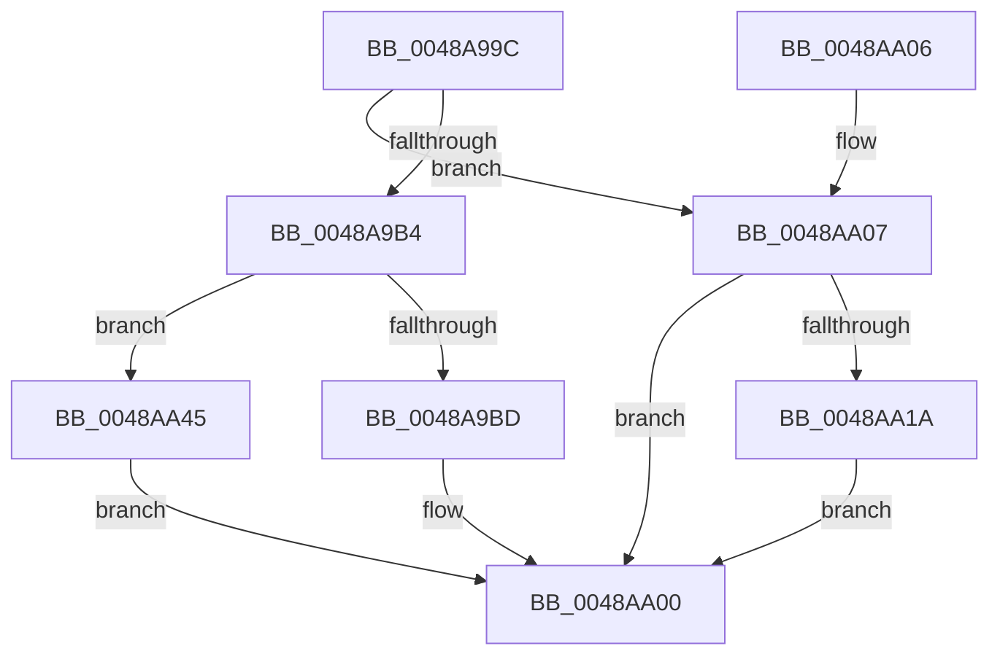

# HalpInterruptGetRemappedLineState

- RVA: `0x0048A99C`–`0x0048AA4C` (길이 `176` bytes)
- VA: `0x000000014048A99C`
- 실행 섹션: `.text`
- PDB 이름 있음: `예`; PDB Function 태그: `아니요`
- unwind 정보 RVA: `0x000B0168`
- 디코드: `51`개 명령, `176/176` bytes 표시
- 미해석 바이트: `0` (있으면 어셈블리에 `.byte`로 보존)

> 이 문서는 커널 이미지의 기계어와 PDB 기호를 분석해 생성했습니다. 4번과 5번은 함수 원형과 자료형을 바이너리 사용 방식에서 추정한 C 해석이며 원본 소스 복구 결과는 아닙니다.

## 1. Dependencies

- 직접 호출 지점: **1**; 고유 호출 대상: **1**
- 직접 호출자로 확인된 함수: **1**
- RIP 상대 이미지 참조: **1**

### Outgoing calls
- `0x0048AA11` → [HalpInterruptFindControllerAndLineState](../2D/HalpInterruptFindControllerAndLineState_function_002D2FC0.md) (function, `0x002D2FC0`)

### Direct callers
- [HalpInterruptSetRemappedDestination](HalpInterruptSetRemappedDestination_function_0048A850.md) at `0x0048A896`

### Static image references
- `0x0048A9F4` → RVA `0x00E101F0` (`.data`; read)

## 2. Other-region calls and transfers

- 다른 실행 섹션으로 향하는 call: **0**
- 별도 외부 분기/꼬리 이동을 확인하지 못했습니다.

## 3. Assembly (complete function range)

```asm
0048A99C  40 53                           push rbx
0048A99E  48 83 EC 20                     sub rsp, 0x20
0048A9A2  48 83 64 24 38 00               and qword ptr [rsp + 0x38], 0
0048A9A8  49 8B D9                        mov rbx, r9
0048A9AB  8B 02                           mov eax, dword ptr [rdx]
0048A9AD  4D 8B C8                        mov r9, r8
0048A9B0  85 C0                           test eax, eax
0048A9B2  74 53                           je 0x14048aa07
0048A9B4  83 F8 03                        cmp eax, 3
0048A9B7  0F 85 88 00 00 00               jne 0x14048aa45
0048A9BD  33 C0                           xor eax, eax
0048A9BF  0F 57 C0                        xorps xmm0, xmm0
0048A9C2  0F 11 03                        movups xmmword ptr [rbx], xmm0
0048A9C5  0F 11 43 10                     movups xmmword ptr [rbx + 0x10], xmm0
0048A9C9  0F 11 43 20                     movups xmmword ptr [rbx + 0x20], xmm0
0048A9CD  48 89 43 30                     mov qword ptr [rbx + 0x30], rax
0048A9D1  8B 42 0C                        mov eax, dword ptr [rdx + 0xc]
0048A9D4  89 03                           mov dword ptr [rbx], eax
0048A9D6  8B 42 10                        mov eax, dword ptr [rdx + 0x10]
0048A9D9  83 4B 10 FF                     or dword ptr [rbx + 0x10], 0xffffffff
0048A9DD  89 43 08                        mov dword ptr [rbx + 8], eax
0048A9E0  C7 43 0C 10 00 00 00            mov dword ptr [rbx + 0xc], 0x10
0048A9E7  C7 43 14 01 00 00 00            mov dword ptr [rbx + 0x14], 1
0048A9EE  8B 42 04                        mov eax, dword ptr [rdx + 4]
0048A9F1  89 43 30                        mov dword ptr [rbx + 0x30], eax
0048A9F4  48 8B 05 F5 57 98 00            mov rax, qword ptr [rip + 0x9857f5]
0048A9FB  49 89 00                        mov qword ptr [r8], rax
0048A9FE  33 C0                           xor eax, eax
0048AA00  48 83 C4 20                     add rsp, 0x20
0048AA04  5B                              pop rbx
0048AA05  C3                              ret
0048AA06  CC                              int3
0048AA07  8B 09                           mov ecx, dword ptr [rcx]
0048AA09  4C 8D 44 24 38                  lea r8, [rsp + 0x38]
0048AA0E  49 8B D1                        mov rdx, r9
0048AA11  E8 AA 85 E4 FF                  call 0x1402d2fc0
0048AA16  85 C0                           test eax, eax
0048AA18  78 E6                           js 0x14048aa00
0048AA1A  48 8B 4C 24 38                  mov rcx, qword ptr [rsp + 0x38]
0048AA1F  0F 10 01                        movups xmm0, xmmword ptr [rcx]
0048AA22  0F 11 03                        movups xmmword ptr [rbx], xmm0
0048AA25  0F 10 49 10                     movups xmm1, xmmword ptr [rcx + 0x10]
0048AA29  0F 11 4B 10                     movups xmmword ptr [rbx + 0x10], xmm1
0048AA2D  0F 10 41 20                     movups xmm0, xmmword ptr [rcx + 0x20]
0048AA31  0F 11 43 20                     movups xmmword ptr [rbx + 0x20], xmm0
0048AA35  F2 0F 10 49 30                  movsd xmm1, qword ptr [rcx + 0x30]
0048AA3A  F2 0F 11 4B 30                  movsd qword ptr [rbx + 0x30], xmm1
0048AA3F  83 4B 0C 10                     or dword ptr [rbx + 0xc], 0x10
0048AA43  EB BB                           jmp 0x14048aa00
0048AA45  B8 0D 00 00 C0                  mov eax, 0xc000000d
0048AA4A  EB B4                           jmp 0x14048aa00
```

## 4. C-style interpretation (structured pseudocode)

```c
__int64 __fastcall HalpInterruptGetRemappedLineState(__int64 a1, __int64 a2, __int64 a3, __int64 a4)
{
    __int64 result;
    __int64 v_rsp;
    unsigned __int64 v_stack_p10;
    unsigned __int64 v_stack_p38;

    v_rsp = (v_rsp) - (32);
    if ((unsigned int)((unsigned int)(*(unsigned int *)(a2))) == 0) goto loc_0048AA07;
    if (((unsigned int)((unsigned int)(*(unsigned int *)(a2)))) != 3) goto loc_0048AA45;
    result = 0;
    *(unsigned __int64 *)(a4) = v_xmm0;
    *(unsigned __int64 *)(a4 + 16) = v_xmm0;
    *(unsigned __int64 *)(a4 + 32) = v_xmm0;
    *(unsigned __int64 *)(a4 + 48) = 0;
    *(unsigned int *)(a4) = (unsigned int)((unsigned int)(*(unsigned int *)(a2 + 12)));
    *(unsigned int *)(a4 + 8) = (unsigned int)((unsigned int)(*(unsigned int *)(a2 + 16)));
    *(unsigned int *)(a4 + 12) = 16;
    *(unsigned int *)(a4 + 20) = 1;
    *(unsigned int *)(a4 + 48) = (unsigned int)((unsigned int)(*(unsigned int *)(a2 + 4)));
    *(unsigned __int64 *)(a3) = *(unsigned __int64 *)(v_rip + 9983989);
    result = 0;
loc_0048AA00:
    v_rsp = (v_rsp) + (32);
    return result;
loc_0048AA07:
    result = HalpInterruptFindControllerAndLineState((unsigned int)(*(unsigned int *)(a1)), a3, v_stack_p38, a3);
    if (sign_flag) goto loc_0048AA00;
    *(unsigned __int64 *)(a4) = v_xmm0;
    *(unsigned __int64 *)(a4 + 16) = v_xmm1;
    *(unsigned __int64 *)(a4 + 32) = v_xmm0;
    *(unsigned __int64 *)(a4 + 48) = v_xmm1;
    goto loc_0048AA00;
loc_0048AA45:
    goto loc_0048AA00;
}
```

## 5. (Beta) C Style

```c
int64_t HalpInterruptGetRemappedLineState(void *Arg1, void *Arg2, void *Arg3, void *Arg4)
{
    uint8_t *arg1 = (uint8_t *)Arg1;
    uint8_t *arg2 = (uint8_t *)Arg2;
    uint8_t *arg3 = (uint8_t *)Arg3;
    uint8_t *arg4 = (uint8_t *)Arg4;

    int64_t result;
    int64_t local_rsp;
    uint64_t v_stack_p10;
    uint64_t v_stack_p38;

    local_rsp = (local_rsp) - (32);
    if ((uint32_t)((uint32_t)(*(uint32_t *)(arg2))) == 0) goto loc_0048AA07;
    if (((uint32_t)((uint32_t)(*(uint32_t *)(arg2)))) != 3) goto loc_0048AA45;
    result = 0;
    *(uint64_t *)(arg4) = v_xmm0;
    *(uint64_t *)(arg4 + 0x10) = v_xmm0;
    *(uint64_t *)(arg4 + 0x20) = v_xmm0;
    *(uint64_t *)(arg4 + 0x30) = 0;
    *(uint32_t *)(arg4) = (uint32_t)((uint32_t)(*(uint32_t *)(arg2 + 0xC)));
    *(uint32_t *)(arg4 + 0x8) = (uint32_t)((uint32_t)(*(uint32_t *)(arg2 + 0x10)));
    *(uint32_t *)(arg4 + 0xC) = 16;
    *(uint32_t *)(arg4 + 0x14) = 1;
    *(uint32_t *)(arg4 + 0x30) = (uint32_t)((uint32_t)(*(uint32_t *)(arg2 + 0x4)));
    *(uint64_t *)(arg3) = *(uint64_t *)(v_rip + 0x9857F5);
    result = 0;
loc_0048AA00:
    local_rsp = (local_rsp) + (32);
    return result;
loc_0048AA07:
    result = HalpInterruptFindControllerAndLineState((uint32_t)(*(uint32_t *)(arg1)), Arg3, v_stack_p38, Arg3);
    if (sign_flag) goto loc_0048AA00;
    *(uint64_t *)(arg4) = v_xmm0;
    *(uint64_t *)(arg4 + 0x10) = v_xmm1;
    *(uint64_t *)(arg4 + 0x20) = v_xmm0;
    *(uint64_t *)(arg4 + 0x30) = v_xmm1;
    goto loc_0048AA00;
loc_0048AA45:
    goto loc_0048AA00;
}
```

### 관측된 메모리 오프셋

구조체 형식이 확인되지 않은 접근은 인자 기준의 오프셋으로만 기록했습니다.

| 기준 인자 | 오프셋 표현 | 폭 (bit) | 접근 |
|---|---:|---:|---|
| `Arg1` | `+ 0x0` | `32` | `R` |
| `Arg2` | `+ 0x0` | `32` | `R` |
| `Arg2` | `+ 0x4` | `32` | `R` |
| `Arg2` | `+ 0xC` | `32` | `R` |
| `Arg2` | `+ 0x10` | `32` | `R` |
| `Arg3` | `+ 0x0` | `64` | `W` |
| `Arg4` | `+ 0x0` | `32` | `W` |
| `Arg4` | `+ 0x0` | `128` | `R` |
| `Arg4` | `+ 0x8` | `32` | `W` |
| `Arg4` | `+ 0xC` | `32` | `R/W` |
| `Arg4` | `+ 0xC` | `32` | `W` |
| `Arg4` | `+ 0x10` | `32` | `R/W` |
| `Arg4` | `+ 0x10` | `128` | `R` |
| `Arg4` | `+ 0x14` | `32` | `W` |
| `Arg4` | `+ 0x20` | `128` | `R` |
| `Arg4` | `+ 0x30` | `32` | `W` |
| `Arg4` | `+ 0x30` | `64` | `W` |

## 6. Execution-region graph

[열기: 2D/3D 그래프와 함수 탐색 컨트롤 패널](../../../control-panel.html?section=text&rva=0x0048A99C&view=graph)

- 2D 그래프는 위에서 아래로 흐르고, 3D 그래프는 빈 공간을 드래그해 회전합니다. Shift+드래그는 이동, 휠은 확대·축소, 함수 노드 선택은 대상 보고서 이동입니다.

### Static fallback


