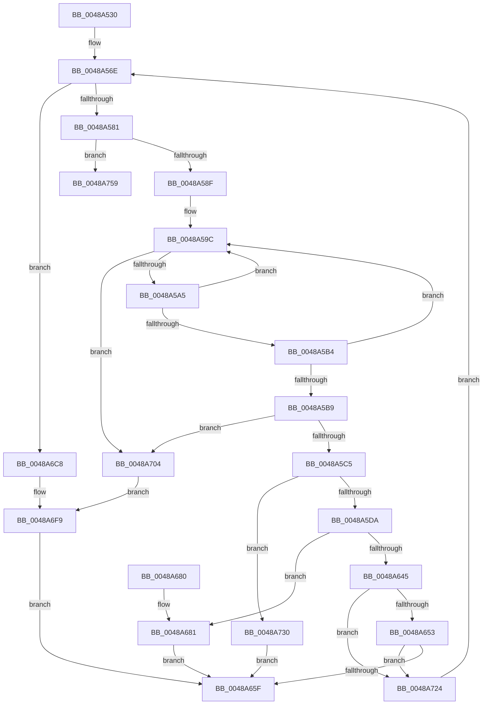

# HalpInterruptSetDestinationInternal

- RVA: `0x0048A530`–`0x0048A77C` (길이 `588` bytes)
- VA: `0x000000014048A530`
- 실행 섹션: `.text`
- PDB 이름 있음: `예`; PDB Function 태그: `아니요`
- unwind 정보 RVA: `0x000B0110`
- 디코드: `142`개 명령, `588/588` bytes 표시
- 미해석 바이트: `0` (있으면 어셈블리에 `.byte`로 보존)

> 이 문서는 커널 이미지의 기계어와 PDB 기호를 분석해 생성했습니다. 4번과 5번은 함수 원형과 자료형을 바이너리 사용 방식에서 추정한 C 해석이며 원본 소스 복구 결과는 아닙니다.

## 1. Dependencies

- 직접 호출 지점: **9**; 고유 호출 대상: **7**
- 직접 호출자로 확인된 함수: **1**
- RIP 상대 이미지 참조: **7**

### Outgoing calls
- `0x0048A565` → [HalpInterruptApplyOverrides](../2D/HalpInterruptApplyOverrides_function_002D2CE0.md) (function, `0x002D2CE0`)
- `0x0048A570` → [HalpInterruptLookupController](../2D/HalpInterruptLookupController_function_002D20D4.md) (function, `0x002D20D4`)
- `0x0048A612` → [HalpInterruptDestinationToTarget](HalpInterruptDestinationToTarget_function_0048AA54.md) (function, `0x0048AA54`)
- `0x0048A625` → [HalpInterruptFindBestRouting](HalpInterruptFindBestRouting_function_0048A784.md) (function, `0x0048A784`)
- `0x0048A639` → [HalpInterruptSetLineStateInternal](../2D/HalpInterruptSetLineStateInternal_function_002D2104.md) (function, `0x002D2104`)
- `0x0048A698` → [HalpInterruptSetProblemEx](HalpInterruptSetProblemEx_function_0048AC8C.md) (function, `0x0048AC8C`)
- `0x0048A71D` → [HalpInterruptSetProblemEx](HalpInterruptSetProblemEx_function_0048AC8C.md) (function, `0x0048AC8C`)
- `0x0048A749` → [HalpInterruptSetProblemEx](HalpInterruptSetProblemEx_function_0048AC8C.md) (function, `0x0048AC8C`)
- `0x0048A776` → [KeBugCheckEx](../4F/KeBugCheckEx_function_004FD660.md) (function, `0x004FD660`)

### Direct callers
- [HalpInterruptSetDestination](../2D/HalpInterruptSetDestination_function_002D3100.md) at `0x002D31D8`

### Static image references
- `0x0048A681` → RVA `0x00010AA8` (`.rdata`; read)
- `0x0048A6C8` → RVA `0x00F906B8` (`.data`; read/write)
- `0x0048A6D7` → RVA `0x00F906A0` (`.data`; read/write)
- `0x0048A6DE` → RVA `0x00F906C8` (`.data`; write)
- `0x0048A6E5` → RVA `0x00F90694` (`.data`; write)
- `0x0048A6EF` → RVA `0x00F906D0` (`.data`; write)
- `0x0048A759` → RVA `0x00F90694` (`.data`; read)

## 2. Other-region calls and transfers

- 다른 실행 섹션으로 향하는 call: **0**
- 별도 외부 분기/꼬리 이동을 확인하지 못했습니다.

## 3. Assembly (complete function range)

```asm
0048A530  48 89 5C 24 10                  mov qword ptr [rsp + 0x10], rbx
0048A535  48 89 74 24 18                  mov qword ptr [rsp + 0x18], rsi
0048A53A  48 89 7C 24 20                  mov qword ptr [rsp + 0x20], rdi
0048A53F  55                              push rbp
0048A540  41 54                           push r12
0048A542  41 55                           push r13
0048A544  41 56                           push r14
0048A546  41 57                           push r15
0048A548  48 8B EC                        mov rbp, rsp
0048A54B  48 83 EC 70                     sub rsp, 0x70
0048A54F  48 8B 01                        mov rax, qword ptr [rcx]
0048A552  4D 8B F0                        mov r14, r8
0048A555  4C 8B E2                        mov r12, rdx
0048A558  48 89 45 30                     mov qword ptr [rbp + 0x30], rax
0048A55C  45 33 C0                        xor r8d, r8d
0048A55F  48 8D 4D 30                     lea rcx, [rbp + 0x30]
0048A563  33 D2                           xor edx, edx
0048A565  E8 76 87 E4 FF                  call 0x1402d2ce0
0048A56A  48 8B 45 30                     mov rax, qword ptr [rbp + 0x30]
0048A56E  8B C8                           mov ecx, eax
0048A570  E8 5F 7B E4 FF                  call 0x1402d20d4
0048A575  48 8B D8                        mov rbx, rax
0048A578  48 85 C0                        test rax, rax
0048A57B  0F 84 47 01 00 00               je 0x14048a6c8
0048A581  8B 80 F8 00 00 00               mov eax, dword ptr [rax + 0xf8]
0048A587  A8 02                           test al, 2
0048A589  0F 85 CA 01 00 00               jne 0x14048a759
0048A58F  8B 45 34                        mov eax, dword ptr [rbp + 0x34]
0048A592  48 8D 93 08 01 00 00            lea rdx, [rbx + 0x108]
0048A599  48 8B 0A                        mov rcx, qword ptr [rdx]
0048A59C  48 3B CA                        cmp rcx, rdx
0048A59F  0F 84 5F 01 00 00               je 0x14048a704
0048A5A5  48 8B F9                        mov rdi, rcx
0048A5A8  48 8B 09                        mov rcx, qword ptr [rcx]
0048A5AB  44 8B 47 14                     mov r8d, dword ptr [rdi + 0x14]
0048A5AF  44 3B C0                        cmp r8d, eax
0048A5B2  7F E8                           jg 0x14048a59c
0048A5B4  39 47 18                        cmp dword ptr [rdi + 0x18], eax
0048A5B7  7E E3                           jle 0x14048a59c
0048A5B9  41 2B C0                        sub eax, r8d
0048A5BC  48 85 FF                        test rdi, rdi
0048A5BF  0F 84 3F 01 00 00               je 0x14048a704
0048A5C5  8B C8                           mov ecx, eax
0048A5C7  8B D0                           mov edx, eax
0048A5C9  48 03 C9                        add rcx, rcx
0048A5CC  48 8B 47 30                     mov rax, qword ptr [rdi + 0x30]
0048A5D0  80 3C C8 00                     cmp byte ptr [rax + rcx*8], 0
0048A5D4  0F 85 56 01 00 00               jne 0x14048a730
0048A5DA  4C 8B 6F 28                     mov r13, qword ptr [rdi + 0x28]
0048A5DE  48 6B F2 38                     imul rsi, rdx, 0x38
0048A5E2  49 8B D4                        mov rdx, r12
0048A5E5  4C 03 EE                        add r13, rsi
0048A5E8  41 0F 10 45 00                  movups xmm0, xmmword ptr [r13]
0048A5ED  4D 8D 45 18                     lea r8, [r13 + 0x18]
0048A5F1  41 0F 10 4D 10                  movups xmm1, xmmword ptr [r13 + 0x10]
0048A5F6  0F 11 45 C0                     movups xmmword ptr [rbp - 0x40], xmm0
0048A5FA  41 0F 10 45 20                  movups xmm0, xmmword ptr [r13 + 0x20]
0048A5FF  0F 11 4D D0                     movups xmmword ptr [rbp - 0x30], xmm1
0048A603  F2 41 0F 10 4D 30               movsd xmm1, qword ptr [r13 + 0x30]
0048A609  0F 11 45 E0                     movups xmmword ptr [rbp - 0x20], xmm0
0048A60D  F2 0F 11 4D F0                  movsd qword ptr [rbp - 0x10], xmm1
0048A612  E8 3D 04 00 00                  call 0x14048aa54
0048A617  49 8B 16                        mov rdx, qword ptr [r14]
0048A61A  4D 8D 7D 10                     lea r15, [r13 + 0x10]
0048A61E  4D 8B C7                        mov r8, r15
0048A621  48 8D 4D 30                     lea rcx, [rbp + 0x30]
0048A625  E8 5A 01 00 00                  call 0x14048a784
0048A62A  F0 83 0C 24 00                  lock or dword ptr [rsp], 0
0048A62F  4D 8B C5                        mov r8, r13
0048A632  48 8D 55 30                     lea rdx, [rbp + 0x30]
0048A636  48 8B CB                        mov rcx, rbx
0048A639  E8 C6 7A E4 FF                  call 0x1402d2104
0048A63E  44 8B C0                        mov r8d, eax
0048A641  85 C0                           test eax, eax
0048A643  78 3C                           js 0x14048a681
0048A645  41 8B 4E 04                     mov ecx, dword ptr [r14 + 4]
0048A649  41 39 4D 14                     cmp dword ptr [r13 + 0x14], ecx
0048A64D  0F 85 D1 00 00 00               jne 0x14048a724
0048A653  41 8B 0E                        mov ecx, dword ptr [r14]
0048A656  41 39 0F                        cmp dword ptr [r15], ecx
0048A659  0F 85 C5 00 00 00               jne 0x14048a724
0048A65F  4C 8D 5C 24 70                  lea r11, [rsp + 0x70]
0048A664  41 8B C0                        mov eax, r8d
0048A667  49 8B 5B 38                     mov rbx, qword ptr [r11 + 0x38]
0048A66B  49 8B 73 40                     mov rsi, qword ptr [r11 + 0x40]
0048A66F  49 8B 7B 48                     mov rdi, qword ptr [r11 + 0x48]
0048A673  49 8B E3                        mov rsp, r11
0048A676  41 5F                           pop r15
0048A678  41 5E                           pop r14
0048A67A  41 5D                           pop r13
0048A67C  41 5C                           pop r12
0048A67E  5D                              pop rbp
0048A67F  C3                              ret
0048A680  CC                              int3
0048A681  4C 8D 0D 20 64 B8 FF            lea r9, [rip - 0x479be0]
0048A688  C7 44 24 20 63 04 00 00         mov dword ptr [rsp + 0x20], 0x463
0048A690  BA 07 00 00 00                  mov edx, 7
0048A695  48 8B CB                        mov rcx, rbx
0048A698  E8 EF 05 00 00                  call 0x14048ac8c
0048A69D  48 8B 4F 28                     mov rcx, qword ptr [rdi + 0x28]
0048A6A1  0F 10 45 C0                     movups xmm0, xmmword ptr [rbp - 0x40]
0048A6A5  0F 10 4D D0                     movups xmm1, xmmword ptr [rbp - 0x30]
0048A6A9  0F 11 04 31                     movups xmmword ptr [rcx + rsi], xmm0
0048A6AD  0F 10 45 E0                     movups xmm0, xmmword ptr [rbp - 0x20]
0048A6B1  0F 11 4C 31 10                  movups xmmword ptr [rcx + rsi + 0x10], xmm1
0048A6B6  F2 0F 10 4D F0                  movsd xmm1, qword ptr [rbp - 0x10]
0048A6BB  0F 11 44 31 20                  movups xmmword ptr [rcx + rsi + 0x20], xmm0
0048A6C0  F2 0F 11 4C 31 30               movsd qword ptr [rcx + rsi + 0x30], xmm1
0048A6C6  EB 97                           jmp 0x14048a65f
0048A6C8  48 83 25 E8 5F B0 00 00         and qword ptr [rip + 0xb05fe8], 0
0048A6D0  4C 8D 0D D1 63 B8 FF            lea r9, [rip - 0x479c2f]
0048A6D7  83 25 C2 5F B0 00 00            and dword ptr [rip + 0xb05fc2], 0
0048A6DE  4C 89 0D E3 5F B0 00            mov qword ptr [rip + 0xb05fe3], r9
0048A6E5  C7 05 A5 5F B0 00 11 00 00 00   mov dword ptr [rip + 0xb05fa5], 0x11
0048A6EF  C7 05 D7 5F B0 00 17 04 00 00   mov dword ptr [rip + 0xb05fd7], 0x417
0048A6F9  41 B8 25 02 00 C0               mov r8d, 0xc0000225
0048A6FF  E9 5B FF FF FF                  jmp 0x14048a65f
0048A704  45 33 C0                        xor r8d, r8d
0048A707  C7 44 24 20 2F 04 00 00         mov dword ptr [rsp + 0x20], 0x42f
0048A70F  4C 8D 0D 92 63 B8 FF            lea r9, [rip - 0x479c6e]
0048A716  48 8B CB                        mov rcx, rbx
0048A719  41 8D 50 12                     lea edx, [r8 + 0x12]
0048A71D  E8 6A 05 00 00                  call 0x14048ac8c
0048A722  EB D5                           jmp 0x14048a6f9
0048A724  49 8B 07                        mov rax, qword ptr [r15]
0048A727  48 89 45 30                     mov qword ptr [rbp + 0x30], rax
0048A72B  E9 3E FE FF FF                  jmp 0x14048a56e
0048A730  45 33 C0                        xor r8d, r8d
0048A733  C7 44 24 20 3C 04 00 00         mov dword ptr [rsp + 0x20], 0x43c
0048A73B  4C 8D 0D 66 63 B8 FF            lea r9, [rip - 0x479c9a]
0048A742  48 8B CB                        mov rcx, rbx
0048A745  41 8D 50 13                     lea edx, [r8 + 0x13]
0048A749  E8 3E 05 00 00                  call 0x14048ac8c
0048A74E  41 B8 0D 00 00 C0               mov r8d, 0xc000000d
0048A754  E9 06 FF FF FF                  jmp 0x14048a65f
0048A759  4C 63 05 34 5F B0 00            movsxd r8, dword ptr [rip + 0xb05f34]
0048A760  4C 8B CB                        mov r9, rbx
0048A763  BA 00 02 00 00                  mov edx, 0x200
0048A768  48 C7 44 24 20 47 18 93 07      mov qword ptr [rsp + 0x20], 0x7931847
0048A771  B9 5C 00 00 00                  mov ecx, 0x5c
0048A776  E8 E5 2E 07 00                  call 0x1404fd660
0048A77B  CC                              int3
```

## 4. C-style interpretation (structured pseudocode)

```c
__int64 __fastcall HalpInterruptSetDestinationInternal(__int64 a1, __int64 a2, __int64 a3)
{
    __int64 result;
    __int64 v_r13;
    __int64 v_rsi;
    __int64 v_rsp;
    unsigned __int64 v_stack_m28;
    unsigned __int64 v_stack_m38;
    unsigned __int64 v_stack_m48;
    unsigned int v_stack_m50;
    unsigned __int64 v_stack_m58;
    unsigned __int64 v_stack_m68;
    unsigned int v_stack_m98;
    unsigned __int64 v_stack_p10;
    unsigned __int64 v_stack_p18;
    unsigned __int64 v_stack_p20;
    unsigned __int64 v_stack_p8;
    unsigned int v_stack_pC;

    v_stack_p10 = v_rbx;
    v_stack_p18 = v_rsi;
    v_stack_p20 = v_rdi;
    v_rsp = (v_rsp) - (112);
    v_stack_p8 = *(unsigned __int64 *)(a1);
    a3 = 0;
    a2 = 0;
    result = HalpInterruptApplyOverrides(v_stack_p8, a2, a3, a4);
loc_0048A56E:
    result = HalpInterruptLookupController((unsigned int)((unsigned int)(v_stack_p8)), a2, a3, a4);
    if (result == 0) goto loc_0048A6C8;
    if ((((unsigned __int8)((unsigned int)(*(unsigned int *)(result + 248)))) & (2)) != 0) goto loc_0048A759;
loc_0048A59C:
    if ((*(unsigned __int64 *)(result + 264)) == (result + 264)) goto loc_0048A704;
    if (((unsigned int)((unsigned int)(*(unsigned int *)(*(unsigned __int64 *)(result + 264) + 20)))) > ((unsigned int)((unsigned int)(v_stack_pC)))) goto loc_0048A59C;
    if ((*(unsigned int *)(*(unsigned __int64 *)(result + 264) + 24)) <= ((unsigned int)((unsigned int)(v_stack_pC)))) goto loc_0048A59C;
    result = (unsigned int)(((unsigned int)(v_stack_pC)) - ((unsigned int)((unsigned int)(*(unsigned int *)(*(unsigned __int64 *)(result + 264) + 20)))));
    if (*(unsigned __int64 *)(result + 264) == 0) goto loc_0048A704;
    a1 = ((unsigned int)((unsigned int)(result))) + ((unsigned int)((unsigned int)(result)));
    if ((*(unsigned __int8 *)(*(unsigned __int64 *)(*(unsigned __int64 *)(result + 264) + 48) + a1 * 8)) != 0) goto loc_0048A730;
    v_rsi = (v_rsi) * ((unsigned int)((unsigned int)(result)));
    v_r13 = (*(unsigned __int64 *)(*(unsigned __int64 *)(result + 264) + 40)) + (v_rsi);
    v_stack_m68 = v_xmm0;
    v_stack_m58 = v_xmm1;
    v_stack_m48 = v_xmm0;
    v_stack_m38 = v_xmm1;
    result = HalpInterruptDestinationToTarget(a1, 0, v_r13 + 24, a4);
    result = HalpInterruptFindBestRouting(v_stack_p8, *(unsigned __int64 *)(a3), v_r13 + 16, a4);
    result = HalpInterruptSetLineStateInternal(result, v_stack_p8, v_r13, a4);
    if (sign_flag) goto loc_0048A681;
    if ((*(unsigned int *)(v_r13 + 20)) != ((unsigned int)((unsigned int)(*(unsigned int *)(a3 + 4))))) goto loc_0048A724;
    if ((*(unsigned int *)(v_r13 + 16)) != ((unsigned int)((unsigned int)(*(unsigned int *)(a3))))) goto loc_0048A724;
loc_0048A65F:
    return (unsigned int)((unsigned int)((unsigned int)((unsigned int)(result))));
loc_0048A681:
    v_stack_m50 = 0x463ULL;
    result = HalpInterruptSetProblemEx(*(unsigned __int64 *)(v_stack_m28 + 56), 7, (unsigned int)((unsigned int)(result)), v_rip - 4692960);
    *(unsigned __int64 *)(*(unsigned __int64 *)(*(unsigned __int64 *)(v_stack_m28 + 72) + 40) + *(unsigned __int64 *)(v_stack_m28 + 64) * 1) = v_xmm0;
    *(unsigned __int64 *)(*(unsigned __int64 *)(*(unsigned __int64 *)(v_stack_m28 + 72) + 40) + *(unsigned __int64 *)(v_stack_m28 + 64) * 1 + 16) = v_xmm1;
    *(unsigned __int64 *)(*(unsigned __int64 *)(*(unsigned __int64 *)(v_stack_m28 + 72) + 40) + *(unsigned __int64 *)(v_stack_m28 + 64) * 1 + 32) = v_xmm0;
    *(unsigned __int64 *)(*(unsigned __int64 *)(*(unsigned __int64 *)(v_stack_m28 + 72) + 40) + *(unsigned __int64 *)(v_stack_m28 + 64) * 1 + 48) = v_xmm1;
    goto loc_0048A65F;
loc_0048A6C8:
    *(unsigned __int64 *)(v_rip + 11558883) = v_rip - 4693039;
    *(unsigned int *)(v_rip + 11558821) = 17;
    *(unsigned int *)(v_rip + 11558871) = 0x417ULL;
loc_0048A6F9:
    goto loc_0048A65F;
loc_0048A704:
    a3 = 0;
    v_stack_m50 = 0x42FULL;
    result = HalpInterruptSetProblemEx(*(unsigned __int64 *)(v_stack_m28 + 56), a3 + 18, a3, v_rip - 4693102);
    goto loc_0048A6F9;
loc_0048A724:
    v_stack_p8 = *(unsigned __int64 *)(v_r13 + 16);
    goto loc_0048A56E;
loc_0048A730:
    a3 = 0;
    v_stack_m50 = 0x43CULL;
    result = HalpInterruptSetProblemEx(*(unsigned __int64 *)(v_stack_m28 + 56), a3 + 19, a3, v_rip - 4693146);
    goto loc_0048A65F;
loc_0048A759:
    v_stack_m50 = 0x7931847ULL;
    result = KeBugCheckEx(92, 512, (int)(*(unsigned int *)(v_rip + 11558708)), *(unsigned __int64 *)(v_stack_m28 + 56));
    return result;
}
```

## 5. (Beta) C Style

```c
int64_t HalpInterruptSetDestinationInternal(void *Arg1, int64_t Arg2, void *Arg3)
{
    uint8_t *arg1 = (uint8_t *)Arg1;
    uint8_t *arg3 = (uint8_t *)Arg3;

    int64_t result;
    int64_t local_r13;
    int64_t local_rsi;
    int64_t local_rsp;
    uint64_t v_stack_m28;
    uint64_t v_stack_m38;
    uint64_t v_stack_m48;
    uint32_t v_stack_m50;
    uint64_t v_stack_m58;
    uint64_t v_stack_m68;
    uint32_t v_stack_m98;
    uint64_t v_stack_p10;
    uint64_t v_stack_p18;
    uint64_t v_stack_p20;
    uint64_t v_stack_p8;
    uint32_t v_stack_pC;

    v_stack_p10 = local_rbx;
    v_stack_p18 = local_rsi;
    v_stack_p20 = local_rdi;
    local_rsp = (local_rsp) - (112);
    v_stack_p8 = *(uint64_t *)(arg1);
    Arg3 = 0;
    Arg2 = 0;
    result = HalpInterruptApplyOverrides(v_stack_p8, Arg2, Arg3, a4);
loc_0048A56E:
    result = HalpInterruptLookupController((uint32_t)((uint32_t)(v_stack_p8)), Arg2, Arg3, a4);
    if (result == 0) goto loc_0048A6C8;
    if ((((uint8_t)((uint32_t)(*(uint32_t *)(result + 0xF8)))) & (2)) != 0) goto loc_0048A759;
loc_0048A59C:
    if ((*(uint64_t *)(result + 0x108)) == (result + 264)) goto loc_0048A704;
    if (((uint32_t)((uint32_t)(*(uint32_t *)(*(uint64_t *)(result + 0x108) + 0x14)))) > ((uint32_t)((uint32_t)(v_stack_pC)))) goto loc_0048A59C;
    if ((*(uint32_t *)(*(uint64_t *)(result + 0x108) + 0x18)) <= ((uint32_t)((uint32_t)(v_stack_pC)))) goto loc_0048A59C;
    result = (uint32_t)(((uint32_t)(v_stack_pC)) - ((uint32_t)((uint32_t)(*(uint32_t *)(*(uint64_t *)(result + 0x108) + 0x14)))));
    if (*(uint64_t *)(result + 0x108) == 0) goto loc_0048A704;
    Arg1 = ((uint32_t)((uint32_t)(result))) + ((uint32_t)((uint32_t)(result)));
    if ((*(uint8_t *)(*(uint64_t *)(*(uint64_t *)(result + 0x108) + 0x30) + arg1 * 8)) != 0) goto loc_0048A730;
    local_rsi = (local_rsi) * ((uint32_t)((uint32_t)(result)));
    local_r13 = (*(uint64_t *)(*(uint64_t *)(result + 0x108) + 0x28)) + (local_rsi);
    v_stack_m68 = v_xmm0;
    v_stack_m58 = v_xmm1;
    v_stack_m48 = v_xmm0;
    v_stack_m38 = v_xmm1;
    result = HalpInterruptDestinationToTarget(Arg1, 0, local_r13 + 24, a4);
    result = HalpInterruptFindBestRouting(v_stack_p8, *(uint64_t *)(arg3), local_r13 + 16, a4);
    result = HalpInterruptSetLineStateInternal(result, v_stack_p8, local_r13, a4);
    if (sign_flag) goto loc_0048A681;
    if ((*(uint32_t *)(local_r13 + 0x14)) != ((uint32_t)((uint32_t)(*(uint32_t *)(arg3 + 0x4))))) goto loc_0048A724;
    if ((*(uint32_t *)(local_r13 + 0x10)) != ((uint32_t)((uint32_t)(*(uint32_t *)(arg3))))) goto loc_0048A724;
loc_0048A65F:
    return (uint32_t)((uint32_t)((uint32_t)((uint32_t)(result))));
loc_0048A681:
    v_stack_m50 = 0x463ULL;
    result = HalpInterruptSetProblemEx(*(uint64_t *)(v_stack_m28 + 0x38), 7, (uint32_t)((uint32_t)(result)), v_rip - 4692960);
    *(uint64_t *)(*(uint64_t *)(*(uint64_t *)(v_stack_m28 + 0x48) + 0x28) + *(uint64_t *)(v_stack_m28 + 0x40) * 1) = v_xmm0;
    *(uint64_t *)(*(uint64_t *)(*(uint64_t *)(v_stack_m28 + 0x48) + 0x28) + *(uint64_t *)(v_stack_m28 + 0x40) * 1 + 0x10) = v_xmm1;
    *(uint64_t *)(*(uint64_t *)(*(uint64_t *)(v_stack_m28 + 0x48) + 0x28) + *(uint64_t *)(v_stack_m28 + 0x40) * 1 + 0x20) = v_xmm0;
    *(uint64_t *)(*(uint64_t *)(*(uint64_t *)(v_stack_m28 + 0x48) + 0x28) + *(uint64_t *)(v_stack_m28 + 0x40) * 1 + 0x30) = v_xmm1;
    goto loc_0048A65F;
loc_0048A6C8:
    *(uint64_t *)(v_rip + 0xB05FE3) = v_rip - 4693039;
    *(uint32_t *)(v_rip + 0xB05FA5) = 17;
    *(uint32_t *)(v_rip + 0xB05FD7) = 0x417ULL;
loc_0048A6F9:
    goto loc_0048A65F;
loc_0048A704:
    Arg3 = 0;
    v_stack_m50 = 0x42FULL;
    result = HalpInterruptSetProblemEx(*(uint64_t *)(v_stack_m28 + 0x38), Arg3 + 18, Arg3, v_rip - 4693102);
    goto loc_0048A6F9;
loc_0048A724:
    v_stack_p8 = *(uint64_t *)(local_r13 + 0x10);
    goto loc_0048A56E;
loc_0048A730:
    Arg3 = 0;
    v_stack_m50 = 0x43CULL;
    result = HalpInterruptSetProblemEx(*(uint64_t *)(v_stack_m28 + 0x38), Arg3 + 19, Arg3, v_rip - 4693146);
    goto loc_0048A65F;
loc_0048A759:
    v_stack_m50 = 0x7931847ULL;
    result = KeBugCheckEx(92, 512, (int32_t)(*(uint32_t *)(v_rip + 0xB05F34)), *(uint64_t *)(v_stack_m28 + 0x38));
    return result;
}
```

### 관측된 메모리 오프셋

구조체 형식이 확인되지 않은 접근은 인자 기준의 오프셋으로만 기록했습니다.

| 기준 인자 | 오프셋 표현 | 폭 (bit) | 접근 |
|---|---:|---:|---|
| `Arg1` | `+ 0x0` | `64` | `R` |
| `Arg3` | `+ 0x0` | `32` | `R` |
| `Arg3` | `+ 0x0` | `64` | `R` |
| `Arg3` | `+ 0x4` | `32` | `R` |

## 6. Execution-region graph

[열기: 2D/3D 그래프와 함수 탐색 컨트롤 패널](../../../control-panel.html?section=text&rva=0x0048A530&view=graph)

- 2D 그래프는 위에서 아래로 흐르고, 3D 그래프는 빈 공간을 드래그해 회전합니다. Shift+드래그는 이동, 휠은 확대·축소, 함수 노드 선택은 대상 보고서 이동입니다.

### Static fallback


