# HalpInterruptSetLineState

- RVA: `0x0048A0C8`–`0x0048A528` (길이 `1,120` bytes)
- VA: `0x000000014048A0C8`
- 실행 섹션: `.text`
- PDB 이름 있음: `예`; PDB Function 태그: `예`
- unwind 정보 RVA: `0x000B00D0`
- 디코드: `267`개 명령, `1,120/1,120` bytes 표시
- 미해석 바이트: `0` (있으면 어셈블리에 `.byte`로 보존)

> 이 문서는 커널 이미지의 기계어와 PDB 기호를 분석해 생성했습니다. 4번과 5번은 함수 원형과 자료형을 바이너리 사용 방식에서 추정한 C 해석이며 원본 소스 복구 결과는 아닙니다.

## 1. Dependencies

- 직접 호출 지점: **13**; 고유 호출 대상: **10**
- 직접 호출자로 확인된 함수: **5**
- RIP 상대 이미지 참조: **12**

### Outgoing calls
- `0x0048A13A` → [HalpAcquireHighLevelLock](../2D/HalpAcquireHighLevelLock_function_002D2390.md) (function, `0x002D2390`)
- `0x0048A18D` → [HalpReleaseHighLevelLock](../2D/HalpReleaseHighLevelLock_function_002D1C58.md) (function, `0x002D1C58`)
- `0x0048A1D2` → [HalpInterruptFindLinesForGsiRange](../2D/HalpInterruptFindLinesForGsiRange_function_002D204C.md) (function, `0x002D204C`)
- `0x0048A1EF` → [HalpInterruptLookupController](../2D/HalpInterruptLookupController_function_002D20D4.md) (function, `0x002D20D4`)
- `0x0048A20F` → [HalpInterruptLookupController](../2D/HalpInterruptLookupController_function_002D20D4.md) (function, `0x002D20D4`)
- `0x0048A2CD` → [HalpInterruptSetLineStateInternal](../2D/HalpInterruptSetLineStateInternal_function_002D2104.md) (function, `0x002D2104`)
- `0x0048A346` → [HalpInterruptDestinationToTarget](HalpInterruptDestinationToTarget_function_0048AA54.md) (function, `0x0048AA54`)
- `0x0048A368` → [HalpInterruptFindBestRouting](HalpInterruptFindBestRouting_function_0048A784.md) (function, `0x0048A784`)
- `0x0048A39F` → [HalpInterruptGetPriority](../2D/HalpInterruptGetPriority_function_002D3558.md) (function, `0x002D3558`)
- `0x0048A41E` → [HalpInterruptSetProblemEx](HalpInterruptSetProblemEx_function_0048AC8C.md) (function, `0x0048AC8C`)
- `0x0048A4AC` → [HalpInterruptSetProblemEx](HalpInterruptSetProblemEx_function_0048AC8C.md) (function, `0x0048AC8C`)
- `0x0048A4F5` → [HalpInterruptSetProblemEx](HalpInterruptSetProblemEx_function_0048AC8C.md) (function, `0x0048AC8C`)
- `0x0048A522` → [KeBugCheckEx](../4F/KeBugCheckEx_function_004FD660.md) (function, `0x004FD660`)

### Direct callers
- [HalEnableInterrupt](../2D/HalEnableInterrupt_function_002D4990.md) at `0x002D4AA6`
- [HalpTimerEnableHypervisorTimer](../4D/HalpTimerEnableHypervisorTimer_function_004D6ECC.md) at `0x004D6FF3`
- [HalpTimerConfigureInterrupt](../54/HalpTimerConfigureInterrupt_function_00548AB0.md) at `0x00548EAE`
- [sub_006DD9A0](../6D/Unknown_function_006DD9A0.md) at `0x006DDA2B`
- [sub_006FA83C](../6F/Unknown_function_006FA83C.md) at `0x006FAAB1`

### Static image references
- `0x0048A128` → RVA `0x00F906F0` (`.data`; read)
- `0x0048A13F` → RVA `0x00F906E0` (`.data`; read)
- `0x0048A19A` → RVA `0x00E101F0` (`.data`; read)
- `0x0048A2A9` → RVA `0x00FC1ED1` (`.data`; read)
- `0x0048A3A7` → RVA `0x00F90680` (`.data`; read)
- `0x0048A3C9` → RVA `0x00F906B8` (`.data`; read/write)
- `0x0048A3D1` → RVA `0x00010AA8` (`.rdata`; read)
- `0x0048A3D8` → RVA `0x00F906A0` (`.data`; read/write)
- `0x0048A3DF` → RVA `0x00F906C8` (`.data`; write)
- `0x0048A3E6` → RVA `0x00F90694` (`.data`; write)
- `0x0048A3F0` → RVA `0x00F906D0` (`.data`; write)
- `0x0048A505` → RVA `0x00F90694` (`.data`; read)

## 2. Other-region calls and transfers

- 다른 실행 섹션으로 향하는 call: **0**
- call이 아닌 외부 분기/꼬리 이동: **4**
  - `0x0048A43B` → [sub_006F5FE0](../6F/Unknown_function_006F5FE0.md) (`tail-transfer`)
  - `0x0048A447` → [sub_006F5FE0](../6F/Unknown_function_006F5FE0.md) (`tail-transfer`)
  - `0x0048A450` → [sub_006F5FE0](../6F/Unknown_function_006F5FE0.md) (`tail-transfer`)
  - `0x0048A45A` → [sub_006F5FE0](../6F/Unknown_function_006F5FE0.md) (`tail-transfer`)

## 3. Assembly (complete function range)

```asm
0048A0C8  48 8B C4                        mov rax, rsp
0048A0CB  44 89 48 20                     mov dword ptr [rax + 0x20], r9d
0048A0CF  44 88 40 18                     mov byte ptr [rax + 0x18], r8b
0048A0D3  89 50 10                        mov dword ptr [rax + 0x10], edx
0048A0D6  55                              push rbp
0048A0D7  53                              push rbx
0048A0D8  56                              push rsi
0048A0D9  57                              push rdi
0048A0DA  41 54                           push r12
0048A0DC  41 55                           push r13
0048A0DE  41 56                           push r14
0048A0E0  41 57                           push r15
0048A0E2  48 8D 68 B9                     lea rbp, [rax - 0x47]
0048A0E6  48 81 EC C8 00 00 00            sub rsp, 0xc8
0048A0ED  44 8B 75 6F                     mov r14d, dword ptr [rbp + 0x6f]
0048A0F1  0F 29 70 A8                     movaps xmmword ptr [rax - 0x58], xmm6
0048A0F5  0F 29 78 98                     movaps xmmword ptr [rax - 0x68], xmm7
0048A0F9  44 0F 29 40 88                  movaps xmmword ptr [rax - 0x78], xmm8
0048A0FE  44 0F 29 88 78 FF FF FF         movaps xmmword ptr [rax - 0x88], xmm9
0048A106  44 0F 29 54 24 70               movaps xmmword ptr [rsp + 0x70], xmm10
0048A10C  41 83 FE 03                     cmp r14d, 3
0048A110  0F 84 1A 02 00 00               je 0x14048a330
0048A116  41 83 FE 04                     cmp r14d, 4
0048A11A  0F 84 05 03 00 00               je 0x14048a425
0048A120  45 32 FF                        xor r15b, r15b
0048A123  48 8B 01                        mov rax, qword ptr [rcx]
0048A126  32 DB                           xor bl, bl
0048A128  48 8D 0D C1 65 B0 00            lea rcx, [rip + 0xb065c1]
0048A12F  48 89 45 4F                     mov qword ptr [rbp + 0x4f], rax
0048A133  44 88 BD 87 00 00 00            mov byte ptr [rbp + 0x87], r15b
0048A13A  E8 51 82 E4 FF                  call 0x1402d2390
0048A13F  4C 8B 05 9A 65 B0 00            mov r8, qword ptr [rip + 0xb0659a]
0048A146  44 8A D8                        mov r11b, al
0048A149  44 8B 4D 53                     mov r9d, dword ptr [rbp + 0x53]
0048A14D  44 8B 55 4F                     mov r10d, dword ptr [rbp + 0x4f]
0048A151  48 8D 05 88 65 B0 00            lea rax, [rip + 0xb06588]
0048A158  4C 3B C0                        cmp r8, rax
0048A15B  74 26                           je 0x14048a183
0048A15D  49 8B D0                        mov rdx, r8
0048A160  4D 8B 00                        mov r8, qword ptr [r8]
0048A163  44 39 52 10                     cmp dword ptr [rdx + 0x10], r10d
0048A167  75 E8                           jne 0x14048a151
0048A169  44 39 4A 14                     cmp dword ptr [rdx + 0x14], r9d
0048A16D  75 E2                           jne 0x14048a151
0048A16F  48 8B 42 18                     mov rax, qword ptr [rdx + 0x18]
0048A173  B3 01                           mov bl, 1
0048A175  48 89 45 4F                     mov qword ptr [rbp + 0x4f], rax
0048A179  8B 42 20                        mov eax, dword ptr [rdx + 0x20]
0048A17C  44 8B 72 24                     mov r14d, dword ptr [rdx + 0x24]
0048A180  89 45 67                        mov dword ptr [rbp + 0x67], eax
0048A183  41 8A D3                        mov dl, r11b
0048A186  48 8D 0D 63 65 B0 00            lea rcx, [rip + 0xb06563]
0048A18D  E8 C6 7A E4 FF                  call 0x1402d1c58
0048A192  84 DB                           test bl, bl
0048A194  0F 85 D9 02 00 00               jne 0x14048a473
0048A19A  48 8B 05 4F 60 98 00            mov rax, qword ptr [rip + 0x98604f]
0048A1A1  83 B8 F0 00 00 00 02            cmp dword ptr [rax + 0xf0], 2
0048A1A8  0F 85 C5 02 00 00               jne 0x14048a473
0048A1AE  8B 7D 4F                        mov edi, dword ptr [rbp + 0x4f]
0048A1B1  8B 5D 53                        mov ebx, dword ptr [rbp + 0x53]
0048A1B4  8D 87 00 50 FF FF               lea eax, [rdi - 0xb000]
0048A1BA  83 F8 01                        cmp eax, 1
0048A1BD  77 2E                           ja 0x14048a1ed
0048A1BF  8B F3                           mov esi, ebx
0048A1C1  81 FF 01 B0 00 00               cmp edi, 0xb001
0048A1C7  0F 84 F4 01 00 00               je 0x14048a3c1
0048A1CD  8D 56 01                        lea edx, [rsi + 1]
0048A1D0  8B CE                           mov ecx, esi
0048A1D2  E8 75 7E E4 FF                  call 0x1402d204c
0048A1D7  48 85 C0                        test rax, rax
0048A1DA  74 11                           je 0x14048a1ed
0048A1DC  8B 58 14                        mov ebx, dword ptr [rax + 0x14]
0048A1DF  2B 58 1C                        sub ebx, dword ptr [rax + 0x1c]
0048A1E2  03 DE                           add ebx, esi
0048A1E4  89 5D 53                        mov dword ptr [rbp + 0x53], ebx
0048A1E7  8B 78 10                        mov edi, dword ptr [rax + 0x10]
0048A1EA  89 7D 4F                        mov dword ptr [rbp + 0x4f], edi
0048A1ED  8B CF                           mov ecx, edi
0048A1EF  E8 E0 7E E4 FF                  call 0x1402d20d4
0048A1F4  48 8B F0                        mov rsi, rax
0048A1F7  48 85 C0                        test rax, rax
0048A1FA  0F 84 C9 01 00 00               je 0x14048a3c9
0048A200  8B 90 F8 00 00 00               mov edx, dword ptr [rax + 0xf8]
0048A206  F6 C2 02                        test dl, 2
0048A209  0F 85 F6 02 00 00               jne 0x14048a505
0048A20F  E8 C0 7E E4 FF                  call 0x1402d20d4
0048A214  48 85 C0                        test rax, rax
0048A217  0F 84 E8 01 00 00               je 0x14048a405
0048A21D  48 8D 88 08 01 00 00            lea rcx, [rax + 0x108]
0048A224  48 8B 01                        mov rax, qword ptr [rcx]
0048A227  48 3B C1                        cmp rax, rcx
0048A22A  0F 84 D5 01 00 00               je 0x14048a405
0048A230  48 8B F8                        mov rdi, rax
0048A233  48 8B 00                        mov rax, qword ptr [rax]
0048A236  8B 57 14                        mov edx, dword ptr [rdi + 0x14]
0048A239  3B D3                           cmp edx, ebx
0048A23B  7F EA                           jg 0x14048a227
0048A23D  39 5F 18                        cmp dword ptr [rdi + 0x18], ebx
0048A240  7E E5                           jle 0x14048a227
0048A242  2B DA                           sub ebx, edx
0048A244  48 85 FF                        test rdi, rdi
0048A247  0F 84 B8 01 00 00               je 0x14048a405
0048A24D  48 8B 4F 30                     mov rcx, qword ptr [rdi + 0x30]
0048A251  44 8B E3                        mov r12d, ebx
0048A254  4D 03 E4                        add r12, r12
0048A257  8B C3                           mov eax, ebx
0048A259  42 80 3C E1 00                  cmp byte ptr [rcx + r12*8], 0
0048A25E  0F 85 78 02 00 00               jne 0x14048a4dc
0048A264  48 8B 5F 28                     mov rbx, qword ptr [rdi + 0x28]
0048A268  46 0F 10 14 E1                  movups xmm10, xmmword ptr [rcx + r12*8]
0048A26D  4C 6B E8 38                     imul r13, rax, 0x38
0048A271  49 03 DD                        add rbx, r13
0048A274  42 80 7C E1 0C 00               cmp byte ptr [rcx + r12*8 + 0xc], 0
0048A27A  F2 0F 10 43 30                  movsd xmm0, qword ptr [rbx + 0x30]
0048A27F  0F 10 33                        movups xmm6, xmmword ptr [rbx]
0048A282  0F 10 7B 10                     movups xmm7, xmmword ptr [rbx + 0x10]
0048A286  44 0F 10 43 20                  movups xmm8, xmmword ptr [rbx + 0x20]
0048A28B  0F 11 74 24 30                  movups xmmword ptr [rsp + 0x30], xmm6
0048A290  0F 11 7C 24 40                  movups xmmword ptr [rsp + 0x40], xmm7
0048A295  44 0F 11 45 8F                  movups xmmword ptr [rbp - 0x71], xmm8
0048A29A  44 0F 28 C8                     movaps xmm9, xmm0
0048A29E  F2 0F 11 45 9F                  movsd qword ptr [rbp - 0x61], xmm0
0048A2A3  0F 84 95 00 00 00               je 0x14048a33e
0048A2A9  80 3D 21 7C B3 00 00            cmp byte ptr [rip + 0xb37c21], 0
0048A2B0  0F 84 7D 01 00 00               je 0x14048a433
0048A2B6  83 4B 0C 10                     or dword ptr [rbx + 0xc], 0x10
0048A2BA  4C 8D 7B 10                     lea r15, [rbx + 0x10]
0048A2BE  F0 83 0C 24 00                  lock or dword ptr [rsp], 0
0048A2C3  4C 8B C3                        mov r8, rbx
0048A2C6  48 8D 55 4F                     lea rdx, [rbp + 0x4f]
0048A2CA  48 8B CE                        mov rcx, rsi
0048A2CD  E8 32 7E E4 FF                  call 0x1402d2104
0048A2D2  44 8B C0                        mov r8d, eax
0048A2D5  85 C0                           test eax, eax
0048A2D7  0F 88 A1 01 00 00               js 0x14048a47e
0048A2DD  48 8B 4D 7F                     mov rcx, qword ptr [rbp + 0x7f]
0048A2E1  8B 41 04                        mov eax, dword ptr [rcx + 4]
0048A2E4  39 43 14                        cmp dword ptr [rbx + 0x14], eax
0048A2E7  0F 85 78 01 00 00               jne 0x14048a465
0048A2ED  8B 01                           mov eax, dword ptr [rcx]
0048A2EF  41 39 07                        cmp dword ptr [r15], eax
0048A2F2  0F 85 6D 01 00 00               jne 0x14048a465
0048A2F8  45 33 C0                        xor r8d, r8d
0048A2FB  4C 8D 9C 24 C8 00 00 00         lea r11, [rsp + 0xc8]
0048A303  41 8B C0                        mov eax, r8d
0048A306  41 0F 28 73 E8                  movaps xmm6, xmmword ptr [r11 - 0x18]
0048A30B  41 0F 28 7B D8                  movaps xmm7, xmmword ptr [r11 - 0x28]
0048A310  45 0F 28 43 C8                  movaps xmm8, xmmword ptr [r11 - 0x38]
0048A315  45 0F 28 4B B8                  movaps xmm9, xmmword ptr [r11 - 0x48]
0048A31A  45 0F 28 53 A8                  movaps xmm10, xmmword ptr [r11 - 0x58]
0048A31F  49 8B E3                        mov rsp, r11
0048A322  41 5F                           pop r15
0048A324  41 5E                           pop r14
0048A326  41 5D                           pop r13
0048A328  41 5C                           pop r12
0048A32A  5F                              pop rdi
0048A32B  5E                              pop rsi
0048A32C  5B                              pop rbx
0048A32D  5D                              pop rbp
0048A32E  C3                              ret
0048A32F  CC                              int3
0048A330  41 B7 01                        mov r15b, 1
0048A333  41 BE 02 00 00 00               mov r14d, 2
0048A339  E9 E5 FD FF FF                  jmp 0x14048a123
0048A33E  48 8B 55 77                     mov rdx, qword ptr [rbp + 0x77]
0048A342  4C 8D 43 18                     lea r8, [rbx + 0x18]
0048A346  E8 09 07 00 00                  call 0x14048aa54
0048A34B  44 8B C0                        mov r8d, eax
0048A34E  85 C0                           test eax, eax
0048A350  0F 88 3F 01 00 00               js 0x14048a495
0048A356  48 8B 55 7F                     mov rdx, qword ptr [rbp + 0x7f]
0048A35A  4C 8D 7B 10                     lea r15, [rbx + 0x10]
0048A35E  4D 8B C7                        mov r8, r15
0048A361  48 8D 4D 4F                     lea rcx, [rbp + 0x4f]
0048A365  48 8B 12                        mov rdx, qword ptr [rdx]
0048A368  E8 17 04 00 00                  call 0x14048a784
0048A36D  44 8B C0                        mov r8d, eax
0048A370  85 C0                           test eax, eax
0048A372  0F 88 39 01 00 00               js 0x14048a4b1
0048A378  8A 85 87 00 00 00               mov al, byte ptr [rbp + 0x87]
0048A37E  48 8B CE                        mov rcx, rsi
0048A381  44 8B 4D 57                     mov r9d, dword ptr [rbp + 0x57]
0048A385  88 43 04                        mov byte ptr [rbx + 4], al
0048A388  41 8B D1                        mov edx, r9d
0048A38B  8B 45 67                        mov eax, dword ptr [rbp + 0x67]
0048A38E  89 43 08                        mov dword ptr [rbx + 8], eax
0048A391  44 89 33                        mov dword ptr [rbx], r14d
0048A394  C7 43 0C 10 00 00 00            mov dword ptr [rbx + 0xc], 0x10
0048A39B  44 89 4B 30                     mov dword ptr [rbx + 0x30], r9d
0048A39F  E8 B4 91 E4 FF                  call 0x1402d3558
0048A3A4  8A 4D 5F                        mov cl, byte ptr [rbp + 0x5f]
0048A3A7  48 8D 15 D2 62 B0 00            lea rdx, [rip + 0xb062d2]
0048A3AE  89 43 34                        mov dword ptr [rbx + 0x34], eax
0048A3B1  41 0F B6 C1                     movzx eax, r9b
0048A3B5  48 C1 E8 04                     shr rax, 4
0048A3B9  88 0C 10                        mov byte ptr [rax + rdx], cl
0048A3BC  E9 FD FE FF FF                  jmp 0x14048a2be
0048A3C1  83 C6 08                        add esi, 8
0048A3C4  E9 04 FE FF FF                  jmp 0x14048a1cd
0048A3C9  48 83 25 E7 62 B0 00 00         and qword ptr [rip + 0xb062e7], 0
0048A3D1  4C 8D 0D D0 66 B8 FF            lea r9, [rip - 0x479930]
0048A3D8  83 25 C1 62 B0 00 00            and dword ptr [rip + 0xb062c1], 0
0048A3DF  4C 89 0D E2 62 B0 00            mov qword ptr [rip + 0xb062e2], r9
0048A3E6  C7 05 A4 62 B0 00 11 00 00 00   mov dword ptr [rip + 0xb062a4], 0x11
0048A3F0  C7 05 D6 62 B0 00 A8 08 00 00   mov dword ptr [rip + 0xb062d6], 0x8a8
0048A3FA  41 B8 25 02 00 C0               mov r8d, 0xc0000225
0048A400  E9 F6 FE FF FF                  jmp 0x14048a2fb
0048A405  45 33 C0                        xor r8d, r8d
0048A408  C7 44 24 20 C0 08 00 00         mov dword ptr [rsp + 0x20], 0x8c0
0048A410  4C 8D 0D 91 66 B8 FF            lea r9, [rip - 0x47996f]
0048A417  48 8B CE                        mov rcx, rsi
0048A41A  41 8D 50 12                     lea edx, [r8 + 0x12]
0048A41E  E8 69 08 00 00                  call 0x14048ac8c
0048A423  EB D5                           jmp 0x14048a3fa
0048A425  41 B7 01                        mov r15b, 1
0048A428  41 BE 01 00 00 00               mov r14d, 1
0048A42E  E9 F0 FC FF FF                  jmp 0x14048a123
0048A433  44 8B 55 57                     mov r10d, dword ptr [rbp + 0x57]
0048A437  44 39 53 30                     cmp dword ptr [rbx + 0x30], r10d
0048A43B  0F 85 9F BB 26 00               jne 0x1406f5fe0
0048A441  8B 45 67                        mov eax, dword ptr [rbp + 0x67]
0048A444  39 43 08                        cmp dword ptr [rbx + 8], eax
0048A447  0F 85 93 BB 26 00               jne 0x1406f5fe0
0048A44D  44 39 33                        cmp dword ptr [rbx], r14d
0048A450  0F 85 8A BB 26 00               jne 0x1406f5fe0
0048A456  44 38 7B 04                     cmp byte ptr [rbx + 4], r15b
0048A45A  0F 85 80 BB 26 00               jne 0x1406f5fe0
0048A460  E9 51 FE FF FF                  jmp 0x14048a2b6
0048A465  49 8B 07                        mov rax, qword ptr [r15]
0048A468  44 8A BD 87 00 00 00            mov r15b, byte ptr [rbp + 0x87]
0048A46F  48 89 45 4F                     mov qword ptr [rbp + 0x4f], rax
0048A473  8B 7D 4F                        mov edi, dword ptr [rbp + 0x4f]
0048A476  8B 5D 53                        mov ebx, dword ptr [rbp + 0x53]
0048A479  E9 6F FD FF FF                  jmp 0x14048a1ed
0048A47E  F2 44 0F 10 4D 9F               movsd xmm9, qword ptr [rbp - 0x61]
0048A484  44 0F 10 45 8F                  movups xmm8, xmmword ptr [rbp - 0x71]
0048A489  0F 10 7C 24 40                  movups xmm7, xmmword ptr [rsp + 0x40]
0048A48E  0F 10 74 24 30                  movups xmm6, xmmword ptr [rsp + 0x30]
0048A493  EB 1C                           jmp 0x14048a4b1
0048A495  4C 8D 0D 0C 66 B8 FF            lea r9, [rip - 0x4799f4]
0048A49C  C7 44 24 20 1A 09 00 00         mov dword ptr [rsp + 0x20], 0x91a
0048A4A4  BA 16 00 00 00                  mov edx, 0x16
0048A4A9  48 8B CE                        mov rcx, rsi
0048A4AC  E8 DB 07 00 00                  call 0x14048ac8c
0048A4B1  48 8B 47 28                     mov rax, qword ptr [rdi + 0x28]
0048A4B5  42 0F 11 34 28                  movups xmmword ptr [rax + r13], xmm6
0048A4BA  42 0F 11 7C 28 10               movups xmmword ptr [rax + r13 + 0x10], xmm7
0048A4C0  46 0F 11 44 28 20               movups xmmword ptr [rax + r13 + 0x20], xmm8
0048A4C6  F2 46 0F 11 4C 28 30            movsd qword ptr [rax + r13 + 0x30], xmm9
0048A4CD  48 8B 47 30                     mov rax, qword ptr [rdi + 0x30]
0048A4D1  F3 46 0F 7F 14 E0               movdqu xmmword ptr [rax + r12*8], xmm10
0048A4D7  E9 1F FE FF FF                  jmp 0x14048a2fb
0048A4DC  45 33 C0                        xor r8d, r8d
0048A4DF  C7 44 24 20 CD 08 00 00         mov dword ptr [rsp + 0x20], 0x8cd
0048A4E7  4C 8D 0D BA 65 B8 FF            lea r9, [rip - 0x479a46]
0048A4EE  48 8B CE                        mov rcx, rsi
0048A4F1  41 8D 50 13                     lea edx, [r8 + 0x13]
0048A4F5  E8 92 07 00 00                  call 0x14048ac8c
0048A4FA  41 B8 0D 00 00 C0               mov r8d, 0xc000000d
0048A500  E9 F6 FD FF FF                  jmp 0x14048a2fb
0048A505  4C 63 05 88 61 B0 00            movsxd r8, dword ptr [rip + 0xb06188]
0048A50C  4C 8B CE                        mov r9, rsi
0048A50F  BA 00 02 00 00                  mov edx, 0x200
0048A514  48 C7 44 24 20 47 18 93 07      mov qword ptr [rsp + 0x20], 0x7931847
0048A51D  B9 5C 00 00 00                  mov ecx, 0x5c
0048A522  E8 39 31 07 00                  call 0x1404fd660
0048A527  CC                              int3
```

## 4. C-style interpretation (structured pseudocode)

```c
__int64 __fastcall HalpInterruptSetLineState(__int64 a1, int a2, unsigned __int8 a3, int a4)
{
    __int64 result;
    __int64 v_r12;
    __int64 v_r13;
    __int64 v_r15;
    __int64 v_rbx;
    __int64 v_rdi;
    __int64 v_rsi;
    __int64 v_rsp;
    unsigned int v_stack_m108;
    unsigned __int64 v_stack_m40;
    unsigned __int64 v_stack_m88;
    unsigned __int64 v_stack_m98;
    unsigned int v_stack_mA8;
    unsigned __int64 v_stack_mC8;
    unsigned __int64 v_stack_mD8;

    *(unsigned int *)(v_rsp + 32) = a4;
    *(unsigned __int8 *)(v_rsp + 24) = a3;
    *(unsigned int *)(v_rsp + 16) = a2;
    v_rsp = (v_rsp) - (200);
    *(unsigned __int64 *)(v_rsp - 88) = v_xmm6;
    *(unsigned __int64 *)(v_rsp - 104) = v_xmm7;
    *(unsigned __int64 *)(v_rsp - 120) = v_xmm8;
    *(unsigned __int64 *)(v_rsp - 136) = v_xmm9;
    v_stack_m98 = v_xmm10;
    if (((unsigned int)((unsigned int)(*(unsigned int *)(v_rsp - 71 + 111)))) == 3) goto loc_0048A330;
    if (((unsigned int)((unsigned int)(*(unsigned int *)(v_rsp - 71 + 111)))) == 4) goto loc_0048A425;
    v_r15 = 0;
loc_0048A123:
    v_rbx = 0;
    *(unsigned __int64 *)(v_rsp - 71 + 79) = *(unsigned __int64 *)(a1);
    *(unsigned __int8 *)(v_rsp - 71 + 135) = 0;
    result = HalpAcquireHighLevelLock(v_rip + 11560385, a2, a3, a4);
loc_0048A151:
    if ((*(unsigned __int64 *)(v_rip + 11560346)) == (v_rip + 11560328)) goto loc_0048A183;
    if ((*(unsigned int *)(*(unsigned __int64 *)(v_rip + 11560346) + 16)) != ((unsigned int)((unsigned int)(*(unsigned int *)(v_rsp - 71 + 79))))) goto loc_0048A151;
    if ((*(unsigned int *)(*(unsigned __int64 *)(v_rip + 11560346) + 20)) != ((unsigned int)((unsigned int)(*(unsigned int *)(v_rsp - 71 + 83))))) goto loc_0048A151;
    *(unsigned __int64 *)(v_rsp - 71 + 79) = *(unsigned __int64 *)(*(unsigned __int64 *)(v_rip + 11560346) + 24);
    *(unsigned int *)(v_rsp - 71 + 103) = (unsigned int)((unsigned int)(*(unsigned int *)(*(unsigned __int64 *)(v_rip + 11560346) + 32)));
loc_0048A183:
    result = HalpReleaseHighLevelLock(v_rip + 11560291, (unsigned __int8)((unsigned __int8)(result)), *(unsigned __int64 *)(*(unsigned __int64 *)(v_rip + 11560346)), (unsigned int)(*(unsigned int *)(v_rsp - 71 + 83)));
    if (1 != 0) goto loc_0048A473;
    if ((*(unsigned int *)(*(unsigned __int64 *)(v_rip + 9986127) + 240)) != 2) goto loc_0048A473;
    if (((unsigned int)((unsigned int)(*(unsigned int *)(v_rsp - 71 + 79)) - 45056)) > 1) goto loc_0048A1ED;
    if (((unsigned int)((unsigned int)(*(unsigned int *)(v_rsp - 71 + 79)))) == 0xB001ULL) goto loc_0048A3C1;
loc_0048A1CD:
    result = HalpInterruptFindLinesForGsiRange((unsigned int)((unsigned int)((unsigned int)((unsigned int)((unsigned int)(*(unsigned int *)(v_rsp - 71 + 83)))))), (unsigned int)((unsigned int)((unsigned int)(*(unsigned int *)(v_rsp - 71 + 83)))) + 1, *(unsigned __int64 *)(*(unsigned __int64 *)(v_rip + 11560346)), (unsigned int)(*(unsigned int *)(v_rsp - 71 + 83)));
    v_rbx = (unsigned int)(*(unsigned int *)(v_rsp - 71 + 83));
    v_rdi = (unsigned int)(*(unsigned int *)(v_rsp - 71 + 79));
    if (result != 0) {
        v_rbx = *(unsigned int *)(result + 20);
        v_rbx = (unsigned int)((v_rbx) - (*(unsigned int *)(result + 28)));
        v_rbx = (unsigned int)((v_rbx) + ((unsigned int)((unsigned int)((unsigned int)((unsigned int)(*(unsigned int *)(v_rsp - 71 + 83)))))));
        *(unsigned int *)(v_rsp - 71 + 83) = (unsigned int)(v_rbx);
        v_rdi = *(unsigned int *)(result + 16);
        *(unsigned int *)(v_rsp - 71 + 79) = (unsigned int)(v_rdi);
    }
    result = HalpInterruptLookupController((unsigned int)((unsigned int)(v_rdi)), (unsigned int)((unsigned int)((unsigned int)(*(unsigned int *)(v_rsp - 71 + 83)))) + 1, *(unsigned __int64 *)(*(unsigned __int64 *)(v_rip + 11560346)), (unsigned int)(*(unsigned int *)(v_rsp - 71 + 83)));
    if (result == 0) goto loc_0048A3C9;
    if ((((unsigned __int8)((unsigned int)(*(unsigned int *)(result + 248)))) & (2)) != 0) goto loc_0048A505;
    result = HalpInterruptLookupController((unsigned int)((unsigned int)(v_rdi)), (unsigned int)(*(unsigned int *)(result + 248)), *(unsigned __int64 *)(*(unsigned __int64 *)(v_rip + 11560346)), (unsigned int)(*(unsigned int *)(v_rsp - 71 + 83)));
    if (result == 0) goto loc_0048A405;
loc_0048A227:
    if ((*(unsigned __int64 *)(result + 264)) == (result + 264)) goto loc_0048A405;
    if (((unsigned int)((unsigned int)(*(unsigned int *)(*(unsigned __int64 *)(result + 264) + 20)))) > ((unsigned int)(v_rbx))) goto loc_0048A227;
    if ((*(unsigned int *)(*(unsigned __int64 *)(result + 264) + 24)) <= ((unsigned int)(v_rbx))) goto loc_0048A227;
    v_rbx = (unsigned int)((v_rbx) - ((unsigned int)((unsigned int)(*(unsigned int *)(*(unsigned __int64 *)(result + 264) + 20)))));
    if (*(unsigned __int64 *)(result + 264) == 0) goto loc_0048A405;
    v_r12 = ((unsigned int)((unsigned int)(v_rbx))) + ((unsigned int)((unsigned int)(v_rbx)));
    if ((*(unsigned __int8 *)(*(unsigned __int64 *)(*(unsigned __int64 *)(result + 264) + 48) + v_r12 * 8)) != 0) goto loc_0048A4DC;
    v_r13 = (v_r13) * ((unsigned int)((unsigned int)(v_rbx)));
    v_rbx = (*(unsigned __int64 *)(*(unsigned __int64 *)(result + 264) + 40)) + (v_r13);
    v_stack_mD8 = v_xmm6;
    v_stack_mC8 = v_xmm7;
    *(unsigned __int64 *)(v_rsp - 71 - 113) = v_xmm8;
    *(unsigned __int64 *)(v_rsp - 71 - 97) = v_xmm0;
    if ((*(unsigned __int8 *)(*(unsigned __int64 *)(*(unsigned __int64 *)(result + 264) + 48) + v_r12 * 8 + 12)) == 0) goto loc_0048A33E;
    if ((*(unsigned __int8 *)(v_rip + 11762721)) == 0) goto loc_0048A433;
loc_0048A2B6:
loc_0048A2BE:
    result = HalpInterruptSetLineStateInternal(result, v_rsp - 71 + 79, v_rbx, (unsigned int)(*(unsigned int *)(v_rsp - 71 + 83)));
    if (sign_flag) goto loc_0048A47E;
    if ((*(unsigned int *)(v_rbx + 20)) != ((unsigned int)((unsigned int)(*(unsigned int *)(*(unsigned __int64 *)(v_rsp - 71 + 127) + 4))))) goto loc_0048A465;
    if ((*(unsigned int *)(v_rbx + 16)) != ((unsigned int)((unsigned int)(*(unsigned int *)(*(unsigned __int64 *)(v_rsp - 71 + 127)))))) goto loc_0048A465;
    a3 = 0;
loc_0048A2FB:
    return 0;
loc_0048A330:
    goto loc_0048A123;
loc_0048A33E:
    result = HalpInterruptDestinationToTarget(*(unsigned __int64 *)(v_rsp - 71 + 127), *(unsigned __int64 *)(v_rsp - 71 + 119), v_rbx + 24, (unsigned int)(*(unsigned int *)(v_rsp - 71 + 83)));
    if (sign_flag) goto loc_0048A495;
    result = HalpInterruptFindBestRouting(v_rsp - 71 + 79, *(unsigned __int64 *)(*(unsigned __int64 *)(v_rsp - 71 + 127)), v_rbx + 16, (unsigned int)(*(unsigned int *)(v_rsp - 71 + 83)));
    if (sign_flag) goto loc_0048A4B1;
    *(unsigned __int8 *)(v_rbx + 4) = (unsigned __int8)(*(unsigned __int8 *)(v_rsp - 71 + 135));
    *(unsigned int *)(v_rbx + 8) = (unsigned int)((unsigned int)(*(unsigned int *)(v_rsp - 71 + 103)));
    *(unsigned int *)(v_rbx) = 2;
    *(unsigned int *)(v_rbx + 12) = 16;
    *(unsigned int *)(v_rbx + 48) = (unsigned int)((unsigned int)(*(unsigned int *)(v_rsp - 71 + 87)));
    result = HalpInterruptGetPriority(result, (unsigned int)((unsigned int)((unsigned int)(*(unsigned int *)(v_rsp - 71 + 87)))), (unsigned int)((unsigned int)(result)), (unsigned int)(*(unsigned int *)(v_rsp - 71 + 87)));
    *(unsigned int *)(v_rbx + 52) = (unsigned int)(result);
    result = ((unsigned __int8)((unsigned int)(*(unsigned int *)(v_rsp - 71 + 87)))) >> (4);
    *(unsigned __int8 *)(result + v_rip + 11559634 * 1) = (unsigned __int8)(*(unsigned __int8 *)(v_rsp - 71 + 95));
    goto loc_0048A2BE;
loc_0048A3C1:
    v_rsi = (unsigned int)((result) + (8));
    goto loc_0048A1CD;
loc_0048A3C9:
    *(unsigned __int64 *)(v_rip + 11559650) = v_rip - 4692272;
    *(unsigned int *)(v_rip + 11559588) = 17;
    *(unsigned int *)(v_rip + 11559638) = 0x8A8ULL;
loc_0048A3FA:
    goto loc_0048A2FB;
loc_0048A405:
    a3 = 0;
    v_stack_mA8 = 0x8C0ULL;
    result = HalpInterruptSetProblemEx(v_rsi, a3 + 18, a3, v_rip - 4692335);
    goto loc_0048A3FA;
loc_0048A425:
    goto loc_0048A123;
loc_0048A433:
    goto loc_0048A2B6;
loc_0048A465:
    *(unsigned __int64 *)(v_rsp - 71 + 79) = *(unsigned __int64 *)(1);
loc_0048A473:
    goto loc_0048A1ED;
loc_0048A47E:
    goto loc_0048A4B1;
loc_0048A495:
    v_stack_mA8 = 0x91AULL;
    result = HalpInterruptSetProblemEx(v_rsi, 22, a3, v_rip - 4692468);
loc_0048A4B1:
    *(unsigned __int64 *)(*(unsigned __int64 *)((unsigned int)(*(unsigned int *)(v_rsp - 71 + 79)) + 40) + v_r13 * 1) = v_xmm6;
    *(unsigned __int64 *)(*(unsigned __int64 *)((unsigned int)(*(unsigned int *)(v_rsp - 71 + 79)) + 40) + v_r13 * 1 + 16) = v_xmm7;
    *(unsigned __int64 *)(*(unsigned __int64 *)((unsigned int)(*(unsigned int *)(v_rsp - 71 + 79)) + 40) + v_r13 * 1 + 32) = v_xmm8;
    *(unsigned __int64 *)(*(unsigned __int64 *)((unsigned int)(*(unsigned int *)(v_rsp - 71 + 79)) + 40) + v_r13 * 1 + 48) = v_xmm9;
    *(unsigned __int64 *)(*(unsigned __int64 *)((unsigned int)(*(unsigned int *)(v_rsp - 71 + 79)) + 48) + v_r12 * 8) = v_xmm10;
    goto loc_0048A2FB;
loc_0048A4DC:
    a3 = 0;
    v_stack_mA8 = 0x8CDULL;
    result = HalpInterruptSetProblemEx(v_rsi, a3 + 19, a3, v_rip - 4692550);
    goto loc_0048A2FB;
loc_0048A505:
    v_stack_mA8 = 0x7931847ULL;
    result = KeBugCheckEx(92, 512, (int)(*(unsigned int *)(v_rip + 11559304)), v_rsi);
    return result;
}
```

## 5. (Beta) C Style

```c
int64_t HalpInterruptSetLineState(void *Arg1, int32_t Arg2, uint8_t Arg3, int32_t Arg4)
{
    uint8_t *arg1 = (uint8_t *)Arg1;

    int64_t result;
    int64_t local_r12;
    int64_t local_r13;
    int64_t local_r15;
    int64_t local_rbx;
    int64_t local_rdi;
    int64_t local_rsi;
    int64_t local_rsp;
    uint32_t v_stack_m108;
    uint64_t v_stack_m40;
    uint64_t v_stack_m88;
    uint64_t v_stack_m98;
    uint32_t v_stack_mA8;
    uint64_t v_stack_mC8;
    uint64_t v_stack_mD8;

    *(uint32_t *)(local_rsp + 0x20) = Arg4;
    *(uint8_t *)(local_rsp + 0x18) = Arg3;
    *(uint32_t *)(local_rsp + 0x10) = Arg2;
    local_rsp = (local_rsp) - (200);
    *(uint64_t *)(local_rsp - 0x58) = v_xmm6;
    *(uint64_t *)(local_rsp - 0x68) = v_xmm7;
    *(uint64_t *)(local_rsp - 0x78) = v_xmm8;
    *(uint64_t *)(local_rsp - 0x88) = v_xmm9;
    v_stack_m98 = v_xmm10;
    if (((uint32_t)((uint32_t)(*(uint32_t *)(local_rsp - 0x47 + 0x6F)))) == 3) goto loc_0048A330;
    if (((uint32_t)((uint32_t)(*(uint32_t *)(local_rsp - 0x47 + 0x6F)))) == 4) goto loc_0048A425;
    local_r15 = 0;
loc_0048A123:
    local_rbx = 0;
    *(uint64_t *)(local_rsp - 0x47 + 0x4F) = *(uint64_t *)(arg1);
    *(uint8_t *)(local_rsp - 0x47 + 0x87) = 0;
    result = HalpAcquireHighLevelLock(v_rip + 11560385, Arg2, Arg3, Arg4);
loc_0048A151:
    if ((*(uint64_t *)(v_rip + 0xB0659A)) == (v_rip + 11560328)) goto loc_0048A183;
    if ((*(uint32_t *)(*(uint64_t *)(v_rip + 0xB0659A) + 0x10)) != ((uint32_t)((uint32_t)(*(uint32_t *)(local_rsp - 0x47 + 0x4F))))) goto loc_0048A151;
    if ((*(uint32_t *)(*(uint64_t *)(v_rip + 0xB0659A) + 0x14)) != ((uint32_t)((uint32_t)(*(uint32_t *)(local_rsp - 0x47 + 0x53))))) goto loc_0048A151;
    *(uint64_t *)(local_rsp - 0x47 + 0x4F) = *(uint64_t *)(*(uint64_t *)(v_rip + 0xB0659A) + 0x18);
    *(uint32_t *)(local_rsp - 0x47 + 0x67) = (uint32_t)((uint32_t)(*(uint32_t *)(*(uint64_t *)(v_rip + 0xB0659A) + 0x20)));
loc_0048A183:
    result = HalpReleaseHighLevelLock(v_rip + 11560291, (uint8_t)((uint8_t)(result)), *(uint64_t *)(*(uint64_t *)(v_rip + 0xB0659A)), (uint32_t)(*(uint32_t *)(local_rsp - 0x47 + 0x53)));
    if (1 != 0) goto loc_0048A473;
    if ((*(uint32_t *)(*(uint64_t *)(v_rip + 0x98604F) + 0xF0)) != 2) goto loc_0048A473;
    if (((uint32_t)((uint32_t)(*(uint32_t *)(local_rsp - 0x47 + 0x4F)) - 45056)) > 1) goto loc_0048A1ED;
    if (((uint32_t)((uint32_t)(*(uint32_t *)(local_rsp - 0x47 + 0x4F)))) == 0xB001ULL) goto loc_0048A3C1;
loc_0048A1CD:
    result = HalpInterruptFindLinesForGsiRange((uint32_t)((uint32_t)((uint32_t)((uint32_t)((uint32_t)(*(uint32_t *)(local_rsp - 0x47 + 0x53)))))), (uint32_t)((uint32_t)((uint32_t)(*(uint32_t *)(local_rsp - 0x47 + 0x53)))) + 1, *(uint64_t *)(*(uint64_t *)(v_rip + 0xB0659A)), (uint32_t)(*(uint32_t *)(local_rsp - 0x47 + 0x53)));
    local_rbx = (uint32_t)(*(uint32_t *)(local_rsp - 0x47 + 0x53));
    local_rdi = (uint32_t)(*(uint32_t *)(local_rsp - 0x47 + 0x4F));
    if (result != 0) {
        local_rbx = *(uint32_t *)(result + 0x14);
        local_rbx = (uint32_t)((local_rbx) - (*(uint32_t *)(result + 0x1C)));
        local_rbx = (uint32_t)((local_rbx) + ((uint32_t)((uint32_t)((uint32_t)((uint32_t)(*(uint32_t *)(local_rsp - 0x47 + 0x53)))))));
        *(uint32_t *)(local_rsp - 0x47 + 0x53) = (uint32_t)(local_rbx);
        local_rdi = *(uint32_t *)(result + 0x10);
        *(uint32_t *)(local_rsp - 0x47 + 0x4F) = (uint32_t)(local_rdi);
    }
    result = HalpInterruptLookupController((uint32_t)((uint32_t)(local_rdi)), (uint32_t)((uint32_t)((uint32_t)(*(uint32_t *)(local_rsp - 0x47 + 0x53)))) + 1, *(uint64_t *)(*(uint64_t *)(v_rip + 0xB0659A)), (uint32_t)(*(uint32_t *)(local_rsp - 0x47 + 0x53)));
    if (result == 0) goto loc_0048A3C9;
    if ((((uint8_t)((uint32_t)(*(uint32_t *)(result + 0xF8)))) & (2)) != 0) goto loc_0048A505;
    result = HalpInterruptLookupController((uint32_t)((uint32_t)(local_rdi)), (uint32_t)(*(uint32_t *)(result + 0xF8)), *(uint64_t *)(*(uint64_t *)(v_rip + 0xB0659A)), (uint32_t)(*(uint32_t *)(local_rsp - 0x47 + 0x53)));
    if (result == 0) goto loc_0048A405;
loc_0048A227:
    if ((*(uint64_t *)(result + 0x108)) == (result + 264)) goto loc_0048A405;
    if (((uint32_t)((uint32_t)(*(uint32_t *)(*(uint64_t *)(result + 0x108) + 0x14)))) > ((uint32_t)(local_rbx))) goto loc_0048A227;
    if ((*(uint32_t *)(*(uint64_t *)(result + 0x108) + 0x18)) <= ((uint32_t)(local_rbx))) goto loc_0048A227;
    local_rbx = (uint32_t)((local_rbx) - ((uint32_t)((uint32_t)(*(uint32_t *)(*(uint64_t *)(result + 0x108) + 0x14)))));
    if (*(uint64_t *)(result + 0x108) == 0) goto loc_0048A405;
    local_r12 = ((uint32_t)((uint32_t)(local_rbx))) + ((uint32_t)((uint32_t)(local_rbx)));
    if ((*(uint8_t *)(*(uint64_t *)(*(uint64_t *)(result + 0x108) + 0x30) + local_r12 * 8)) != 0) goto loc_0048A4DC;
    local_r13 = (local_r13) * ((uint32_t)((uint32_t)(local_rbx)));
    local_rbx = (*(uint64_t *)(*(uint64_t *)(result + 0x108) + 0x28)) + (local_r13);
    v_stack_mD8 = v_xmm6;
    v_stack_mC8 = v_xmm7;
    *(uint64_t *)(local_rsp - 0x47 - 0x71) = v_xmm8;
    *(uint64_t *)(local_rsp - 0x47 - 0x61) = v_xmm0;
    if ((*(uint8_t *)(*(uint64_t *)(*(uint64_t *)(result + 0x108) + 0x30) + local_r12 * 8 + 0xC)) == 0) goto loc_0048A33E;
    if ((*(uint8_t *)(v_rip + 0xB37C21)) == 0) goto loc_0048A433;
loc_0048A2B6:
loc_0048A2BE:
    result = HalpInterruptSetLineStateInternal(result, local_rsp - 71 + 79, local_rbx, (uint32_t)(*(uint32_t *)(local_rsp - 0x47 + 0x53)));
    if (sign_flag) goto loc_0048A47E;
    if ((*(uint32_t *)(local_rbx + 0x14)) != ((uint32_t)((uint32_t)(*(uint32_t *)(*(uint64_t *)(local_rsp - 0x47 + 0x7F) + 0x4))))) goto loc_0048A465;
    if ((*(uint32_t *)(local_rbx + 0x10)) != ((uint32_t)((uint32_t)(*(uint32_t *)(*(uint64_t *)(local_rsp - 0x47 + 0x7F)))))) goto loc_0048A465;
    Arg3 = 0;
loc_0048A2FB:
    return 0;
loc_0048A330:
    goto loc_0048A123;
loc_0048A33E:
    result = HalpInterruptDestinationToTarget(*(uint64_t *)(local_rsp - 0x47 + 0x7F), *(uint64_t *)(local_rsp - 0x47 + 0x77), local_rbx + 24, (uint32_t)(*(uint32_t *)(local_rsp - 0x47 + 0x53)));
    if (sign_flag) goto loc_0048A495;
    result = HalpInterruptFindBestRouting(local_rsp - 71 + 79, *(uint64_t *)(*(uint64_t *)(local_rsp - 0x47 + 0x7F)), local_rbx + 16, (uint32_t)(*(uint32_t *)(local_rsp - 0x47 + 0x53)));
    if (sign_flag) goto loc_0048A4B1;
    *(uint8_t *)(local_rbx + 0x4) = (uint8_t)(*(uint8_t *)(local_rsp - 0x47 + 0x87));
    *(uint32_t *)(local_rbx + 0x8) = (uint32_t)((uint32_t)(*(uint32_t *)(local_rsp - 0x47 + 0x67)));
    *(uint32_t *)(local_rbx) = 2;
    *(uint32_t *)(local_rbx + 0xC) = 16;
    *(uint32_t *)(local_rbx + 0x30) = (uint32_t)((uint32_t)(*(uint32_t *)(local_rsp - 0x47 + 0x57)));
    result = HalpInterruptGetPriority(result, (uint32_t)((uint32_t)((uint32_t)(*(uint32_t *)(local_rsp - 0x47 + 0x57)))), (uint32_t)((uint32_t)(result)), (uint32_t)(*(uint32_t *)(local_rsp - 0x47 + 0x57)));
    *(uint32_t *)(local_rbx + 0x34) = (uint32_t)(result);
    result = ((uint8_t)((uint32_t)(*(uint32_t *)(local_rsp - 0x47 + 0x57)))) >> (4);
    *(uint8_t *)(result + v_rip + 0xB062D2 * 1) = (uint8_t)(*(uint8_t *)(local_rsp - 0x47 + 0x5F));
    goto loc_0048A2BE;
loc_0048A3C1:
    local_rsi = (uint32_t)((result) + (8));
    goto loc_0048A1CD;
loc_0048A3C9:
    *(uint64_t *)(v_rip + 0xB062E2) = v_rip - 4692272;
    *(uint32_t *)(v_rip + 0xB062A4) = 17;
    *(uint32_t *)(v_rip + 0xB062D6) = 0x8A8ULL;
loc_0048A3FA:
    goto loc_0048A2FB;
loc_0048A405:
    Arg3 = 0;
    v_stack_mA8 = 0x8C0ULL;
    result = HalpInterruptSetProblemEx(local_rsi, Arg3 + 18, Arg3, v_rip - 4692335);
    goto loc_0048A3FA;
loc_0048A425:
    goto loc_0048A123;
loc_0048A433:
    goto loc_0048A2B6;
loc_0048A465:
    *(uint64_t *)(local_rsp - 0x47 + 0x4F) = *(uint64_t *)(1);
loc_0048A473:
    goto loc_0048A1ED;
loc_0048A47E:
    goto loc_0048A4B1;
loc_0048A495:
    v_stack_mA8 = 0x91AULL;
    result = HalpInterruptSetProblemEx(local_rsi, 22, Arg3, v_rip - 4692468);
loc_0048A4B1:
    *(uint64_t *)(*(uint64_t *)((uint32_t)(*(uint32_t *)(local_rsp - 0x47 + 0x4F)) + 0x28) + local_r13 * 1) = v_xmm6;
    *(uint64_t *)(*(uint64_t *)((uint32_t)(*(uint32_t *)(local_rsp - 0x47 + 0x4F)) + 0x28) + local_r13 * 1 + 0x10) = v_xmm7;
    *(uint64_t *)(*(uint64_t *)((uint32_t)(*(uint32_t *)(local_rsp - 0x47 + 0x4F)) + 0x28) + local_r13 * 1 + 0x20) = v_xmm8;
    *(uint64_t *)(*(uint64_t *)((uint32_t)(*(uint32_t *)(local_rsp - 0x47 + 0x4F)) + 0x28) + local_r13 * 1 + 0x30) = v_xmm9;
    *(uint64_t *)(*(uint64_t *)((uint32_t)(*(uint32_t *)(local_rsp - 0x47 + 0x4F)) + 0x30) + local_r12 * 8) = v_xmm10;
    goto loc_0048A2FB;
loc_0048A4DC:
    Arg3 = 0;
    v_stack_mA8 = 0x8CDULL;
    result = HalpInterruptSetProblemEx(local_rsi, Arg3 + 19, Arg3, v_rip - 4692550);
    goto loc_0048A2FB;
loc_0048A505:
    v_stack_mA8 = 0x7931847ULL;
    result = KeBugCheckEx(92, 512, (int32_t)(*(uint32_t *)(v_rip + 0xB06188)), local_rsi);
    return result;
}
```

### 관측된 메모리 오프셋

구조체 형식이 확인되지 않은 접근은 인자 기준의 오프셋으로만 기록했습니다.

| 기준 인자 | 오프셋 표현 | 폭 (bit) | 접근 |
|---|---:|---:|---|
| `Arg1` | `+ 0x0` | `64` | `R` |

## 6. Execution-region graph

[열기: 2D/3D 그래프와 함수 탐색 컨트롤 패널](../../../control-panel.html?section=text&rva=0x0048A0C8&view=graph)

- 2D 그래프는 위에서 아래로 흐르고, 3D 그래프는 빈 공간을 드래그해 회전합니다. Shift+드래그는 이동, 휠은 확대·축소, 함수 노드 선택은 대상 보고서 이동입니다.

### Static fallback

```mermaid
flowchart TD
  bb_0048A0C8[BB_0048A0C8]
  bb_0048A116[BB_0048A116]
  bb_0048A120[BB_0048A120]
  bb_0048A123[BB_0048A123]
  bb_0048A151[BB_0048A151]
  bb_0048A15D[BB_0048A15D]
  bb_0048A169[BB_0048A169]
  bb_0048A16F[BB_0048A16F]
  bb_0048A183[BB_0048A183]
  bb_0048A19A[BB_0048A19A]
  bb_0048A1AE[BB_0048A1AE]
  bb_0048A1BF[BB_0048A1BF]
  bb_0048A1CD[BB_0048A1CD]
  bb_0048A1DC[BB_0048A1DC]
  bb_0048A1ED[BB_0048A1ED]
  bb_0048A200[BB_0048A200]
  bb_0048A20F[BB_0048A20F]
  bb_0048A21D[BB_0048A21D]
  bb_0048A227[BB_0048A227]
  bb_0048A230[BB_0048A230]
  bb_0048A23D[BB_0048A23D]
  bb_0048A242[BB_0048A242]
  bb_0048A24D[BB_0048A24D]
  bb_0048A264[BB_0048A264]
  bb_0048A2A9[BB_0048A2A9]
  bb_0048A2B6[BB_0048A2B6]
  bb_0048A2BE[BB_0048A2BE]
  bb_0048A2DD[BB_0048A2DD]
  bb_0048A2ED[BB_0048A2ED]
  bb_0048A2F8[BB_0048A2F8]
  bb_0048A2FB[BB_0048A2FB]
  bb_0048A32F[BB_0048A32F]
  bb_0048A330[BB_0048A330]
  bb_0048A33E[BB_0048A33E]
  bb_0048A356[BB_0048A356]
  bb_0048A378[BB_0048A378]
  bb_0048A3C1[BB_0048A3C1]
  bb_0048A3C9[BB_0048A3C9]
  bb_0048A3FA[BB_0048A3FA]
  bb_0048A405[BB_0048A405]
  bb_0048A425[BB_0048A425]
  bb_0048A433[BB_0048A433]
  bb_0048A441[BB_0048A441]
  bb_0048A44D[BB_0048A44D]
  bb_0048A456[BB_0048A456]
  bb_0048A460[BB_0048A460]
  bb_0048A465[BB_0048A465]
  bb_0048A473[BB_0048A473]
  bb_0048A47E[BB_0048A47E]
  bb_0048A495[BB_0048A495]
  bb_0048A4B1[BB_0048A4B1]
  bb_0048A4DC[BB_0048A4DC]
  bb_0048A505[BB_0048A505]
  bb_0048A0C8 -->|branch| bb_0048A330
  bb_0048A0C8 -->|fallthrough| bb_0048A116
  bb_0048A116 -->|branch| bb_0048A425
  bb_0048A116 -->|fallthrough| bb_0048A120
  bb_0048A120 -->|flow| bb_0048A123
  bb_0048A123 -->|flow| bb_0048A151
  bb_0048A151 -->|branch| bb_0048A183
  bb_0048A151 -->|fallthrough| bb_0048A15D
  bb_0048A15D -->|branch| bb_0048A151
  bb_0048A15D -->|fallthrough| bb_0048A169
  bb_0048A169 -->|branch| bb_0048A151
  bb_0048A169 -->|fallthrough| bb_0048A16F
  bb_0048A16F -->|flow| bb_0048A183
  bb_0048A183 -->|branch| bb_0048A473
  bb_0048A183 -->|fallthrough| bb_0048A19A
  bb_0048A19A -->|branch| bb_0048A473
  bb_0048A19A -->|fallthrough| bb_0048A1AE
  bb_0048A1AE -->|branch| bb_0048A1ED
  bb_0048A1AE -->|fallthrough| bb_0048A1BF
  bb_0048A1BF -->|branch| bb_0048A3C1
  bb_0048A1BF -->|fallthrough| bb_0048A1CD
  bb_0048A1CD -->|branch| bb_0048A1ED
  bb_0048A1CD -->|fallthrough| bb_0048A1DC
  bb_0048A1DC -->|flow| bb_0048A1ED
  bb_0048A1ED -->|branch| bb_0048A3C9
  bb_0048A1ED -->|fallthrough| bb_0048A200
  bb_0048A200 -->|branch| bb_0048A505
  bb_0048A200 -->|fallthrough| bb_0048A20F
  bb_0048A20F -->|branch| bb_0048A405
  bb_0048A20F -->|fallthrough| bb_0048A21D
  bb_0048A21D -->|flow| bb_0048A227
  bb_0048A227 -->|branch| bb_0048A405
  bb_0048A227 -->|fallthrough| bb_0048A230
  bb_0048A230 -->|branch| bb_0048A227
  bb_0048A230 -->|fallthrough| bb_0048A23D
  bb_0048A23D -->|branch| bb_0048A227
  bb_0048A23D -->|fallthrough| bb_0048A242
  bb_0048A242 -->|branch| bb_0048A405
  bb_0048A242 -->|fallthrough| bb_0048A24D
  bb_0048A24D -->|branch| bb_0048A4DC
  bb_0048A24D -->|fallthrough| bb_0048A264
  bb_0048A264 -->|branch| bb_0048A33E
  bb_0048A264 -->|fallthrough| bb_0048A2A9
  bb_0048A2A9 -->|branch| bb_0048A433
  bb_0048A2A9 -->|fallthrough| bb_0048A2B6
  bb_0048A2B6 -->|flow| bb_0048A2BE
  bb_0048A2BE -->|branch| bb_0048A47E
  bb_0048A2BE -->|fallthrough| bb_0048A2DD
  bb_0048A2DD -->|branch| bb_0048A465
  bb_0048A2DD -->|fallthrough| bb_0048A2ED
  bb_0048A2ED -->|branch| bb_0048A465
  bb_0048A2ED -->|fallthrough| bb_0048A2F8
  bb_0048A2F8 -->|flow| bb_0048A2FB
  bb_0048A32F -->|flow| bb_0048A330
  bb_0048A330 -->|branch| bb_0048A123
  bb_0048A33E -->|branch| bb_0048A495
  bb_0048A33E -->|fallthrough| bb_0048A356
  bb_0048A356 -->|branch| bb_0048A4B1
  bb_0048A356 -->|fallthrough| bb_0048A378
  bb_0048A378 -->|branch| bb_0048A2BE
  bb_0048A3C1 -->|branch| bb_0048A1CD
  bb_0048A3C9 -->|flow| bb_0048A3FA
  bb_0048A3FA -->|branch| bb_0048A2FB
  bb_0048A405 -->|branch| bb_0048A3FA
  bb_0048A425 -->|branch| bb_0048A123
  bb_0048A433 -->|fallthrough| bb_0048A441
  bb_0048A441 -->|fallthrough| bb_0048A44D
  bb_0048A44D -->|fallthrough| bb_0048A456
  bb_0048A456 -->|fallthrough| bb_0048A460
  bb_0048A460 -->|branch| bb_0048A2B6
  bb_0048A465 -->|flow| bb_0048A473
  bb_0048A473 -->|branch| bb_0048A1ED
  bb_0048A47E -->|branch| bb_0048A4B1
  bb_0048A495 -->|flow| bb_0048A4B1
  bb_0048A4B1 -->|branch| bb_0048A2FB
  bb_0048A4DC -->|branch| bb_0048A2FB
```


