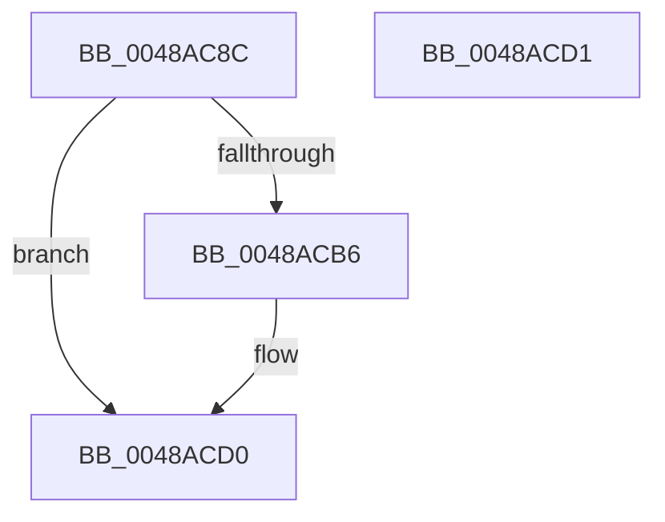

# HalpInterruptSetProblemEx

- RVA: `0x0048AC8C`–`0x0048ACD2` (길이 `70` bytes)
- VA: `0x000000014048AC8C`
- 실행 섹션: `.text`
- PDB 이름 있음: `예`; PDB Function 태그: `아니요`
- unwind 정보 RVA: `0x000DB714`
- 디코드: `14`개 명령, `70/70` bytes 표시
- 미해석 바이트: `0` (있으면 어셈블리에 `.byte`로 보존)

> 이 문서는 커널 이미지의 기계어와 PDB 기호를 분석해 생성했습니다. 4번과 5번은 함수 원형과 자료형을 바이너리 사용 방식에서 추정한 C 해석이며 원본 소스 복구 결과는 아닙니다.

## 1. Dependencies

- 직접 호출 지점: **0**; 고유 호출 대상: **0**
- 직접 호출자로 확인된 함수: **41**
- RIP 상대 이미지 참조: **5**

### Outgoing calls
- 직접 디코드된 call 명령이 없습니다.

### Direct callers
- [HalpMaskInterrupt](../2D/HalpMaskInterrupt_function_002D1DB0.md) at `0x002D1EC9`
- [HalpUnmaskInterrupt](../2D/HalpUnmaskInterrupt_function_002D1EE0.md) at `0x002D203B`
- [HalpInterruptSetLineStateInternal](../2D/HalpInterruptSetLineStateInternal_function_002D2104.md) at `0x002D218E`
- [HalpInterruptFindControllerAndLineState](../2D/HalpInterruptFindControllerAndLineState_function_002D2FC0.md) at `0x002D30E9`
- [HalpInterruptSetDestination](../2D/HalpInterruptSetDestination_function_002D3100.md) at `0x002D3231`
- [HalpInterruptSetRemappedDestinationHv](../2D/HalpInterruptSetRemappedDestinationHv_function_002D3248.md) at `0x002D32B4`
- [HalpInterruptSetRemappedDestinationHv](../2D/HalpInterruptSetRemappedDestinationHv_function_002D3248.md) at `0x002D337D`
- [HalDisableInterrupt](../2D/HalDisableInterrupt_function_002D39F0.md) at `0x002D3B56`
- [HalDisableInterrupt](../2D/HalDisableInterrupt_function_002D39F0.md) at `0x002D3B78`
- [HalEnableInterrupt](../2D/HalEnableInterrupt_function_002D4990.md) at `0x002D49F1`
- [HalGetMessageRoutingInfo](../2D/HalGetMessageRoutingInfo_function_002D4E00.md) at `0x002D50BA`
- [HalpInterruptSetLineState](HalpInterruptSetLineState_function_0048A0C8.md) at `0x0048A41E`
- [HalpInterruptSetLineState](HalpInterruptSetLineState_function_0048A0C8.md) at `0x0048A4AC`
- [HalpInterruptSetLineState](HalpInterruptSetLineState_function_0048A0C8.md) at `0x0048A4F5`
- [HalpInterruptSetDestinationInternal](HalpInterruptSetDestinationInternal_function_0048A530.md) at `0x0048A698`
- [HalpInterruptSetDestinationInternal](HalpInterruptSetDestinationInternal_function_0048A530.md) at `0x0048A71D`
- [HalpInterruptSetDestinationInternal](HalpInterruptSetDestinationInternal_function_0048A530.md) at `0x0048A749`
- [HalpInterruptFindBestRouting](HalpInterruptFindBestRouting_function_0048A784.md) at `0x0048A81D`
- [HalQueryMaximumProcessorCount](../4A/HalQueryMaximumProcessorCount_function_004AC9A0.md) at `0x004ACA0F`
- [HalGetInterruptTargetInformation](../4C/HalGetInterruptTargetInformation_function_004C20F0.md) at `0x004C212B`
- [HalpInterruptGenerateMessage](../54/HalpInterruptGenerateMessage_function_005428F0.md) at `0x00542993`
- [HalpInterruptGenerateMessage](../54/HalpInterruptGenerateMessage_function_005428F0.md) at `0x00542AB7`
- [HalpInterruptRemap](../54/HalpInterruptRemap_function_00542AE4.md) at `0x00542BBF`
- [HalpInterruptRemap](../54/HalpInterruptRemap_function_00542AE4.md) at `0x00542C2F`
- [HalpInterruptRemap](../54/HalpInterruptRemap_function_00542AE4.md) at `0x00542C9E`
- [HalpInterruptRemap](../54/HalpInterruptRemap_function_00542AE4.md) at `0x00542D85`
- [HalpInterruptSetRemappedLineStateInternal](../54/HalpInterruptSetRemappedLineStateInternal_function_00542F48.md) at `0x00542F93`
- [HalpInterruptResetThisProcessor](../54/HalpInterruptResetThisProcessor_function_00543930.md) at `0x00543976`
- [HalpInterruptResetThisProcessor](../54/HalpInterruptResetThisProcessor_function_00543930.md) at `0x00543A08`
- [HalpInterruptResetThisProcessor](../54/HalpInterruptResetThisProcessor_function_00543930.md) at `0x00543A6B`
- [HalpInterruptGetHighestPriorityInterrupt](../54/HalpInterruptGetHighestPriorityInterrupt_function_00543F90.md) at `0x00544059`
- [HalpInterruptRemapFixedLines](../54/HalpInterruptRemapFixedLines_function_00544210.md) at `0x00544432`
- [HalpInterruptRequestInterrupt](../54/HalpInterruptRequestInterrupt_function_00544460.md) at `0x005444F3`
- [HalpInterruptRestoreClock](../54/HalpInterruptRestoreClock_function_00544580.md) at `0x00544631`
- [HalpTimerInitializeHypervisorTimer](../54/HalpTimerInitializeHypervisorTimer_function_0054B8F4.md) at `0x0054BB52`
- [HalpConnectThermalInterrupt](../55/HalpConnectThermalInterrupt_function_00557310.md) at `0x00557461`
- [HalpConnectThermalInterrupt](../55/HalpConnectThermalInterrupt_function_00557310.md) at `0x005574AA`
- [HalpInterruptInitializeController](../55/HalpInterruptInitializeController_function_00557914.md) at `0x005579CA`
- [HalpInterruptInitializeLocalUnit](../55/HalpInterruptInitializeLocalUnit_function_00557A2C.md) at `0x00557AB6`
- [HalpInterruptInitializeLocalUnit](../55/HalpInterruptInitializeLocalUnit_function_00557A2C.md) at `0x00557D1A`
- [HalpInterruptParseAcpiTables](../55/HalpInterruptParseAcpiTables_function_00557DD4.md) at `0x00557E20`
- [HalpInterruptParseMadt](../55/HalpInterruptParseMadt_function_00557E74.md) at `0x00557F6A`
- [HalpInterruptSelectController](../55/HalpInterruptSelectController_function_005587A8.md) at `0x00558848`
- [HalpAllocateKInterrupt](../55/HalpAllocateKInterrupt_function_0055B8F4.md) at `0x0055B9E4`
- [HalpInterruptDpReplaceBegin](../56/HalpInterruptDpReplaceBegin_function_005631CC.md) at `0x00563263`
- [HalpInterruptDpReplaceBegin](../56/HalpInterruptDpReplaceBegin_function_005631CC.md) at `0x0056351D`
- [sub_006F5FE0](../6F/Unknown_function_006F5FE0.md) at `0x006F5FF9`
- [sub_006FA83C](../6F/Unknown_function_006FA83C.md) at `0x006FA939`
- [sub_006FA83C](../6F/Unknown_function_006FA83C.md) at `0x006FAA5D`
- [sub_006FA83C](../6F/Unknown_function_006FA83C.md) at `0x006FAB02`
- [HalpInterruptUnmap](../../page/70/HalpInterruptUnmap_function_00707408.md) at `0x00707530`
- [HalpInterruptStartProcessor](../../pagelk/B5/HalpInterruptStartProcessor_function_00B5BEF0.md) at `0x00B5C038`
- [HalpDpGetInterruptReplayState](../../pagelk/B5/HalpDpGetInterruptReplayState_function_00B5FB70.md) at `0x00B5FBFD`
- [HalpDpReplayInterrupts](../../pagelk/B6/HalpDpReplayInterrupts_function_00B60320.md) at `0x00B6036D`
- [HalpInterruptUpdateLocalUnitIdentifier](../../pagelk/B6/HalpInterruptUpdateLocalUnitIdentifier_function_00B607DC.md) at `0x00B608C1`
- [HalpInterruptUpdateLocalUnitIdentifier](../../pagelk/B6/HalpInterruptUpdateLocalUnitIdentifier_function_00B607DC.md) at `0x00B60974`
- [HalpInterruptUpdateLocalUnitIdentifier](../../pagelk/B6/HalpInterruptUpdateLocalUnitIdentifier_function_00B607DC.md) at `0x00B609F3`
- [HalpInterruptUpdateLocalUnitIdentifier](../../pagelk/B6/HalpInterruptUpdateLocalUnitIdentifier_function_00B607DC.md) at `0x00B60A14`
- [sub_00B81232](../../pagelk/B8/Unknown_function_00B81232.md) at `0x00B8123E`
- [HalpInitializeInterrupts](../../init/C1/HalpInitializeInterrupts_function_00C1E4F8.md) at `0x00C1E6FF`
- [HalpPreAllocateKInterrupts](../../init/C2/HalpPreAllocateKInterrupts_function_00C2378C.md) at `0x00C237D8`

### Static image references
- `0x0048AC90` → RVA `0x00F906D0` (`.data`; write)
- `0x0048AC96` → RVA `0x00F906B8` (`.data`; write)
- `0x0048AC9D` → RVA `0x00F90694` (`.data`; write)
- `0x0048ACA3` → RVA `0x00F906A0` (`.data`; write)
- `0x0048ACAA` → RVA `0x00F906C8` (`.data`; write)

## 2. Other-region calls and transfers

- 다른 실행 섹션으로 향하는 call: **0**
- 별도 외부 분기/꼬리 이동을 확인하지 못했습니다.

## 3. Assembly (complete function range)

```asm
0048AC8C  8B 44 24 28                     mov eax, dword ptr [rsp + 0x28]
0048AC90  89 05 3A 5A B0 00               mov dword ptr [rip + 0xb05a3a], eax
0048AC96  48 89 0D 1B 5A B0 00            mov qword ptr [rip + 0xb05a1b], rcx
0048AC9D  89 15 F1 59 B0 00               mov dword ptr [rip + 0xb059f1], edx
0048ACA3  44 89 05 F6 59 B0 00            mov dword ptr [rip + 0xb059f6], r8d
0048ACAA  4C 89 0D 17 5A B0 00            mov qword ptr [rip + 0xb05a17], r9
0048ACB1  48 85 C9                        test rcx, rcx
0048ACB4  74 1A                           je 0x14048acd0
0048ACB6  89 91 3C 01 00 00               mov dword ptr [rcx + 0x13c], edx
0048ACBC  44 89 81 40 01 00 00            mov dword ptr [rcx + 0x140], r8d
0048ACC3  4C 89 89 48 01 00 00            mov qword ptr [rcx + 0x148], r9
0048ACCA  89 81 50 01 00 00               mov dword ptr [rcx + 0x150], eax
0048ACD0  C3                              ret
0048ACD1  CC                              int3
```

## 4. C-style interpretation (structured pseudocode)

```c
__int64 __fastcall HalpInterruptSetProblemEx(__int64 a1, int a2, int a3, __int64 a4, unsigned int a5)
{
    *(unsigned int *)(v_rip + 11557434) = (unsigned int)((unsigned int)(a5));
    *(unsigned __int64 *)(v_rip + 11557403) = a1;
    *(unsigned int *)(v_rip + 11557361) = a2;
    *(unsigned int *)(v_rip + 11557366) = a3;
    *(unsigned __int64 *)(v_rip + 11557399) = a4;
    if (a1 != 0) {
        *(unsigned int *)(a1 + 316) = a2;
        *(unsigned int *)(a1 + 320) = a3;
        *(unsigned __int64 *)(a1 + 328) = a4;
        *(unsigned int *)(a1 + 336) = (unsigned int)((unsigned int)(a5));
    }
    return (unsigned int)(a5);
}
```

## 5. (Beta) C Style

```c
int64_t HalpInterruptSetProblemEx(int64_t Arg1, int32_t Arg2, int32_t Arg3, int64_t Arg4, uint32_t Arg5)
{
    *(uint32_t *)(v_rip + 0xB05A3A) = (uint32_t)((uint32_t)(Arg5));
    *(uint64_t *)(v_rip + 0xB05A1B) = Arg1;
    *(uint32_t *)(v_rip + 0xB059F1) = Arg2;
    *(uint32_t *)(v_rip + 0xB059F6) = Arg3;
    *(uint64_t *)(v_rip + 0xB05A17) = Arg4;
    if (Arg1 != 0) {
        *(uint32_t *)(Arg1 + 0x13C) = Arg2;
        *(uint32_t *)(Arg1 + 0x140) = Arg3;
        *(uint64_t *)(Arg1 + 0x148) = Arg4;
        *(uint32_t *)(Arg1 + 0x150) = (uint32_t)((uint32_t)(Arg5));
    }
    return (uint32_t)(Arg5);
}
```

## 6. Execution-region graph

[열기: 2D/3D 그래프와 함수 탐색 컨트롤 패널](../../../control-panel.html?section=text&rva=0x0048AC8C&view=graph)

- 2D 그래프는 위에서 아래로 흐르고, 3D 그래프는 빈 공간을 드래그해 회전합니다. Shift+드래그는 이동, 휠은 확대·축소, 함수 노드 선택은 대상 보고서 이동입니다.

### Static fallback


