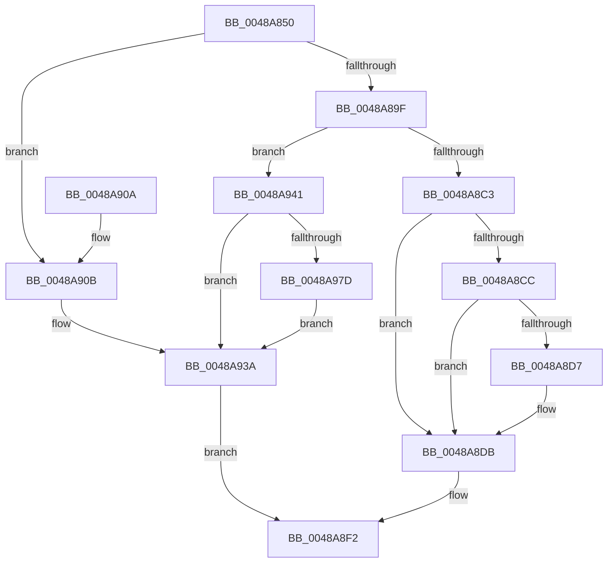

# HalpInterruptSetRemappedDestination

- RVA: `0x0048A850`–`0x0048A994` (길이 `324` bytes)
- VA: `0x000000014048A850`
- 실행 섹션: `.text`
- PDB 이름 있음: `예`; PDB Function 태그: `아니요`
- unwind 정보 RVA: `0x000B0150`
- 디코드: `77`개 명령, `324/324` bytes 표시
- 미해석 바이트: `0` (있으면 어셈블리에 `.byte`로 보존)

> 이 문서는 커널 이미지의 기계어와 PDB 기호를 분석해 생성했습니다. 4번과 5번은 함수 원형과 자료형을 바이너리 사용 방식에서 추정한 C 해석이며 원본 소스 복구 결과는 아닙니다.

## 1. Dependencies

- 직접 호출 지점: **3**; 고유 호출 대상: **3**
- 직접 호출자로 확인된 함수: **1**
- RIP 상대 이미지 참조: **6**

### Outgoing calls
- `0x0048A896` → [HalpInterruptGetRemappedLineState](HalpInterruptGetRemappedLineState_function_0048A99C.md) (function, `0x0048A99C`)
- `0x0048A8BA` → [HalpInterruptDestinationToTarget](HalpInterruptDestinationToTarget_function_0048AA54.md) (function, `0x0048AA54`)
- `0x0048A8ED` → [HalpIommuUpdateRemappingTableEntry](HalpIommuUpdateRemappingTableEntry_function_0048ABC8.md) (function, `0x0048ABC8`)

### Direct callers
- [HalpInterruptSetDestination](../2D/HalpInterruptSetDestination_function_002D3100.md) at `0x002D3205`

### Static image references
- `0x0048A90B` → RVA `0x00010AA8` (`.rdata`; read)
- `0x0048A912` → RVA `0x00F906B8` (`.data`; write)
- `0x0048A919` → RVA `0x00F906C8` (`.data`; write)
- `0x0048A920` → RVA `0x00F90694` (`.data`; write)
- `0x0048A92A` → RVA `0x00F906A0` (`.data`; write)
- `0x0048A930` → RVA `0x00F906D0` (`.data`; write)

## 2. Other-region calls and transfers

- 다른 실행 섹션으로 향하는 call: **0**
- 별도 외부 분기/꼬리 이동을 확인하지 못했습니다.

## 3. Assembly (complete function range)

```asm
0048A850  48 89 5C 24 08                  mov qword ptr [rsp + 8], rbx
0048A855  48 89 74 24 10                  mov qword ptr [rsp + 0x10], rsi
0048A85A  48 89 7C 24 18                  mov qword ptr [rsp + 0x18], rdi
0048A85F  55                              push rbp
0048A860  48 8B EC                        mov rbp, rsp
0048A863  48 83 EC 70                     sub rsp, 0x70
0048A867  0F 57 C0                        xorps xmm0, xmm0
0048A86A  4C 8D 4D C8                     lea r9, [rbp - 0x38]
0048A86E  33 DB                           xor ebx, ebx
0048A870  49 8B F0                        mov rsi, r8
0048A873  33 C0                           xor eax, eax
0048A875  48 89 5D 28                     mov qword ptr [rbp + 0x28], rbx
0048A879  4C 8D 45 28                     lea r8, [rbp + 0x28]
0048A87D  48 89 45 F8                     mov qword ptr [rbp - 8], rax
0048A881  0F 11 45 C8                     movups xmmword ptr [rbp - 0x38], xmm0
0048A885  89 5D B4                        mov dword ptr [rbp - 0x4c], ebx
0048A888  48 8B FA                        mov rdi, rdx
0048A88B  0F 11 45 D8                     movups xmmword ptr [rbp - 0x28], xmm0
0048A88F  89 5D C0                        mov dword ptr [rbp - 0x40], ebx
0048A892  0F 11 45 E8                     movups xmmword ptr [rbp - 0x18], xmm0
0048A896  E8 01 01 00 00                  call 0x14048a99c
0048A89B  85 C0                           test eax, eax
0048A89D  78 6C                           js 0x14048a90b
0048A89F  48 89 75 B8                     mov qword ptr [rbp - 0x48], rsi
0048A8A3  4C 8D 45 E0                     lea r8, [rbp - 0x20]
0048A8A7  48 8D 77 28                     lea rsi, [rdi + 0x28]
0048A8AB  C7 45 B0 01 00 00 00            mov dword ptr [rbp - 0x50], 1
0048A8B2  48 8D 55 B0                     lea rdx, [rbp - 0x50]
0048A8B6  48 89 75 C0                     mov qword ptr [rbp - 0x40], rsi
0048A8BA  E8 95 01 00 00                  call 0x14048aa54
0048A8BF  85 C0                           test eax, eax
0048A8C1  78 7E                           js 0x14048a941
0048A8C3  81 7F 04 D1 00 00 00            cmp dword ptr [rdi + 4], 0xd1
0048A8CA  74 0F                           je 0x14048a8db
0048A8CC  8B 45 E0                        mov eax, dword ptr [rbp - 0x20]
0048A8CF  83 C0 FB                        add eax, -5
0048A8D2  83 F8 01                        cmp eax, 1
0048A8D5  77 04                           ja 0x14048a8db
0048A8D7  83 4D D4 02                     or dword ptr [rbp - 0x2c], 2
0048A8DB  8B 16                           mov edx, dword ptr [rsi]
0048A8DD  4C 8D 45 C8                     lea r8, [rbp - 0x38]
0048A8E1  81 E2 FF FF FF 3F               and edx, 0x3fffffff
0048A8E7  83 3F 03                        cmp dword ptr [rdi], 3
0048A8EA  0F 94 C1                        sete cl
0048A8ED  E8 D6 02 00 00                  call 0x14048abc8
0048A8F2  4C 8D 5C 24 70                  lea r11, [rsp + 0x70]
0048A8F7  8B C3                           mov eax, ebx
0048A8F9  49 8B 5B 10                     mov rbx, qword ptr [r11 + 0x10]
0048A8FD  49 8B 73 18                     mov rsi, qword ptr [r11 + 0x18]
0048A901  49 8B 7B 20                     mov rdi, qword ptr [r11 + 0x20]
0048A905  49 8B E3                        mov rsp, r11
0048A908  5D                              pop rbp
0048A909  C3                              ret
0048A90A  CC                              int3
0048A90B  48 8D 0D 96 61 B8 FF            lea rcx, [rip - 0x479e6a]
0048A912  48 89 1D 9F 5D B0 00            mov qword ptr [rip + 0xb05d9f], rbx
0048A919  48 89 0D A8 5D B0 00            mov qword ptr [rip + 0xb05da8], rcx
0048A920  C7 05 6A 5D B0 00 12 00 00 00   mov dword ptr [rip + 0xb05d6a], 0x12
0048A92A  89 1D 70 5D B0 00               mov dword ptr [rip + 0xb05d70], ebx
0048A930  C7 05 96 5D B0 00 4C 03 00 00   mov dword ptr [rip + 0xb05d96], 0x34c
0048A93A  BB 25 02 00 C0                  mov ebx, 0xc0000225
0048A93F  EB B1                           jmp 0x14048a8f2
0048A941  48 8B 45 28                     mov rax, qword ptr [rbp + 0x28]
0048A945  48 8D 0D 5C 61 B8 FF            lea rcx, [rip - 0x479ea4]
0048A94C  48 89 05 65 5D B0 00            mov qword ptr [rip + 0xb05d65], rax
0048A953  BA 16 00 00 00                  mov edx, 0x16
0048A958  89 15 36 5D B0 00               mov dword ptr [rip + 0xb05d36], edx
0048A95E  41 B8 62 03 00 00               mov r8d, 0x362
0048A964  89 1D 36 5D B0 00               mov dword ptr [rip + 0xb05d36], ebx
0048A96A  48 89 0D 57 5D B0 00            mov qword ptr [rip + 0xb05d57], rcx
0048A971  44 89 05 58 5D B0 00            mov dword ptr [rip + 0xb05d58], r8d
0048A978  48 85 C0                        test rax, rax
0048A97B  74 BD                           je 0x14048a93a
0048A97D  48 89 90 3C 01 00 00            mov qword ptr [rax + 0x13c], rdx
0048A984  48 89 88 48 01 00 00            mov qword ptr [rax + 0x148], rcx
0048A98B  44 89 80 50 01 00 00            mov dword ptr [rax + 0x150], r8d
0048A992  EB A6                           jmp 0x14048a93a
```

## 4. C-style interpretation (structured pseudocode)

```c
__int64 __fastcall HalpInterruptSetRemappedDestination(__int64 a1, __int64 a2, __int64 a3)
{
    __int64 result;
    __int64 v_rbx;
    __int64 v_rsp;
    unsigned __int64 v_stack_m10;
    unsigned __int64 v_stack_m20;
    unsigned __int64 v_stack_m28;
    unsigned __int64 v_stack_m30;
    unsigned int v_stack_m34;
    unsigned __int64 v_stack_m40;
    unsigned int v_stack_m48;
    unsigned __int64 v_stack_m50;
    unsigned int v_stack_m54;
    unsigned int v_stack_m58;
    unsigned __int64 v_stack_m8;
    unsigned __int64 v_stack_p10;
    unsigned __int64 v_stack_p18;
    unsigned __int64 v_stack_p20;
    unsigned __int64 v_stack_p8;

    v_stack_p8 = v_rbx;
    v_stack_p10 = v_rsi;
    v_stack_p18 = v_rdi;
    v_rsp = (v_rsp) - (112);
    v_rbx = 0;
    result = 0;
    v_stack_p20 = 0;
    v_stack_m10 = 0;
    v_stack_m40 = v_xmm0;
    v_stack_m54 = 0;
    v_stack_m30 = v_xmm0;
    v_stack_m48 = 0;
    v_stack_m20 = v_xmm0;
    result = HalpInterruptGetRemappedLineState(a1, a2, v_stack_p20, v_stack_m40);
    if (sign_flag) goto loc_0048A90B;
    v_stack_m50 = a3;
    v_stack_m58 = 1;
    v_stack_m48 = a2 + 40;
    result = HalpInterruptDestinationToTarget(a1, v_stack_m58, v_stack_m28, v_stack_m40);
    if (sign_flag) goto loc_0048A941;
    if ((*(unsigned int *)(a2 + 4)) == 209) goto loc_0048A8DB;
    result = (unsigned int)(((unsigned int)(v_stack_m28)) + (-5));
    if (((unsigned int)(result)) <= 1) {
    }
    a2 = (unsigned int)(((unsigned int)(*(unsigned int *)(a2 + 40))) & (0x3FFFFFFFULL));
    a1 = ((*(unsigned int *)(a2)) == 3) ? 1 : 0;
    result = HalpIommuUpdateRemappingTableEntry(a1, a2, v_stack_m40, v_stack_m40);
loc_0048A8F2:
    return 0;
loc_0048A90B:
    *(unsigned __int64 *)(v_rip + 11558303) = *(unsigned __int64 *)(v_stack_m8 + 16);
    *(unsigned __int64 *)(v_rip + 11558312) = v_rip - 4693610;
    *(unsigned int *)(v_rip + 11558250) = 18;
    *(unsigned int *)(v_rip + 11558256) = (unsigned int)(*(unsigned __int64 *)(v_stack_m8 + 16));
    *(unsigned int *)(v_rip + 11558294) = 844;
loc_0048A93A:
    goto loc_0048A8F2;
loc_0048A941:
    *(unsigned __int64 *)(v_rip + 11558245) = v_stack_p20;
    *(unsigned int *)(v_rip + 11558198) = 22;
    *(unsigned int *)(v_rip + 11558198) = (unsigned int)((unsigned int)(0xC0000225ULL));
    *(unsigned __int64 *)(v_rip + 11558231) = v_rip - 4693668;
    *(unsigned int *)(v_rip + 11558232) = 866;
    if (v_stack_p20 == 0) goto loc_0048A93A;
    *(unsigned __int64 *)(v_stack_p20 + 316) = 22;
    *(unsigned __int64 *)(v_stack_p20 + 328) = v_rip - 4693668;
    *(unsigned int *)(v_stack_p20 + 336) = 866;
    goto loc_0048A93A;
}
```

## 5. (Beta) C Style

```c
int64_t HalpInterruptSetRemappedDestination(int64_t Arg1, void *Arg2, int64_t Arg3)
{
    uint8_t *arg2 = (uint8_t *)Arg2;

    int64_t result;
    int64_t local_rbx;
    int64_t local_rsp;
    uint64_t v_stack_m10;
    uint64_t v_stack_m20;
    uint64_t v_stack_m28;
    uint64_t v_stack_m30;
    uint32_t v_stack_m34;
    uint64_t v_stack_m40;
    uint32_t v_stack_m48;
    uint64_t v_stack_m50;
    uint32_t v_stack_m54;
    uint32_t v_stack_m58;
    uint64_t v_stack_m8;
    uint64_t v_stack_p10;
    uint64_t v_stack_p18;
    uint64_t v_stack_p20;
    uint64_t v_stack_p8;

    v_stack_p8 = local_rbx;
    v_stack_p10 = local_rsi;
    v_stack_p18 = local_rdi;
    local_rsp = (local_rsp) - (112);
    local_rbx = 0;
    result = 0;
    v_stack_p20 = 0;
    v_stack_m10 = 0;
    v_stack_m40 = v_xmm0;
    v_stack_m54 = 0;
    v_stack_m30 = v_xmm0;
    v_stack_m48 = 0;
    v_stack_m20 = v_xmm0;
    result = HalpInterruptGetRemappedLineState(Arg1, Arg2, v_stack_p20, v_stack_m40);
    if (sign_flag) goto loc_0048A90B;
    v_stack_m50 = Arg3;
    v_stack_m58 = 1;
    v_stack_m48 = Arg2 + 40;
    result = HalpInterruptDestinationToTarget(Arg1, v_stack_m58, v_stack_m28, v_stack_m40);
    if (sign_flag) goto loc_0048A941;
    if ((*(uint32_t *)(arg2 + 0x4)) == 209) goto loc_0048A8DB;
    result = (uint32_t)(((uint32_t)(v_stack_m28)) + (-5));
    if (((uint32_t)(result)) <= 1) {
    }
    Arg2 = (uint32_t)(((uint32_t)(*(uint32_t *)(arg2 + 0x28))) & (0x3FFFFFFFULL));
    Arg1 = ((*(uint32_t *)(arg2)) == 3) ? 1 : 0;
    result = HalpIommuUpdateRemappingTableEntry(Arg1, Arg2, v_stack_m40, v_stack_m40);
loc_0048A8F2:
    return 0;
loc_0048A90B:
    *(uint64_t *)(v_rip + 0xB05D9F) = *(uint64_t *)(v_stack_m8 + 0x10);
    *(uint64_t *)(v_rip + 0xB05DA8) = v_rip - 4693610;
    *(uint32_t *)(v_rip + 0xB05D6A) = 18;
    *(uint32_t *)(v_rip + 0xB05D70) = (uint32_t)(*(uint64_t *)(v_stack_m8 + 0x10));
    *(uint32_t *)(v_rip + 0xB05D96) = 844;
loc_0048A93A:
    goto loc_0048A8F2;
loc_0048A941:
    *(uint64_t *)(v_rip + 0xB05D65) = v_stack_p20;
    *(uint32_t *)(v_rip + 0xB05D36) = 22;
    *(uint32_t *)(v_rip + 0xB05D36) = (uint32_t)((uint32_t)(0xC0000225ULL));
    *(uint64_t *)(v_rip + 0xB05D57) = v_rip - 4693668;
    *(uint32_t *)(v_rip + 0xB05D58) = 866;
    if (v_stack_p20 == 0) goto loc_0048A93A;
    *(uint64_t *)(v_stack_p20 + 0x13C) = 22;
    *(uint64_t *)(v_stack_p20 + 0x148) = v_rip - 4693668;
    *(uint32_t *)(v_stack_p20 + 0x150) = 866;
    goto loc_0048A93A;
}
```

### 관측된 메모리 오프셋

구조체 형식이 확인되지 않은 접근은 인자 기준의 오프셋으로만 기록했습니다.

| 기준 인자 | 오프셋 표현 | 폭 (bit) | 접근 |
|---|---:|---:|---|
| `Arg2` | `+ 0x0` | `32` | `R` |
| `Arg2` | `+ 0x4` | `32` | `R` |
| `Arg2` | `+ 0x28` | `64` | `R` |

## 6. Execution-region graph

[열기: 2D/3D 그래프와 함수 탐색 컨트롤 패널](../../../control-panel.html?section=text&rva=0x0048A850&view=graph)

- 2D 그래프는 위에서 아래로 흐르고, 3D 그래프는 빈 공간을 드래그해 회전합니다. Shift+드래그는 이동, 휠은 확대·축소, 함수 노드 선택은 대상 보고서 이동입니다.

### Static fallback


