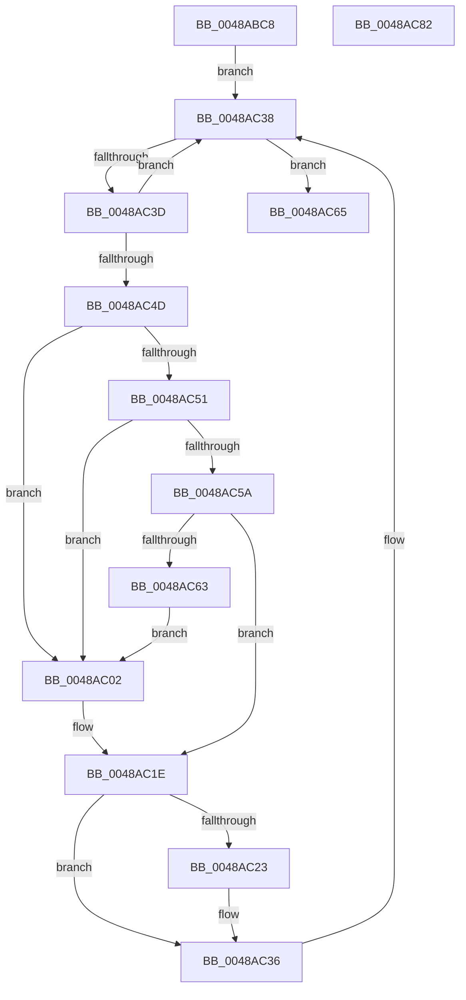

# HalpIommuUpdateRemappingTableEntry

- RVA: `0x0048ABC8`–`0x0048AC83` (길이 `187` bytes)
- VA: `0x000000014048ABC8`
- 실행 섹션: `.text`
- PDB 이름 있음: `예`; PDB Function 태그: `아니요`
- unwind 정보 RVA: `0x0008C20C`
- 디코드: `56`개 명령, `187/187` bytes 표시
- 미해석 바이트: `0` (있으면 어셈블리에 `.byte`로 보존)

> 이 문서는 커널 이미지의 기계어와 PDB 기호를 분석해 생성했습니다. 4번과 5번은 함수 원형과 자료형을 바이너리 사용 방식에서 추정한 C 해석이며 원본 소스 복구 결과는 아닙니다.

## 1. Dependencies

- 직접 호출 지점: **2**; 고유 호출 대상: **1**
- 직접 호출자로 확인된 함수: **5**
- RIP 상대 이미지 참조: **2**

### Outgoing calls
- `0x0048AC16` → [guard_dispatch_icall](../6B/guard_dispatch_icall_function_006BAAD0.md) (function, `0x006BAAD0`)
- `0x0048AC31` → [guard_dispatch_icall](../6B/guard_dispatch_icall_function_006BAAD0.md) (function, `0x006BAAD0`)

### Direct callers
- [HalpSetIrtEntry](HalpSetIrtEntry_function_0048A830.md) at `0x0048A83C`
- [HalpInterruptSetRemappedDestination](HalpInterruptSetRemappedDestination_function_0048A850.md) at `0x0048A8ED`
- [HalpInterruptRemap](../54/HalpInterruptRemap_function_00542AE4.md) at `0x00542CDF`
- [HalpInterruptRemap](../54/HalpInterruptRemap_function_00542AE4.md) at `0x00542ECF`
- [HalpInterruptRemapFixedLines](../54/HalpInterruptRemapFixedLines_function_00544210.md) at `0x00544377`
- [sub_006FA83C](../6F/Unknown_function_006FA83C.md) at `0x006FAA0E`

### Static image references
- `0x0048ABE4` → RVA `0x00FC1740` (`.data`; read)
- `0x0048AC51` → RVA `0x00FC18E4` (`.data`; read)

## 2. Other-region calls and transfers

- 다른 실행 섹션으로 향하는 call: **0**
- 별도 외부 분기/꼬리 이동을 확인하지 못했습니다.

## 3. Assembly (complete function range)

```asm
0048ABC8  48 89 5C 24 08                  mov qword ptr [rsp + 8], rbx
0048ABCD  48 89 6C 24 10                  mov qword ptr [rsp + 0x10], rbp
0048ABD2  48 89 74 24 18                  mov qword ptr [rsp + 0x18], rsi
0048ABD7  57                              push rdi
0048ABD8  41 54                           push r12
0048ABDA  41 55                           push r13
0048ABDC  41 56                           push r14
0048ABDE  41 57                           push r15
0048ABE0  48 83 EC 30                     sub rsp, 0x30
0048ABE4  48 8B 1D 55 6B B3 00            mov rbx, qword ptr [rip + 0xb36b55]
0048ABEB  4C 8D 2D 4E 6B B3 00            lea r13, [rip + 0xb36b4e]
0048ABF2  33 F6                           xor esi, esi
0048ABF4  4D 8B F8                        mov r15, r8
0048ABF7  40 32 ED                        xor bpl, bpl
0048ABFA  44 8B F2                        mov r14d, edx
0048ABFD  44 8A E1                        mov r12b, cl
0048AC00  EB 36                           jmp 0x14048ac38
0048AC02  48 8B 87 B0 00 00 00            mov rax, qword ptr [rdi + 0xb0]
0048AC09  4D 8B CF                        mov r9, r15
0048AC0C  48 8B 4F 10                     mov rcx, qword ptr [rdi + 0x10]
0048AC10  45 8B C6                        mov r8d, r14d
0048AC13  41 8A D4                        mov dl, r12b
0048AC16  E8 B5 FE 22 00                  call 0x1406baad0
0048AC1B  40 8A E8                        mov bpl, al
0048AC1E  40 84 ED                        test bpl, bpl
0048AC21  74 13                           je 0x14048ac36
0048AC23  48 8B 87 B8 00 00 00            mov rax, qword ptr [rdi + 0xb8]
0048AC2A  41 8B D6                        mov edx, r14d
0048AC2D  48 8B 4F 10                     mov rcx, qword ptr [rdi + 0x10]
0048AC31  E8 9A FE 22 00                  call 0x1406baad0
0048AC36  FF C6                           inc esi
0048AC38  49 3B DD                        cmp rbx, r13
0048AC3B  74 28                           je 0x14048ac65
0048AC3D  48 8D 3B                        lea rdi, [rbx]
0048AC40  48 8B 1B                        mov rbx, qword ptr [rbx]
0048AC43  8B 87 D8 01 00 00               mov eax, dword ptr [rdi + 0x1d8]
0048AC49  A8 40                           test al, 0x40
0048AC4B  74 EB                           je 0x14048ac38
0048AC4D  85 F6                           test esi, esi
0048AC4F  74 B1                           je 0x14048ac02
0048AC51  83 3D 8C 6C B3 00 02            cmp dword ptr [rip + 0xb36c8c], 2
0048AC58  74 A8                           je 0x14048ac02
0048AC5A  83 BF DC 01 00 00 06            cmp dword ptr [rdi + 0x1dc], 6
0048AC61  75 BB                           jne 0x14048ac1e
0048AC63  EB 9D                           jmp 0x14048ac02
0048AC65  48 8B 5C 24 60                  mov rbx, qword ptr [rsp + 0x60]
0048AC6A  48 8B 6C 24 68                  mov rbp, qword ptr [rsp + 0x68]
0048AC6F  48 8B 74 24 70                  mov rsi, qword ptr [rsp + 0x70]
0048AC74  48 83 C4 30                     add rsp, 0x30
0048AC78  41 5F                           pop r15
0048AC7A  41 5E                           pop r14
0048AC7C  41 5D                           pop r13
0048AC7E  41 5C                           pop r12
0048AC80  5F                              pop rdi
0048AC81  C3                              ret
0048AC82  CC                              int3
```

## 4. C-style interpretation (structured pseudocode)

```c
__int64 __fastcall HalpIommuUpdateRemappingTableEntry(unsigned __int8 a1, int a2, __int64 a3)
{
    __int64 result;
    __int64 v_rbp;
    __int64 v_rsi;
    __int64 v_rsp;
    unsigned __int64 v_stack_p10;
    unsigned __int64 v_stack_p18;
    unsigned __int64 v_stack_p8;

    v_stack_p8 = v_rbx;
    v_stack_p10 = v_rbp;
    v_stack_p18 = v_rsi;
    v_rsp = (v_rsp) - (48);
    v_rsi = 0;
    v_rbp = 0;
    goto loc_0048AC38;
loc_0048AC02:
    result = guard_dispatch_icall(*(unsigned __int64 *)(v_rdi + 16), a1, (unsigned int)((unsigned int)((unsigned int)(a2))), a3);
loc_0048AC1E:
    if ((unsigned __int8)((unsigned __int8)(result)) != 0) {
        result = *(unsigned __int64 *)(v_rdi + 184);
        a2 = (unsigned int)((unsigned int)(a2));
        a1 = *(unsigned __int64 *)(v_rdi + 16);
        result = guard_dispatch_icall(a1, a2, (unsigned int)((unsigned int)((unsigned int)(a2))), a3);
    }
    v_rsi = (unsigned int)((v_rsi) + 1);
loc_0048AC38:
    if ((*(unsigned __int64 *)(v_rip + 11758421)) == (v_rip + 11758414)) goto loc_0048AC65;
    if ((((unsigned __int8)((unsigned int)(*(unsigned int *)(*(unsigned __int64 *)(v_rip + 11758421) + 472)))) & (64)) == 0) goto loc_0048AC38;
    if ((unsigned int)(v_rsi) == 0) goto loc_0048AC02;
    if ((*(unsigned int *)(v_rip + 11758732)) == 2) goto loc_0048AC02;
    if ((*(unsigned int *)(*(unsigned __int64 *)(v_rip + 11758421) + 476)) != 6) goto loc_0048AC1E;
    goto loc_0048AC02;
loc_0048AC65:
    v_rsp = (v_rsp) + (48);
    return (unsigned int)(*(unsigned int *)(*(unsigned __int64 *)(v_rip + 11758421) + 472));
}
```

## 5. (Beta) C Style

```c
int64_t HalpIommuUpdateRemappingTableEntry(uint8_t Arg1, int32_t Arg2, int64_t Arg3)
{
    int64_t result;
    int64_t local_rbp;
    int64_t local_rsi;
    int64_t local_rsp;
    uint64_t v_stack_p10;
    uint64_t v_stack_p18;
    uint64_t v_stack_p8;

    v_stack_p8 = local_rbx;
    v_stack_p10 = local_rbp;
    v_stack_p18 = local_rsi;
    local_rsp = (local_rsp) - (48);
    local_rsi = 0;
    local_rbp = 0;
    goto loc_0048AC38;
loc_0048AC02:
    result = guard_dispatch_icall(*(uint64_t *)(local_rdi + 0x10), Arg1, (uint32_t)((uint32_t)((uint32_t)(Arg2))), Arg3);
loc_0048AC1E:
    if ((uint8_t)((uint8_t)(result)) != 0) {
        result = *(uint64_t *)(local_rdi + 0xB8);
        Arg2 = (uint32_t)((uint32_t)(Arg2));
        Arg1 = *(uint64_t *)(local_rdi + 0x10);
        result = guard_dispatch_icall(Arg1, Arg2, (uint32_t)((uint32_t)((uint32_t)(Arg2))), Arg3);
    }
    local_rsi = (uint32_t)((local_rsi) + 1);
loc_0048AC38:
    if ((*(uint64_t *)(v_rip + 0xB36B55)) == (v_rip + 11758414)) goto loc_0048AC65;
    if ((((uint8_t)((uint32_t)(*(uint32_t *)(*(uint64_t *)(v_rip + 0xB36B55) + 0x1D8)))) & (64)) == 0) goto loc_0048AC38;
    if ((uint32_t)(local_rsi) == 0) goto loc_0048AC02;
    if ((*(uint32_t *)(v_rip + 0xB36C8C)) == 2) goto loc_0048AC02;
    if ((*(uint32_t *)(*(uint64_t *)(v_rip + 0xB36B55) + 0x1DC)) != 6) goto loc_0048AC1E;
    goto loc_0048AC02;
loc_0048AC65:
    local_rsp = (local_rsp) + (48);
    return (uint32_t)(*(uint32_t *)(*(uint64_t *)(v_rip + 0xB36B55) + 0x1D8));
}
```

## 6. Execution-region graph

[열기: 2D/3D 그래프와 함수 탐색 컨트롤 패널](../../../control-panel.html?section=text&rva=0x0048ABC8&view=graph)

- 2D 그래프는 위에서 아래로 흐르고, 3D 그래프는 빈 공간을 드래그해 회전합니다. Shift+드래그는 이동, 휠은 확대·축소, 함수 노드 선택은 대상 보고서 이동입니다.

### Static fallback


