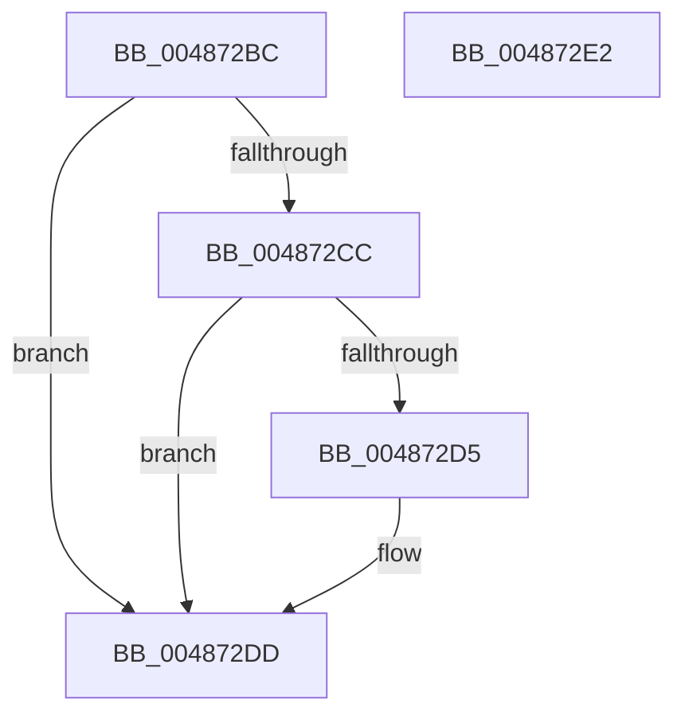

# HalpMcaProcessorBankConfig

- RVA: `0x004872BC`–`0x004872E3` (길이 `39` bytes)
- VA: `0x00000001404872BC`
- 실행 섹션: `.text`
- PDB 이름 있음: `예`; PDB Function 태그: `아니요`
- unwind 정보 RVA: `0x0005C788`
- 디코드: `12`개 명령, `39/39` bytes 표시
- 미해석 바이트: `0` (있으면 어셈블리에 `.byte`로 보존)

> 이 문서는 커널 이미지의 기계어와 PDB 기호를 분석해 생성했습니다. 4번과 5번은 함수 원형과 자료형을 바이너리 사용 방식에서 추정한 C 해석이며 원본 소스 복구 결과는 아닙니다.

## 1. Dependencies

- 직접 호출 지점: **2**; 고유 호출 대상: **2**
- 직접 호출자로 확인된 함수: **1**
- RIP 상대 이미지 참조: **1**

### Outgoing calls
- `0x004872C3` → [HalpGetCpuVendor](HalpGetCpuVendor_function_004879E4.md) (function, `0x004879E4`)
- `0x004872D8` → [HalpMcaProcessorBankConfigAmd](../54/HalpMcaProcessorBankConfigAmd_function_005454CC.md) (function, `0x005454CC`)

### Direct callers
- [HalpMcaSetProcessorConfig](../../pagelk/B7/HalpMcaSetProcessorConfig_function_00B7B418.md) at `0x00B7B506`

### Static image references
- `0x004872CC` → RVA `0x00E10258` (`.data`; read)

## 2. Other-region calls and transfers

- 다른 실행 섹션으로 향하는 call: **0**
- 별도 외부 분기/꼬리 이동을 확인하지 못했습니다.

## 3. Assembly (complete function range)

```asm
004872BC  48 83 EC 28                     sub rsp, 0x28
004872C0  4C 8B C1                        mov r8, rcx
004872C3  E8 1C 07 00 00                  call 0x1404879e4
004872C8  3C 01                           cmp al, 1
004872CA  75 11                           jne 0x1404872dd
004872CC  80 3D 85 8F 98 00 00            cmp byte ptr [rip + 0x988f85], 0
004872D3  74 08                           je 0x1404872dd
004872D5  49 8B C8                        mov rcx, r8
004872D8  E8 EF E1 0B 00                  call 0x1405454cc
004872DD  48 83 C4 28                     add rsp, 0x28
004872E1  C3                              ret
004872E2  CC                              int3
```

## 4. C-style interpretation (structured pseudocode)

```c
__int64 __fastcall HalpMcaProcessorBankConfig(__int64 a1)
{
    __int64 result;
    __int64 v_rsp;

    v_rsp = (v_rsp) - (40);
    result = HalpGetCpuVendor(a1, a2, a1, a4);
    if (((unsigned __int8)(result)) != 1) goto loc_004872DD;
    if ((*(unsigned __int8 *)(v_rip + 9998213)) != 0) {
        a1 = a1;
        result = HalpMcaProcessorBankConfigAmd(a1, a2, a1, a4);
    }
    v_rsp = (v_rsp) + (40);
    return result;
}
```

## 5. (Beta) C Style

```c
int64_t HalpMcaProcessorBankConfig(int64_t Arg1)
{
    int64_t result;
    int64_t local_rsp;

    local_rsp = (local_rsp) - (40);
    result = HalpGetCpuVendor(Arg1, a2, Arg1, a4);
    if (((uint8_t)(result)) != 1) goto loc_004872DD;
    if ((*(uint8_t *)(v_rip + 0x988F85)) != 0) {
        Arg1 = Arg1;
        result = HalpMcaProcessorBankConfigAmd(Arg1, a2, Arg1, a4);
    }
    local_rsp = (local_rsp) + (40);
    return result;
}
```

## 6. Execution-region graph

[열기: 2D/3D 그래프와 함수 탐색 컨트롤 패널](../../../control-panel.html?section=text&rva=0x004872BC&view=graph)

- 2D 그래프는 위에서 아래로 흐르고, 3D 그래프는 빈 공간을 드래그해 회전합니다. Shift+드래그는 이동, 휠은 확대·축소, 함수 노드 선택은 대상 보고서 이동입니다.

### Static fallback


