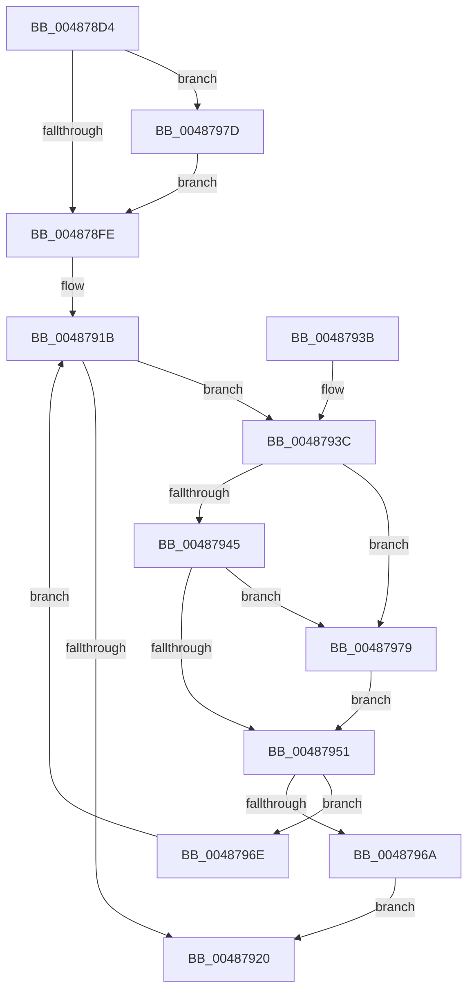

# HalpMcaReadErrorPresence

- RVA: `0x004878D4`–`0x00487996` (길이 `194` bytes)
- VA: `0x00000001404878D4`
- 실행 섹션: `.text`
- PDB 이름 있음: `예`; PDB Function 태그: `아니요`
- unwind 정보 RVA: `0x000AFB88`
- 디코드: `56`개 명령, `194/194` bytes 표시
- 미해석 바이트: `0` (있으면 어셈블리에 `.byte`로 보존)

> 이 문서는 커널 이미지의 기계어와 PDB 기호를 분석해 생성했습니다. 4번과 5번은 함수 원형과 자료형을 바이너리 사용 방식에서 추정한 C 해석이며 원본 소스 복구 결과는 아닙니다.

## 1. Dependencies

- 직접 호출 지점: **2**; 고유 호출 대상: **2**
- 직접 호출자로 확인된 함수: **3**
- RIP 상대 이미지 참조: **4**

### Outgoing calls
- `0x0048793C` → [HalpGetCpuVendor](HalpGetCpuVendor_function_004879E4.md) (function, `0x004879E4`)
- `0x00487960` → [guard_dispatch_icall](../6B/guard_dispatch_icall_function_006BAAD0.md) (function, `0x006BAAD0`)

### Direct callers
- [HalpCmcPollProcessor](HalpCmcPollProcessor_function_0048772C.md) at `0x00487790`
- [HalpMceHandlerCore](../54/HalpMceHandlerCore_function_00542038.md) at `0x005420D0`
- [HalpHandlePreviousMcaErrorsOnProcessor](../../pagelk/B5/HalpHandlePreviousMcaErrorsOnProcessor_function_00B5BA2C.md) at `0x00B5BA4F`

### Static image references
- `0x004878EC` → RVA `0x00E100E0` (`.data`; read)
- `0x00487945` → RVA `0x00E10258` (`.data`; read)
- `0x00487951` → RVA `0x00FC1990` (`.data`; read)
- `0x0048798B` → RVA `0x00E100E0` (`.data`; write)

## 2. Other-region calls and transfers

- 다른 실행 섹션으로 향하는 call: **0**
- 별도 외부 분기/꼬리 이동을 확인하지 못했습니다.

## 3. Assembly (complete function range)

```asm
004878D4  48 89 5C 24 08                  mov qword ptr [rsp + 8], rbx
004878D9  48 89 6C 24 10                  mov qword ptr [rsp + 0x10], rbp
004878DE  48 89 74 24 20                  mov qword ptr [rsp + 0x20], rsi
004878E3  57                              push rdi
004878E4  41 56                           push r14
004878E6  41 57                           push r15
004878E8  48 83 EC 20                     sub rsp, 0x20
004878EC  8A 05 EE 87 98 00               mov al, byte ptr [rip + 0x9887ee]
004878F2  48 8B DA                        mov rbx, rdx
004878F5  BE 25 02 00 C0                  mov esi, 0xc0000225
004878FA  84 C0                           test al, al
004878FC  74 7F                           je 0x14048797d
004878FE  8A 05 DC 87 98 00               mov al, byte ptr [rip + 0x9887dc]
00487904  BD 01 04 00 00                  mov ebp, 0x401
00487909  48 83 64 24 50 00               and qword ptr [rsp + 0x50], 0
0048790F  41 BE 01 20 00 C0               mov r14d, 0xc0002001
00487915  33 FF                           xor edi, edi
00487917  44 0F B6 F8                     movzx r15d, al
0048791B  41 3B FF                        cmp edi, r15d
0048791E  72 1C                           jb 0x14048793c
00487920  48 8B 5C 24 40                  mov rbx, qword ptr [rsp + 0x40]
00487925  8B C6                           mov eax, esi
00487927  48 8B 74 24 58                  mov rsi, qword ptr [rsp + 0x58]
0048792C  48 8B 6C 24 48                  mov rbp, qword ptr [rsp + 0x48]
00487931  48 83 C4 20                     add rsp, 0x20
00487935  41 5F                           pop r15
00487937  41 5E                           pop r14
00487939  5F                              pop rdi
0048793A  C3                              ret
0048793B  CC                              int3
0048793C  E8 A3 00 00 00                  call 0x1404879e4
00487941  3C 01                           cmp al, 1
00487943  75 34                           jne 0x140487979
00487945  80 3D 0C 89 98 00 00            cmp byte ptr [rip + 0x98890c], 0
0048794C  41 8B D6                        mov edx, r14d
0048794F  74 28                           je 0x140487979
00487951  48 8B 05 38 A0 B3 00            mov rax, qword ptr [rip + 0xb3a038]
00487958  4C 8D 44 24 50                  lea r8, [rsp + 0x50]
0048795D  48 8B CB                        mov rcx, rbx
00487960  E8 6B 31 23 00                  call 0x1406baad0
00487965  48 85 C0                        test rax, rax
00487968  79 04                           jns 0x14048796e
0048796A  33 F6                           xor esi, esi
0048796C  EB B2                           jmp 0x140487920
0048796E  FF C7                           inc edi
00487970  41 83 C6 10                     add r14d, 0x10
00487974  83 C5 04                        add ebp, 4
00487977  EB A2                           jmp 0x14048791b
00487979  8B D5                           mov edx, ebp
0048797B  EB D4                           jmp 0x140487951
0048797D  B9 79 01 00 00                  mov ecx, 0x179
00487982  0F 32                           rdmsr
00487984  48 C1 E2 20                     shl rdx, 0x20
00487988  48 0B C2                        or rax, rdx
0048798B  88 05 4F 87 98 00               mov byte ptr [rip + 0x98874f], al
00487991  E9 68 FF FF FF                  jmp 0x1404878fe
```

## 4. C-style interpretation (structured pseudocode)

```c
__int64 __fastcall HalpMcaReadErrorPresence(__int64 a1, __int64 a2)
{
    __int64 result;
    __int64 v_r14;
    __int64 v_rbp;
    __int64 v_rdi;
    __int64 v_rsi;
    __int64 v_rsp;
    unsigned __int64 v_stack_p10;
    unsigned __int64 v_stack_p18;
    unsigned __int64 v_stack_p20;
    unsigned __int64 v_stack_p50;
    unsigned __int64 v_stack_p8;

    v_stack_p8 = v_rbx;
    v_stack_p10 = v_rbp;
    v_stack_p20 = v_rsi;
    v_rsp = (v_rsp) - (32);
    if ((unsigned __int8)(*(unsigned __int8 *)(v_rip + 9996270)) == 0) goto loc_0048797D;
loc_004878FE:
    v_rdi = 0;
loc_0048791B:
    if (0 < ((unsigned int)((unsigned __int8)(*(unsigned __int8 *)(v_rip + 9996252))))) goto loc_0048793C;
loc_00487920:
    v_rsp = (v_rsp) + (32);
    return (unsigned int)((unsigned int)((unsigned int)(0xC0000225ULL)));
loc_0048793C:
    result = HalpGetCpuVendor(a1, a2, a3, a4);
    if (((unsigned __int8)(result)) != 1) goto loc_00487979;
    if ((*(unsigned __int8 *)(v_rip + 9996556)) == 0) goto loc_00487979;
loc_00487951:
    result = guard_dispatch_icall(v_stack_p8, (unsigned int)((unsigned int)((unsigned int)(0xC0002001ULL))), v_stack_p50, a4);
    if (!sign_flag) goto loc_0048796E;
    v_rsi = 0;
    goto loc_00487920;
loc_0048796E:
    v_rdi = (unsigned int)((v_rdi) + 1);
    v_r14 = (unsigned int)(((unsigned int)(0xC0002001ULL)) + (16));
    v_rbp = (unsigned int)((v_stack_p10) + (4));
    goto loc_0048791B;
loc_00487979:
    goto loc_00487951;
loc_0048797D:
    a2 = ((unsigned int)((unsigned int)(v_rbp))) << (32);
    result = (result) | (a2);
    *(unsigned __int8 *)(v_rip + 9996111) = (unsigned __int8)(result);
    goto loc_004878FE;
}
```

## 5. (Beta) C Style

```c
int64_t HalpMcaReadErrorPresence(int64_t Arg1, int64_t Arg2)
{
    int64_t result;
    int64_t local_r14;
    int64_t local_rbp;
    int64_t local_rdi;
    int64_t local_rsi;
    int64_t local_rsp;
    uint64_t v_stack_p10;
    uint64_t v_stack_p18;
    uint64_t v_stack_p20;
    uint64_t v_stack_p50;
    uint64_t v_stack_p8;

    v_stack_p8 = local_rbx;
    v_stack_p10 = local_rbp;
    v_stack_p20 = local_rsi;
    local_rsp = (local_rsp) - (32);
    if ((uint8_t)(*(uint8_t *)(v_rip + 0x9887EE)) == 0) goto loc_0048797D;
loc_004878FE:
    local_rdi = 0;
loc_0048791B:
    if (0 < ((uint32_t)((uint8_t)(*(uint8_t *)(v_rip + 0x9887DC))))) goto loc_0048793C;
loc_00487920:
    local_rsp = (local_rsp) + (32);
    return (uint32_t)((uint32_t)((uint32_t)(0xC0000225ULL)));
loc_0048793C:
    result = HalpGetCpuVendor(Arg1, Arg2, a3, a4);
    if (((uint8_t)(result)) != 1) goto loc_00487979;
    if ((*(uint8_t *)(v_rip + 0x98890C)) == 0) goto loc_00487979;
loc_00487951:
    result = guard_dispatch_icall(v_stack_p8, (uint32_t)((uint32_t)((uint32_t)(0xC0002001ULL))), v_stack_p50, a4);
    if (!sign_flag) goto loc_0048796E;
    local_rsi = 0;
    goto loc_00487920;
loc_0048796E:
    local_rdi = (uint32_t)((local_rdi) + 1);
    local_r14 = (uint32_t)(((uint32_t)(0xC0002001ULL)) + (16));
    local_rbp = (uint32_t)((v_stack_p10) + (4));
    goto loc_0048791B;
loc_00487979:
    goto loc_00487951;
loc_0048797D:
    Arg2 = ((uint32_t)((uint32_t)(local_rbp))) << (32);
    result = (result) | (Arg2);
    *(uint8_t *)(v_rip + 0x98874F) = (uint8_t)(result);
    goto loc_004878FE;
}
```

## 6. Execution-region graph

[열기: 2D/3D 그래프와 함수 탐색 컨트롤 패널](../../../control-panel.html?section=text&rva=0x004878D4&view=graph)

- 2D 그래프는 위에서 아래로 흐르고, 3D 그래프는 빈 공간을 드래그해 회전합니다. Shift+드래그는 이동, 휠은 확대·축소, 함수 노드 선택은 대상 보고서 이동입니다.

### Static fallback


