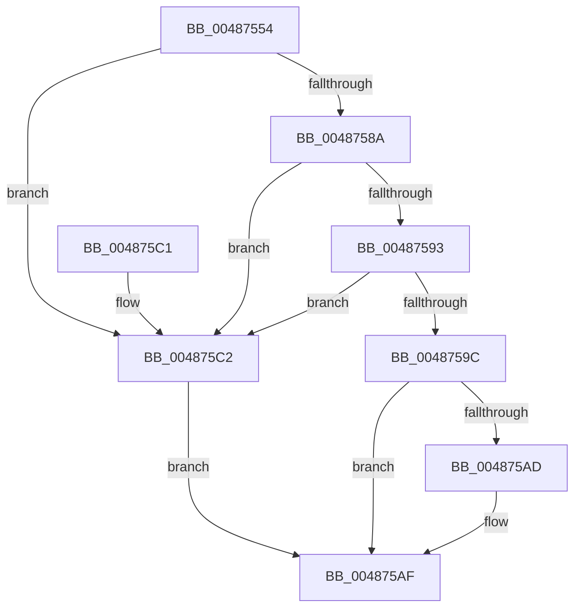

# HalpMcaStuckErrorCheck

- RVA: `0x00487554`–`0x004875DD` (길이 `137` bytes)
- VA: `0x0000000140487554`
- 실행 섹션: `.text`
- PDB 이름 있음: `예`; PDB Function 태그: `아니요`
- unwind 정보 RVA: `0x0007CED0`
- 디코드: `33`개 명령, `137/137` bytes 표시
- 미해석 바이트: `0` (있으면 어셈블리에 `.byte`로 보존)

> 이 문서는 커널 이미지의 기계어와 PDB 기호를 분석해 생성했습니다. 4번과 5번은 함수 원형과 자료형을 바이너리 사용 방식에서 추정한 C 해석이며 원본 소스 복구 결과는 아닙니다.

## 1. Dependencies

- 직접 호출 지점: **1**; 고유 호출 대상: **1**
- 직접 호출자로 확인된 함수: **1**
- RIP 상대 이미지 참조: **0**

### Outgoing calls
- `0x00487566` → [HalpGetMcaPcrContext](HalpGetMcaPcrContext_function_00487A38.md) (function, `0x00487A38`)

### Direct callers
- [HalpMcaReadError](../54/HalpMcaReadError_function_00541A2C.md) at `0x00541C6F`

### Static image references
- 디코드된 RIP-relative 메모리 참조가 없습니다.

## 2. Other-region calls and transfers

- 다른 실행 섹션으로 향하는 call: **0**
- 별도 외부 분기/꼬리 이동을 확인하지 못했습니다.

## 3. Assembly (complete function range)

```asm
00487554  48 89 5C 24 08                  mov qword ptr [rsp + 8], rbx
00487559  57                              push rdi
0048755A  48 83 EC 20                     sub rsp, 0x20
0048755E  8B F9                           mov edi, ecx
00487560  48 8B DA                        mov rbx, rdx
00487563  49 8B C8                        mov rcx, r8
00487566  E8 CD 04 00 00                  call 0x140487a38
0048756B  4C 8B C8                        mov r9, rax
0048756E  0F 31                           rdtsc
00487570  48 C1 E2 20                     shl rdx, 0x20
00487574  48 0B C2                        or rax, rdx
00487577  4C 8B C0                        mov r8, rax
0048757A  4D 2B 81 98 00 00 00            sub r8, qword ptr [r9 + 0x98]
00487581  49 81 F8 00 C2 EB 0B            cmp r8, 0xbebc200
00487588  77 38                           ja 0x1404875c2
0048758A  41 39 B9 84 00 00 00            cmp dword ptr [r9 + 0x84], edi
00487591  75 2F                           jne 0x1404875c2
00487593  49 39 99 88 00 00 00            cmp qword ptr [r9 + 0x88], rbx
0048759A  75 26                           jne 0x1404875c2
0048759C  41 FF 81 90 00 00 00            inc dword ptr [r9 + 0x90]
004875A3  41 83 B9 90 00 00 00 03         cmp dword ptr [r9 + 0x90], 3
004875AB  76 02                           jbe 0x1404875af
004875AD  0F 09                           wbinvd
004875AF  48 8B 5C 24 30                  mov rbx, qword ptr [rsp + 0x30]
004875B4  49 89 81 98 00 00 00            mov qword ptr [r9 + 0x98], rax
004875BB  48 83 C4 20                     add rsp, 0x20
004875BF  5F                              pop rdi
004875C0  C3                              ret
004875C1  CC                              int3
004875C2  41 89 B9 84 00 00 00            mov dword ptr [r9 + 0x84], edi
004875C9  49 89 99 88 00 00 00            mov qword ptr [r9 + 0x88], rbx
004875D0  41 C7 81 90 00 00 00 01 00 00 00  mov dword ptr [r9 + 0x90], 1
004875DB  EB D2                           jmp 0x1404875af
```

## 4. C-style interpretation (structured pseudocode)

```c
__int64 __fastcall HalpMcaStuckErrorCheck(int a1, __int64 a2, __int64 a3)
{
    __int64 result;
    __int64 v_rsp;
    unsigned __int64 v_stack_p8;

    v_stack_p8 = v_rbx;
    v_rsp = (v_rsp) - (32);
    result = HalpGetMcaPcrContext(a3, a2, a3, a4);
    a2 = (a2) << (32);
    result = (result) | (a2);
    a3 = (result) - (*(unsigned __int64 *)(result + 152));
    if (a3 > 0xBEBC200ULL) goto loc_004875C2;
    if ((*(unsigned int *)(result + 132)) != ((unsigned int)((unsigned int)(a1)))) goto loc_004875C2;
    if ((*(unsigned __int64 *)(result + 136)) != a2) goto loc_004875C2;
    if ((*(unsigned int *)(result + 144)) >= = 3) {
    }
    *(unsigned __int64 *)(result + 152) = result;
    v_rsp = (v_rsp) + (32);
    return result;
loc_004875C2:
    *(unsigned int *)(result + 132) = (unsigned int)((unsigned int)(a1));
    *(unsigned __int64 *)(result + 136) = v_stack_p8;
    *(unsigned int *)(result + 144) = 1;
    goto loc_004875AF;
}
```

## 5. (Beta) C Style

```c
int64_t HalpMcaStuckErrorCheck(int32_t Arg1, int64_t Arg2, int64_t Arg3)
{
    int64_t result;
    int64_t local_rsp;
    uint64_t v_stack_p8;

    v_stack_p8 = local_rbx;
    local_rsp = (local_rsp) - (32);
    result = HalpGetMcaPcrContext(Arg3, Arg2, Arg3, a4);
    Arg2 = (Arg2) << (32);
    result = (result) | (Arg2);
    Arg3 = (result) - (*(uint64_t *)(result + 0x98));
    if (Arg3 > 0xBEBC200ULL) goto loc_004875C2;
    if ((*(uint32_t *)(result + 0x84)) != ((uint32_t)((uint32_t)(Arg1)))) goto loc_004875C2;
    if ((*(uint64_t *)(result + 0x88)) != Arg2) goto loc_004875C2;
    if ((*(uint32_t *)(result + 0x90)) >= = 3) {
    }
    *(uint64_t *)(result + 0x98) = result;
    local_rsp = (local_rsp) + (32);
    return result;
loc_004875C2:
    *(uint32_t *)(result + 0x84) = (uint32_t)((uint32_t)(Arg1));
    *(uint64_t *)(result + 0x88) = v_stack_p8;
    *(uint32_t *)(result + 0x90) = 1;
    goto loc_004875AF;
}
```

## 6. Execution-region graph

[열기: 2D/3D 그래프와 함수 탐색 컨트롤 패널](../../../control-panel.html?section=text&rva=0x00487554&view=graph)

- 2D 그래프는 위에서 아래로 흐르고, 3D 그래프는 빈 공간을 드래그해 회전합니다. Shift+드래그는 이동, 휠은 확대·축소, 함수 노드 선택은 대상 보고서 이동입니다.

### Static fallback


