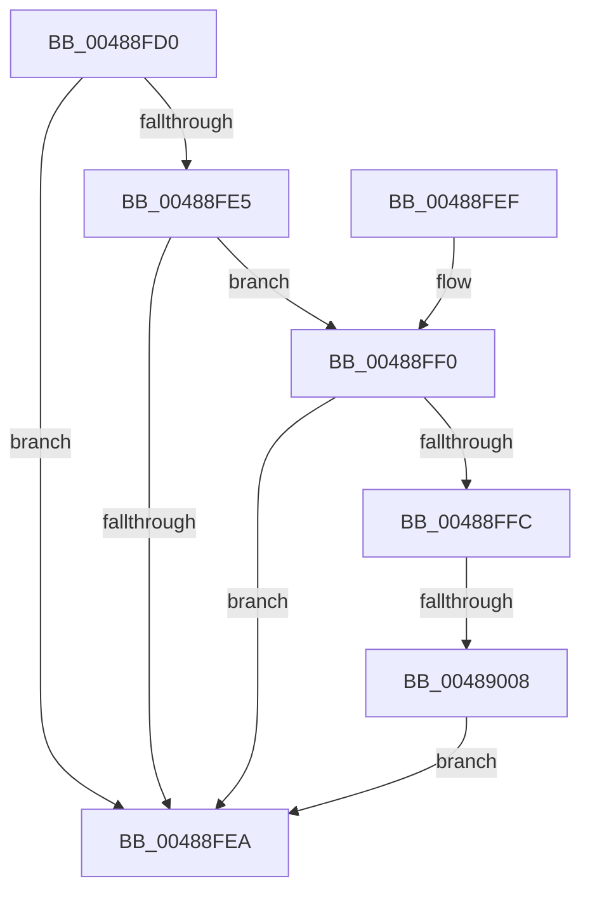

# HalpReleaseSecondaryIcEntryShared

- RVA: `0x00488FD0`–`0x0048900F` (길이 `63` bytes)
- VA: `0x0000000140488FD0`
- 실행 섹션: `.text`
- PDB 이름 있음: `예`; PDB Function 태그: `예`
- unwind 정보 RVA: `0x0006E680`
- 디코드: `21`개 명령, `63/63` bytes 표시
- 미해석 바이트: `0` (있으면 어셈블리에 `.byte`로 보존)

> 이 문서는 커널 이미지의 기계어와 PDB 기호를 분석해 생성했습니다. 4번과 5번은 함수 원형과 자료형을 바이너리 사용 방식에서 추정한 C 해석이며 원본 소스 복구 결과는 아닙니다.

## 1. Dependencies

- 직접 호출 지점: **1**; 고유 호출 대상: **1**
- 직접 호출자로 확인된 함수: **5**
- RIP 상대 이미지 참조: **0**

### Outgoing calls
- `0x00489008` → [HalpInsertSecondarySignalList](../55/HalpInsertSecondarySignalList_function_00556EFC.md) (function, `0x00556EFC`)

### Direct callers
- [HalpDisableSecondaryInterrupt](HalpDisableSecondaryInterrupt_function_00488F34.md) at `0x00488F9D`
- [HalpInterruptRequestSecondaryInterrupt](../55/HalpInterruptRequestSecondaryInterrupt_function_005570A8.md) at `0x00557124`
- [HalpUnregisterSecondaryIcInterface](../55/HalpUnregisterSecondaryIcInterface_function_00557230.md) at `0x005572B8`
- [HalpQueryPrimaryInterruptInformation](../../page/AB/HalpQueryPrimaryInterruptInformation_function_00AB888C.md) at `0x00AB88FB`
- [HalpEnableSecondaryInterrupt](../../page/AC/HalpEnableSecondaryInterrupt_function_00AC4DC0.md) at `0x00AC4E86`

### Static image references
- 디코드된 RIP-relative 메모리 참조가 없습니다.

## 2. Other-region calls and transfers

- 다른 실행 섹션으로 향하는 call: **0**
- call이 아닌 외부 분기/꼬리 이동: **1**
  - `0x00489002` → [sub_006F5C9C](../6F/Unknown_function_006F5C9C.md) (`tail-transfer`)

## 3. Assembly (complete function range)

```asm
00488FD0  48 83 EC 28                     sub rsp, 0x28
00488FD4  83 C8 FF                        or eax, 0xffffffff
00488FD7  F0 0F C1 41 70                  lock xadd dword ptr [rcx + 0x70], eax
00488FDC  FF C8                           dec eax
00488FDE  45 33 C0                        xor r8d, r8d
00488FE1  84 D2                           test dl, dl
00488FE3  74 05                           je 0x140488fea
00488FE5  83 F8 01                        cmp eax, 1
00488FE8  74 06                           je 0x140488ff0
00488FEA  48 83 C4 28                     add rsp, 0x28
00488FEE  C3                              ret
00488FEF  CC                              int3
00488FF0  33 C0                           xor eax, eax
00488FF2  F0 44 0F B1 41 74               lock cmpxchg dword ptr [rcx + 0x74], r8d
00488FF8  85 C0                           test eax, eax
00488FFA  74 EE                           je 0x140488fea
00488FFC  44 0F 20 C0                     mov rax, cr8
00489000  3C 02                           cmp al, 2
00489002  0F 86 94 CC 26 00               jbe 0x1406f5c9c
00489008  E8 EF DE 0C 00                  call 0x140556efc
0048900D  EB DB                           jmp 0x140488fea
```

## 4. C-style interpretation (structured pseudocode)

```c
__int64 __fastcall HalpReleaseSecondaryIcEntryShared(__int64 a1, unsigned __int8 a2, int a3)
{
    __int64 result;
    __int64 v_rsp;

    v_rsp = (v_rsp) - (40);
    result = (unsigned int)((result) | (0xFFFFFFFFULL));
    result = (unsigned int)((result) - 1);
    a3 = 0;
    if (a2 == 0) goto loc_00488FEA;
    if (((unsigned int)(result)) == 1) goto loc_00488FF0;
loc_00488FEA:
    v_rsp = (v_rsp) + (40);
    return result;
loc_00488FF0:
    result = 0;
    if (0 == 0) goto loc_00488FEA;
    result = HalpInsertSecondarySignalList(a1, a2, a3, a4);
    goto loc_00488FEA;
}
```

## 5. (Beta) C Style

```c
int64_t HalpReleaseSecondaryIcEntryShared(void *Arg1, uint8_t Arg2, int32_t Arg3)
{
    uint8_t *arg1 = (uint8_t *)Arg1;

    int64_t result;
    int64_t local_rsp;

    local_rsp = (local_rsp) - (40);
    result = (uint32_t)((result) | (0xFFFFFFFFULL));
    result = (uint32_t)((result) - 1);
    Arg3 = 0;
    if (Arg2 == 0) goto loc_00488FEA;
    if (((uint32_t)(result)) == 1) goto loc_00488FF0;
loc_00488FEA:
    local_rsp = (local_rsp) + (40);
    return result;
loc_00488FF0:
    result = 0;
    if (0 == 0) goto loc_00488FEA;
    result = HalpInsertSecondarySignalList(Arg1, Arg2, Arg3, a4);
    goto loc_00488FEA;
}
```

### 관측된 메모리 오프셋

구조체 형식이 확인되지 않은 접근은 인자 기준의 오프셋으로만 기록했습니다.

| 기준 인자 | 오프셋 표현 | 폭 (bit) | 접근 |
|---|---:|---:|---|
| `Arg1` | `+ 0x70` | `32` | `R/W` |
| `Arg1` | `+ 0x74` | `32` | `R` |

## 6. Execution-region graph

[열기: 2D/3D 그래프와 함수 탐색 컨트롤 패널](../../../control-panel.html?section=text&rva=0x00488FD0&view=graph)

- 2D 그래프는 위에서 아래로 흐르고, 3D 그래프는 빈 공간을 드래그해 회전합니다. Shift+드래그는 이동, 휠은 확대·축소, 함수 노드 선택은 대상 보고서 이동입니다.

### Static fallback


