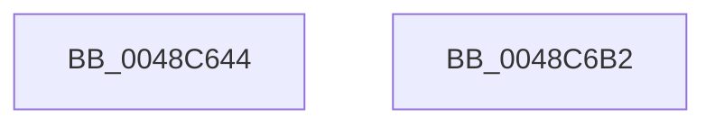

# HalpRemapVirtualAddress64

- RVA: `0x0048C644`–`0x0048C6B3` (길이 `111` bytes)
- VA: `0x000000014048C644`
- 실행 섹션: `.text`
- PDB 이름 있음: `예`; PDB Function 태그: `아니요`
- unwind 정보 RVA: `0x000DB714`
- 디코드: `25`개 명령, `111/111` bytes 표시
- 미해석 바이트: `0` (있으면 어셈블리에 `.byte`로 보존)

> 이 문서는 커널 이미지의 기계어와 PDB 기호를 분석해 생성했습니다. 4번과 5번은 함수 원형과 자료형을 바이너리 사용 방식에서 추정한 C 해석이며 원본 소스 복구 결과는 아닙니다.

## 1. Dependencies

- 직접 호출 지점: **0**; 고유 호출 대상: **0**
- 직접 호출자로 확인된 함수: **2**
- RIP 상대 이미지 참조: **0**

### Outgoing calls
- 직접 디코드된 call 명령이 없습니다.

### Direct callers
- [HalpReadWriteWheaPhysicalMemory](../56/HalpReadWriteWheaPhysicalMemory_function_005648B0.md) at `0x00564997`
- [HalpBlkAddVirtualMapping](../../init/C2/HalpBlkAddVirtualMapping_function_00C231D0.md) at `0x00C23212`

### Static image references
- 디코드된 RIP-relative 메모리 참조가 없습니다.

## 2. Other-region calls and transfers

- 다른 실행 섹션으로 향하는 call: **0**
- 별도 외부 분기/꼬리 이동을 확인하지 못했습니다.

## 3. Assembly (complete function range)

```asm
0048C644  48 8B C1                        mov rax, rcx
0048C647  4C 8B D1                        mov r10, rcx
0048C64A  48 C1 E8 0C                     shr rax, 0xc
0048C64E  48 B9 FF FF FF FF 0F 00 00 00   movabs rcx, 0xfffffffff
0048C658  48 23 C1                        and rax, rcx
0048C65B  48 B9 00 00 00 00 80 F6 FF FF   movabs rcx, 0xfffff68000000000
0048C665  4C 8D 0C C1                     lea r9, [rcx + rax*8]
0048C669  4C 89 4C 24 08                  mov qword ptr [rsp + 8], r9
0048C66E  48 8B 44 24 08                  mov rax, qword ptr [rsp + 8]
0048C673  48 83 20 00                     and qword ptr [rax], 0
0048C677  41 0F 01 3A                     invlpg byte ptr [r10]
0048C67B  48 B9 03 00 00 00 00 00 00 80   movabs rcx, 0x8000000000000003
0048C685  4C 89 4C 24 08                  mov qword ptr [rsp + 8], r9
0048C68A  41 F6 D8                        neg r8b
0048C68D  48 1B C0                        sbb rax, rax
0048C690  83 E0 18                        and eax, 0x18
0048C693  48 03 C1                        add rax, rcx
0048C696  48 B9 00 F0 FF FF FF FF 0F 00   movabs rcx, 0xffffffffff000
0048C6A0  48 23 D1                        and rdx, rcx
0048C6A3  48 8B 4C 24 08                  mov rcx, qword ptr [rsp + 8]
0048C6A8  48 0B C2                        or rax, rdx
0048C6AB  48 89 01                        mov qword ptr [rcx], rax
0048C6AE  49 8B C2                        mov rax, r10
0048C6B1  C3                              ret
0048C6B2  CC                              int3
```

## 4. C-style interpretation (structured pseudocode)

```c
__int64 __fastcall HalpRemapVirtualAddress64(__int64 a1, __int64 a2, unsigned __int8 a3)
{
    __int64 result;
    unsigned __int64 v_stack_p8;

    result = (a1) >> (12);
    result = (result) & (a1);
    v_stack_p8 = a1 + result * 8;
    v_stack_p8 = a1 + result * 8;
    a3 = (unsigned __int8)(-(a3));
    result = (unsigned int)((v_stack_p8) & (24));
    result = (result) + (a1);
    a2 = (a2) & (a1);
    result = (result) | (a2);
    *(unsigned __int64 *)(v_stack_p8) = result;
    return a1;
}
```

## 5. (Beta) C Style

```c
void *HalpRemapVirtualAddress64(void *Arg1, int64_t Arg2, uint8_t Arg3)
{
    uint8_t *arg1 = (uint8_t *)Arg1;

    int64_t result;
    uint64_t v_stack_p8;

    result = (Arg1) >> (12);
    result = (result) & (Arg1);
    v_stack_p8 = Arg1 + result * 8;
    v_stack_p8 = Arg1 + result * 8;
    Arg3 = (uint8_t)(-(Arg3));
    result = (uint32_t)((v_stack_p8) & (24));
    result = (result) + (Arg1);
    Arg2 = (Arg2) & (Arg1);
    result = (result) | (Arg2);
    *(uint64_t *)(v_stack_p8) = result;
    return Arg1;
}
```

### 관측된 메모리 오프셋

구조체 형식이 확인되지 않은 접근은 인자 기준의 오프셋으로만 기록했습니다.

| 기준 인자 | 오프셋 표현 | 폭 (bit) | 접근 |
|---|---:|---:|---|
| `Arg1` | `+ 0x0` | `8` | `R` |

## 6. Execution-region graph

[열기: 2D/3D 그래프와 함수 탐색 컨트롤 패널](../../../control-panel.html?section=text&rva=0x0048C644&view=graph)

- 2D 그래프는 위에서 아래로 흐르고, 3D 그래프는 빈 공간을 드래그해 회전합니다. Shift+드래그는 이동, 휠은 확대·축소, 함수 노드 선택은 대상 보고서 이동입니다.

### Static fallback


