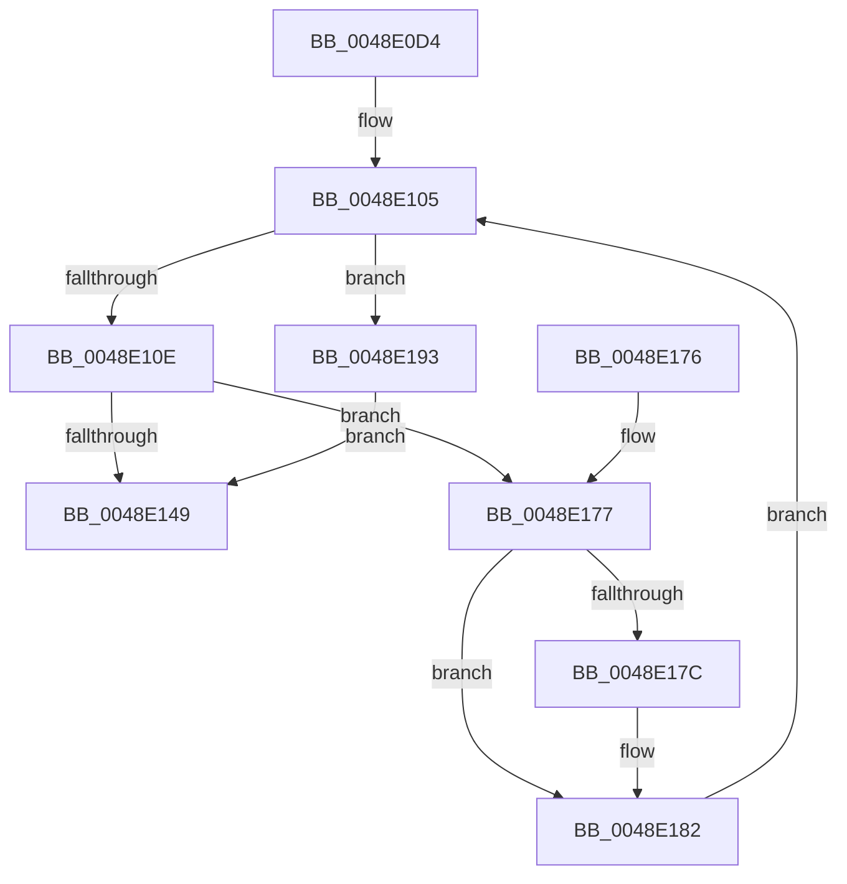

# HalpTimerCaptureCurrentAuxiliaryQpcPair

- RVA: `0x0048E0D4`–`0x0048E19E` (길이 `202` bytes)
- VA: `0x000000014048E0D4`
- 실행 섹션: `.text`
- PDB 이름 있음: `예`; PDB Function 태그: `아니요`
- unwind 정보 RVA: `0x000B14E0`
- 디코드: `62`개 명령, `202/202` bytes 표시
- 미해석 바이트: `0` (있으면 어셈블리에 `.byte`로 보존)

> 이 문서는 커널 이미지의 기계어와 PDB 기호를 분석해 생성했습니다. 4번과 5번은 함수 원형과 자료형을 바이너리 사용 방식에서 추정한 C 해석이며 원본 소스 복구 결과는 아닙니다.

## 1. Dependencies

- 직접 호출 지점: **4**; 고유 호출 대상: **3**
- 직접 호출자로 확인된 함수: **2**
- RIP 상대 이미지 참조: **2**

### Outgoing calls
- `0x0048E110` → [KeQueryPerformanceCounter](../37/KeQueryPerformanceCounter_function_0037E7E0.md) (function, `0x0037E7E0`)
- `0x0048E122` → [HalpTimerGetInternalData](../20/HalpTimerGetInternalData_function_00209500.md) (function, `0x00209500`)
- `0x0048E12E` → [guard_dispatch_icall](../6B/guard_dispatch_icall_function_006BAAD0.md) (function, `0x006BAAD0`)
- `0x0048E138` → [KeQueryPerformanceCounter](../37/KeQueryPerformanceCounter_function_0037E7E0.md) (function, `0x0037E7E0`)

### Direct callers
- [HalpTimerConvertAuxiliaryCounterToPerformanceCounter](HalpTimerConvertAuxiliaryCounterToPerformanceCounter_function_0048DF60.md) at `0x0048DFDF`
- [HalpTimerConvertPerformanceCounterToAuxiliaryCounter](../53/HalpTimerConvertPerformanceCounterToAuxiliaryCounter_function_0053C4E0.md) at `0x0053C56F`

### Static image references
- `0x0048E115` → RVA `0x00FC4130` (`.data`; read)
- `0x0048E140` → RVA `0x00FC3FA8` (`.data`; read)

## 2. Other-region calls and transfers

- 다른 실행 섹션으로 향하는 call: **0**
- 별도 외부 분기/꼬리 이동을 확인하지 못했습니다.

## 3. Assembly (complete function range)

```asm
0048E0D4  48 8B C4                        mov rax, rsp
0048E0D7  48 89 58 10                     mov qword ptr [rax + 0x10], rbx
0048E0DB  48 89 68 18                     mov qword ptr [rax + 0x18], rbp
0048E0DF  48 89 70 20                     mov qword ptr [rax + 0x20], rsi
0048E0E3  48 89 48 08                     mov qword ptr [rax + 8], rcx
0048E0E7  57                              push rdi
0048E0E8  41 54                           push r12
0048E0EA  41 55                           push r13
0048E0EC  41 56                           push r14
0048E0EE  41 57                           push r15
0048E0F0  48 83 EC 20                     sub rsp, 0x20
0048E0F4  33 FF                           xor edi, edi
0048E0F6  4D 8B E0                        mov r12, r8
0048E0F9  44 8B FF                        mov r15d, edi
0048E0FC  8B EF                           mov ebp, edi
0048E0FE  48 83 CB FF                     or rbx, 0xffffffffffffffff
0048E102  4C 8B EA                        mov r13, rdx
0048E105  83 FD 0A                        cmp ebp, 0xa
0048E108  0F 83 85 00 00 00               jae 0x14048e193
0048E10E  33 C9                           xor ecx, ecx
0048E110  E8 CB 06 EF FF                  call 0x14037e7e0
0048E115  48 8B 15 14 60 B3 00            mov rdx, qword ptr [rip + 0xb36014]
0048E11C  48 8B F0                        mov rsi, rax
0048E11F  48 8B CA                        mov rcx, rdx
0048E122  E8 D9 B3 D7 FF                  call 0x140209500
0048E127  48 8B C8                        mov rcx, rax
0048E12A  48 8B 42 70                     mov rax, qword ptr [rdx + 0x70]
0048E12E  E8 9D C9 22 00                  call 0x1406baad0
0048E133  33 C9                           xor ecx, ecx
0048E135  4C 8B F0                        mov r14, rax
0048E138  E8 A3 06 EF FF                  call 0x14037e7e0
0048E13D  48 2B C6                        sub rax, rsi
0048E140  48 3B 05 61 5E B3 00            cmp rax, qword ptr [rip + 0xb35e61]
0048E147  77 2E                           ja 0x14048e177
0048E149  48 8B 4C 24 50                  mov rcx, qword ptr [rsp + 0x50]
0048E14E  48 89 31                        mov qword ptr [rcx], rsi
0048E151  4D 89 75 00                     mov qword ptr [r13], r14
0048E155  49 89 04 24                     mov qword ptr [r12], rax
0048E159  48 8B 5C 24 58                  mov rbx, qword ptr [rsp + 0x58]
0048E15E  48 8B 6C 24 60                  mov rbp, qword ptr [rsp + 0x60]
0048E163  48 8B 74 24 68                  mov rsi, qword ptr [rsp + 0x68]
0048E168  48 83 C4 20                     add rsp, 0x20
0048E16C  41 5F                           pop r15
0048E16E  41 5E                           pop r14
0048E170  41 5D                           pop r13
0048E172  41 5C                           pop r12
0048E174  5F                              pop rdi
0048E175  C3                              ret
0048E176  CC                              int3
0048E177  48 3B D8                        cmp rbx, rax
0048E17A  76 06                           jbe 0x14048e182
0048E17C  49 8B FE                        mov rdi, r14
0048E17F  4C 8B FE                        mov r15, rsi
0048E182  FF C5                           inc ebp
0048E184  48 3B D8                        cmp rbx, rax
0048E187  48 0F 46 C3                     cmovbe rax, rbx
0048E18B  48 8B D8                        mov rbx, rax
0048E18E  E9 72 FF FF FF                  jmp 0x14048e105
0048E193  48 8B C3                        mov rax, rbx
0048E196  4C 8B F7                        mov r14, rdi
0048E199  49 8B F7                        mov rsi, r15
0048E19C  EB AB                           jmp 0x14048e149
```

## 4. C-style interpretation (structured pseudocode)

```c
__int64 __fastcall HalpTimerCaptureCurrentAuxiliaryQpcPair(__int64 a1, __int64 a2, __int64 a3)
{
    __int64 result;
    __int64 v_r15;
    __int64 v_rbp;
    __int64 v_rbx;
    __int64 v_rdi;
    __int64 v_rsp;
    unsigned __int64 v_stack_p10;
    unsigned __int64 v_stack_p18;
    unsigned __int64 v_stack_p20;
    unsigned __int64 v_stack_p8;

    *(unsigned __int64 *)(v_rsp + 16) = v_rbx;
    *(unsigned __int64 *)(v_rsp + 24) = v_rbp;
    *(unsigned __int64 *)(v_rsp + 32) = v_rsi;
    *(unsigned __int64 *)(v_rsp + 8) = a1;
    v_rsp = (v_rsp) - (32);
    v_rdi = 0;
    v_rbx = (v_rbx) | (-1);
loc_0048E105:
    if (0 >= 10) goto loc_0048E193;
    a1 = 0;
    result = KeQueryPerformanceCounter(a1, a2, a3, a4);
    result = HalpTimerGetInternalData(*(unsigned __int64 *)(v_rip + 11755540), *(unsigned __int64 *)(v_rip + 11755540), a3, a4);
    result = guard_dispatch_icall(result, *(unsigned __int64 *)(v_rip + 11755540), a3, a4);
    a1 = 0;
    result = KeQueryPerformanceCounter(a1, *(unsigned __int64 *)(v_rip + 11755540), a3, a4);
    result = (result) - (result);
    if (result > (*(unsigned __int64 *)(v_rip + 11755105))) goto loc_0048E177;
loc_0048E149:
    *(unsigned __int64 *)(v_stack_p8) = result;
    *(unsigned __int64 *)(a2) = result;
    *(unsigned __int64 *)(a3) = result;
    v_rsp = (v_rsp) + (32);
    return result;
loc_0048E177:
    v_r15 = 0;
    if (v_stack_p10 >= = result) {
        v_rdi = result;
        v_r15 = v_stack_p20;
    }
    v_rbp = (unsigned int)((v_stack_p18) + 1);
    if (v_stack_p10 <= result) { result = v_stack_p10; }
    goto loc_0048E105;
loc_0048E193:
    goto loc_0048E149;
}
```

## 5. (Beta) C Style

```c
int64_t HalpTimerCaptureCurrentAuxiliaryQpcPair(int64_t Arg1, void *Arg2, void *Arg3)
{
    uint8_t *arg2 = (uint8_t *)Arg2;
    uint8_t *arg3 = (uint8_t *)Arg3;

    int64_t result;
    int64_t local_r15;
    int64_t local_rbp;
    int64_t local_rbx;
    int64_t local_rdi;
    int64_t local_rsp;
    uint64_t v_stack_p10;
    uint64_t v_stack_p18;
    uint64_t v_stack_p20;
    uint64_t v_stack_p8;

    *(uint64_t *)(local_rsp + 0x10) = local_rbx;
    *(uint64_t *)(local_rsp + 0x18) = local_rbp;
    *(uint64_t *)(local_rsp + 0x20) = local_rsi;
    *(uint64_t *)(local_rsp + 0x8) = Arg1;
    local_rsp = (local_rsp) - (32);
    local_rdi = 0;
    local_rbx = (local_rbx) | (-1);
loc_0048E105:
    if (0 >= 10) goto loc_0048E193;
    Arg1 = 0;
    result = KeQueryPerformanceCounter(Arg1, Arg2, Arg3, a4);
    result = HalpTimerGetInternalData(*(uint64_t *)(v_rip + 0xB36014), *(uint64_t *)(v_rip + 0xB36014), Arg3, a4);
    result = guard_dispatch_icall(result, *(uint64_t *)(v_rip + 0xB36014), Arg3, a4);
    Arg1 = 0;
    result = KeQueryPerformanceCounter(Arg1, *(uint64_t *)(v_rip + 0xB36014), Arg3, a4);
    result = (result) - (result);
    if (result > (*(uint64_t *)(v_rip + 0xB35E61))) goto loc_0048E177;
loc_0048E149:
    *(uint64_t *)(v_stack_p8) = result;
    *(uint64_t *)(arg2) = result;
    *(uint64_t *)(arg3) = result;
    local_rsp = (local_rsp) + (32);
    return result;
loc_0048E177:
    local_r15 = 0;
    if (v_stack_p10 >= = result) {
        local_rdi = result;
        local_r15 = v_stack_p20;
    }
    local_rbp = (uint32_t)((v_stack_p18) + 1);
    if (v_stack_p10 <= result) { result = v_stack_p10; }
    goto loc_0048E105;
loc_0048E193:
    goto loc_0048E149;
}
```

### 관측된 메모리 오프셋

구조체 형식이 확인되지 않은 접근은 인자 기준의 오프셋으로만 기록했습니다.

| 기준 인자 | 오프셋 표현 | 폭 (bit) | 접근 |
|---|---:|---:|---|
| `Arg2` | `+ 0x0` | `64` | `W` |
| `Arg3` | `+ 0x0` | `64` | `W` |

## 6. Execution-region graph

[열기: 2D/3D 그래프와 함수 탐색 컨트롤 패널](../../../control-panel.html?section=text&rva=0x0048E0D4&view=graph)

- 2D 그래프는 위에서 아래로 흐르고, 3D 그래프는 빈 공간을 드래그해 회전합니다. Shift+드래그는 이동, 휠은 확대·축소, 함수 노드 선택은 대상 보고서 이동입니다.

### Static fallback


