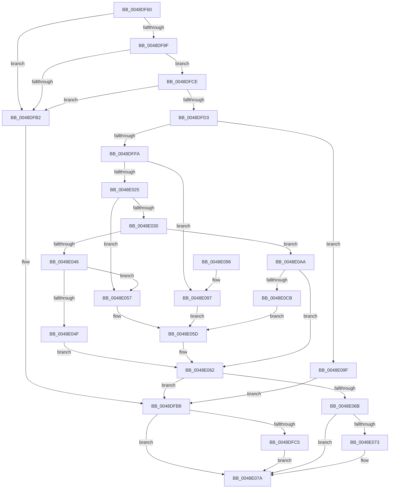

# HalpTimerConvertAuxiliaryCounterToPerformanceCounter

- RVA: `0x0048DF60`–`0x0048E0CD` (길이 `365` bytes)
- VA: `0x000000014048DF60`
- 실행 섹션: `.text`
- PDB 이름 있음: `예`; PDB Function 태그: `아니요`
- unwind 정보 RVA: `0x000B14C4`
- 디코드: `104`개 명령, `365/365` bytes 표시
- 미해석 바이트: `0` (있으면 어셈블리에 `.byte`로 보존)

> 이 문서는 커널 이미지의 기계어와 PDB 기호를 분석해 생성했습니다. 4번과 5번은 함수 원형과 자료형을 바이너리 사용 방식에서 추정한 C 해석이며 원본 소스 복구 결과는 아닙니다.

## 1. Dependencies

- 직접 호출 지점: **1**; 고유 호출 대상: **1**
- 직접 호출자로 확인된 함수: **0**
- RIP 상대 이미지 참조: **2**

### Outgoing calls
- `0x0048DFDF` → [HalpTimerCaptureCurrentAuxiliaryQpcPair](HalpTimerCaptureCurrentAuxiliaryQpcPair_function_0048E0D4.md) (function, `0x0048E0D4`)

### Direct callers
- 이 함수 시작 RVA로 연결되는 직접 call은 확인되지 않았습니다. 간접 호출은 완전히 역산할 수 없습니다.

### Static image references
- `0x0048DF93` → RVA `0x00FC4130` (`.data`; read)
- `0x0048DF9F` → RVA `0x00FC4020` (`.data`; read)

## 2. Other-region calls and transfers

- 다른 실행 섹션으로 향하는 call: **0**
- 별도 외부 분기/꼬리 이동을 확인하지 못했습니다.

## 3. Assembly (complete function range)

```asm
0048DF60  48 89 5C 24 08                  mov qword ptr [rsp + 8], rbx
0048DF65  48 89 74 24 10                  mov qword ptr [rsp + 0x10], rsi
0048DF6A  48 89 7C 24 18                  mov qword ptr [rsp + 0x18], rdi
0048DF6F  55                              push rbp
0048DF70  41 56                           push r14
0048DF72  41 57                           push r15
0048DF74  48 8B EC                        mov rbp, rsp
0048DF77  48 83 EC 40                     sub rsp, 0x40
0048DF7B  48 83 65 E8 00                  and qword ptr [rbp - 0x18], 0
0048DF80  49 8B D8                        mov rbx, r8
0048DF83  48 83 65 38 00                  and qword ptr [rbp + 0x38], 0
0048DF88  4C 8B F2                        mov r14, rdx
0048DF8B  48 83 65 E0 00                  and qword ptr [rbp - 0x20], 0
0048DF90  4C 8B F9                        mov r15, rcx
0048DF93  48 8B 05 96 61 B3 00            mov rax, qword ptr [rip + 0xb36196]
0048DF9A  48 85 C0                        test rax, rax
0048DF9D  74 13                           je 0x14048dfb2
0048DF9F  48 8B 3D 7A 60 B3 00            mov rdi, qword ptr [rip + 0xb3607a]
0048DFA6  48 8B B0 C0 00 00 00            mov rsi, qword ptr [rax + 0xc0]
0048DFAD  48 85 FF                        test rdi, rdi
0048DFB0  75 1C                           jne 0x14048dfce
0048DFB2  41 B9 BB 00 00 C0               mov r9d, 0xc00000bb
0048DFB8  49 83 26 00                     and qword ptr [r14], 0
0048DFBC  48 85 DB                        test rbx, rbx
0048DFBF  0F 84 B5 00 00 00               je 0x14048e07a
0048DFC5  48 83 23 00                     and qword ptr [rbx], 0
0048DFC9  E9 AC 00 00 00                  jmp 0x14048e07a
0048DFCE  48 85 F6                        test rsi, rsi
0048DFD1  74 DF                           je 0x14048dfb2
0048DFD3  4C 8D 45 E0                     lea r8, [rbp - 0x20]
0048DFD7  48 8D 55 E8                     lea rdx, [rbp - 0x18]
0048DFDB  48 8D 4D 38                     lea rcx, [rbp + 0x38]
0048DFDF  E8 F0 00 00 00                  call 0x14048e0d4
0048DFE4  41 BA 00 CA 9A 3B               mov r10d, 0x3b9aca00
0048DFEA  41 8B C2                        mov eax, r10d
0048DFED  48 F7 65 E0                     mul qword ptr [rbp - 0x20]
0048DFF1  48 85 D2                        test rdx, rdx
0048DFF4  0F 85 A5 00 00 00               jne 0x14048e09f
0048DFFA  4C 8B 4D E8                     mov r9, qword ptr [rbp - 0x18]
0048DFFE  49 8B CF                        mov rcx, r15
0048E001  48 F7 F7                        div rdi
0048E004  49 2B C9                        sub rcx, r9
0048E007  4C 8B D8                        mov r11, rax
0048E00A  49 8B C1                        mov rax, r9
0048E00D  49 2B C7                        sub rax, r15
0048E010  4D 3B CF                        cmp r9, r15
0048E013  48 0F 43 C8                     cmovae rcx, rax
0048E017  33 D2                           xor edx, edx
0048E019  48 8B C1                        mov rax, rcx
0048E01C  48 F7 F6                        div rsi
0048E01F  48 83 F8 0A                     cmp rax, 0xa
0048E023  73 72                           jae 0x14048e097
0048E025  48 8B C1                        mov rax, rcx
0048E028  48 F7 E7                        mul rdi
0048E02B  48 85 D2                        test rdx, rdx
0048E02E  75 27                           jne 0x14048e057
0048E030  48 F7 F6                        div rsi
0048E033  33 D2                           xor edx, edx
0048E035  4C 8B C0                        mov r8, rax
0048E038  41 8B C2                        mov eax, r10d
0048E03B  48 F7 F7                        div rdi
0048E03E  4C 8B D0                        mov r10, rax
0048E041  4D 3B CF                        cmp r9, r15
0048E044  72 64                           jb 0x14048e0aa
0048E046  48 8B 45 38                     mov rax, qword ptr [rbp + 0x38]
0048E04A  49 3B C0                        cmp rax, r8
0048E04D  72 08                           jb 0x14048e057
0048E04F  45 33 C9                        xor r9d, r9d
0048E052  49 2B C0                        sub rax, r8
0048E055  EB 0B                           jmp 0x14048e062
0048E057  41 B9 01 00 00 C0               mov r9d, 0xc0000001
0048E05D  45 33 D2                        xor r10d, r10d
0048E060  33 C0                           xor eax, eax
0048E062  45 85 C9                        test r9d, r9d
0048E065  0F 88 4D FF FF FF               js 0x14048dfb8
0048E06B  49 89 06                        mov qword ptr [r14], rax
0048E06E  48 85 DB                        test rbx, rbx
0048E071  74 07                           je 0x14048e07a
0048E073  4B 8D 04 13                     lea rax, [r11 + r10]
0048E077  48 89 03                        mov qword ptr [rbx], rax
0048E07A  48 8B 5C 24 60                  mov rbx, qword ptr [rsp + 0x60]
0048E07F  41 8B C1                        mov eax, r9d
0048E082  48 8B 74 24 68                  mov rsi, qword ptr [rsp + 0x68]
0048E087  48 8B 7C 24 70                  mov rdi, qword ptr [rsp + 0x70]
0048E08C  48 83 C4 40                     add rsp, 0x40
0048E090  41 5F                           pop r15
0048E092  41 5E                           pop r14
0048E094  5D                              pop rbp
0048E095  C3                              ret
0048E096  CC                              int3
0048E097  41 B9 0D 00 00 C0               mov r9d, 0xc000000d
0048E09D  EB BE                           jmp 0x14048e05d
0048E09F  41 B9 01 00 00 C0               mov r9d, 0xc0000001
0048E0A5  E9 0E FF FF FF                  jmp 0x14048dfb8
0048E0AA  48 8B 4D 38                     mov rcx, qword ptr [rbp + 0x38]
0048E0AE  48 83 C8 FF                     or rax, 0xffffffffffffffff
0048E0B2  49 03 C8                        add rcx, r8
0048E0B5  49 3B C8                        cmp rcx, r8
0048E0B8  48 0F 43 C1                     cmovae rax, rcx
0048E0BC  45 1B C9                        sbb r9d, r9d
0048E0BF  41 81 E1 95 00 00 C0            and r9d, 0xc0000095
0048E0C6  49 3B C8                        cmp rcx, r8
0048E0C9  73 97                           jae 0x14048e062
0048E0CB  EB 90                           jmp 0x14048e05d
```

## 4. C-style interpretation (structured pseudocode)

```c
__int64 __fastcall HalpTimerConvertAuxiliaryCounterToPerformanceCounter(__int64 a1, __int64 a2, __int64 a3)
{
    __int64 result;
    __int64 v_r10;
    __int64 v_rsp;
    unsigned __int64 v_stack_m30;
    unsigned __int64 v_stack_m38;
    unsigned __int64 v_stack_p10;
    unsigned __int64 v_stack_p18;
    unsigned __int64 v_stack_p20;
    unsigned __int64 v_stack_p8;

    v_stack_p8 = v_rbx;
    v_stack_p10 = v_rsi;
    v_stack_p18 = v_rdi;
    v_rsp = (v_rsp) - (64);
    if (*(unsigned __int64 *)(v_rip + 11755926) == 0) goto loc_0048DFB2;
    if (*(unsigned __int64 *)(v_rip + 11755642) != 0) goto loc_0048DFCE;
loc_0048DFB2:
loc_0048DFB8:
    if (a3 == 0) goto loc_0048E07A;
    goto loc_0048E07A;
loc_0048DFCE:
    if (*(unsigned __int64 *)(*(unsigned __int64 *)(v_rip + 11755926) + 192) == 0) goto loc_0048DFB2;
    result = HalpTimerCaptureCurrentAuxiliaryQpcPair(v_stack_p20, v_stack_m30, v_stack_m38, (unsigned int)(0xC00000BBULL));
    if (v_stack_m30 != 0) goto loc_0048E09F;
    a1 = (a1) - (v_stack_m30);
    result = (v_stack_m30) - (a1);
    if (v_stack_m30 >= a1) { a1 = result; }
    a2 = 0;
    if (a1 >= 10) goto loc_0048E097;
    if (0 != 0) goto loc_0048E057;
    a2 = 0;
    if (v_stack_m30 < a1) goto loc_0048E0AA;
    if (v_stack_p20 < a1) goto loc_0048E057;
    a4 = 0;
    result = (v_stack_p20) - (a1);
    goto loc_0048E062;
loc_0048E057:
loc_0048E05D:
    v_r10 = 0;
    result = 0;
loc_0048E062:
    if (sign_flag) goto loc_0048DFB8;
    *(unsigned __int64 *)(a2) = 0;
    if (a3 != 0) {
        result = (unsigned int)((unsigned int)((unsigned int)(0x3B9ACA00ULL))) + v_r10 * 1;
        *(unsigned __int64 *)(a3) = result;
    }
    v_rsp = (v_rsp) + (64);
    return (unsigned int)((unsigned int)((unsigned int)(0xC0000001ULL)));
loc_0048E097:
    goto loc_0048E05D;
loc_0048E09F:
    goto loc_0048DFB8;
loc_0048E0AA:
    result = ((unsigned int)((unsigned int)((unsigned int)(0xC0000001ULL)))) | (-1);
    a1 = (v_stack_p20) + (a1);
    if (a1 >= a1) { result = a1; }
    a4 = (unsigned int)(((unsigned int)(0xC0000001ULL)) & (0xC0000095ULL));
    if (a1 >= a1) goto loc_0048E062;
    goto loc_0048E05D;
}
```

## 5. (Beta) C Style

```c
int64_t HalpTimerConvertAuxiliaryCounterToPerformanceCounter(int64_t Arg1, void *Arg2, int64_t Arg3)
{
    uint8_t *arg2 = (uint8_t *)Arg2;

    int64_t result;
    int64_t local_r10;
    int64_t local_rsp;
    uint64_t v_stack_m30;
    uint64_t v_stack_m38;
    uint64_t v_stack_p10;
    uint64_t v_stack_p18;
    uint64_t v_stack_p20;
    uint64_t v_stack_p8;

    v_stack_p8 = local_rbx;
    v_stack_p10 = local_rsi;
    v_stack_p18 = local_rdi;
    local_rsp = (local_rsp) - (64);
    if (*(uint64_t *)(v_rip + 0xB36196) == 0) goto loc_0048DFB2;
    if (*(uint64_t *)(v_rip + 0xB3607A) != 0) goto loc_0048DFCE;
loc_0048DFB2:
loc_0048DFB8:
    if (Arg3 == 0) goto loc_0048E07A;
    goto loc_0048E07A;
loc_0048DFCE:
    if (*(uint64_t *)(*(uint64_t *)(v_rip + 0xB36196) + 0xC0) == 0) goto loc_0048DFB2;
    result = HalpTimerCaptureCurrentAuxiliaryQpcPair(v_stack_p20, v_stack_m30, v_stack_m38, (uint32_t)(0xC00000BBULL));
    if (v_stack_m30 != 0) goto loc_0048E09F;
    Arg1 = (Arg1) - (v_stack_m30);
    result = (v_stack_m30) - (Arg1);
    if (v_stack_m30 >= Arg1) { Arg1 = result; }
    Arg2 = 0;
    if (Arg1 >= 10) goto loc_0048E097;
    if (0 != 0) goto loc_0048E057;
    Arg2 = 0;
    if (v_stack_m30 < Arg1) goto loc_0048E0AA;
    if (v_stack_p20 < Arg1) goto loc_0048E057;
    a4 = 0;
    result = (v_stack_p20) - (Arg1);
    goto loc_0048E062;
loc_0048E057:
loc_0048E05D:
    local_r10 = 0;
    result = 0;
loc_0048E062:
    if (sign_flag) goto loc_0048DFB8;
    *(uint64_t *)(arg2) = 0;
    if (Arg3 != 0) {
        result = (uint32_t)((uint32_t)((uint32_t)(0x3B9ACA00ULL))) + local_r10 * 1;
        *(uint64_t *)(Arg3) = result;
    }
    local_rsp = (local_rsp) + (64);
    return (uint32_t)((uint32_t)((uint32_t)(0xC0000001ULL)));
loc_0048E097:
    goto loc_0048E05D;
loc_0048E09F:
    goto loc_0048DFB8;
loc_0048E0AA:
    result = ((uint32_t)((uint32_t)((uint32_t)(0xC0000001ULL)))) | (-1);
    Arg1 = (v_stack_p20) + (Arg1);
    if (Arg1 >= Arg1) { result = Arg1; }
    a4 = (uint32_t)(((uint32_t)(0xC0000001ULL)) & (0xC0000095ULL));
    if (Arg1 >= Arg1) goto loc_0048E062;
    goto loc_0048E05D;
}
```

### 관측된 메모리 오프셋

구조체 형식이 확인되지 않은 접근은 인자 기준의 오프셋으로만 기록했습니다.

| 기준 인자 | 오프셋 표현 | 폭 (bit) | 접근 |
|---|---:|---:|---|
| `Arg2` | `+ 0x0` | `64` | `R/W` |
| `Arg2` | `+ 0x0` | `64` | `W` |

## 6. Execution-region graph

[열기: 2D/3D 그래프와 함수 탐색 컨트롤 패널](../../../control-panel.html?section=text&rva=0x0048DF60&view=graph)

- 2D 그래프는 위에서 아래로 흐르고, 3D 그래프는 빈 공간을 드래그해 회전합니다. Shift+드래그는 이동, 휠은 확대·축소, 함수 노드 선택은 대상 보고서 이동입니다.

### Static fallback


