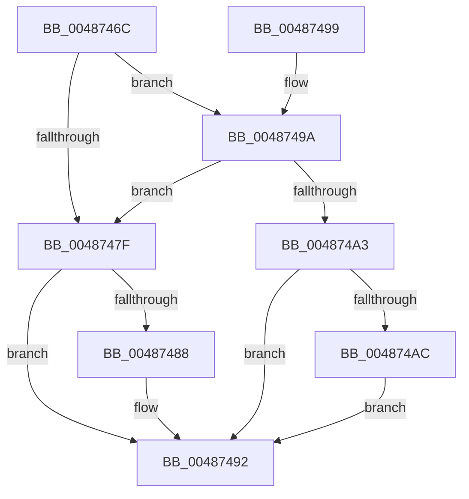

# HalpWheaGetBankFromMciStatusIndex

- RVA: `0x0048746C`–`0x004874B8` (길이 `76` bytes)
- VA: `0x000000014048746C`
- 실행 섹션: `.text`
- PDB 이름 있음: `예`; PDB Function 태그: `아니요`
- unwind 정보 RVA: `0x0005FA94`
- 디코드: `21`개 명령, `76/76` bytes 표시
- 미해석 바이트: `0` (있으면 어셈블리에 `.byte`로 보존)

> 이 문서는 커널 이미지의 기계어와 PDB 기호를 분석해 생성했습니다. 4번과 5번은 함수 원형과 자료형을 바이너리 사용 방식에서 추정한 C 해석이며 원본 소스 복구 결과는 아닙니다.

## 1. Dependencies

- 직접 호출 지점: **1**; 고유 호출 대상: **1**
- 직접 호출자로 확인된 함수: **1**
- RIP 상대 이미지 참조: **1**

### Outgoing calls
- `0x00487476` → [HalpGetCpuVendor](HalpGetCpuVendor_function_004879E4.md) (function, `0x004879E4`)

### Direct callers
- [HalpHvLpReadMcaStatusMsr](HalpHvLpReadMcaStatusMsr_function_004873C8.md) at `0x004873EE`

### Static image references
- `0x0048749A` → RVA `0x00E10258` (`.data`; read)

## 2. Other-region calls and transfers

- 다른 실행 섹션으로 향하는 call: **0**
- 별도 외부 분기/꼬리 이동을 확인하지 못했습니다.

## 3. Assembly (complete function range)

```asm
0048746C  48 83 EC 28                     sub rsp, 0x28
00487470  44 8B C1                        mov r8d, ecx
00487473  83 CA FF                        or edx, 0xffffffff
00487476  E8 69 05 00 00                  call 0x1404879e4
0048747B  3C 01                           cmp al, 1
0048747D  74 1B                           je 0x14048749a
0048747F  41 81 F8 01 04 00 00            cmp r8d, 0x401
00487486  72 0A                           jb 0x140487492
00487488  41 8D 90 FF FB FF FF            lea edx, [r8 - 0x401]
0048748F  C1 EA 02                        shr edx, 2
00487492  8B C2                           mov eax, edx
00487494  48 83 C4 28                     add rsp, 0x28
00487498  C3                              ret
00487499  CC                              int3
0048749A  80 3D B7 8D 98 00 00            cmp byte ptr [rip + 0x988db7], 0
004874A1  74 DC                           je 0x14048747f
004874A3  41 81 F8 00 20 00 C0            cmp r8d, 0xc0002000
004874AA  72 E6                           jb 0x140487492
004874AC  41 8D 90 00 E0 FF 3F            lea edx, [r8 + 0x3fffe000]
004874B3  C1 EA 04                        shr edx, 4
004874B6  EB DA                           jmp 0x140487492
```

## 4. C-style interpretation (structured pseudocode)

```c
__int64 __fastcall HalpWheaGetBankFromMciStatusIndex(int a1, int a2)
{
    __int64 result;
    __int64 v_rsp;

    v_rsp = (v_rsp) - (40);
    a2 = (unsigned int)((a2) | (0xFFFFFFFFULL));
    result = HalpGetCpuVendor(a1, a2, (unsigned int)(a1), a4);
    if (((unsigned __int8)(result)) == 1) goto loc_0048749A;
loc_0048747F:
    if (((unsigned int)((unsigned int)(a1))) >= 0x401ULL) {
        a2 = (unsigned int)(a1) - 1025;
        a2 = (unsigned int)((a2) >> (2));
    }
    v_rsp = (v_rsp) + (40);
    return (unsigned int)(a2);
loc_0048749A:
    if ((*(unsigned __int8 *)(v_rip + 9997751)) == 0) goto loc_0048747F;
    if (((unsigned int)((unsigned int)(a1))) < 0xC0002000ULL) goto loc_00487492;
    a2 = (unsigned int)(((unsigned int)(a1) + 1073733632) >> (4));
    goto loc_00487492;
}
```

## 5. (Beta) C Style

```c
int64_t HalpWheaGetBankFromMciStatusIndex(int32_t Arg1, int32_t Arg2)
{
    int64_t result;
    int64_t local_rsp;

    local_rsp = (local_rsp) - (40);
    Arg2 = (uint32_t)((Arg2) | (0xFFFFFFFFULL));
    result = HalpGetCpuVendor(Arg1, Arg2, (uint32_t)(Arg1), a4);
    if (((uint8_t)(result)) == 1) goto loc_0048749A;
loc_0048747F:
    if (((uint32_t)((uint32_t)(Arg1))) >= 0x401ULL) {
        Arg2 = (uint32_t)(Arg1) - 1025;
        Arg2 = (uint32_t)((Arg2) >> (2));
    }
    local_rsp = (local_rsp) + (40);
    return (uint32_t)(Arg2);
loc_0048749A:
    if ((*(uint8_t *)(v_rip + 0x988DB7)) == 0) goto loc_0048747F;
    if (((uint32_t)((uint32_t)(Arg1))) < 0xC0002000ULL) goto loc_00487492;
    Arg2 = (uint32_t)(((uint32_t)(Arg1) + 1073733632) >> (4));
    goto loc_00487492;
}
```

## 6. Execution-region graph

[열기: 2D/3D 그래프와 함수 탐색 컨트롤 패널](../../../control-panel.html?section=text&rva=0x0048746C&view=graph)

- 2D 그래프는 위에서 아래로 흐르고, 3D 그래프는 빈 공간을 드래그해 회전합니다. Shift+드래그는 이동, 휠은 확대·축소, 함수 노드 선택은 대상 보고서 이동입니다.

### Static fallback


