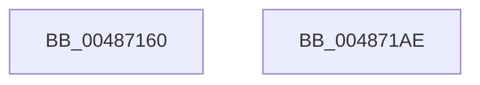

# HalpWheaInitProcessorGenericSection

- RVA: `0x00487160`–`0x004871AF` (길이 `79` bytes)
- VA: `0x0000000140487160`
- 실행 섹션: `.text`
- PDB 이름 있음: `예`; PDB Function 태그: `아니요`
- unwind 정보 RVA: `0x0005CAAC`
- 디코드: `20`개 명령, `79/79` bytes 표시
- 미해석 바이트: `0` (있으면 어셈블리에 `.byte`로 보존)

> 이 문서는 커널 이미지의 기계어와 PDB 기호를 분석해 생성했습니다. 4번과 5번은 함수 원형과 자료형을 바이너리 사용 방식에서 추정한 C 해석이며 원본 소스 복구 결과는 아닙니다.

## 1. Dependencies

- 직접 호출 지점: **2**; 고유 호출 대상: **2**
- 직접 호출자로 확인된 함수: **0**
- RIP 상대 이미지 참조: **1**

### Outgoing calls
- `0x00487176` → [memset](../6C/memset_function_006C6C40.md) (function, `0x006C6C40`)
- `0x0048719E` → [HaliWheaInitProcessorGenericSection](HaliWheaInitProcessorGenericSection_function_004871B8.md) (function, `0x004871B8`)

### Direct callers
- 이 함수 시작 RVA로 연결되는 직접 call은 확인되지 않았습니다. 간접 호출은 완전히 역산할 수 없습니다.

### Static image references
- `0x0048717B` → RVA `0x0001A5B0` (`.rdata`; read)

## 2. Other-region calls and transfers

- 다른 실행 섹션으로 향하는 call: **0**
- 별도 외부 분기/꼬리 이동을 확인하지 못했습니다.

## 3. Assembly (complete function range)

```asm
00487160  48 89 5C 24 08                  mov qword ptr [rsp + 8], rbx
00487165  57                              push rdi
00487166  48 83 EC 20                     sub rsp, 0x20
0048716A  48 8B FA                        mov rdi, rdx
0048716D  48 8B D9                        mov rbx, rcx
00487170  33 D2                           xor edx, edx
00487172  44 8D 42 48                     lea r8d, [rdx + 0x48]
00487176  E8 C5 FA 23 00                  call 0x1406c6c40
0048717B  0F 10 05 2E 34 B9 FF            movups xmm0, xmmword ptr [rip - 0x46cbd2]
00487182  48 8B CF                        mov rcx, rdi
00487185  66 C7 43 08 00 03               mov word ptr [rbx + 8], 0x300
0048718B  C7 43 04 C0 00 00 00            mov dword ptr [rbx + 4], 0xc0
00487192  F3 0F 7F 43 10                  movdqu xmmword ptr [rbx + 0x10], xmm0
00487197  C7 43 30 03 00 00 00            mov dword ptr [rbx + 0x30], 3
0048719E  E8 15 00 00 00                  call 0x1404871b8
004871A3  48 8B 5C 24 30                  mov rbx, qword ptr [rsp + 0x30]
004871A8  48 83 C4 20                     add rsp, 0x20
004871AC  5F                              pop rdi
004871AD  C3                              ret
004871AE  CC                              int3
```

## 4. C-style interpretation (structured pseudocode)

```c
__int64 __fastcall HalpWheaInitProcessorGenericSection(__int64 a1, __int64 a2)
{
    __int64 result;
    __int64 v_rsp;
    unsigned __int64 v_stack_p8;

    v_stack_p8 = v_rbx;
    v_rsp = (v_rsp) - (32);
    a2 = 0;
    result = memset(a1, a2, a2 + 72, a4);
    *(unsigned __int16 *)(a1 + 8) = 768;
    *(unsigned int *)(a1 + 4) = 192;
    *(unsigned __int64 *)(a1 + 16) = v_xmm0;
    *(unsigned int *)(a1 + 48) = 3;
    result = HaliWheaInitProcessorGenericSection(0, a2, a2 + 72, a4);
    v_rsp = (v_rsp) + (32);
    return result;
}
```

## 5. (Beta) C Style

```c
int64_t HalpWheaInitProcessorGenericSection(void *Arg1, int64_t Arg2)
{
    uint8_t *arg1 = (uint8_t *)Arg1;

    int64_t result;
    int64_t local_rsp;
    uint64_t v_stack_p8;

    v_stack_p8 = local_rbx;
    local_rsp = (local_rsp) - (32);
    Arg2 = 0;
    result = memset(Arg1, Arg2, Arg2 + 72, a4);
    *(uint16_t *)(arg1 + 0x8) = 768;
    *(uint32_t *)(arg1 + 0x4) = 192;
    *(uint64_t *)(arg1 + 0x10) = v_xmm0;
    *(uint32_t *)(arg1 + 0x30) = 3;
    result = HaliWheaInitProcessorGenericSection(0, Arg2, Arg2 + 72, a4);
    local_rsp = (local_rsp) + (32);
    return result;
}
```

### 관측된 메모리 오프셋

구조체 형식이 확인되지 않은 접근은 인자 기준의 오프셋으로만 기록했습니다.

| 기준 인자 | 오프셋 표현 | 폭 (bit) | 접근 |
|---|---:|---:|---|
| `Arg1` | `+ 0x4` | `32` | `W` |
| `Arg1` | `+ 0x8` | `16` | `W` |
| `Arg1` | `+ 0x10` | `128` | `W` |
| `Arg1` | `+ 0x30` | `32` | `W` |

## 6. Execution-region graph

[열기: 2D/3D 그래프와 함수 탐색 컨트롤 패널](../../../control-panel.html?section=text&rva=0x00487160&view=graph)

- 2D 그래프는 위에서 아래로 흐르고, 3D 그래프는 빈 공간을 드래그해 회전합니다. Shift+드래그는 이동, 휠은 확대·축소, 함수 노드 선택은 대상 보고서 이동입니다.

### Static fallback


