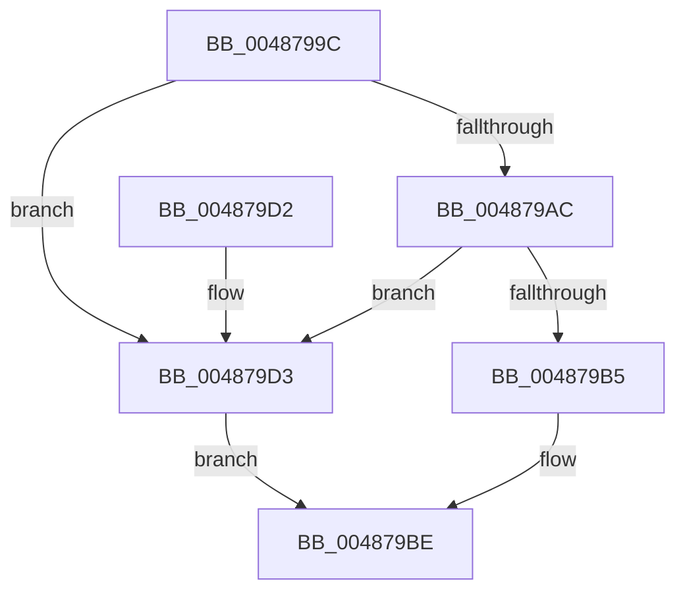

# HalpWheaReadMsrStatus

- RVA: `0x0048799C`–`0x004879DC` (길이 `64` bytes)
- VA: `0x000000014048799C`
- 실행 섹션: `.text`
- PDB 이름 있음: `예`; PDB Function 태그: `아니요`
- unwind 정보 RVA: `0x0006EDE0`
- 디코드: `17`개 명령, `64/64` bytes 표시
- 미해석 바이트: `0` (있으면 어셈블리에 `.byte`로 보존)

> 이 문서는 커널 이미지의 기계어와 PDB 기호를 분석해 생성했습니다. 4번과 5번은 함수 원형과 자료형을 바이너리 사용 방식에서 추정한 C 해석이며 원본 소스 복구 결과는 아닙니다.

## 1. Dependencies

- 직접 호출 지점: **2**; 고유 호출 대상: **2**
- 직접 호출자로 확인된 함수: **2**
- RIP 상대 이미지 참조: **2**

### Outgoing calls
- `0x004879A3` → [HalpGetCpuVendor](HalpGetCpuVendor_function_004879E4.md) (function, `0x004879E4`)
- `0x004879C8` → [guard_dispatch_icall](../6B/guard_dispatch_icall_function_006BAAD0.md) (function, `0x006BAAD0`)

### Direct callers
- [HalpMcaClearError](../54/HalpMcaClearError_function_00541478.md) at `0x005414AA`
- [HalpMcaReadError](../54/HalpMcaReadError_function_00541A2C.md) at `0x00541AF5`

### Static image references
- `0x004879AC` → RVA `0x00E10258` (`.data`; read)
- `0x004879BE` → RVA `0x00FC1990` (`.data`; read)

## 2. Other-region calls and transfers

- 다른 실행 섹션으로 향하는 call: **0**
- 별도 외부 분기/꼬리 이동을 확인하지 못했습니다.

## 3. Assembly (complete function range)

```asm
0048799C  48 83 EC 28                     sub rsp, 0x28
004879A0  4C 8B C9                        mov r9, rcx
004879A3  E8 3C 00 00 00                  call 0x1404879e4
004879A8  3C 01                           cmp al, 1
004879AA  75 27                           jne 0x1404879d3
004879AC  80 3D A5 88 98 00 00            cmp byte ptr [rip + 0x9888a5], 0
004879B3  74 1E                           je 0x1404879d3
004879B5  C1 E2 04                        shl edx, 4
004879B8  81 EA FF DF FF 3F               sub edx, 0x3fffdfff
004879BE  48 8B 05 CB 9F B3 00            mov rax, qword ptr [rip + 0xb39fcb]
004879C5  49 8B C9                        mov rcx, r9
004879C8  E8 03 31 23 00                  call 0x1406baad0
004879CD  48 83 C4 28                     add rsp, 0x28
004879D1  C3                              ret
004879D2  CC                              int3
004879D3  8D 14 95 01 04 00 00            lea edx, [rdx*4 + 0x401]
004879DA  EB E2                           jmp 0x1404879be
```

## 4. C-style interpretation (structured pseudocode)

```c
__int64 __fastcall HalpWheaReadMsrStatus(__int64 a1, int a2)
{
    __int64 result;
    __int64 v_rsp;

    v_rsp = (v_rsp) - (40);
    result = HalpGetCpuVendor(a1, a2, a3, a1);
    if (((unsigned __int8)(result)) != 1) goto loc_004879D3;
    if ((*(unsigned __int8 *)(v_rip + 9996453)) == 0) goto loc_004879D3;
    a2 = (unsigned int)((a2) << (4));
    a2 = (unsigned int)((a2) - (0x3FFFDFFFULL));
loc_004879BE:
    result = guard_dispatch_icall(a1, a2, a3, a1);
    v_rsp = (v_rsp) + (40);
    return result;
loc_004879D3:
    goto loc_004879BE;
}
```

## 5. (Beta) C Style

```c
int64_t HalpWheaReadMsrStatus(int64_t Arg1, int32_t Arg2)
{
    int64_t result;
    int64_t local_rsp;

    local_rsp = (local_rsp) - (40);
    result = HalpGetCpuVendor(Arg1, Arg2, a3, Arg1);
    if (((uint8_t)(result)) != 1) goto loc_004879D3;
    if ((*(uint8_t *)(v_rip + 0x9888A5)) == 0) goto loc_004879D3;
    Arg2 = (uint32_t)((Arg2) << (4));
    Arg2 = (uint32_t)((Arg2) - (0x3FFFDFFFULL));
loc_004879BE:
    result = guard_dispatch_icall(Arg1, Arg2, a3, Arg1);
    local_rsp = (local_rsp) + (40);
    return result;
loc_004879D3:
    goto loc_004879BE;
}
```

## 6. Execution-region graph

[열기: 2D/3D 그래프와 함수 탐색 컨트롤 패널](../../../control-panel.html?section=text&rva=0x0048799C&view=graph)

- 2D 그래프는 위에서 아래로 흐르고, 3D 그래프는 빈 공간을 드래그해 회전합니다. Shift+드래그는 이동, 휠은 확대·축소, 함수 노드 선택은 대상 보고서 이동입니다.

### Static fallback


