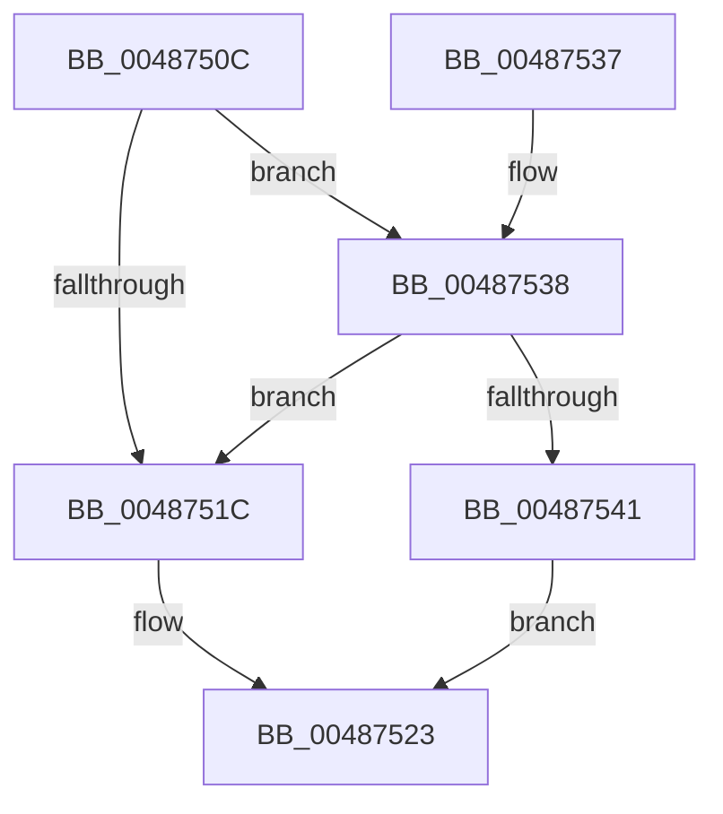

# HalpWheaWriteMsrControl

- RVA: `0x0048750C`–`0x0048754C` (길이 `64` bytes)
- VA: `0x000000014048750C`
- 실행 섹션: `.text`
- PDB 이름 있음: `예`; PDB Function 태그: `아니요`
- unwind 정보 RVA: `0x0008A618`
- 디코드: `17`개 명령, `64/64` bytes 표시
- 미해석 바이트: `0` (있으면 어셈블리에 `.byte`로 보존)

> 이 문서는 커널 이미지의 기계어와 PDB 기호를 분석해 생성했습니다. 4번과 5번은 함수 원형과 자료형을 바이너리 사용 방식에서 추정한 C 해석이며 원본 소스 복구 결과는 아닙니다.

## 1. Dependencies

- 직접 호출 지점: **2**; 고유 호출 대상: **2**
- 직접 호출자로 확인된 함수: **1**
- RIP 상대 이미지 참조: **2**

### Outgoing calls
- `0x00487513` → [HalpGetCpuVendor](HalpGetCpuVendor_function_004879E4.md) (function, `0x004879E4`)
- `0x0048752D` → [guard_dispatch_icall](../6B/guard_dispatch_icall_function_006BAAD0.md) (function, `0x006BAAD0`)

### Direct callers
- [HalpMcaSetProcessorConfig](../../pagelk/B7/HalpMcaSetProcessorConfig_function_00B7B418.md) at `0x00B7B4FC`

### Static image references
- `0x00487523` → RVA `0x00FC1980` (`.data`; read)
- `0x00487538` → RVA `0x00E10258` (`.data`; read)

## 2. Other-region calls and transfers

- 다른 실행 섹션으로 향하는 call: **0**
- 별도 외부 분기/꼬리 이동을 확인하지 못했습니다.

## 3. Assembly (complete function range)

```asm
0048750C  48 83 EC 28                     sub rsp, 0x28
00487510  4C 8B C9                        mov r9, rcx
00487513  E8 CC 04 00 00                  call 0x1404879e4
00487518  3C 01                           cmp al, 1
0048751A  74 1C                           je 0x140487538
0048751C  8D 14 95 00 04 00 00            lea edx, [rdx*4 + 0x400]
00487523  48 8B 05 56 A4 B3 00            mov rax, qword ptr [rip + 0xb3a456]
0048752A  49 8B C9                        mov rcx, r9
0048752D  E8 9E 35 23 00                  call 0x1406baad0
00487532  48 83 C4 28                     add rsp, 0x28
00487536  C3                              ret
00487537  CC                              int3
00487538  80 3D 19 8D 98 00 00            cmp byte ptr [rip + 0x988d19], 0
0048753F  74 DB                           je 0x14048751c
00487541  C1 E2 04                        shl edx, 4
00487544  81 EA 00 E0 FF 3F               sub edx, 0x3fffe000
0048754A  EB D7                           jmp 0x140487523
```

## 4. C-style interpretation (structured pseudocode)

```c
__int64 __fastcall HalpWheaWriteMsrControl(__int64 a1, __int64 a2)
{
    __int64 result;
    __int64 v_rsp;

    v_rsp = (v_rsp) - (40);
    result = HalpGetCpuVendor(a1, a2, a3, a1);
    if (((unsigned __int8)(result)) == 1) goto loc_00487538;
loc_0048751C:
loc_00487523:
    result = guard_dispatch_icall(a1, a2 * 4 + 1024, a3, a1);
    v_rsp = (v_rsp) + (40);
    return result;
loc_00487538:
    if ((*(unsigned __int8 *)(v_rip + 9997593)) == 0) goto loc_0048751C;
    a2 = (unsigned int)((a2 * 4 + 1024) << (4));
    a2 = (unsigned int)((a2) - (0x3FFFE000ULL));
    goto loc_00487523;
}
```

## 5. (Beta) C Style

```c
int64_t HalpWheaWriteMsrControl(int64_t Arg1, int64_t Arg2)
{
    int64_t result;
    int64_t local_rsp;

    local_rsp = (local_rsp) - (40);
    result = HalpGetCpuVendor(Arg1, Arg2, a3, Arg1);
    if (((uint8_t)(result)) == 1) goto loc_00487538;
loc_0048751C:
loc_00487523:
    result = guard_dispatch_icall(Arg1, Arg2 * 4 + 1024, a3, Arg1);
    local_rsp = (local_rsp) + (40);
    return result;
loc_00487538:
    if ((*(uint8_t *)(v_rip + 0x988D19)) == 0) goto loc_0048751C;
    Arg2 = (uint32_t)((Arg2 * 4 + 1024) << (4));
    Arg2 = (uint32_t)((Arg2) - (0x3FFFE000ULL));
    goto loc_00487523;
}
```

## 6. Execution-region graph

[열기: 2D/3D 그래프와 함수 탐색 컨트롤 패널](../../../control-panel.html?section=text&rva=0x0048750C&view=graph)

- 2D 그래프는 위에서 아래로 흐르고, 3D 그래프는 빈 공간을 드래그해 회전합니다. Shift+드래그는 이동, 휠은 확대·축소, 함수 노드 선택은 대상 보고서 이동입니다.

### Static fallback


