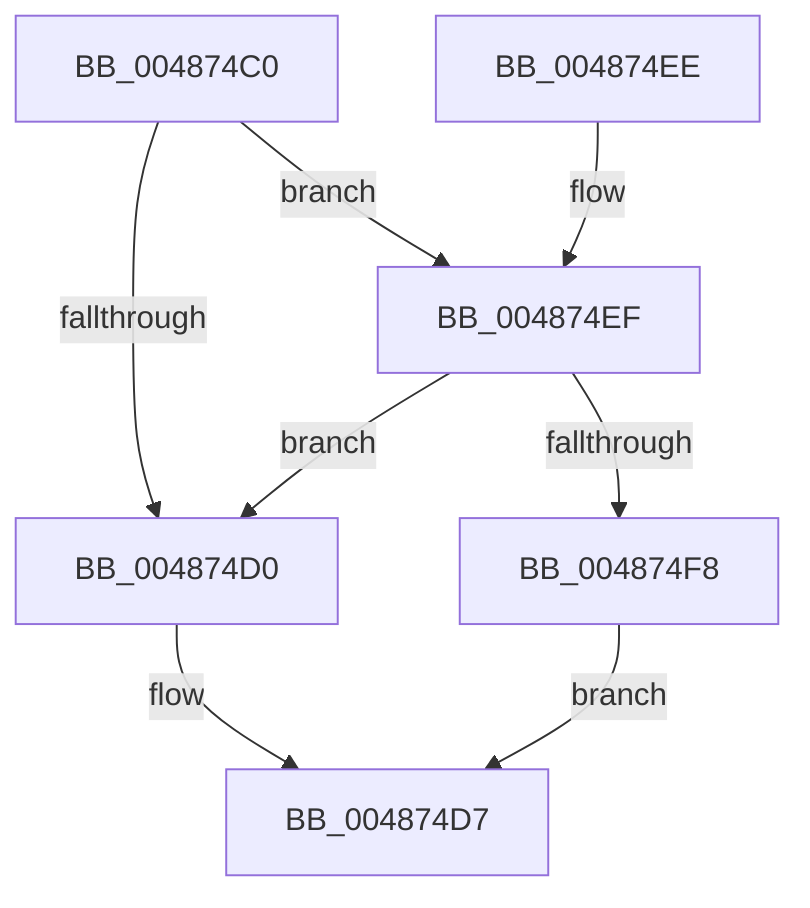

# HalpWheaWriteMsrStatus

- RVA: `0x004874C0`–`0x00487503` (길이 `67` bytes)
- VA: `0x00000001404874C0`
- 실행 섹션: `.text`
- PDB 이름 있음: `예`; PDB Function 태그: `아니요`
- unwind 정보 RVA: `0x0008A618`
- 디코드: `18`개 명령, `67/67` bytes 표시
- 미해석 바이트: `0` (있으면 어셈블리에 `.byte`로 보존)

> 이 문서는 커널 이미지의 기계어와 PDB 기호를 분석해 생성했습니다. 4번과 5번은 함수 원형과 자료형을 바이너리 사용 방식에서 추정한 C 해석이며 원본 소스 복구 결과는 아닙니다.

## 1. Dependencies

- 직접 호출 지점: **2**; 고유 호출 대상: **2**
- 직접 호출자로 확인된 함수: **3**
- RIP 상대 이미지 참조: **2**

### Outgoing calls
- `0x004874C7` → [HalpGetCpuVendor](HalpGetCpuVendor_function_004879E4.md) (function, `0x004879E4`)
- `0x004874E4` → [guard_dispatch_icall](../6B/guard_dispatch_icall_function_006BAAD0.md) (function, `0x006BAAD0`)

### Direct callers
- [HalpMcaClearError](../54/HalpMcaClearError_function_00541478.md) at `0x00541500`
- [HalpMcaReadErrorUncorrected](../54/HalpMcaReadErrorUncorrected_function_00545520.md) at `0x00545586`
- [HalpMcaSetProcessorConfig](../../pagelk/B7/HalpMcaSetProcessorConfig_function_00B7B418.md) at `0x00B7B4E7`

### Static image references
- `0x004874D7` → RVA `0x00FC1980` (`.data`; read)
- `0x004874EF` → RVA `0x00E10258` (`.data`; read)

## 2. Other-region calls and transfers

- 다른 실행 섹션으로 향하는 call: **0**
- 별도 외부 분기/꼬리 이동을 확인하지 못했습니다.

## 3. Assembly (complete function range)

```asm
004874C0  48 83 EC 28                     sub rsp, 0x28
004874C4  4C 8B C9                        mov r9, rcx
004874C7  E8 18 05 00 00                  call 0x1404879e4
004874CC  3C 01                           cmp al, 1
004874CE  74 1F                           je 0x1404874ef
004874D0  8D 14 95 01 04 00 00            lea edx, [rdx*4 + 0x401]
004874D7  48 8B 05 A2 A4 B3 00            mov rax, qword ptr [rip + 0xb3a4a2]
004874DE  45 33 C0                        xor r8d, r8d
004874E1  49 8B C9                        mov rcx, r9
004874E4  E8 E7 35 23 00                  call 0x1406baad0
004874E9  48 83 C4 28                     add rsp, 0x28
004874ED  C3                              ret
004874EE  CC                              int3
004874EF  80 3D 62 8D 98 00 00            cmp byte ptr [rip + 0x988d62], 0
004874F6  74 D8                           je 0x1404874d0
004874F8  C1 E2 04                        shl edx, 4
004874FB  81 EA FF DF FF 3F               sub edx, 0x3fffdfff
00487501  EB D4                           jmp 0x1404874d7
```

## 4. C-style interpretation (structured pseudocode)

```c
__int64 __fastcall HalpWheaWriteMsrStatus(__int64 a1, __int64 a2, int a3)
{
    __int64 result;
    __int64 v_rsp;

    v_rsp = (v_rsp) - (40);
    result = HalpGetCpuVendor(a1, a2, a3, a1);
    if (((unsigned __int8)(result)) == 1) goto loc_004874EF;
loc_004874D0:
loc_004874D7:
    a3 = 0;
    result = guard_dispatch_icall(a1, a2 * 4 + 1025, a3, a1);
    v_rsp = (v_rsp) + (40);
    return result;
loc_004874EF:
    if ((*(unsigned __int8 *)(v_rip + 9997666)) == 0) goto loc_004874D0;
    a2 = (unsigned int)((a2 * 4 + 1025) << (4));
    a2 = (unsigned int)((a2) - (0x3FFFDFFFULL));
    goto loc_004874D7;
}
```

## 5. (Beta) C Style

```c
int64_t HalpWheaWriteMsrStatus(int64_t Arg1, int64_t Arg2, int32_t Arg3)
{
    int64_t result;
    int64_t local_rsp;

    local_rsp = (local_rsp) - (40);
    result = HalpGetCpuVendor(Arg1, Arg2, Arg3, Arg1);
    if (((uint8_t)(result)) == 1) goto loc_004874EF;
loc_004874D0:
loc_004874D7:
    Arg3 = 0;
    result = guard_dispatch_icall(Arg1, Arg2 * 4 + 1025, Arg3, Arg1);
    local_rsp = (local_rsp) + (40);
    return result;
loc_004874EF:
    if ((*(uint8_t *)(v_rip + 0x988D62)) == 0) goto loc_004874D0;
    Arg2 = (uint32_t)((Arg2 * 4 + 1025) << (4));
    Arg2 = (uint32_t)((Arg2) - (0x3FFFDFFFULL));
    goto loc_004874D7;
}
```

## 6. Execution-region graph

[열기: 2D/3D 그래프와 함수 탐색 컨트롤 패널](../../../control-panel.html?section=text&rva=0x004874C0&view=graph)

- 2D 그래프는 위에서 아래로 흐르고, 3D 그래프는 빈 공간을 드래그해 회전합니다. Shift+드래그는 이동, 휠은 확대·축소, 함수 노드 선택은 대상 보고서 이동입니다.

### Static fallback


