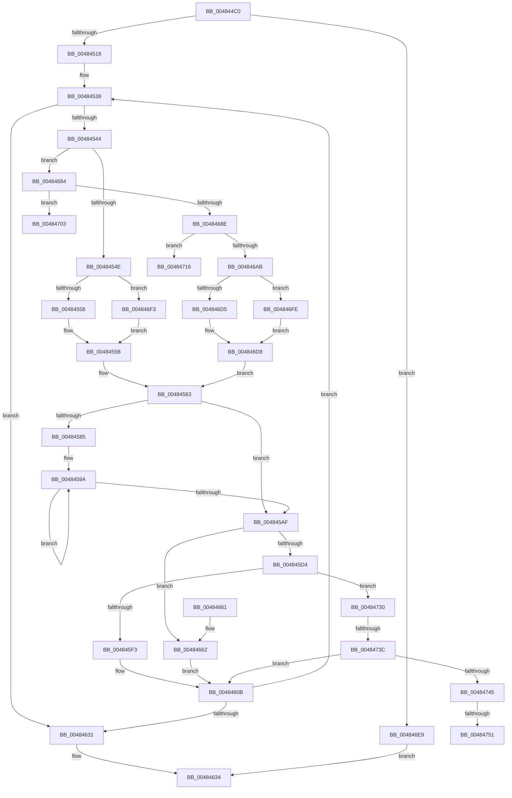

# HvlDmaUnmapDeviceSparsePages

- RVA: `0x004844C0`–`0x00484763` (길이 `675` bytes)
- VA: `0x00000001404844C0`
- 실행 섹션: `.text`
- PDB 이름 있음: `예`; PDB Function 태그: `예`
- unwind 정보 RVA: `0x000AF1E4`
- 디코드: `167`개 명령, `675/675` bytes 표시
- 미해석 바이트: `0` (있으면 어셈블리에 `.byte`로 보존)

> 이 문서는 커널 이미지의 기계어와 PDB 기호를 분석해 생성했습니다. 4번과 5번은 함수 원형과 자료형을 바이너리 사용 방식에서 추정한 C 해석이며 원본 소스 복구 결과는 아닙니다.

## 1. Dependencies

- 직접 호출 지점: **9**; 고유 호출 대상: **8**
- 직접 호출자로 확인된 함수: **0**
- RIP 상대 이미지 참조: **3**

### Outgoing calls
- `0x004845DA` → [HvcallInitiateHypercall](../31/HvcallInitiateHypercall_function_00313630.md) (function, `0x00313630`)
- `0x00484606` → [ExpInterlockedPushEntrySList](../6B/ExpInterlockedPushEntrySList_function_006BA5B0.md) (function, `0x006BA5B0`)
- `0x0048461C` → [HvlpHvToNtStatus](../30/HvlpHvToNtStatus_function_00307BD8.md) (function, `0x00307BD8`)
- `0x0048463B` → [_security_check_cookie](../6A/_security_check_cookie_function_006AC640.md) (function, `0x006AC640`)
- `0x00484676` → [HvcallFastExtended](../31/HvcallFastExtended_function_003130E0.md) (function, `0x003130E0`)
- `0x0048469E` → [ExpInterlockedPopEntrySList](../6B/ExpInterlockedPopEntrySList_function_006BA570.md) (function, `0x006BA570`)
- `0x0048470B` → [KeDisableInterrupts](../21/KeDisableInterrupts_function_00217BE0.md) (function, `0x00217BE0`)
- `0x0048471E` → [KeDisableInterrupts](../21/KeDisableInterrupts_function_00217BE0.md) (function, `0x00217BE0`)
- `0x00484758` → [KiLowerIrqlProcessIrqlFlags](../4F/KiLowerIrqlProcessIrqlFlags_function_004F5698.md) (function, `0x004F5698`)

### Direct callers
- 이 함수 시작 RVA로 연결되는 직접 call은 확인되지 않았습니다. 간접 호출은 완전히 역산할 수 없습니다.

### Static image references
- `0x004844E3` → RVA `0x00E0A740` (`.data`; read)
- `0x00484684` → RVA `0x00FC6A90` (`ALMOSTRO`; read)
- `0x00484745` → RVA `0x00FC6D20` (`ALMOSTRO`; read)

## 2. Other-region calls and transfers

- 다른 실행 섹션으로 향하는 call: **0**
- call이 아닌 외부 분기/꼬리 이동: **5**
  - `0x00484711` → [sub_006F5356](../6F/Unknown_function_006F5356.md) (`tail-transfer`)
  - `0x0048472B` → [sub_006F5356](../6F/Unknown_function_006F5356.md) (`tail-transfer`)
  - `0x00484736` → [sub_006F5356 + 0x30](../6F/Unknown_function_006F5356.md) (`tail-transfer`)
  - `0x0048474B` → [sub_006F5356 + 0x23](../6F/Unknown_function_006F5356.md) (`tail-transfer`)
  - `0x0048475E` → [sub_006F5356 + 0x23](../6F/Unknown_function_006F5356.md) (`tail-transfer`)

## 3. Assembly (complete function range)

```asm
004844C0  48 8B C4                        mov rax, rsp
004844C3  48 89 58 08                     mov qword ptr [rax + 8], rbx
004844C7  48 89 70 10                     mov qword ptr [rax + 0x10], rsi
004844CB  48 89 78 20                     mov qword ptr [rax + 0x20], rdi
004844CF  55                              push rbp
004844D0  41 54                           push r12
004844D2  41 55                           push r13
004844D4  41 56                           push r14
004844D6  41 57                           push r15
004844D8  48 8D 68 A1                     lea rbp, [rax - 0x5f]
004844DC  48 81 EC F0 00 00 00            sub rsp, 0xf0
004844E3  48 8B 05 56 62 98 00            mov rax, qword ptr [rip + 0x986256]
004844EA  48 33 C4                        xor rax, rsp
004844ED  48 89 45 27                     mov qword ptr [rbp + 0x27], rax
004844F1  80 79 04 00                     cmp byte ptr [rcx + 4], 0
004844F5  0F 57 C0                        xorps xmm0, xmm0
004844F8  0F 11 44 24 38                  movups xmmword ptr [rsp + 0x38], xmm0
004844FD  4D 8B F0                        mov r14, r8
00484500  4C 8B DA                        mov r11, rdx
00484503  0F 11 45 8F                     movups xmmword ptr [rbp - 0x71], xmm0
00484507  48 89 55 A7                     mov qword ptr [rbp - 0x59], rdx
0048450B  4C 8B D1                        mov r10, rcx
0048450E  48 89 4D 9F                     mov qword ptr [rbp - 0x61], rcx
00484512  0F 85 D1 01 00 00               jne 0x1404846e9
00484518  48 8B 7D 97                     mov rdi, qword ptr [rbp - 0x69]
0048451C  33 C0                           xor eax, eax
0048451E  40 8A 75 87                     mov sil, byte ptr [rbp - 0x79]
00484522  45 33 E4                        xor r12d, r12d
00484525  48 C7 44 24 30 C8 00 00 00      mov qword ptr [rsp + 0x30], 0xc8
0048452E  44 8B 6C 24 34                  mov r13d, dword ptr [rsp + 0x34]
00484533  44 8B 7C 24 30                  mov r15d, dword ptr [rsp + 0x30]
00484538  49 8B 16                        mov rdx, qword ptr [r14]
0048453B  48 85 D2                        test rdx, rdx
0048453E  0F 84 ED 00 00 00               je 0x140484631
00484544  48 83 FA 0B                     cmp rdx, 0xb
00484548  0F 87 36 01 00 00               ja 0x140484684
0048454E  48 8D 4D B7                     lea rcx, [rbp - 0x49]
00484552  0F 83 9B 01 00 00               jae 0x1404846f3
00484558  44 8B C2                        mov r8d, edx
0048455B  41 B1 01                        mov r9b, 1
0048455E  41 0F BA EF 10                  bts r15d, 0x10
00484563  48 83 61 08 00                  and qword ptr [rcx + 8], 0
00484568  48 83 61 10 00                  and qword ptr [rcx + 0x10], 0
0048456D  48 83 09 FF                     or qword ptr [rcx], 0xffffffffffffffff
00484571  83 61 10 F0                     and dword ptr [rcx + 0x10], 0xfffffff0
00484575  41 8B 02                        mov eax, dword ptr [r10]
00484578  44 89 7C 24 30                  mov dword ptr [rsp + 0x30], r15d
0048457D  89 41 14                        mov dword ptr [rcx + 0x14], eax
00484580  45 85 C0                        test r8d, r8d
00484583  74 2A                           je 0x1404845af
00484585  4E 8D 14 E5 E8 FF FF FF         lea r10, [r12*8 - 0x18]
0048458D  4C 2B D1                        sub r10, rcx
00484590  48 8D 51 18                     lea rdx, [rcx + 0x18]
00484594  4D 03 D3                        add r10, r11
00484597  41 8B C8                        mov ecx, r8d
0048459A  49 8B 04 12                     mov rax, qword ptr [r10 + rdx]
0048459E  48 C1 E0 0C                     shl rax, 0xc
004845A2  48 89 02                        mov qword ptr [rdx], rax
004845A5  48 8D 52 08                     lea rdx, [rdx + 8]
004845A9  48 83 E9 01                     sub rcx, 1
004845AD  75 EB                           jne 0x14048459a
004845AF  41 81 E5 00 F0 FF FF            and r13d, 0xfffff000
004845B6  41 8B C0                        mov eax, r8d
004845B9  25 FF 0F 00 00                  and eax, 0xfff
004845BE  44 0B E8                        or r13d, eax
004845C1  44 89 6C 24 34                  mov dword ptr [rsp + 0x34], r13d
004845C6  48 8B 4C 24 30                  mov rcx, qword ptr [rsp + 0x30]
004845CB  45 84 C9                        test r9b, r9b
004845CE  0F 85 8E 00 00 00               jne 0x140484662
004845D4  45 33 C0                        xor r8d, r8d
004845D7  48 8B D7                        mov rdx, rdi
004845DA  E8 51 F0 E8 FF                  call 0x140313630
004845DF  48 8B D8                        mov rbx, rax
004845E2  48 89 45 AF                     mov qword ptr [rbp - 0x51], rax
004845E6  33 C0                           xor eax, eax
004845E8  F6 44 24 38 01                  test byte ptr [rsp + 0x38], 1
004845ED  0F 84 3D 01 00 00               je 0x140484730
004845F3  48 8B 55 8F                     mov rdx, qword ptr [rbp - 0x71]
004845F7  48 8B 4D 87                     mov rcx, qword ptr [rbp - 0x79]
004845FB  48 81 C1 C0 8B 00 00            add rcx, 0x8bc0
00484602  48 89 7A 10                     mov qword ptr [rdx + 0x10], rdi
00484606  E8 A5 5F 23 00                  call 0x1406ba5b0
0048460B  8B 45 B3                        mov eax, dword ptr [rbp - 0x4d]
0048460E  0F B7 CB                        movzx ecx, bx
00484611  25 FF 0F 00 00                  and eax, 0xfff
00484616  49 29 06                        sub qword ptr [r14], rax
00484619  4C 03 E0                        add r12, rax
0048461C  E8 B7 35 E8 FF                  call 0x140307bd8
00484621  4C 8B 55 9F                     mov r10, qword ptr [rbp - 0x61]
00484625  4C 8B 5D A7                     mov r11, qword ptr [rbp - 0x59]
00484629  85 C0                           test eax, eax
0048462B  0F 89 07 FF FF FF               jns 0x140484538
00484631  4D 89 26                        mov qword ptr [r14], r12
00484634  48 8B 4D 27                     mov rcx, qword ptr [rbp + 0x27]
00484638  48 33 CC                        xor rcx, rsp
0048463B  E8 00 80 22 00                  call 0x1406ac640
00484640  4C 8D 9C 24 F0 00 00 00         lea r11, [rsp + 0xf0]
00484648  49 8B 5B 30                     mov rbx, qword ptr [r11 + 0x30]
0048464C  49 8B 73 38                     mov rsi, qword ptr [r11 + 0x38]
00484650  49 8B 7B 48                     mov rdi, qword ptr [r11 + 0x48]
00484654  49 8B E3                        mov rsp, r11
00484657  41 5F                           pop r15
00484659  41 5E                           pop r14
0048465B  41 5D                           pop r13
0048465D  41 5C                           pop r12
0048465F  5D                              pop rbp
00484660  C3                              ret
00484661  CC                              int3
00484662  83 64 24 20 00                  and dword ptr [rsp + 0x20], 0
00484667  46 8D 04 C5 18 00 00 00         lea r8d, [r8*8 + 0x18]
0048466F  45 33 C9                        xor r9d, r9d
00484672  48 8D 55 B7                     lea rdx, [rbp - 0x49]
00484676  E8 65 EA E8 FF                  call 0x1403130e0
0048467B  48 8B D8                        mov rbx, rax
0048467E  48 89 45 AF                     mov qword ptr [rbp - 0x51], rax
00484682  EB 87                           jmp 0x14048460b
00484684  8B 05 06 24 B4 00               mov eax, dword ptr [rip + 0xb42406]
0048468A  A8 08                           test al, 8
0048468C  74 75                           je 0x140484703
0048468E  65 48 8B 1C 25 20 00 00 00      mov rbx, qword ptr gs:[0x20]
00484697  48 8D 8B C0 8B 00 00            lea rcx, [rbx + 0x8bc0]
0048469E  E8 CD 5E 23 00                  call 0x1406ba570
004846A3  48 8B C8                        mov rcx, rax
004846A6  48 85 C0                        test rax, rax
004846A9  74 6B                           je 0x140484716
004846AB  48 8B 78 10                     mov rdi, qword ptr [rax + 0x10]
004846AF  4C 8B 55 9F                     mov r10, qword ptr [rbp - 0x61]
004846B3  4C 8B 5D A7                     mov r11, qword ptr [rbp - 0x59]
004846B7  C7 44 24 38 01 00 00 00         mov dword ptr [rsp + 0x38], 1
004846BF  48 89 5D 87                     mov qword ptr [rbp - 0x79], rbx
004846C3  48 89 45 8F                     mov qword ptr [rbp - 0x71], rax
004846C7  B8 FD 01 00 00                  mov eax, 0x1fd
004846CC  48 89 7D 97                     mov qword ptr [rbp - 0x69], rdi
004846D0  49 39 06                        cmp qword ptr [r14], rax
004846D3  73 29                           jae 0x1404846fe
004846D5  45 8B 06                        mov r8d, dword ptr [r14]
004846D8  48 8B 75 87                     mov rsi, qword ptr [rbp - 0x79]
004846DC  45 32 C9                        xor r9b, r9b
004846DF  41 0F BA F7 10                  btr r15d, 0x10
004846E4  E9 7A FE FF FF                  jmp 0x140484563
004846E9  B8 BB 00 00 C0                  mov eax, 0xc00000bb
004846EE  E9 41 FF FF FF                  jmp 0x140484634
004846F3  41 B8 0B 00 00 00               mov r8d, 0xb
004846F9  E9 5D FE FF FF                  jmp 0x14048455b
004846FE  44 8B C0                        mov r8d, eax
00484701  EB D5                           jmp 0x1404846d8
00484703  C7 44 24 38 04 00 00 00         mov dword ptr [rsp + 0x38], 4
0048470B  E8 D0 34 D9 FF                  call 0x140217be0
00484710  90                              nop
00484711  E9 40 0C 27 00                  jmp 0x1406f5356
00484716  C7 44 24 38 04 00 00 00         mov dword ptr [rsp + 0x38], 4
0048471E  E8 BD 34 D9 FF                  call 0x140217be0
00484723  4C 8B 55 9F                     mov r10, qword ptr [rbp - 0x61]
00484727  4C 8B 5D A7                     mov r11, qword ptr [rbp - 0x59]
0048472B  E9 26 0C 27 00                  jmp 0x1406f5356
00484730  B2 02                           mov dl, 2
00484732  84 54 24 38                     test byte ptr [rsp + 0x38], dl
00484736  0F 84 4A 0C 27 00               je 0x1406f5386
0048473C  40 3A F2                        cmp sil, dl
0048473F  0F 83 C6 FE FF FF               jae 0x14048460b
00484745  39 05 D5 25 B4 00               cmp dword ptr [rip + 0xb425d5], eax
0048474B  0F 84 28 0C 27 00               je 0x1406f5379
00484751  44 0F 20 C1                     mov rcx, cr8
00484755  40 8A D6                        mov dl, sil
00484758  E8 3B 0F 07 00                  call 0x1404f5698
0048475D  90                              nop
0048475E  E9 16 0C 27 00                  jmp 0x1406f5379
```

## 4. C-style interpretation (structured pseudocode)

```c
__int64 __fastcall HvlDmaUnmapDeviceSparsePages(__int64 a1, __int64 a2, __int64 a3)
{
    __int64 result;
    __int64 v_r10;
    __int64 v_r12;
    __int64 v_r13;
    __int64 v_rsp;
    unsigned __int64 v_stack_m28;
    unsigned int v_stack_mB8;
    unsigned int v_stack_mD0;
    unsigned __int64 v_stack_mE0;
    unsigned int v_stack_mE4;
    unsigned __int64 v_stack_mE8;

    *(unsigned __int64 *)(v_rsp + 8) = v_rbx;
    *(unsigned __int64 *)(v_rsp + 16) = v_rsi;
    *(unsigned __int64 *)(v_rsp + 32) = v_rdi;
    v_rsp = (v_rsp) - (240);
    result = (*(unsigned __int64 *)(v_rip + 9986646)) ^ (v_rsp);
    *(unsigned __int64 *)(v_rsp - 95 + 39) = result;
    v_stack_mE0 = v_xmm0;
    *(unsigned __int64 *)(v_rsp - 95 - 113) = v_xmm0;
    *(unsigned __int64 *)(v_rsp - 95 - 89) = a2;
    *(unsigned __int64 *)(v_rsp - 95 - 97) = a1;
    if ((*(unsigned __int8 *)(a1 + 4)) != 0) goto loc_004846E9;
    result = 0;
    v_r12 = 0;
    v_stack_mE8 = 200;
loc_00484538:
    if (*(unsigned __int64 *)(a3) == 0) goto loc_00484631;
    if ((*(unsigned __int64 *)(a3)) > 11) goto loc_00484684;
    if ((*(unsigned __int64 *)(a3)) >= 11) goto loc_004846F3;
loc_0048455B:
loc_00484563:
    v_stack_mE8 = (unsigned int)((unsigned int)(v_stack_mE8));
    *(unsigned int *)(v_rsp - 95 - 73 + 20) = (unsigned int)((unsigned int)(*(unsigned int *)(a1)));
    if ((unsigned int)((unsigned int)((unsigned int)(*(unsigned __int64 *)(a3)))) == 0) goto loc_004845AF;
    v_r10 = (v_r12 * 8 - 24) - (v_rsp - 95 - 73);
    v_r10 = (v_r10) + (a2);
loc_0048459A:
    result = (*(unsigned __int64 *)(v_r10 + v_rsp - 95 - 73 + 24 * 1)) << (12);
    *(unsigned __int64 *)(v_rsp - 95 - 73 + 24) = result;
    a1 = ((unsigned int)((unsigned int)((unsigned int)((unsigned int)(*(unsigned __int64 *)(a3)))))) - (1);
    if (condition_is_not_equal) goto loc_0048459A;
loc_004845AF:
    v_r13 = (unsigned int)(((unsigned int)(v_stack_mE4)) & (0xFFFFF000ULL));
    result = (unsigned int)(((unsigned int)((unsigned int)((unsigned int)((unsigned int)(*(unsigned __int64 *)(a3)))))) & (0xFFFULL));
    v_r13 = (unsigned int)((v_r13) | ((unsigned int)(result)));
    v_stack_mE4 = (unsigned int)(v_r13);
    if (1 != 0) goto loc_00484662;
    a3 = 0;
    result = HvcallInitiateHypercall(v_stack_mE8, *(unsigned __int64 *)(v_rsp - 95 - 105), a3, 1);
    *(unsigned __int64 *)(v_rsp - 95 - 81) = result;
    result = 0;
    if (((v_stack_mE0) & (1)) == 0) goto loc_00484730;
    a1 = (*(unsigned __int64 *)(v_rsp - 95 - 121)) + (0x8BC0ULL);
    *(unsigned __int64 *)(*(unsigned __int64 *)(v_rsp - 95 - 113) + 16) = *(unsigned __int64 *)(v_rsp - 95 - 105);
    result = ExpInterlockedPushEntrySList(a1, *(unsigned __int64 *)(v_rsp - 95 - 113), a3, 1);
loc_0048460B:
    result = (unsigned int)(((unsigned int)(*(unsigned int *)(v_rsp - 95 - 77))) & (0xFFFULL));
    v_r12 = (v_r12) + (result);
    result = HvlpHvToNtStatus((unsigned __int16)(result), *(unsigned __int64 *)(v_rsp - 95 - 113), a3, 1);
    if (!sign_flag) goto loc_00484538;
loc_00484631:
    *(unsigned __int64 *)(a3) = v_r12;
loc_00484634:
    a1 = (*(unsigned __int64 *)(v_rsp - 95 + 39)) ^ (v_rsp);
    result = _security_check_cookie(a1, *(unsigned __int64 *)(v_rsp - 95 - 113), a3, 1);
    return result;
loc_00484662:
    a4 = 0;
    result = HvcallFastExtended(a1, v_rsp - 95 - 73, a3 * 8 + 24, a4);
    *(unsigned __int64 *)(v_rsp - 95 - 81) = result;
    goto loc_0048460B;
loc_00484684:
    if ((((unsigned __int8)((unsigned int)(*(unsigned int *)(v_rip + 11805702)))) & (8)) == 0) goto loc_00484703;
    result = ExpInterlockedPopEntrySList(*(unsigned __int64 *)(gs_base + (0 + 32)) + 35776, v_rsp - 95 - 73, a3 * 8 + 24, a4);
    if (result == 0) goto loc_00484716;
    v_stack_mB8 = 1;
    *(unsigned __int64 *)(v_rsp - 95 - 121) = *(unsigned __int64 *)(gs_base + (0 + 32));
    *(unsigned __int64 *)(v_rsp - 95 - 113) = result;
    *(unsigned __int64 *)(v_rsp - 95 - 105) = *(unsigned __int64 *)(result + 16);
    if ((*(unsigned __int64 *)(a3)) >= 509) goto loc_004846FE;
loc_004846D8:
    a4 = 0;
    goto loc_00484563;
loc_004846E9:
    goto loc_00484634;
loc_004846F3:
    goto loc_0048455B;
loc_004846FE:
    goto loc_004846D8;
loc_00484703:
    v_stack_mB8 = 4;
    result = KeDisableInterrupts(result, v_rsp - 95 - 73, (unsigned int)((unsigned int)((unsigned int)(0xC00000BBULL))), a4);
loc_00484716:
    v_stack_mB8 = 4;
    result = KeDisableInterrupts(result, v_rsp - 95 - 73, (unsigned int)((unsigned int)((unsigned int)(0xC00000BBULL))), a4);
loc_00484730:
    if (((unsigned __int8)(*(unsigned __int64 *)(v_rsp - 95 - 121))) >= 2) goto loc_0048460B;
    result = KiLowerIrqlProcessIrqlFlags(v_cr8, (unsigned __int8)(*(unsigned __int64 *)(v_rsp - 95 - 121)), (unsigned int)((unsigned int)((unsigned int)(0xC00000BBULL))), a4);
}
```

## 5. (Beta) C Style

```c
int64_t HvlDmaUnmapDeviceSparsePages(void *Arg1, int64_t Arg2, void *Arg3)
{
    uint8_t *arg1 = (uint8_t *)Arg1;
    uint8_t *arg3 = (uint8_t *)Arg3;

    int64_t result;
    int64_t local_r10;
    int64_t local_r12;
    int64_t local_r13;
    int64_t local_rsp;
    uint64_t v_stack_m28;
    uint32_t v_stack_mB8;
    uint32_t v_stack_mD0;
    uint64_t v_stack_mE0;
    uint32_t v_stack_mE4;
    uint64_t v_stack_mE8;

    *(uint64_t *)(local_rsp + 0x8) = local_rbx;
    *(uint64_t *)(local_rsp + 0x10) = local_rsi;
    *(uint64_t *)(local_rsp + 0x20) = local_rdi;
    local_rsp = (local_rsp) - (240);
    result = (*(uint64_t *)(v_rip + 0x986256)) ^ (local_rsp);
    *(uint64_t *)(local_rsp - 0x5F + 0x27) = result;
    v_stack_mE0 = v_xmm0;
    *(uint64_t *)(local_rsp - 0x5F - 0x71) = v_xmm0;
    *(uint64_t *)(local_rsp - 0x5F - 0x59) = Arg2;
    *(void **)(local_rsp - 0x5F - 0x61) = Arg1;
    if ((*(uint8_t *)(arg1 + 0x4)) != 0) goto loc_004846E9;
    result = 0;
    local_r12 = 0;
    v_stack_mE8 = 200;
loc_00484538:
    if (*(uint64_t *)(arg3) == 0) goto loc_00484631;
    if ((*(uint64_t *)(arg3)) > 11) goto loc_00484684;
    if ((*(uint64_t *)(arg3)) >= 11) goto loc_004846F3;
loc_0048455B:
loc_00484563:
    v_stack_mE8 = (uint32_t)((uint32_t)(v_stack_mE8));
    *(uint32_t *)(local_rsp - 0x5F - 0x49 + 0x14) = (uint32_t)((uint32_t)(*(uint32_t *)(arg1)));
    if ((uint32_t)((uint32_t)((uint32_t)(*(uint64_t *)(arg3)))) == 0) goto loc_004845AF;
    local_r10 = (local_r12 * 8 - 24) - (local_rsp - 95 - 73);
    local_r10 = (local_r10) + (Arg2);
loc_0048459A:
    result = (*(uint64_t *)(local_r10 + local_rsp - 0x5F - 0x49 + 0x18 * 1)) << (12);
    *(uint64_t *)(local_rsp - 0x5F - 0x49 + 0x18) = result;
    Arg1 = ((uint32_t)((uint32_t)((uint32_t)((uint32_t)(*(uint64_t *)(arg3)))))) - (1);
    if (condition_is_not_equal) goto loc_0048459A;
loc_004845AF:
    local_r13 = (uint32_t)(((uint32_t)(v_stack_mE4)) & (0xFFFFF000ULL));
    result = (uint32_t)(((uint32_t)((uint32_t)((uint32_t)((uint32_t)(*(uint64_t *)(arg3)))))) & (0xFFFULL));
    local_r13 = (uint32_t)((local_r13) | ((uint32_t)(result)));
    v_stack_mE4 = (uint32_t)(local_r13);
    if (1 != 0) goto loc_00484662;
    Arg3 = 0;
    result = HvcallInitiateHypercall(v_stack_mE8, *(uint64_t *)(local_rsp - 0x5F - 0x69), Arg3, 1);
    *(uint64_t *)(local_rsp - 0x5F - 0x51) = result;
    result = 0;
    if (((v_stack_mE0) & (1)) == 0) goto loc_00484730;
    Arg1 = (*(uint64_t *)(local_rsp - 0x5F - 0x79)) + (0x8BC0ULL);
    *(uint64_t *)(*(uint64_t *)(local_rsp - 0x5F - 0x71) + 0x10) = *(uint64_t *)(local_rsp - 0x5F - 0x69);
    result = ExpInterlockedPushEntrySList(Arg1, *(uint64_t *)(local_rsp - 0x5F - 0x71), Arg3, 1);
loc_0048460B:
    result = (uint32_t)(((uint32_t)(*(uint32_t *)(local_rsp - 0x5F - 0x4D))) & (0xFFFULL));
    local_r12 = (local_r12) + (result);
    result = HvlpHvToNtStatus((uint16_t)(result), *(uint64_t *)(local_rsp - 0x5F - 0x71), Arg3, 1);
    if (!sign_flag) goto loc_00484538;
loc_00484631:
    *(uint64_t *)(arg3) = local_r12;
loc_00484634:
    Arg1 = (*(uint64_t *)(local_rsp - 0x5F + 0x27)) ^ (local_rsp);
    result = _security_check_cookie(Arg1, *(uint64_t *)(local_rsp - 0x5F - 0x71), Arg3, 1);
    return result;
loc_00484662:
    a4 = 0;
    result = HvcallFastExtended(Arg1, local_rsp - 95 - 73, Arg3 * 8 + 24, a4);
    *(uint64_t *)(local_rsp - 0x5F - 0x51) = result;
    goto loc_0048460B;
loc_00484684:
    if ((((uint8_t)((uint32_t)(*(uint32_t *)(v_rip + 0xB42406)))) & (8)) == 0) goto loc_00484703;
    result = ExpInterlockedPopEntrySList(*(uint64_t *)(gs_base + (0 + 0x20)) + 35776, local_rsp - 95 - 73, Arg3 * 8 + 24, a4);
    if (result == 0) goto loc_00484716;
    v_stack_mB8 = 1;
    *(uint64_t *)(local_rsp - 0x5F - 0x79) = *(uint64_t *)(gs_base + (0 + 0x20));
    *(uint64_t *)(local_rsp - 0x5F - 0x71) = result;
    *(uint64_t *)(local_rsp - 0x5F - 0x69) = *(uint64_t *)(result + 0x10);
    if ((*(uint64_t *)(arg3)) >= 509) goto loc_004846FE;
loc_004846D8:
    a4 = 0;
    goto loc_00484563;
loc_004846E9:
    goto loc_00484634;
loc_004846F3:
    goto loc_0048455B;
loc_004846FE:
    goto loc_004846D8;
loc_00484703:
    v_stack_mB8 = 4;
    result = KeDisableInterrupts(result, local_rsp - 95 - 73, (uint32_t)((uint32_t)((uint32_t)(0xC00000BBULL))), a4);
loc_00484716:
    v_stack_mB8 = 4;
    result = KeDisableInterrupts(result, local_rsp - 95 - 73, (uint32_t)((uint32_t)((uint32_t)(0xC00000BBULL))), a4);
loc_00484730:
    if (((uint8_t)(*(uint64_t *)(local_rsp - 0x5F - 0x79))) >= 2) goto loc_0048460B;
    result = KiLowerIrqlProcessIrqlFlags(v_cr8, (uint8_t)(*(uint64_t *)(local_rsp - 0x5F - 0x79)), (uint32_t)((uint32_t)((uint32_t)(0xC00000BBULL))), a4);
}
```

### 관측된 메모리 오프셋

구조체 형식이 확인되지 않은 접근은 인자 기준의 오프셋으로만 기록했습니다.

| 기준 인자 | 오프셋 표현 | 폭 (bit) | 접근 |
|---|---:|---:|---|
| `Arg1` | `+ 0x4` | `8` | `R` |
| `Arg3` | `+ 0x0` | `32` | `R` |
| `Arg3` | `+ 0x0` | `64` | `R` |
| `Arg3` | `+ 0x0` | `64` | `R/W` |
| `Arg3` | `+ 0x0` | `64` | `W` |

## 6. Execution-region graph

[열기: 2D/3D 그래프와 함수 탐색 컨트롤 패널](../../../control-panel.html?section=text&rva=0x004844C0&view=graph)

- 2D 그래프는 위에서 아래로 흐르고, 3D 그래프는 빈 공간을 드래그해 회전합니다. Shift+드래그는 이동, 휠은 확대·축소, 함수 노드 선택은 대상 보고서 이동입니다.

### Static fallback


