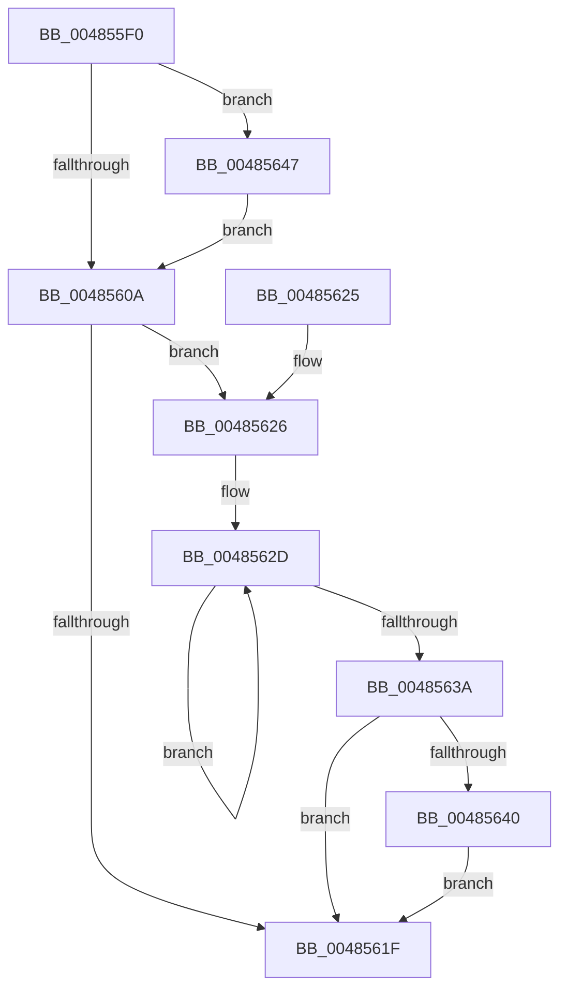

# HvlPerformEndOfInterrupt

- RVA: `0x004855F0`–`0x00485650` (길이 `96` bytes)
- VA: `0x00000001404855F0`
- 실행 섹션: `.text`
- PDB 이름 있음: `예`; PDB Function 태그: `아니요`
- unwind 정보 RVA: `0x000AF520`
- 디코드: `27`개 명령, `96/96` bytes 표시
- 미해석 바이트: `0` (있으면 어셈블리에 `.byte`로 보존)

> 이 문서는 커널 이미지의 기계어와 PDB 기호를 분석해 생성했습니다. 4번과 5번은 함수 원형과 자료형을 바이너리 사용 방식에서 추정한 C 해석이며 원본 소스 복구 결과는 아닙니다.

## 1. Dependencies

- 직접 호출 지점: **3**; 고유 호출 대상: **3**
- 직접 호출자로 확인된 함수: **1**
- RIP 상대 이미지 참조: **2**

### Outgoing calls
- `0x004855FC` → [guard_dispatch_icall](../6B/guard_dispatch_icall_function_006BAAD0.md) (function, `0x006BAAD0`)
- `0x00485640` → [KiRemoveSystemWorkPriorityKick](../26/KiRemoveSystemWorkPriorityKick_function_002631D0.md) (function, `0x002631D0`)
- `0x00485649` → [HalpInterruptPerformDirectedEndOfInterrupt](../54/HalpInterruptPerformDirectedEndOfInterrupt_function_00545C88.md) (function, `0x00545C88`)

### Direct callers
- [HvlDummyInterruptCallback](../58/HvlDummyInterruptCallback_function_00583B20.md) at `0x00583B24`

### Static image references
- `0x004855F5` → RVA `0x00E002D0` (`.data`; read)
- `0x00485601` → RVA `0x00F906D4` (`.data`; read)

## 2. Other-region calls and transfers

- 다른 실행 섹션으로 향하는 call: **0**
- 별도 외부 분기/꼬리 이동을 확인하지 못했습니다.

## 3. Assembly (complete function range)

```asm
004855F0  48 83 EC 28                     sub rsp, 0x28
004855F4  FA                              cli
004855F5  48 8B 05 D4 AC 97 00            mov rax, qword ptr [rip + 0x97acd4]
004855FC  E8 CF 54 23 00                  call 0x1406baad0
00485601  80 3D CC B0 B0 00 00            cmp byte ptr [rip + 0xb0b0cc], 0
00485608  75 3D                           jne 0x140485647
0048560A  65 48 8B 0C 25 20 00 00 00      mov rcx, qword ptr gs:[0x20]
00485613  4C 8B 81 B8 8E 00 00            mov r8, qword ptr [rcx + 0x8eb8]
0048561A  4D 85 C0                        test r8, r8
0048561D  75 07                           jne 0x140485626
0048561F  FB                              sti
00485620  48 83 C4 28                     add rsp, 0x28
00485624  C3                              ret
00485625  CC                              int3
00485626  41 0F 0D 08                     prefetchw byte ptr [r8]
0048562A  41 8B 00                        mov eax, dword ptr [r8]
0048562D  8B D0                           mov edx, eax
0048562F  0F BA F2 15                     btr edx, 0x15
00485633  F0 41 0F B1 10                  lock cmpxchg dword ptr [r8], edx
00485638  75 F3                           jne 0x14048562d
0048563A  0F BA E0 15                     bt eax, 0x15
0048563E  73 DF                           jae 0x14048561f
00485640  E8 8B DB DD FF                  call 0x1402631d0
00485645  EB D8                           jmp 0x14048561f
00485647  33 C9                           xor ecx, ecx
00485649  E8 3A 06 0C 00                  call 0x140545c88
0048564E  EB BA                           jmp 0x14048560a
```

## 4. C-style interpretation (structured pseudocode)

```c
__int64 __fastcall HvlPerformEndOfInterrupt(void)
{
    __int64 result;
    __int64 v_rsp;

    v_rsp = (v_rsp) - (40);
    result = guard_dispatch_icall(a1, a2, a3, a4);
    if ((*(unsigned __int8 *)(v_rip + 11579596)) != 0) goto loc_00485647;
loc_0048560A:
    if (*(unsigned __int64 *)(*(unsigned __int64 *)(gs_base + (0 + 32)) + 36536) != 0) goto loc_00485626;
loc_0048561F:
    v_rsp = (v_rsp) + (40);
    return result;
loc_00485626:
loc_0048562D:
    if (condition_is_not_equal) goto loc_0048562D;
    if (condition_is_above_or_equal) goto loc_0048561F;
    result = KiRemoveSystemWorkPriorityKick(*(unsigned __int64 *)(gs_base + (0 + 32)), (unsigned int)((unsigned int)((unsigned int)(*(unsigned int *)(*(unsigned __int64 *)(*(unsigned __int64 *)(gs_base + (0 + 32)) + 36536))))), *(unsigned __int64 *)(*(unsigned __int64 *)(gs_base + (0 + 32)) + 36536), a4);
    goto loc_0048561F;
loc_00485647:
    a1 = 0;
    result = HalpInterruptPerformDirectedEndOfInterrupt(a1, (unsigned int)((unsigned int)((unsigned int)(*(unsigned int *)(*(unsigned __int64 *)(*(unsigned __int64 *)(gs_base + (0 + 32)) + 36536))))), *(unsigned __int64 *)(*(unsigned __int64 *)(gs_base + (0 + 32)) + 36536), a4);
    goto loc_0048560A;
}
```

## 5. (Beta) C Style

```c
void HvlPerformEndOfInterrupt(void)
{
    int64_t result;
    int64_t local_rsp;

    local_rsp = (local_rsp) - (40);
    result = guard_dispatch_icall(a1, a2, a3, a4);
    if ((*(uint8_t *)(v_rip + 0xB0B0CC)) != 0) goto loc_00485647;
loc_0048560A:
    if (*(uint64_t *)(*(uint64_t *)(gs_base + (0 + 0x20)) + 0x8EB8) != 0) goto loc_00485626;
loc_0048561F:
    local_rsp = (local_rsp) + (40);
    return result;
loc_00485626:
loc_0048562D:
    if (condition_is_not_equal) goto loc_0048562D;
    if (condition_is_above_or_equal) goto loc_0048561F;
    result = KiRemoveSystemWorkPriorityKick(*(uint64_t *)(gs_base + (0 + 0x20)), (uint32_t)((uint32_t)((uint32_t)(*(uint32_t *)(*(uint64_t *)(*(uint64_t *)(gs_base + (0 + 0x20)) + 0x8EB8))))), *(uint64_t *)(*(uint64_t *)(gs_base + (0 + 0x20)) + 0x8EB8), a4);
    goto loc_0048561F;
loc_00485647:
    a1 = 0;
    result = HalpInterruptPerformDirectedEndOfInterrupt(a1, (uint32_t)((uint32_t)((uint32_t)(*(uint32_t *)(*(uint64_t *)(*(uint64_t *)(gs_base + (0 + 0x20)) + 0x8EB8))))), *(uint64_t *)(*(uint64_t *)(gs_base + (0 + 0x20)) + 0x8EB8), a4);
    goto loc_0048560A;
}
```

## 6. Execution-region graph

[열기: 2D/3D 그래프와 함수 탐색 컨트롤 패널](../../../control-panel.html?section=text&rva=0x004855F0&view=graph)

- 2D 그래프는 위에서 아래로 흐르고, 3D 그래프는 빈 공간을 드래그해 회전합니다. Shift+드래그는 이동, 휠은 확대·축소, 함수 노드 선택은 대상 보고서 이동입니다.

### Static fallback


