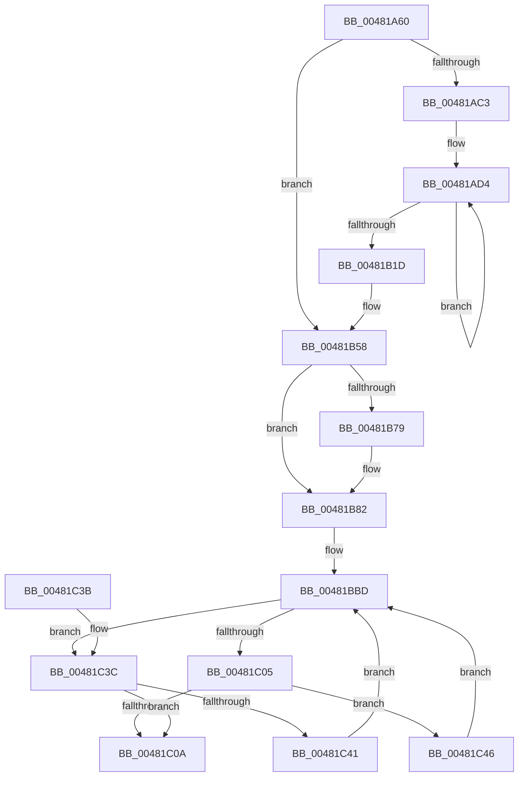

# HvpGenerateLogEntryHeader

- RVA: `0x00481A60`–`0x00481C4F` (길이 `495` bytes)
- VA: `0x0000000140481A60`
- 실행 섹션: `.text`
- PDB 이름 있음: `예`; PDB Function 태그: `아니요`
- unwind 정보 RVA: `0x000AED44`
- 디코드: `132`개 명령, `495/495` bytes 표시
- 미해석 바이트: `0` (있으면 어셈블리에 `.byte`로 보존)

> 이 문서는 커널 이미지의 기계어와 PDB 기호를 분석해 생성했습니다. 4번과 5번은 함수 원형과 자료형을 바이너리 사용 방식에서 추정한 C 해석이며 원본 소스 복구 결과는 아닙니다.

## 1. Dependencies

- 직접 호출 지점: **3**; 고유 호출 대상: **3**
- 직접 호출자로 확인된 함수: **1**
- RIP 상대 이미지 참조: **1**

### Outgoing calls
- `0x00481B40` → [HvpHeaderCheckSum](../../pagecmrc/BC/HvpHeaderCheckSum_function_00BC97A0.md) (function, `0x00BC97A0`)
- `0x00481BF1` → [memcpy](../6C/memcpy_function_006C6840.md) (function, `0x006C6840`)
- `0x00481C1E` → [_security_check_cookie](../6A/_security_check_cookie_function_006AC640.md) (function, `0x006AC640`)

### Direct callers
- [HvpGenerateLogEntry](../../page/9B/HvpGenerateLogEntry_function_009B65F0.md) at `0x009B66E6`

### Static image references
- `0x00481A74` → RVA `0x00E0A740` (`.data`; read)

## 2. Other-region calls and transfers

- 다른 실행 섹션으로 향하는 call: **1**
  - `0x00481B40` → [HvpHeaderCheckSum](../../pagecmrc/BC/HvpHeaderCheckSum_function_00BC97A0.md) (`.text` → `PAGECMRC`)
- 별도 외부 분기/꼬리 이동을 확인하지 못했습니다.

## 3. Assembly (complete function range)

```asm
00481A60  48 89 5C 24 18                  mov qword ptr [rsp + 0x18], rbx
00481A65  55                              push rbp
00481A66  56                              push rsi
00481A67  57                              push rdi
00481A68  41 54                           push r12
00481A6A  41 55                           push r13
00481A6C  41 56                           push r14
00481A6E  41 57                           push r15
00481A70  48 83 EC 60                     sub rsp, 0x60
00481A74  48 8B 05 C5 8C 98 00            mov rax, qword ptr [rip + 0x988cc5]
00481A7B  48 33 C4                        xor rax, rsp
00481A7E  48 89 44 24 58                  mov qword ptr [rsp + 0x58], rax
00481A83  4C 8B A4 24 C0 00 00 00         mov r12, qword ptr [rsp + 0xc0]
00481A8B  4C 8D 91 AC 00 00 00            lea r10, [rcx + 0xac]
00481A92  40 8A BC 24 D8 00 00 00         mov dil, byte ptr [rsp + 0xd8]
00481A9A  48 8D 99 18 01 00 00            lea rbx, [rcx + 0x118]
00481AA1  4C 89 64 24 28                  mov qword ptr [rsp + 0x28], r12
00481AA6  4D 8B F9                        mov r15, r9
00481AA9  4C 8D 59 40                     lea r11, [rcx + 0x40]
00481AAD  4C 8B EA                        mov r13, rdx
00481AB0  41 8B 34 24                     mov esi, dword ptr [r12]
00481AB4  41 B8 01 00 00 00               mov r8d, 1
00481ABA  40 84 FF                        test dil, dil
00481ABD  0F 84 95 00 00 00               je 0x140481b58
00481AC3  4C 8B 4A 08                     mov r9, qword ptr [rdx + 8]
00481AC7  41 8D 50 03                     lea edx, [r8 + 3]
00481ACB  49 8B 03                        mov rax, qword ptr [r11]
00481ACE  8D 6A 7C                        lea ebp, [rdx + 0x7c]
00481AD1  49 8B C9                        mov rcx, r9
00481AD4  0F 10 00                        movups xmm0, xmmword ptr [rax]
00481AD7  0F 11 01                        movups xmmword ptr [rcx], xmm0
00481ADA  0F 10 48 10                     movups xmm1, xmmword ptr [rax + 0x10]
00481ADE  0F 11 49 10                     movups xmmword ptr [rcx + 0x10], xmm1
00481AE2  0F 10 40 20                     movups xmm0, xmmword ptr [rax + 0x20]
00481AE6  0F 11 41 20                     movups xmmword ptr [rcx + 0x20], xmm0
00481AEA  0F 10 48 30                     movups xmm1, xmmword ptr [rax + 0x30]
00481AEE  0F 11 49 30                     movups xmmword ptr [rcx + 0x30], xmm1
00481AF2  0F 10 40 40                     movups xmm0, xmmword ptr [rax + 0x40]
00481AF6  0F 11 41 40                     movups xmmword ptr [rcx + 0x40], xmm0
00481AFA  0F 10 48 50                     movups xmm1, xmmword ptr [rax + 0x50]
00481AFE  0F 11 49 50                     movups xmmword ptr [rcx + 0x50], xmm1
00481B02  0F 10 40 60                     movups xmm0, xmmword ptr [rax + 0x60]
00481B06  0F 11 41 60                     movups xmmword ptr [rcx + 0x60], xmm0
00481B0A  48 03 CD                        add rcx, rbp
00481B0D  0F 10 48 70                     movups xmm1, xmmword ptr [rax + 0x70]
00481B11  48 03 C5                        add rax, rbp
00481B14  0F 11 49 F0                     movups xmmword ptr [rcx - 0x10], xmm1
00481B18  49 2B D0                        sub rdx, r8
00481B1B  75 B7                           jne 0x140481ad4
00481B1D  41 8B 02                        mov eax, dword ptr [r10]
00481B20  49 8B C9                        mov rcx, r9
00481B23  41 89 41 04                     mov dword ptr [r9 + 4], eax
00481B27  41 8B 02                        mov eax, dword ptr [r10]
00481B2A  41 89 41 08                     mov dword ptr [r9 + 8], eax
00481B2E  41 C7 41 1C 06 00 00 00         mov dword ptr [r9 + 0x1c], 6
00481B36  8B 03                           mov eax, dword ptr [rbx]
00481B38  41 89 41 28                     mov dword ptr [r9 + 0x28], eax
00481B3C  45 89 41 2C                     mov dword ptr [r9 + 0x2c], r8d
00481B40  E8 5B 7C 74 00                  call 0x140bc97a0
00481B45  41 89 81 FC 01 00 00            mov dword ptr [r9 + 0x1fc], eax
00481B4C  81 C6 00 02 00 00               add esi, 0x200
00481B52  41 B8 01 00 00 00               mov r8d, 1
00481B58  8B 84 24 C8 00 00 00            mov eax, dword ptr [rsp + 0xc8]
00481B5F  0F 57 C0                        xorps xmm0, xmm0
00481B62  C7 44 24 30 48 76 4C 45         mov dword ptr [rsp + 0x30], 0x454c7648
00481B6A  89 44 24 34                     mov dword ptr [rsp + 0x34], eax
00481B6E  F3 0F 7F 44 24 48               movdqu xmmword ptr [rsp + 0x48], xmm0
00481B74  40 84 FF                        test dil, dil
00481B77  74 09                           je 0x140481b82
00481B79  05 00 FE FF FF                  add eax, 0xfffffe00
00481B7E  89 44 24 34                     mov dword ptr [rsp + 0x34], eax
00481B82  41 8B 02                        mov eax, dword ptr [r10]
00481B85  41 BE 28 00 00 00               mov r14d, 0x28
00481B8B  41 8B 2F                        mov ebp, dword ptr [r15]
00481B8E  89 44 24 3C                     mov dword ptr [rsp + 0x3c], eax
00481B92  49 8B 03                        mov rax, qword ptr [r11]
00481B95  44 84 80 90 00 00 00            test byte ptr [rax + 0x90], r8b
00481B9C  B8 00 00 00 00                  mov eax, 0
00481BA1  41 0F 45 C0                     cmovne eax, r8d
00481BA5  45 33 E4                        xor r12d, r12d
00481BA8  89 44 24 38                     mov dword ptr [rsp + 0x38], eax
00481BAC  8B 03                           mov eax, dword ptr [rbx]
00481BAE  89 44 24 40                     mov dword ptr [rsp + 0x40], eax
00481BB2  8B 84 24 D0 00 00 00            mov eax, dword ptr [rsp + 0xd0]
00481BB9  89 44 24 44                     mov dword ptr [rsp + 0x44], eax
00481BBD  8B C5                           mov eax, ebp
00481BBF  42 8D 14 36                     lea edx, [rsi + r14]
00481BC3  48 8D 3C 40                     lea rdi, [rax + rax*2]
00481BC7  41 8B C6                        mov eax, r14d
00481BCA  45 8B 44 FD 10                  mov r8d, dword ptr [r13 + rdi*8 + 0x10]
00481BCF  41 8B C8                        mov ecx, r8d
00481BD2  2B CE                           sub ecx, esi
00481BD4  41 3B D0                        cmp edx, r8d
00481BD7  48 8D 54 24 30                  lea rdx, [rsp + 0x30]
00481BDC  0F 47 C1                        cmova eax, ecx
00481BDF  8B CE                           mov ecx, esi
00481BE1  49 03 4C FD 08                  add rcx, qword ptr [r13 + rdi*8 + 8]
00481BE6  8B D8                           mov ebx, eax
00481BE8  44 8B C0                        mov r8d, eax
00481BEB  41 8B C4                        mov eax, r12d
00481BEE  48 03 D0                        add rdx, rax
00481BF1  E8 4A 4C 24 00                  call 0x1406c6840
00481BF6  44 03 E3                        add r12d, ebx
00481BF9  03 F3                           add esi, ebx
00481BFB  44 2B F3                        sub r14d, ebx
00481BFE  41 3B 74 FD 10                  cmp esi, dword ptr [r13 + rdi*8 + 0x10]
00481C03  75 37                           jne 0x140481c3c
00481C05  45 85 F6                        test r14d, r14d
00481C08  75 3C                           jne 0x140481c46
00481C0A  4C 8B 64 24 28                  mov r12, qword ptr [rsp + 0x28]
00481C0F  41 89 2F                        mov dword ptr [r15], ebp
00481C12  41 89 34 24                     mov dword ptr [r12], esi
00481C16  48 8B 4C 24 58                  mov rcx, qword ptr [rsp + 0x58]
00481C1B  48 33 CC                        xor rcx, rsp
00481C1E  E8 1D AA 22 00                  call 0x1406ac640
00481C23  48 8B 9C 24 B0 00 00 00         mov rbx, qword ptr [rsp + 0xb0]
00481C2B  48 83 C4 60                     add rsp, 0x60
00481C2F  41 5F                           pop r15
00481C31  41 5E                           pop r14
00481C33  41 5D                           pop r13
00481C35  41 5C                           pop r12
00481C37  5F                              pop rdi
00481C38  5E                              pop rsi
00481C39  5D                              pop rbp
00481C3A  C3                              ret
00481C3B  CC                              int3
00481C3C  45 85 F6                        test r14d, r14d
00481C3F  74 C9                           je 0x140481c0a
00481C41  E9 77 FF FF FF                  jmp 0x140481bbd
00481C46  FF C5                           inc ebp
00481C48  33 F6                           xor esi, esi
00481C4A  E9 6E FF FF FF                  jmp 0x140481bbd
```

## 4. C-style interpretation (structured pseudocode)

```c
__int64 __fastcall HvpGenerateLogEntryHeader(__int64 a1, __int64 a2, __int64 a3, __int64 a4, __int64 a5, unsigned int a6, unsigned int a7, unsigned __int8 a8)
{
    __int64 result;
    __int64 v_r12;
    __int64 v_r14;
    __int64 v_rbp;
    __int64 v_rsi;
    __int64 v_rsp;
    unsigned __int64 v_stack_m40;
    unsigned __int64 v_stack_m50;
    unsigned int v_stack_m54;
    unsigned int v_stack_m58;
    unsigned int v_stack_m5C;
    unsigned int v_stack_m60;
    unsigned int v_stack_m64;
    unsigned int v_stack_m68;
    unsigned __int64 v_stack_m70;
    unsigned __int64 v_stack_p18;

    v_stack_p18 = v_rbx;
    v_rsp = (v_rsp) - (96);
    result = (*(unsigned __int64 *)(v_rip + 9997509)) ^ (v_rsp);
    v_stack_m40 = result;
    v_stack_m70 = a5;
    if (a8 == 0) goto loc_00481B58;
loc_00481AD4:
    *(unsigned __int64 *)(*(unsigned __int64 *)(a2 + 8)) = v_xmm0;
    *(unsigned __int64 *)(*(unsigned __int64 *)(a2 + 8) + 16) = v_xmm1;
    *(unsigned __int64 *)(*(unsigned __int64 *)(a2 + 8) + 32) = v_xmm0;
    *(unsigned __int64 *)(*(unsigned __int64 *)(a2 + 8) + 48) = v_xmm1;
    *(unsigned __int64 *)(*(unsigned __int64 *)(a2 + 8) + 64) = v_xmm0;
    *(unsigned __int64 *)(*(unsigned __int64 *)(a2 + 8) + 80) = v_xmm1;
    *(unsigned __int64 *)(*(unsigned __int64 *)(a2 + 8) + 96) = v_xmm0;
    a1 = (*(unsigned __int64 *)(a2 + 8)) + (1 + 3 + 124);
    result = (*(unsigned __int64 *)(a1 + 64)) + (1 + 3 + 124);
    *(unsigned __int64 *)(a1 - 16) = v_xmm1;
    a2 = (1 + 3) - (1);
    if (condition_is_not_equal) goto loc_00481AD4;
    *(unsigned int *)(*(unsigned __int64 *)(a2 + 8) + 4) = (unsigned int)((unsigned int)(*(unsigned int *)(a1 + 172)));
    *(unsigned int *)(*(unsigned __int64 *)(a2 + 8) + 8) = (unsigned int)((unsigned int)(*(unsigned int *)(a1 + 172)));
    *(unsigned int *)(*(unsigned __int64 *)(a2 + 8) + 28) = 6;
    *(unsigned int *)(*(unsigned __int64 *)(a2 + 8) + 40) = (unsigned int)((unsigned int)(*(unsigned int *)(a1 + 280)));
    *(unsigned int *)(*(unsigned __int64 *)(a2 + 8) + 44) = 1;
    result = HvpHeaderCheckSum(*(unsigned __int64 *)(a2 + 8), a2, 1, *(unsigned __int64 *)(a2 + 8));
    *(unsigned int *)(*(unsigned __int64 *)(a2 + 8) + 508) = (unsigned int)(result);
    v_rsi = (unsigned int)(((unsigned int)(*(unsigned int *)(a5))) + (512));
loc_00481B58:
    v_stack_m68 = 0x454C7648ULL;
    v_stack_m64 = (unsigned int)((unsigned int)(a6));
    v_stack_m50 = v_xmm0;
    result = (unsigned int)(a6);
    if (a8 != 0) {
        result = (unsigned int)(((unsigned int)(a6)) + (0xFFFFFE00ULL));
        v_stack_m64 = (unsigned int)(result);
    }
    v_stack_m5C = (unsigned int)((unsigned int)(*(unsigned int *)(a1 + 172)));
    result = 0;
    if (((*(unsigned __int8 *)(*(unsigned __int64 *)(a1 + 64) + 144)) & (1)) != 0) { result = 1; }
    v_r12 = 0;
    v_stack_m60 = (unsigned int)(result);
    v_stack_m58 = (unsigned int)((unsigned int)(*(unsigned int *)(a1 + 280)));
    v_stack_m54 = (unsigned int)((unsigned int)(a7));
loc_00481BBD:
    a1 = (unsigned int)(((unsigned int)((unsigned int)((unsigned int)(*(unsigned int *)(a2 + (unsigned int)((unsigned int)((unsigned int)(*(unsigned int *)(a4)))) + (unsigned int)((unsigned int)((unsigned int)(*(unsigned int *)(a4)))) * 2 * 8 + 16))))) - ((unsigned int)(v_rsi)));
    result = 40;
    if (((unsigned int)(v_rsi + 40 * 1)) > ((unsigned int)((unsigned int)(*(unsigned int *)(a2 + (unsigned int)((unsigned int)((unsigned int)(*(unsigned int *)(a4)))) + (unsigned int)((unsigned int)((unsigned int)(*(unsigned int *)(a4)))) * 2 * 8 + 16))))) { result = (unsigned int)(a1); }
    a1 = ((unsigned int)((unsigned int)(v_rsi))) + (*(unsigned __int64 *)(a2 + (unsigned int)((unsigned int)((unsigned int)(*(unsigned int *)(a4)))) + (unsigned int)((unsigned int)((unsigned int)(*(unsigned int *)(a4)))) * 2 * 8 + 8));
    a2 = (v_stack_m68) + (0);
    result = memcpy(a1, a2, (unsigned int)((unsigned int)(result)), *(unsigned __int64 *)(a2 + 8));
    v_r12 = (unsigned int)((v_r12) + ((unsigned int)((unsigned int)((unsigned int)(result)))));
    v_rsi = (unsigned int)((v_rsi) + ((unsigned int)((unsigned int)((unsigned int)(result)))));
    v_r14 = (unsigned int)((40) - ((unsigned int)((unsigned int)((unsigned int)(result)))));
    if (((unsigned int)(v_rsi)) != (*(unsigned int *)(a2 + (unsigned int)((unsigned int)((unsigned int)(*(unsigned int *)(a4)))) + (unsigned int)((unsigned int)((unsigned int)(*(unsigned int *)(a4)))) * 2 * 8 + 16))) goto loc_00481C3C;
    if ((unsigned int)(v_r14) != 0) goto loc_00481C46;
loc_00481C0A:
    *(unsigned int *)(a4) = (unsigned int)((unsigned int)(*(unsigned int *)(a4)));
    *(unsigned int *)(v_stack_m70) = (unsigned int)(v_rsi);
    a1 = (v_stack_m40) ^ (v_rsp);
    result = _security_check_cookie(a1, a2, (unsigned int)((unsigned int)(result)), *(unsigned __int64 *)(a2 + 8));
    v_rsp = (v_rsp) + (96);
    return result;
loc_00481C3C:
    if ((unsigned int)(v_r14) == 0) goto loc_00481C0A;
    goto loc_00481BBD;
loc_00481C46:
    v_rbp = (unsigned int)(((unsigned int)(*(unsigned int *)(a4))) + 1);
    v_rsi = 0;
    goto loc_00481BBD;
}
```

## 5. (Beta) C Style

```c
int64_t HvpGenerateLogEntryHeader(void *Arg1, void *Arg2, int64_t Arg3, void *Arg4, void *Arg5, uint32_t Arg6, uint32_t Arg7, uint8_t Arg8)
{
    uint8_t *arg1 = (uint8_t *)Arg1;
    uint8_t *arg2 = (uint8_t *)Arg2;
    uint8_t *arg4 = (uint8_t *)Arg4;
    uint8_t *arg5 = (uint8_t *)Arg5;

    int64_t result;
    int64_t local_r12;
    int64_t local_r14;
    int64_t local_rbp;
    int64_t local_rsi;
    int64_t local_rsp;
    uint64_t v_stack_m40;
    uint64_t v_stack_m50;
    uint32_t v_stack_m54;
    uint32_t v_stack_m58;
    uint32_t v_stack_m5C;
    uint32_t v_stack_m60;
    uint32_t v_stack_m64;
    uint32_t v_stack_m68;
    uint64_t v_stack_m70;
    uint64_t v_stack_p18;

    v_stack_p18 = local_rbx;
    local_rsp = (local_rsp) - (96);
    result = (*(uint64_t *)(v_rip + 0x988CC5)) ^ (local_rsp);
    v_stack_m40 = result;
    v_stack_m70 = Arg5;
    if (Arg8 == 0) goto loc_00481B58;
loc_00481AD4:
    *(uint64_t *)(*(uint64_t *)(arg2 + 0x8)) = v_xmm0;
    *(uint64_t *)(*(uint64_t *)(arg2 + 0x8) + 0x10) = v_xmm1;
    *(uint64_t *)(*(uint64_t *)(arg2 + 0x8) + 0x20) = v_xmm0;
    *(uint64_t *)(*(uint64_t *)(arg2 + 0x8) + 0x30) = v_xmm1;
    *(uint64_t *)(*(uint64_t *)(arg2 + 0x8) + 0x40) = v_xmm0;
    *(uint64_t *)(*(uint64_t *)(arg2 + 0x8) + 0x50) = v_xmm1;
    *(uint64_t *)(*(uint64_t *)(arg2 + 0x8) + 0x60) = v_xmm0;
    Arg1 = (*(uint64_t *)(arg2 + 0x8)) + (1 + 3 + 124);
    result = (*(uint64_t *)(arg1 + 0x40)) + (1 + 3 + 124);
    *(uint64_t *)(arg1 - 0x10) = v_xmm1;
    Arg2 = (1 + 3) - (1);
    if (condition_is_not_equal) goto loc_00481AD4;
    *(uint32_t *)(*(uint64_t *)(arg2 + 0x8) + 0x4) = (uint32_t)((uint32_t)(*(uint32_t *)(arg1 + 0xAC)));
    *(uint32_t *)(*(uint64_t *)(arg2 + 0x8) + 0x8) = (uint32_t)((uint32_t)(*(uint32_t *)(arg1 + 0xAC)));
    *(uint32_t *)(*(uint64_t *)(arg2 + 0x8) + 0x1C) = 6;
    *(uint32_t *)(*(uint64_t *)(arg2 + 0x8) + 0x28) = (uint32_t)((uint32_t)(*(uint32_t *)(arg1 + 0x118)));
    *(uint32_t *)(*(uint64_t *)(arg2 + 0x8) + 0x2C) = 1;
    result = HvpHeaderCheckSum(*(uint64_t *)(arg2 + 0x8), Arg2, 1, *(uint64_t *)(arg2 + 0x8));
    *(uint32_t *)(*(uint64_t *)(arg2 + 0x8) + 0x1FC) = (uint32_t)(result);
    local_rsi = (uint32_t)(((uint32_t)(*(uint32_t *)(arg5))) + (512));
loc_00481B58:
    v_stack_m68 = 0x454C7648ULL;
    v_stack_m64 = (uint32_t)((uint32_t)(Arg6));
    v_stack_m50 = v_xmm0;
    result = (uint32_t)(Arg6);
    if (Arg8 != 0) {
        result = (uint32_t)(((uint32_t)(Arg6)) + (0xFFFFFE00ULL));
        v_stack_m64 = (uint32_t)(result);
    }
    v_stack_m5C = (uint32_t)((uint32_t)(*(uint32_t *)(arg1 + 0xAC)));
    result = 0;
    if (((*(uint8_t *)(*(uint64_t *)(arg1 + 0x40) + 0x90)) & (1)) != 0) { result = 1; }
    local_r12 = 0;
    v_stack_m60 = (uint32_t)(result);
    v_stack_m58 = (uint32_t)((uint32_t)(*(uint32_t *)(arg1 + 0x118)));
    v_stack_m54 = (uint32_t)((uint32_t)(Arg7));
loc_00481BBD:
    Arg1 = (uint32_t)(((uint32_t)((uint32_t)((uint32_t)(*(uint32_t *)(arg2 + (uint32_t)((uint32_t)((uint32_t)(*(uint32_t *)(arg4)))) + (uint32_t)((uint32_t)((uint32_t)(*(uint32_t *)(arg4)))) * 2 * 8 + 0x10))))) - ((uint32_t)(local_rsi)));
    result = 40;
    if (((uint32_t)(local_rsi + 40 * 1)) > ((uint32_t)((uint32_t)(*(uint32_t *)(arg2 + (uint32_t)((uint32_t)((uint32_t)(*(uint32_t *)(arg4)))) + (uint32_t)((uint32_t)((uint32_t)(*(uint32_t *)(arg4)))) * 2 * 8 + 0x10))))) { result = (uint32_t)(Arg1); }
    Arg1 = ((uint32_t)((uint32_t)(local_rsi))) + (*(uint64_t *)(arg2 + (uint32_t)((uint32_t)((uint32_t)(*(uint32_t *)(arg4)))) + (uint32_t)((uint32_t)((uint32_t)(*(uint32_t *)(arg4)))) * 2 * 8 + 0x8));
    Arg2 = (v_stack_m68) + (0);
    result = memcpy(Arg1, Arg2, (uint32_t)((uint32_t)(result)), *(uint64_t *)(arg2 + 0x8));
    local_r12 = (uint32_t)((local_r12) + ((uint32_t)((uint32_t)((uint32_t)(result)))));
    local_rsi = (uint32_t)((local_rsi) + ((uint32_t)((uint32_t)((uint32_t)(result)))));
    local_r14 = (uint32_t)((40) - ((uint32_t)((uint32_t)((uint32_t)(result)))));
    if (((uint32_t)(local_rsi)) != (*(uint32_t *)(arg2 + (uint32_t)((uint32_t)((uint32_t)(*(uint32_t *)(arg4)))) + (uint32_t)((uint32_t)((uint32_t)(*(uint32_t *)(arg4)))) * 2 * 8 + 0x10))) goto loc_00481C3C;
    if ((uint32_t)(local_r14) != 0) goto loc_00481C46;
loc_00481C0A:
    *(uint32_t *)(arg4) = (uint32_t)((uint32_t)(*(uint32_t *)(arg4)));
    *(uint32_t *)(v_stack_m70) = (uint32_t)(local_rsi);
    Arg1 = (v_stack_m40) ^ (local_rsp);
    result = _security_check_cookie(Arg1, Arg2, (uint32_t)((uint32_t)(result)), *(uint64_t *)(arg2 + 0x8));
    local_rsp = (local_rsp) + (96);
    return result;
loc_00481C3C:
    if ((uint32_t)(local_r14) == 0) goto loc_00481C0A;
    goto loc_00481BBD;
loc_00481C46:
    local_rbp = (uint32_t)(((uint32_t)(*(uint32_t *)(arg4))) + 1);
    local_rsi = 0;
    goto loc_00481BBD;
}
```

### 관측된 메모리 오프셋

구조체 형식이 확인되지 않은 접근은 인자 기준의 오프셋으로만 기록했습니다.

| 기준 인자 | 오프셋 표현 | 폭 (bit) | 접근 |
|---|---:|---:|---|
| `Arg1` | `+ 0x0` | `32` | `R` |
| `Arg1` | `+ 0x0` | `64` | `R` |
| `Arg1` | `+ 0x40` | `64` | `R` |
| `Arg1` | `+ 0xAC` | `64` | `R` |
| `Arg1` | `+ 0x118` | `64` | `R` |
| `Arg2` | `+ 0x8` | `64` | `R` |
| `Arg2` | `+ 0x8 + rdi*8` | `64` | `R` |
| `Arg2` | `+ 0x10 + rdi*8` | `32` | `R` |
| `Arg4` | `+ 0x0` | `32` | `R` |
| `Arg4` | `+ 0x0` | `32` | `W` |
| `Arg5` | `+ 0x0` | `32` | `R` |

## 6. Execution-region graph

[열기: 2D/3D 그래프와 함수 탐색 컨트롤 패널](../../../control-panel.html?section=text&rva=0x00481A60&view=graph)

- 2D 그래프는 위에서 아래로 흐르고, 3D 그래프는 빈 공간을 드래그해 회전합니다. Shift+드래그는 이동, 휠은 확대·축소, 함수 노드 선택은 대상 보고서 이동입니다.

### Static fallback


