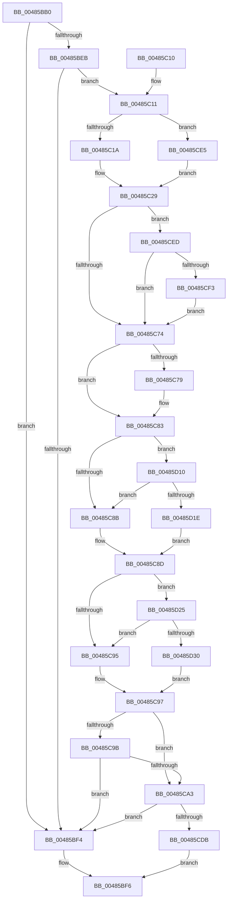

# IoCheckRedirectionTrustLevel

- RVA: `0x00485BB0`–`0x00485D37` (길이 `391` bytes)
- VA: `0x0000000140485BB0`
- 실행 섹션: `.text`
- PDB 이름 있음: `예`; PDB Function 태그: `아니요`
- unwind 정보 RVA: `0x000AF690`
- 디코드: `98`개 명령, `391/391` bytes 표시
- 미해석 바이트: `0` (있으면 어셈블리에 `.byte`로 보존)

> 이 문서는 커널 이미지의 기계어와 PDB 기호를 분석해 생성했습니다. 4번과 5번은 함수 원형과 자료형을 바이너리 사용 방식에서 추정한 C 해석이며 원본 소스 복구 결과는 아닙니다.

## 1. Dependencies

- 직접 호출 지점: **7**; 고유 호출 대상: **7**
- 직접 호출자로 확인된 함수: **0**
- RIP 상대 이미지 참조: **0**

### Outgoing calls
- `0x00485C1F` → [SeCaptureSubjectContext](../../page/86/SeCaptureSubjectContext_function_0086B820.md) (function, `0x0086B820`)
- `0x00485C45` → [ExAcquireResourceSharedLite](../21/ExAcquireResourceSharedLite_function_00211BC0.md) (function, `0x00211BC0`)
- `0x00485C54` → [ExReleaseResourceLite](../25/ExReleaseResourceLite_function_0025FA10.md) (function, `0x0025FA10`)
- `0x00485C59` → [KeLeaveCriticalRegion](../25/KeLeaveCriticalRegion_function_0025D8B0.md) (function, `0x0025D8B0`)
- `0x00485C7E` → [SeReleaseSubjectContext](../../page/86/SeReleaseSubjectContext_function_0086B710.md) (function, `0x0086B710`)
- `0x00485CCE` → [EtwTimLogRedirectionTrustPolicy](../../page/AB/EtwTimLogRedirectionTrustPolicy_function_00ABA7E0.md) (function, `0x00ABA7E0`)
- `0x00485D00` → [SeTokenGetRedirectionTrustPolicy](../49/SeTokenGetRedirectionTrustPolicy_function_00498C30.md) (function, `0x00498C30`)

### Direct callers
- 이 함수 시작 RVA로 연결되는 직접 call은 확인되지 않았습니다. 간접 호출은 완전히 역산할 수 없습니다.

### Static image references
- 디코드된 RIP-relative 메모리 참조가 없습니다.

## 2. Other-region calls and transfers

- 다른 실행 섹션으로 향하는 call: **3**
  - `0x00485C1F` → [SeCaptureSubjectContext](../../page/86/SeCaptureSubjectContext_function_0086B820.md) (`.text` → `PAGE`)
  - `0x00485C7E` → [SeReleaseSubjectContext](../../page/86/SeReleaseSubjectContext_function_0086B710.md) (`.text` → `PAGE`)
  - `0x00485CCE` → [EtwTimLogRedirectionTrustPolicy](../../page/AB/EtwTimLogRedirectionTrustPolicy_function_00ABA7E0.md) (`.text` → `PAGE`)
- 별도 외부 분기/꼬리 이동을 확인하지 못했습니다.

## 3. Assembly (complete function range)

```asm
00485BB0  48 8B C4                        mov rax, rsp
00485BB3  48 89 58 08                     mov qword ptr [rax + 8], rbx
00485BB7  48 89 68 18                     mov qword ptr [rax + 0x18], rbp
00485BBB  48 89 70 20                     mov qword ptr [rax + 0x20], rsi
00485BBF  57                              push rdi
00485BC0  41 56                           push r14
00485BC2  41 57                           push r15
00485BC4  48 83 EC 60                     sub rsp, 0x60
00485BC8  0F 57 C0                        xorps xmm0, xmm0
00485BCB  41 BE 01 00 00 00               mov r14d, 1
00485BD1  44 88 70 10                     mov byte ptr [rax + 0x10], r14b
00485BD5  49 8B F8                        mov rdi, r8
00485BD8  44 88 70 B8                     mov byte ptr [rax - 0x48], r14b
00485BDC  44 8B F9                        mov r15d, ecx
00485BDF  0F 11 40 C0                     movups xmmword ptr [rax - 0x40], xmm0
00485BE3  0F 11 40 D0                     movups xmmword ptr [rax - 0x30], xmm0
00485BE7  84 D2                           test dl, dl
00485BE9  74 09                           je 0x140485bf4
00485BEB  41 F7 C1 FD FF FF FF            test r9d, 0xfffffffd
00485BF2  75 1D                           jne 0x140485c11
00485BF4  33 C0                           xor eax, eax
00485BF6  4C 8D 5C 24 60                  lea r11, [rsp + 0x60]
00485BFB  49 8B 5B 20                     mov rbx, qword ptr [r11 + 0x20]
00485BFF  49 8B 6B 30                     mov rbp, qword ptr [r11 + 0x30]
00485C03  49 8B 73 38                     mov rsi, qword ptr [r11 + 0x38]
00485C07  49 8B E3                        mov rsp, r11
00485C0A  41 5F                           pop r15
00485C0C  41 5E                           pop r14
00485C0E  5F                              pop rdi
00485C0F  C3                              ret
00485C10  CC                              int3
00485C11  48 85 FF                        test rdi, rdi
00485C14  0F 85 CB 00 00 00               jne 0x140485ce5
00485C1A  48 8D 4C 24 38                  lea rcx, [rsp + 0x38]
00485C1F  E8 FC 5B 3E 00                  call 0x14086b820
00485C24  48 8D 74 24 38                  lea rsi, [rsp + 0x38]
00485C29  65 48 8B 04 25 88 01 00 00      mov rax, qword ptr gs:[0x188]
00485C32  41 8A D6                        mov dl, r14b
00485C35  48 8B 5E 10                     mov rbx, qword ptr [rsi + 0x10]
00485C39  66 FF 88 E4 01 00 00            dec word ptr [rax + 0x1e4]
00485C40  90                              nop
00485C41  48 8B 4B 30                     mov rcx, qword ptr [rbx + 0x30]
00485C45  E8 76 BF D8 FF                  call 0x140211bc0
00485C4A  48 8B 4B 30                     mov rcx, qword ptr [rbx + 0x30]
00485C4E  8B AB C8 00 00 00               mov ebp, dword ptr [rbx + 0xc8]
00485C54  E8 B7 9D DD FF                  call 0x14025fa10
00485C59  E8 52 7C DD FF                  call 0x14025d8b0
00485C5E  48 8B 0E                        mov rcx, qword ptr [rsi]
00485C61  8B DD                           mov ebx, ebp
00485C63  81 E3 00 00 40 00               and ebx, 0x400000
00485C69  81 E5 00 00 80 00               and ebp, 0x800000
00485C6F  48 85 C9                        test rcx, rcx
00485C72  75 79                           jne 0x140485ced
00485C74  48 85 FF                        test rdi, rdi
00485C77  75 0A                           jne 0x140485c83
00485C79  48 8D 4C 24 38                  lea rcx, [rsp + 0x38]
00485C7E  E8 8D 5A 3E 00                  call 0x14086b710
00485C83  85 DB                           test ebx, ebx
00485C85  0F 85 85 00 00 00               jne 0x140485d10
00485C8B  32 DB                           xor bl, bl
00485C8D  85 ED                           test ebp, ebp
00485C8F  0F 85 90 00 00 00               jne 0x140485d25
00485C95  32 C0                           xor al, al
00485C97  84 DB                           test bl, bl
00485C99  75 08                           jne 0x140485ca3
00485C9B  84 C0                           test al, al
00485C9D  0F 84 51 FF FF FF               je 0x140485bf4
00485CA3  65 48 8B 14 25 88 01 00 00      mov rdx, qword ptr gs:[0x188]
00485CAC  41 83 FE 02                     cmp r14d, 2
00485CB0  4C 8B 8C 24 A0 00 00 00         mov r9, qword ptr [rsp + 0xa0]
00485CB8  45 8B C7                        mov r8d, r15d
00485CBB  0F 94 C0                        sete al
00485CBE  0F B6 CB                        movzx ecx, bl
00485CC1  FF C1                           inc ecx
00485CC3  88 44 24 20                     mov byte ptr [rsp + 0x20], al
00485CC7  48 8B 92 B8 00 00 00            mov rdx, qword ptr [rdx + 0xb8]
00485CCE  E8 0D 4B 63 00                  call 0x140aba7e0
00485CD3  84 DB                           test bl, bl
00485CD5  0F 84 19 FF FF FF               je 0x140485bf4
00485CDB  B8 BC 04 00 C0                  mov eax, 0xc00004bc
00485CE0  E9 11 FF FF FF                  jmp 0x140485bf6
00485CE5  48 8B F7                        mov rsi, rdi
00485CE8  E9 3C FF FF FF                  jmp 0x140485c29
00485CED  83 7E 08 02                     cmp dword ptr [rsi + 8], 2
00485CF1  7C 81                           jl 0x140485c74
00485CF3  4C 8D 44 24 30                  lea r8, [rsp + 0x30]
00485CF8  48 8D 94 24 88 00 00 00         lea rdx, [rsp + 0x88]
00485D00  E8 2B 2F 01 00                  call 0x140498c30
00485D05  41 BE 02 00 00 00               mov r14d, 2
00485D0B  E9 64 FF FF FF                  jmp 0x140485c74
00485D10  80 BC 24 88 00 00 00 00         cmp byte ptr [rsp + 0x88], 0
00485D18  0F 84 6D FF FF FF               je 0x140485c8b
00485D1E  B3 01                           mov bl, 1
00485D20  E9 68 FF FF FF                  jmp 0x140485c8d
00485D25  80 7C 24 30 00                  cmp byte ptr [rsp + 0x30], 0
00485D2A  0F 84 65 FF FF FF               je 0x140485c95
00485D30  B0 01                           mov al, 1
00485D32  E9 60 FF FF FF                  jmp 0x140485c97
```

## 4. C-style interpretation (structured pseudocode)

```c
__int64 __fastcall IoCheckRedirectionTrustLevel(int a1, unsigned __int8 a2, __int64 a3, int a4, __int64 a5)
{
    __int64 result;
    __int64 v_rbp;
    __int64 v_rbx;
    __int64 v_rsp;
    unsigned __int64 v_stack_m18;
    unsigned __int64 v_stack_m28;
    unsigned __int64 v_stack_m30;
    unsigned __int8 v_stack_m40;
    unsigned __int64 v_stack_p28;

    *(unsigned __int64 *)(v_rsp + 8) = v_rbx;
    *(unsigned __int64 *)(v_rsp + 24) = v_rbp;
    *(unsigned __int64 *)(v_rsp + 32) = v_rsi;
    v_rsp = (v_rsp) - (96);
    *(unsigned __int8 *)(v_rsp + 16) = 1;
    *(unsigned __int8 *)(v_rsp - 72) = 1;
    *(unsigned __int64 *)(v_rsp - 64) = v_xmm0;
    *(unsigned __int64 *)(v_rsp - 48) = v_xmm0;
    if (a2 == 0) goto loc_00485BF4;
    if (((a4) & (0xFFFFFFFDULL)) != 0) goto loc_00485C11;
loc_00485BF4:
    result = 0;
loc_00485BF6:
    return result;
loc_00485C11:
    if (a3 != 0) goto loc_00485CE5;
    result = SeCaptureSubjectContext(v_stack_m28, a2, a3, a4);
loc_00485C29:
    result = ExAcquireResourceSharedLite(*(unsigned __int64 *)(*(unsigned __int64 *)(v_stack_m28 + 16) + 48), 1, a3, a4);
    result = ExReleaseResourceLite(*(unsigned __int64 *)(*(unsigned __int64 *)(v_stack_m28 + 16) + 48), 1, a3, a4);
    result = KeLeaveCriticalRegion(*(unsigned __int64 *)(*(unsigned __int64 *)(v_stack_m28 + 16) + 48), 1, a3, a4);
    v_rbx = (unsigned int)(((unsigned int)((unsigned int)((unsigned int)(*(unsigned int *)(*(unsigned __int64 *)(v_stack_m28 + 16) + 200))))) & (0x400000ULL));
    v_rbp = (unsigned int)(((unsigned int)(*(unsigned int *)(*(unsigned __int64 *)(v_stack_m28 + 16) + 200))) & (0x800000ULL));
    if (*(unsigned __int64 *)(v_stack_m28) != 0) goto loc_00485CED;
loc_00485C74:
    if (a3 == 0) {
        a1 = v_stack_m28;
        result = SeReleaseSubjectContext(a1, 1, a3, a4);
    }
    if ((unsigned int)(v_rbx) != 0) goto loc_00485D10;
loc_00485C8B:
    v_rbx = 0;
loc_00485C8D:
    if ((unsigned int)(v_rbp) != 0) goto loc_00485D25;
loc_00485C95:
    result = 0;
loc_00485C97:
    if (0 != 0) goto loc_00485CA3;
    if (0 == 0) goto loc_00485BF4;
loc_00485CA3:
    result = (1 == 2) ? 1 : 0;
    a1 = (unsigned int)((0) + 1);
    v_stack_m40 = (unsigned __int8)(result);
    result = EtwTimLogRedirectionTrustPolicy(a1, *(unsigned __int64 *)(*(unsigned __int64 *)(gs_base + (0 + 392)) + 184), (unsigned int)((unsigned int)((unsigned int)(a1))), a5);
    if (0 == 0) goto loc_00485BF4;
    goto loc_00485BF6;
loc_00485CE5:
    goto loc_00485C29;
loc_00485CED:
    if ((*(unsigned int *)(a3 + 8)) < 2) goto loc_00485C74;
    result = SeTokenGetRedirectionTrustPolicy(a1, v_stack_p28, v_stack_m30, a5);
    goto loc_00485C74;
loc_00485D10:
    if (v_stack_p28 == 0) goto loc_00485C8B;
    goto loc_00485C8D;
loc_00485D25:
    if (v_stack_m30 == 0) goto loc_00485C95;
    goto loc_00485C97;
}
```

## 5. (Beta) C Style

```c
int64_t IoCheckRedirectionTrustLevel(int32_t Arg1, uint8_t Arg2, int64_t Arg3, int32_t Arg4, int64_t Arg5)
{
    int64_t result;
    int64_t local_rbp;
    int64_t local_rbx;
    int64_t local_rsp;
    uint64_t v_stack_m18;
    uint64_t v_stack_m28;
    uint64_t v_stack_m30;
    uint8_t v_stack_m40;
    uint64_t v_stack_p28;

    *(uint64_t *)(local_rsp + 0x8) = local_rbx;
    *(uint64_t *)(local_rsp + 0x18) = local_rbp;
    *(uint64_t *)(local_rsp + 0x20) = local_rsi;
    local_rsp = (local_rsp) - (96);
    *(uint8_t *)(local_rsp + 0x10) = 1;
    *(uint8_t *)(local_rsp - 0x48) = 1;
    *(uint64_t *)(local_rsp - 0x40) = v_xmm0;
    *(uint64_t *)(local_rsp - 0x30) = v_xmm0;
    if (Arg2 == 0) goto loc_00485BF4;
    if (((Arg4) & (0xFFFFFFFDULL)) != 0) goto loc_00485C11;
loc_00485BF4:
    result = 0;
loc_00485BF6:
    return result;
loc_00485C11:
    if (Arg3 != 0) goto loc_00485CE5;
    result = SeCaptureSubjectContext(v_stack_m28, Arg2, Arg3, Arg4);
loc_00485C29:
    result = ExAcquireResourceSharedLite(*(uint64_t *)(*(uint64_t *)(v_stack_m28 + 0x10) + 0x30), 1, Arg3, Arg4);
    result = ExReleaseResourceLite(*(uint64_t *)(*(uint64_t *)(v_stack_m28 + 0x10) + 0x30), 1, Arg3, Arg4);
    result = KeLeaveCriticalRegion(*(uint64_t *)(*(uint64_t *)(v_stack_m28 + 0x10) + 0x30), 1, Arg3, Arg4);
    local_rbx = (uint32_t)(((uint32_t)((uint32_t)((uint32_t)(*(uint32_t *)(*(uint64_t *)(v_stack_m28 + 0x10) + 0xC8))))) & (0x400000ULL));
    local_rbp = (uint32_t)(((uint32_t)(*(uint32_t *)(*(uint64_t *)(v_stack_m28 + 0x10) + 0xC8))) & (0x800000ULL));
    if (*(uint64_t *)(v_stack_m28) != 0) goto loc_00485CED;
loc_00485C74:
    if (Arg3 == 0) {
        Arg1 = v_stack_m28;
        result = SeReleaseSubjectContext(Arg1, 1, Arg3, Arg4);
    }
    if ((uint32_t)(local_rbx) != 0) goto loc_00485D10;
loc_00485C8B:
    local_rbx = 0;
loc_00485C8D:
    if ((uint32_t)(local_rbp) != 0) goto loc_00485D25;
loc_00485C95:
    result = 0;
loc_00485C97:
    if (0 != 0) goto loc_00485CA3;
    if (0 == 0) goto loc_00485BF4;
loc_00485CA3:
    result = (1 == 2) ? 1 : 0;
    Arg1 = (uint32_t)((0) + 1);
    v_stack_m40 = (uint8_t)(result);
    result = EtwTimLogRedirectionTrustPolicy(Arg1, *(uint64_t *)(*(uint64_t *)(gs_base + (0 + 0x188)) + 0xB8), (uint32_t)((uint32_t)((uint32_t)(Arg1))), Arg5);
    if (0 == 0) goto loc_00485BF4;
    goto loc_00485BF6;
loc_00485CE5:
    goto loc_00485C29;
loc_00485CED:
    if ((*(uint32_t *)(Arg3 + 0x8)) < 2) goto loc_00485C74;
    result = SeTokenGetRedirectionTrustPolicy(Arg1, v_stack_p28, v_stack_m30, Arg5);
    goto loc_00485C74;
loc_00485D10:
    if (v_stack_p28 == 0) goto loc_00485C8B;
    goto loc_00485C8D;
loc_00485D25:
    if (v_stack_m30 == 0) goto loc_00485C95;
    goto loc_00485C97;
}
```

## 6. Execution-region graph

[열기: 2D/3D 그래프와 함수 탐색 컨트롤 패널](../../../control-panel.html?section=text&rva=0x00485BB0&view=graph)

- 2D 그래프는 위에서 아래로 흐르고, 3D 그래프는 빈 공간을 드래그해 회전합니다. Shift+드래그는 이동, 휠은 확대·축소, 함수 노드 선택은 대상 보고서 이동입니다.

### Static fallback


