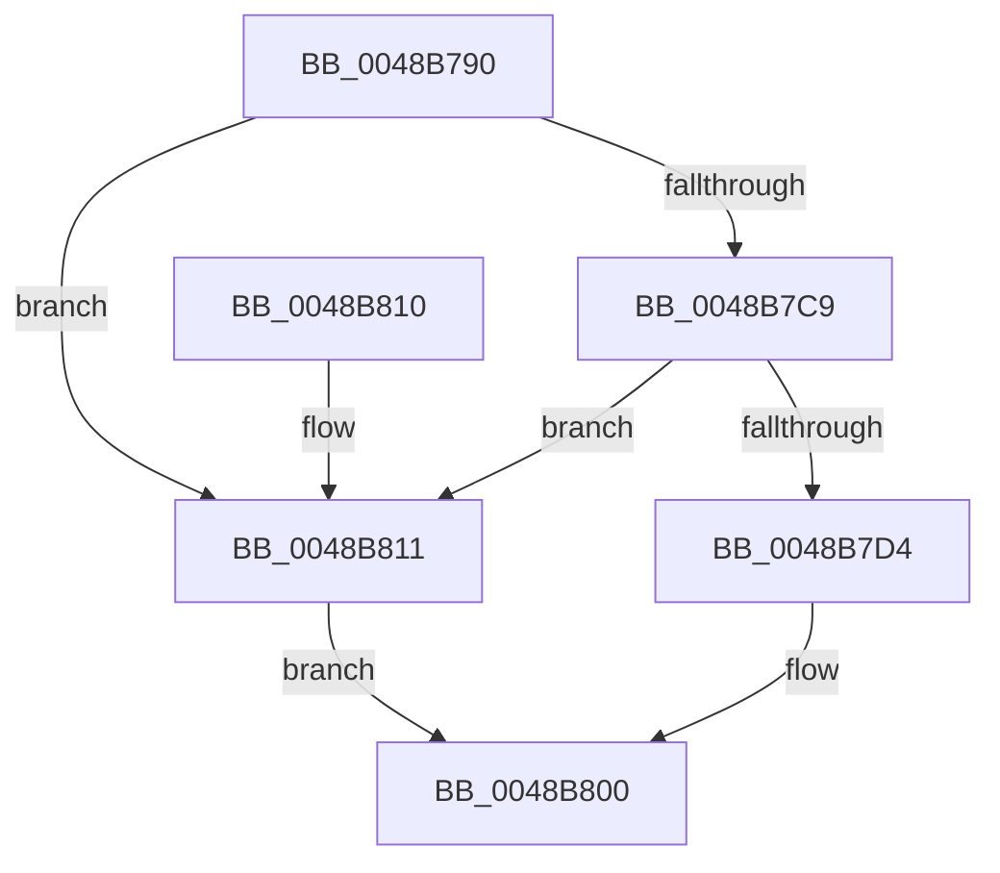

# IoCsqRemoveIrp

- RVA: `0x0048B790`–`0x0048B822` (길이 `146` bytes)
- VA: `0x000000014048B790`
- 실행 섹션: `.text`
- PDB 이름 있음: `예`; PDB Function 태그: `아니요`
- unwind 정보 RVA: `0x000B08F0`
- 디코드: `40`개 명령, `146/146` bytes 표시
- 미해석 바이트: `0` (있으면 어셈블리에 `.byte`로 보존)

> 이 문서는 커널 이미지의 기계어와 PDB 기호를 분석해 생성했습니다. 4번과 5번은 함수 원형과 자료형을 바이너리 사용 방식에서 추정한 C 해석이며 원본 소스 복구 결과는 아닙니다.

## 1. Dependencies

- 직접 호출 지점: **4**; 고유 호출 대상: **1**
- 직접 호출자로 확인된 함수: **0**
- RIP 상대 이미지 참조: **0**

### Outgoing calls
- `0x0048B7B8` → [guard_dispatch_icall](../6B/guard_dispatch_icall_function_006BAAD0.md) (function, `0x006BAAD0`)
- `0x0048B7DB` → [guard_dispatch_icall](../6B/guard_dispatch_icall_function_006BAAD0.md) (function, `0x006BAAD0`)
- `0x0048B7F8` → [guard_dispatch_icall](../6B/guard_dispatch_icall_function_006BAAD0.md) (function, `0x006BAAD0`)
- `0x0048B819` → [guard_dispatch_icall](../6B/guard_dispatch_icall_function_006BAAD0.md) (function, `0x006BAAD0`)

### Direct callers
- 이 함수 시작 RVA로 연결되는 직접 call은 확인되지 않았습니다. 간접 호출은 완전히 역산할 수 없습니다.

### Static image references
- 디코드된 RIP-relative 메모리 참조가 없습니다.

## 2. Other-region calls and transfers

- 다른 실행 섹션으로 향하는 call: **0**
- 별도 외부 분기/꼬리 이동을 확인하지 못했습니다.

## 3. Assembly (complete function range)

```asm
0048B790  48 89 5C 24 10                  mov qword ptr [rsp + 0x10], rbx
0048B795  48 89 74 24 18                  mov qword ptr [rsp + 0x18], rsi
0048B79A  57                              push rdi
0048B79B  48 83 EC 20                     sub rsp, 0x20
0048B79F  48 8B 41 20                     mov rax, qword ptr [rcx + 0x20]
0048B7A3  48 8B F2                        mov rsi, rdx
0048B7A6  48 83 61 38 00                  and qword ptr [rcx + 0x38], 0
0048B7AB  48 8D 54 24 30                  lea rdx, [rsp + 0x30]
0048B7B0  48 8B D9                        mov rbx, rcx
0048B7B3  C6 44 24 30 00                  mov byte ptr [rsp + 0x30], 0
0048B7B8  E8 13 F3 22 00                  call 0x1406baad0
0048B7BD  48 8B 7E 08                     mov rdi, qword ptr [rsi + 8]
0048B7C1  48 8B CB                        mov rcx, rbx
0048B7C4  48 85 FF                        test rdi, rdi
0048B7C7  74 48                           je 0x14048b811
0048B7C9  33 C0                           xor eax, eax
0048B7CB  48 87 47 68                     xchg qword ptr [rdi + 0x68], rax
0048B7CF  48 85 C0                        test rax, rax
0048B7D2  74 3D                           je 0x14048b811
0048B7D4  48 8B 43 10                     mov rax, qword ptr [rbx + 0x10]
0048B7D8  48 8B D7                        mov rdx, rdi
0048B7DB  E8 F0 F2 22 00                  call 0x1406baad0
0048B7E0  48 83 66 08 00                  and qword ptr [rsi + 8], 0
0048B7E5  48 8B CB                        mov rcx, rbx
0048B7E8  48 83 A7 90 00 00 00 00         and qword ptr [rdi + 0x90], 0
0048B7F0  48 8B 43 28                     mov rax, qword ptr [rbx + 0x28]
0048B7F4  8A 54 24 30                     mov dl, byte ptr [rsp + 0x30]
0048B7F8  E8 D3 F2 22 00                  call 0x1406baad0
0048B7FD  48 8B C7                        mov rax, rdi
0048B800  48 8B 5C 24 38                  mov rbx, qword ptr [rsp + 0x38]
0048B805  48 8B 74 24 40                  mov rsi, qword ptr [rsp + 0x40]
0048B80A  48 83 C4 20                     add rsp, 0x20
0048B80E  5F                              pop rdi
0048B80F  C3                              ret
0048B810  CC                              int3
0048B811  8A 54 24 30                     mov dl, byte ptr [rsp + 0x30]
0048B815  48 8B 43 28                     mov rax, qword ptr [rbx + 0x28]
0048B819  E8 B2 F2 22 00                  call 0x1406baad0
0048B81E  33 C0                           xor eax, eax
0048B820  EB DE                           jmp 0x14048b800
```

## 4. C-style interpretation (structured pseudocode)

```c
__int64 __fastcall IoCsqRemoveIrp(__int64 a1, __int64 a2)
{
    __int64 result;
    __int64 v_rsp;
    unsigned __int64 v_stack_p10;
    unsigned __int64 v_stack_p18;
    unsigned __int8 v_stack_p30;
    unsigned __int64 v_stack_p8;

    v_stack_p10 = v_rbx;
    v_stack_p18 = v_rsi;
    v_rsp = (v_rsp) - (32);
    v_stack_p8 = 0;
    result = guard_dispatch_icall(a1, v_stack_p8, a3, a4);
    if (*(unsigned __int64 *)(a2 + 8) == 0) goto loc_0048B811;
    result = 0;
    if (0 == 0) goto loc_0048B811;
    result = guard_dispatch_icall(a1, *(unsigned __int64 *)(a2 + 8), a3, a4);
    result = guard_dispatch_icall(a1, v_stack_p8, a3, a4);
loc_0048B800:
    v_rsp = (v_rsp) + (32);
    return *(unsigned __int64 *)(a2 + 8);
loc_0048B811:
    result = guard_dispatch_icall(a1, v_stack_p30, a3, a4);
    result = 0;
    goto loc_0048B800;
}
```

## 5. (Beta) C Style

```c
int64_t IoCsqRemoveIrp(void *Arg1, void *Arg2)
{
    uint8_t *arg1 = (uint8_t *)Arg1;
    uint8_t *arg2 = (uint8_t *)Arg2;

    int64_t result;
    int64_t local_rsp;
    uint64_t v_stack_p10;
    uint64_t v_stack_p18;
    uint8_t v_stack_p30;
    uint64_t v_stack_p8;

    v_stack_p10 = local_rbx;
    v_stack_p18 = local_rsi;
    local_rsp = (local_rsp) - (32);
    v_stack_p8 = 0;
    result = guard_dispatch_icall(Arg1, v_stack_p8, a3, a4);
    if (*(uint64_t *)(arg2 + 0x8) == 0) goto loc_0048B811;
    result = 0;
    if (0 == 0) goto loc_0048B811;
    result = guard_dispatch_icall(Arg1, *(uint64_t *)(arg2 + 0x8), a3, a4);
    result = guard_dispatch_icall(Arg1, v_stack_p8, a3, a4);
loc_0048B800:
    local_rsp = (local_rsp) + (32);
    return *(uint64_t *)(arg2 + 0x8);
loc_0048B811:
    result = guard_dispatch_icall(Arg1, v_stack_p30, a3, a4);
    result = 0;
    goto loc_0048B800;
}
```

### 관측된 메모리 오프셋

구조체 형식이 확인되지 않은 접근은 인자 기준의 오프셋으로만 기록했습니다.

| 기준 인자 | 오프셋 표현 | 폭 (bit) | 접근 |
|---|---:|---:|---|
| `Arg1` | `+ 0x10` | `64` | `R` |
| `Arg1` | `+ 0x20` | `64` | `R` |
| `Arg1` | `+ 0x28` | `64` | `R` |
| `Arg1` | `+ 0x38` | `64` | `R/W` |
| `Arg2` | `+ 0x8` | `64` | `R` |
| `Arg2` | `+ 0x8` | `64` | `R/W` |

## 6. Execution-region graph

[열기: 2D/3D 그래프와 함수 탐색 컨트롤 패널](../../../control-panel.html?section=text&rva=0x0048B790&view=graph)

- 2D 그래프는 위에서 아래로 흐르고, 3D 그래프는 빈 공간을 드래그해 회전합니다. Shift+드래그는 이동, 휠은 확대·축소, 함수 노드 선택은 대상 보고서 이동입니다.

### Static fallback


