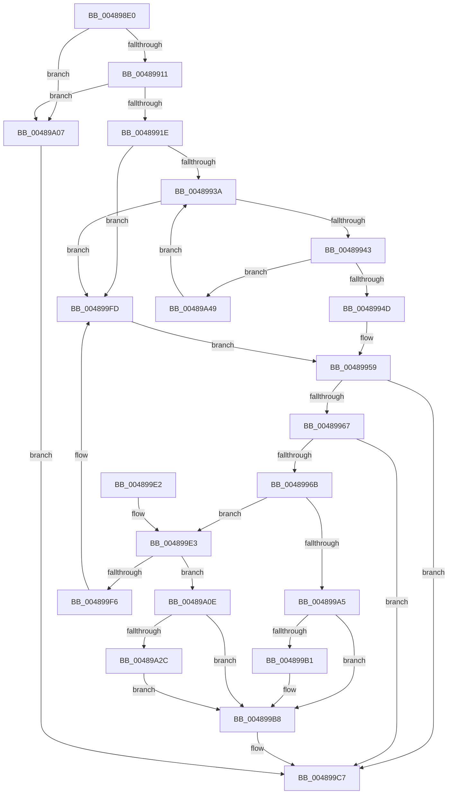

# IoDecrementKeepAliveCount

- RVA: `0x004898E0`–`0x00489A51` (길이 `369` bytes)
- VA: `0x00000001404898E0`
- 실행 섹션: `.text`
- PDB 이름 있음: `예`; PDB Function 태그: `아니요`
- unwind 정보 RVA: `0x000B0034`
- 디코드: `92`개 명령, `369/369` bytes 표시
- 미해석 바이트: `0` (있으면 어셈블리에 `.byte`로 보존)

> 이 문서는 커널 이미지의 기계어와 PDB 기호를 분석해 생성했습니다. 4번과 5번은 함수 원형과 자료형을 바이너리 사용 방식에서 추정한 C 해석이며 원본 소스 복구 결과는 아닙니다.

## 1. Dependencies

- 직접 호출 지점: **6**; 고유 호출 대상: **4**
- 직접 호출자로 확인된 함수: **0**
- RIP 상대 이미지 참조: **9**

### Outgoing calls
- `0x00489928` → [KeAcquireSpinLockRaiseToDpc](../20/KeAcquireSpinLockRaiseToDpc_function_00208470.md) (function, `0x00208470`)
- `0x0048995E` → [KeReleaseSpinLock](../39/KeReleaseSpinLock_function_00392BA0.md) (function, `0x00392BA0`)
- `0x00489972` → [KeAcquireSpinLockRaiseToDpc](../20/KeAcquireSpinLockRaiseToDpc_function_00208470.md) (function, `0x00208470`)
- `0x004899B3` → [KeAlertThread](KeAlertThread_function_00489B40.md) (function, `0x00489B40`)
- `0x004899C2` → [KeReleaseSpinLock](../39/KeReleaseSpinLock_function_00392BA0.md) (function, `0x00392BA0`)
- `0x00489A3F` → [ExQueueWorkItem](../2F/ExQueueWorkItem_function_002F9520.md) (function, `0x002F9520`)

### Direct callers
- 이 함수 시작 RVA로 연결되는 직접 call은 확인되지 않았습니다. 간접 호출은 완전히 역산할 수 없습니다.

### Static image references
- `0x0048996B` → RVA `0x00F8D730` (`.data`; read)
- `0x0048998B` → RVA `0x00E0A9BC` (`.data`; read)
- `0x004899A5` → RVA `0x00F8D760` (`.data`; read)
- `0x004899E3` → RVA `0x00F8D728` (`.data`; read)
- `0x004899EA` → RVA `0x00F8D720` (`.data`; read)
- `0x00489A18` → RVA `0x00F8D728` (`.data`; write)
- `0x00489A23` → RVA `0x00F8D758` (`.data`; read)
- `0x00489A31` → RVA `0x00F8D758` (`.data`; write)
- `0x00489A38` → RVA `0x00F8D700` (`.data`; read)

## 2. Other-region calls and transfers

- 다른 실행 섹션으로 향하는 call: **0**
- 별도 외부 분기/꼬리 이동을 확인하지 못했습니다.

## 3. Assembly (complete function range)

```asm
004898E0  48 89 5C 24 08                  mov qword ptr [rsp + 8], rbx
004898E5  48 89 6C 24 10                  mov qword ptr [rsp + 0x10], rbp
004898EA  48 89 74 24 18                  mov qword ptr [rsp + 0x18], rsi
004898EF  57                              push rdi
004898F0  41 56                           push r14
004898F2  41 57                           push r15
004898F4  48 83 EC 20                     sub rsp, 0x20
004898F8  48 8B 81 D0 00 00 00            mov rax, qword ptr [rcx + 0xd0]
004898FF  33 F6                           xor esi, esi
00489901  33 FF                           xor edi, edi
00489903  33 DB                           xor ebx, ebx
00489905  4C 8B FA                        mov r15, rdx
00489908  48 85 C0                        test rax, rax
0048990B  0F 84 F6 00 00 00               je 0x140489a07
00489911  48 8B 68 10                     mov rbp, qword ptr [rax + 0x10]
00489915  48 85 ED                        test rbp, rbp
00489918  0F 84 E9 00 00 00               je 0x140489a07
0048991E  4C 8D B1 B8 00 00 00            lea r14, [rcx + 0xb8]
00489925  49 8B CE                        mov rcx, r14
00489928  E8 43 EB D7 FF                  call 0x140208470
0048992D  48 8B 4D 18                     mov rcx, qword ptr [rbp + 0x18]
00489931  48 85 C9                        test rcx, rcx
00489934  0F 84 C3 00 00 00               je 0x1404899fd
0048993A  48 85 C9                        test rcx, rcx
0048993D  0F 84 BA 00 00 00               je 0x1404899fd
00489943  4C 39 79 08                     cmp qword ptr [rcx + 8], r15
00489947  0F 85 FC 00 00 00               jne 0x140489a49
0048994D  8B 71 10                        mov esi, dword ptr [rcx + 0x10]
00489950  48 8B 79 18                     mov rdi, qword ptr [rcx + 0x18]
00489954  FF CE                           dec esi
00489956  89 71 10                        mov dword ptr [rcx + 0x10], esi
00489959  8A D0                           mov dl, al
0048995B  49 8B CE                        mov rcx, r14
0048995E  E8 3D 92 F0 FF                  call 0x140392ba0
00489963  85 DB                           test ebx, ebx
00489965  78 60                           js 0x1404899c7
00489967  85 F6                           test esi, esi
00489969  75 5C                           jne 0x1404899c7
0048996B  48 8D 0D BE 3D B0 00            lea rcx, [rip + 0xb03dbe]
00489972  E8 F9 EA D7 FF                  call 0x140208470
00489977  49 B8 14 00 00 00 80 F7 FF FF   movabs r8, 0xfffff78000000014
00489981  40 8A F0                        mov sil, al
00489984  4D 8B 00                        mov r8, qword ptr [r8]
00489987  4C 89 47 30                     mov qword ptr [rdi + 0x30], r8
0048998B  69 15 27 10 98 00 10 27 00 00   imul edx, dword ptr [rip + 0x981027], 0x2710
00489995  FF 4F 20                        dec dword ptr [rdi + 0x20]
00489998  49 03 D0                        add rdx, r8
0048999B  80 7F 10 00                     cmp byte ptr [rdi + 0x10], 0
0048999F  48 89 57 30                     mov qword ptr [rdi + 0x30], rdx
004899A3  74 3E                           je 0x1404899e3
004899A5  48 8B 0D B4 3D B0 00            mov rcx, qword ptr [rip + 0xb03db4]
004899AC  48 85 C9                        test rcx, rcx
004899AF  74 07                           je 0x1404899b8
004899B1  33 D2                           xor edx, edx
004899B3  E8 88 01 00 00                  call 0x140489b40
004899B8  40 8A D6                        mov dl, sil
004899BB  48 8D 0D 6E 3D B0 00            lea rcx, [rip + 0xb03d6e]
004899C2  E8 D9 91 F0 FF                  call 0x140392ba0
004899C7  48 8B 6C 24 48                  mov rbp, qword ptr [rsp + 0x48]
004899CC  8B C3                           mov eax, ebx
004899CE  48 8B 5C 24 40                  mov rbx, qword ptr [rsp + 0x40]
004899D3  48 8B 74 24 50                  mov rsi, qword ptr [rsp + 0x50]
004899D8  48 83 C4 20                     add rsp, 0x20
004899DC  41 5F                           pop r15
004899DE  41 5E                           pop r14
004899E0  5F                              pop rdi
004899E1  C3                              ret
004899E2  CC                              int3
004899E3  48 8B 05 3E 3D B0 00            mov rax, qword ptr [rip + 0xb03d3e]
004899EA  48 8D 0D 2F 3D B0 00            lea rcx, [rip + 0xb03d2f]
004899F1  48 39 08                        cmp qword ptr [rax], rcx
004899F4  74 18                           je 0x140489a0e
004899F6  B9 03 00 00 00                  mov ecx, 3
004899FB  CD 29                           int 0x29
004899FD  BB 0D 00 00 C0                  mov ebx, 0xc000000d
00489A02  E9 52 FF FF FF                  jmp 0x140489959
00489A07  BB 0D 00 00 C0                  mov ebx, 0xc000000d
00489A0C  EB B9                           jmp 0x1404899c7
00489A0E  48 89 0F                        mov qword ptr [rdi], rcx
00489A11  48 89 47 08                     mov qword ptr [rdi + 8], rax
00489A15  48 89 38                        mov qword ptr [rax], rdi
00489A18  48 89 3D 09 3D B0 00            mov qword ptr [rip + 0xb03d09], rdi
00489A1F  C6 47 10 01                     mov byte ptr [rdi + 0x10], 1
00489A23  80 3D 2E 3D B0 00 00            cmp byte ptr [rip + 0xb03d2e], 0
00489A2A  75 8C                           jne 0x1404899b8
00489A2C  BA 01 00 00 00                  mov edx, 1
00489A31  C6 05 20 3D B0 00 01            mov byte ptr [rip + 0xb03d20], 1
00489A38  48 8D 0D C1 3C B0 00            lea rcx, [rip + 0xb03cc1]
00489A3F  E8 DC FA E6 FF                  call 0x1402f9520
00489A44  E9 6F FF FF FF                  jmp 0x1404899b8
00489A49  48 8B 09                        mov rcx, qword ptr [rcx]
00489A4C  E9 E9 FE FF FF                  jmp 0x14048993a
```

## 4. C-style interpretation (structured pseudocode)

```c
__int64 __fastcall IoDecrementKeepAliveCount(__int64 a1, __int64 a2)
{
    __int64 result;
    __int64 v_rbx;
    __int64 v_rdi;
    __int64 v_rsi;
    __int64 v_rsp;
    unsigned __int64 v_stack_p10;
    unsigned __int64 v_stack_p18;
    unsigned __int64 v_stack_p8;

    v_stack_p8 = v_rbx;
    v_stack_p10 = v_rbp;
    v_stack_p18 = v_rsi;
    v_rsp = (v_rsp) - (32);
    v_rsi = 0;
    v_rdi = 0;
    v_rbx = 0;
    if (*(unsigned __int64 *)(a1 + 208) == 0) goto loc_00489A07;
    if (*(unsigned __int64 *)(*(unsigned __int64 *)(a1 + 208) + 16) == 0) goto loc_00489A07;
    result = KeAcquireSpinLockRaiseToDpc(a1 + 184, a2, a3, a4);
    if (*(unsigned __int64 *)(*(unsigned __int64 *)(*(unsigned __int64 *)(a1 + 208) + 16) + 24) == 0) goto loc_004899FD;
loc_0048993A:
    if (*(unsigned __int64 *)(*(unsigned __int64 *)(*(unsigned __int64 *)(a1 + 208) + 16) + 24) == 0) goto loc_004899FD;
    if ((*(unsigned __int64 *)(*(unsigned __int64 *)(*(unsigned __int64 *)(*(unsigned __int64 *)(a1 + 208) + 16) + 24) + 8)) != a2) goto loc_00489A49;
    v_rsi = (unsigned int)(((unsigned int)(*(unsigned int *)(*(unsigned __int64 *)(*(unsigned __int64 *)(*(unsigned __int64 *)(a1 + 208) + 16) + 24) + 16))) - 1);
    *(unsigned int *)(*(unsigned __int64 *)(*(unsigned __int64 *)(*(unsigned __int64 *)(a1 + 208) + 16) + 24) + 16) = (unsigned int)(v_rsi);
loc_00489959:
    result = KeReleaseSpinLock(a1 + 184, (unsigned __int8)(result), a3, a4);
    if (sign_flag) goto loc_004899C7;
    if ((unsigned int)(v_rsi) != 0) goto loc_004899C7;
    result = KeAcquireSpinLockRaiseToDpc(v_rip + 11550142, (unsigned __int8)(result), a3, a4);
    *(unsigned __int64 *)(*(unsigned __int64 *)(*(unsigned __int64 *)(*(unsigned __int64 *)(*(unsigned __int64 *)(a1 + 208) + 16) + 24) + 24) + 48) = *(unsigned __int64 *)(a3);
    a2 = (unsigned int)(((unsigned __int8)(result)) * (*(unsigned int *)(v_rip + 9965607)));
    a2 = (a2) + (*(unsigned __int64 *)(a3));
    *(unsigned __int64 *)(*(unsigned __int64 *)(*(unsigned __int64 *)(*(unsigned __int64 *)(*(unsigned __int64 *)(a1 + 208) + 16) + 24) + 24) + 48) = a2;
    if ((*(unsigned __int8 *)(*(unsigned __int64 *)(*(unsigned __int64 *)(*(unsigned __int64 *)(*(unsigned __int64 *)(a1 + 208) + 16) + 24) + 24) + 16)) == 0) goto loc_004899E3;
    if (*(unsigned __int64 *)(v_rip + 11550132) != 0) {
        a2 = 0;
        result = KeAlertThread(*(unsigned __int64 *)(v_rip + 11550132), a2, *(unsigned __int64 *)(a3), a4);
    }
    result = KeReleaseSpinLock(v_rip + 11550062, (unsigned __int8)((unsigned __int8)(result)), *(unsigned __int64 *)(a3), a4);
loc_004899C7:
    v_rsp = (v_rsp) + (32);
    return 0;
loc_004899E3:
    if ((*(unsigned __int64 *)(*(unsigned __int64 *)(v_rip + 11550014))) == (v_rip + 11549999)) goto loc_00489A0E;
loc_004899FD:
    goto loc_00489959;
loc_00489A07:
    goto loc_004899C7;
loc_00489A0E:
    *(unsigned __int64 *)(*(unsigned __int64 *)(*(unsigned __int64 *)(*(unsigned __int64 *)(*(unsigned __int64 *)(a1 + 208) + 16) + 24) + 24)) = 3;
    *(unsigned __int64 *)(*(unsigned __int64 *)(*(unsigned __int64 *)(*(unsigned __int64 *)(*(unsigned __int64 *)(a1 + 208) + 16) + 24) + 24) + 8) = *(unsigned __int64 *)(v_rip + 11550014);
    *(unsigned __int64 *)(*(unsigned __int64 *)(v_rip + 11550014)) = *(unsigned __int64 *)(*(unsigned __int64 *)(*(unsigned __int64 *)(*(unsigned __int64 *)(a1 + 208) + 16) + 24) + 24);
    *(unsigned __int64 *)(v_rip + 11549961) = *(unsigned __int64 *)(*(unsigned __int64 *)(*(unsigned __int64 *)(*(unsigned __int64 *)(a1 + 208) + 16) + 24) + 24);
    *(unsigned __int8 *)(*(unsigned __int64 *)(*(unsigned __int64 *)(*(unsigned __int64 *)(*(unsigned __int64 *)(a1 + 208) + 16) + 24) + 24) + 16) = 1;
    if ((*(unsigned __int8 *)(v_rip + 11549998)) != 0) goto loc_004899B8;
    *(unsigned __int8 *)(v_rip + 11549984) = 1;
    result = ExQueueWorkItem(v_rip + 11549889, 1, *(unsigned __int64 *)(a3), a4);
    goto loc_004899B8;
loc_00489A49:
    goto loc_0048993A;
}
```

## 5. (Beta) C Style

```c
int64_t IoDecrementKeepAliveCount(void *Arg1, int64_t Arg2)
{
    uint8_t *arg1 = (uint8_t *)Arg1;

    int64_t result;
    int64_t local_rbx;
    int64_t local_rdi;
    int64_t local_rsi;
    int64_t local_rsp;
    uint64_t v_stack_p10;
    uint64_t v_stack_p18;
    uint64_t v_stack_p8;

    v_stack_p8 = local_rbx;
    v_stack_p10 = local_rbp;
    v_stack_p18 = local_rsi;
    local_rsp = (local_rsp) - (32);
    local_rsi = 0;
    local_rdi = 0;
    local_rbx = 0;
    if (*(uint64_t *)(arg1 + 0xD0) == 0) goto loc_00489A07;
    if (*(uint64_t *)(*(uint64_t *)(arg1 + 0xD0) + 0x10) == 0) goto loc_00489A07;
    result = KeAcquireSpinLockRaiseToDpc(Arg1 + 184, Arg2, a3, a4);
    if (*(uint64_t *)(*(uint64_t *)(*(uint64_t *)(arg1 + 0xD0) + 0x10) + 0x18) == 0) goto loc_004899FD;
loc_0048993A:
    if (*(uint64_t *)(*(uint64_t *)(*(uint64_t *)(arg1 + 0xD0) + 0x10) + 0x18) == 0) goto loc_004899FD;
    if ((*(uint64_t *)(*(uint64_t *)(*(uint64_t *)(*(uint64_t *)(arg1 + 0xD0) + 0x10) + 0x18) + 0x8)) != Arg2) goto loc_00489A49;
    local_rsi = (uint32_t)(((uint32_t)(*(uint32_t *)(*(uint64_t *)(*(uint64_t *)(*(uint64_t *)(arg1 + 0xD0) + 0x10) + 0x18) + 0x10))) - 1);
    *(uint32_t *)(*(uint64_t *)(*(uint64_t *)(*(uint64_t *)(arg1 + 0xD0) + 0x10) + 0x18) + 0x10) = (uint32_t)(local_rsi);
loc_00489959:
    result = KeReleaseSpinLock(Arg1 + 184, (uint8_t)(result), a3, a4);
    if (sign_flag) goto loc_004899C7;
    if ((uint32_t)(local_rsi) != 0) goto loc_004899C7;
    result = KeAcquireSpinLockRaiseToDpc(v_rip + 11550142, (uint8_t)(result), a3, a4);
    *(uint64_t *)(*(uint64_t *)(*(uint64_t *)(*(uint64_t *)(*(uint64_t *)(arg1 + 0xD0) + 0x10) + 0x18) + 0x18) + 0x30) = *(uint64_t *)(a3);
    Arg2 = (uint32_t)(((uint8_t)(result)) * (*(uint32_t *)(v_rip + 0x981027)));
    Arg2 = (Arg2) + (*(uint64_t *)(a3));
    *(uint64_t *)(*(uint64_t *)(*(uint64_t *)(*(uint64_t *)(*(uint64_t *)(arg1 + 0xD0) + 0x10) + 0x18) + 0x18) + 0x30) = Arg2;
    if ((*(uint8_t *)(*(uint64_t *)(*(uint64_t *)(*(uint64_t *)(*(uint64_t *)(arg1 + 0xD0) + 0x10) + 0x18) + 0x18) + 0x10)) == 0) goto loc_004899E3;
    if (*(uint64_t *)(v_rip + 0xB03DB4) != 0) {
        Arg2 = 0;
        result = KeAlertThread(*(uint64_t *)(v_rip + 0xB03DB4), Arg2, *(uint64_t *)(a3), a4);
    }
    result = KeReleaseSpinLock(v_rip + 11550062, (uint8_t)((uint8_t)(result)), *(uint64_t *)(a3), a4);
loc_004899C7:
    local_rsp = (local_rsp) + (32);
    return 0;
loc_004899E3:
    if ((*(uint64_t *)(*(uint64_t *)(v_rip + 0xB03D3E))) == (v_rip + 11549999)) goto loc_00489A0E;
loc_004899FD:
    goto loc_00489959;
loc_00489A07:
    goto loc_004899C7;
loc_00489A0E:
    *(uint64_t *)(*(uint64_t *)(*(uint64_t *)(*(uint64_t *)(*(uint64_t *)(arg1 + 0xD0) + 0x10) + 0x18) + 0x18)) = 3;
    *(uint64_t *)(*(uint64_t *)(*(uint64_t *)(*(uint64_t *)(*(uint64_t *)(arg1 + 0xD0) + 0x10) + 0x18) + 0x18) + 0x8) = *(uint64_t *)(v_rip + 0xB03D3E);
    *(uint64_t *)(*(uint64_t *)(v_rip + 0xB03D3E)) = *(uint64_t *)(*(uint64_t *)(*(uint64_t *)(*(uint64_t *)(arg1 + 0xD0) + 0x10) + 0x18) + 0x18);
    *(uint64_t *)(v_rip + 0xB03D09) = *(uint64_t *)(*(uint64_t *)(*(uint64_t *)(*(uint64_t *)(arg1 + 0xD0) + 0x10) + 0x18) + 0x18);
    *(uint8_t *)(*(uint64_t *)(*(uint64_t *)(*(uint64_t *)(*(uint64_t *)(arg1 + 0xD0) + 0x10) + 0x18) + 0x18) + 0x10) = 1;
    if ((*(uint8_t *)(v_rip + 0xB03D2E)) != 0) goto loc_004899B8;
    *(uint8_t *)(v_rip + 0xB03D20) = 1;
    result = ExQueueWorkItem(v_rip + 11549889, 1, *(uint64_t *)(a3), a4);
    goto loc_004899B8;
loc_00489A49:
    goto loc_0048993A;
}
```

### 관측된 메모리 오프셋

구조체 형식이 확인되지 않은 접근은 인자 기준의 오프셋으로만 기록했습니다.

| 기준 인자 | 오프셋 표현 | 폭 (bit) | 접근 |
|---|---:|---:|---|
| `Arg1` | `+ 0xB8` | `64` | `R` |
| `Arg1` | `+ 0xD0` | `64` | `R` |

## 6. Execution-region graph

[열기: 2D/3D 그래프와 함수 탐색 컨트롤 패널](../../../control-panel.html?section=text&rva=0x004898E0&view=graph)

- 2D 그래프는 위에서 아래로 흐르고, 3D 그래프는 빈 공간을 드래그해 회전합니다. Shift+드래그는 이동, 휠은 확대·축소, 함수 노드 선택은 대상 보고서 이동입니다.

### Static fallback


